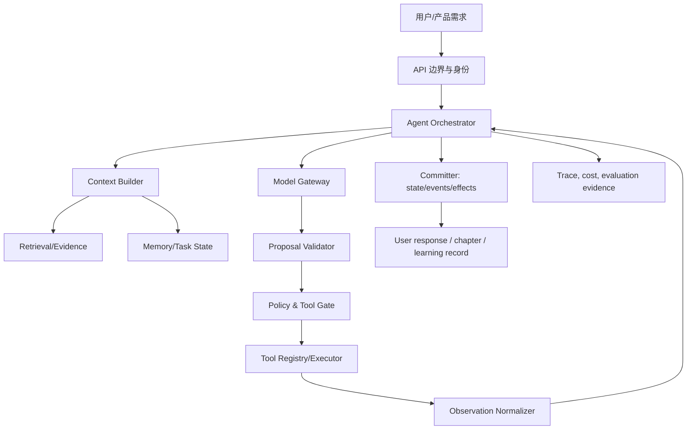

# Agent 开发工程师架构蓝图 v0.1

- **岗位**：Agent 开发工程师（新增专业岗位）
- **日期**：2026-10-14（Asia/Shanghai）
- **范围**：为后续 AI 需求和 Agent 运行时提供架构契约、边界、版本与交接规则。
- **本文件性质**：架构蓝图与接口提案，不是已实现代码、模型接入承诺或生产验收报告。
- **只读依据**：`server/index.mjs`、`server/generation/index.mjs`、`server/retrieval/index.mjs`、`server/retrieval/semantic.mjs`、`server/retrieval/dialog.mjs`、`server/retrieval/README.md`及其声明的本地索引/模型锁文件。本轮未修改运行代码，未发起外部模型调用。

## 1. 岗位责任与交接边界

Agent 开发工程师负责把已确认的 AI 需求转换成可观察、可限制、可恢复的 Agent 运行契约：任务目标、模型输入输出、检索证据、工具能力、记忆读写、状态迁移、停止条件、安全政策、观测字段和评估样本。该岗位也负责在需求变化时维护架构版本和迁移/回滚方案。

该岗位不代替产品经理决定用户问题和验收门槛，不代替课程架构师编写教材，不代替内容检索工程师编制教材索引，不代替后端数据工程师拥有账户/数据库迁移，不代替软件工程师实现客户端，不代替测试工程师给出独立验收。对这些领域的变更，提交契约和交接单，由原责任岗位实现与复验。

每项后续 AI 需求都应先形成以下交付物再实现：

1. **AI 需求卡**：目标用户、输入、期望产物、不能做的事、成功/失败/未知效果定义、预算和延迟上限。
2. **运行契约**：`AgentSpec`、状态图、模型/检索/工具/记忆接口及版本号。
3. **证据包**：固定样本、允许来源、工具模拟器、失败矩阵、基线和结果；未执行的调用标为 `not_run`。
4. **交接单**：写明交给客户端、数据、检索、生成、QA 的路径和字段，不能直接跨岗位改动。

## 2. 当前实现基线（静态读取结论）

### 2.1 服务入口与数据层

`server/index.mjs` 目前同时承担 HTTP 路由、请求边界、认证/会话/CSRF、SQLite 初始化、职业/教材版本登记、生成任务队列和 worker、事件及章节持久化、学习记录接口。服务声明 `PRODUCT_VERSION = local-mvp-0.4`，默认绑定本地 `127.0.0.1`，公共部署需要显式 `PUBLIC_DEPLOYMENT=true`。静态路径和跨来源请求有白名单检查。

现有持久对象包括：

- 账户和会话：`users`、`sessions`、`profiles`。
- 生成任务：`jobs`、`attempts`、`events`、`chapters`；任务有幂等键、输入哈希、租约、worker、重试来源和未知外部效果标记。
- 学习产品数据：`submissions`、`reviews`、`careers`、`user_careers`、`user_preferences`、`user_favorites`、`user_progress`、`user_recent`、`user_notes`。

生成 worker 每 500 ms 取一项 queued job；以 lease token/worker ID 抢占，心跳续租，过期或服务关闭时将运行中任务记录为 `interrupted`/`failed`，并标出 `providerOutcomeUnknown`。这是后续 Agent 状态持久化应复用的事实基础，不应另造一套绕过 `jobs/events` 的隐式状态。

### 2.2 生成模块

`server/generation/index.mjs` 的现状是**受控单章生成器**，不是通用 Agent：

- 当前只允许 `moduleId = e03`，九个固定 section ID、固定先修和目标；输入、来源 bundle、supported claims 双向引用都会严格校验。
- `getGenerationReadiness()` 要求 API key、模型名、输出上限、预算、单次预估成本和超时；配置缺失或预估超预算时在 dispatch 前失败。
- `generateChapter()` 向 OpenAI Responses API 发起单次结构化 JSON 请求，支持 `AbortSignal`、超时、响应大小限制、请求/响应 ID、usage、request hash、output hash 和来源快照。
- 拒答、不完整响应、无效结构、来源引用错误、超时/取消/网络错误均不会保存为成功章节；示例固定为 `verificationStatus: not_run`。
- `transport` 可注入模拟传输供离线自查，模拟结果带 `provenance.simulation=true`，不得当成真实供应商运行。

### 2.3 内容检索模块

`server/retrieval/index.mjs` 是只读内容定位服务，不是答案生成器，也不执行工具：

- 当前默认 `textbook-v12`，读取并校验 30 个单元的源文件、章节 SHA-256、合订本 hash、assembly manifest 和课程绑定。
- `getContentCatalog`、`getContentChapter`、`getContentAsset`、`getContentReference` 提供版本化原文和允许公开资源。
- `recommendContent({query, startingPoint, currentUnitId, currentSectionId, corpusVersion})` 返回 `recommended | needs_clarification | no_match | invalid_input | unavailable`，推荐最多 6 项，每个意图最多 3 项，结果带 unit/section、原文摘录、source path/hash、版本和稳定链接。
- 默认语义通路由 `semantic.mjs` 使用本机锁定的 `Xenova/bge-small-zh-v1.5` int8 CPU 模型；禁止远程模型，Node 主版本要求 24；`ROLECRAFT_RETRIEVAL_MODE=concept` 是明确标注的规则降级。
- `dialogContent()` 由 `dialog.mjs` 做领域/否定/歧义识别并从教材原文抽取句子；返回 `answerMode: extractive`，不是生成式辅导。它会核对上下文的 corpus version、unit/section 和 source hash。
- `closeContentRetrieval()` 等待在途检索/对话、清理缓存并释放语义模型。

README 中仍有 v11 文字描述，而代码默认和当前服务登记为 `content-retrieval-0.12-v12`；实施时以运行代码、索引绑定和独立 QA 的当前版本为准，不能把 README 的旧措辞当新版本证据。

### 2.4 现有 HTTP 交接点

当前入口包括：

| 能力 | 现有路由/函数 | 事实边界 |
|---|---|---|
| 健康与能力 | `GET /api/health` | 同时报告生成 readiness 与内容 retrieval readiness，不代表真实供应商已调用 |
| 教材读取 | `GET /api/content/catalog`、`/chapter/:unitId`、资产/引用路由 | 只读、版本白名单、源 hash 校验 |
| 内容推荐 | `POST /api/content/recommend` | 只返回定位和证据，不生成答案或执行动作 |
| 教材对话 | `POST /api/content/dialog` | 抽取式句子/引用，可能澄清或无依据 |
| 单章生成入队 | `POST /api/generation-jobs` | 仅受控 e03；先检查 profile、幂等键、来源与预算配置 |
| 任务状态 | `GET /api/generation-jobs/:id` | 返回 attempts/events、租约和未知供应商效果 |
| 任务控制 | `POST /api/generation-jobs/:id/cancel|retry` | 取消不能推断供应商已撤销；重试必须显式新幂等键 |
| 章节与学习记录 | `/api/chapters`、`/api/submissions`、`/api/reviews`、`/api/me/*` | 账户拥有权和教材版本目标分开校验 |

Agent 架构必须通过明确的适配器使用这些交接点。不得在客户端复制模型调用，不得让检索模块直接写用户数据，不得把 `/api/content/dialog` 的抽取句子包装成模型生成。

## 3. 目标分层

目标是把“需求理解、证据定位、模型提议、工具执行、持久状态和评价”拆开，使每层能够单独替换、回归和回滚。



各层只拥有以下责任：

1. **边界层**：校验请求、身份、CSRF、租约、大小、来源和速率；不解释模型意图。
2. **编排层**：运行 `AgentSpec` 状态机，选择下一节点、重试/重规划/停止；不直接拼接 SQL 或绕过策略。
3. **上下文层**：按预算组合当前目标、事实、检索证据、记忆和工具清单；不把未经核验文本当系统指令。
4. **模型层**：把版本化请求交给候选模型，返回结构化 proposal 和 usage；不拥有工具副作用。
5. **证据层**：只读召回、排序、版本/权限/来源核验；不编造缺失答案。
6. **工具层**：能力目录、参数 schema、权限、幂等和副作用执行；不接受模型直接传来的任意 URL/路径/SQL。
7. **状态/记忆层**：保存任务事实、提交点、上下文快照和可纠正记忆；不把对话全文无限累积。
8. **策略/安全层**：决定能否读证据、调用工具、写记忆、返回结果；宿主强制，提示词不能替代。
9. **观测层**：记录决定、版本、耗时、预算、失败和未知效果；脱敏且可按 trace 重建，不保存原始秘密。
10. **评价/发布层**：冻结样本和门槛，比较版本，保留回滚指针；不把自测或单次演示写成职业/用户效果。

## 4. AgentSpec 与运行循环

### 4.1 最小 AgentSpec

以下是提案接口，字段名和版本需由产品经理/后端数据工程师确认后落地；`schemaVersion` 变化必须迁移或拒绝旧任务。

```json
{
  "schemaVersion": "agent-spec-v1",
  "agentId": "rolecraft-learning-agent",
  "agentVersion": "0.1.0",
  "taskType": "content_guidance|chapter_generation|product_workflow",
  "goal": {"text": "可验收目标", "successCriteria": ["..."], "stopCriteria": ["..."]},
  "modelPolicyId": "model-policy-v1",
  "retrievalPolicyId": "retrieval-policy-v1",
  "toolPolicyId": "tool-policy-v1",
  "memoryPolicyId": "memory-policy-v1",
  "stateSchemaId": "agent-state-v1",
  "budget": {"maxSteps": 12, "timeoutMs": 60000, "maxCostUsd": 0.5},
  "allowedTools": [],
  "allowedSources": [],
  "outputContract": {"type": "json", "schemaId": "..."}
}
```

### 4.2 运行循环

每一步都必须先观察、后提议、再由宿主验证和授权执行；模型的“思考文本”不是执行许可。

1. **接收**：校验 `AgentTaskEnvelope`，绑定 user/career/教材版本、trace ID、幂等键和预算。
2. **恢复**：从最近一个已提交 checkpoint 读 `TaskState`；对 running/unknown 动作先查询效果账本，不能盲目重做。
3. **组装上下文**：按硬约束优先级合并用户目标、当前状态、允许来源、召回证据、受限记忆和可用工具。
4. **模型提议**：调用版本化 `ModelGateway.propose()`，只允许返回下一动作、候选计划、检索需求或最终草稿之一。
5. **结构与业务校验**：检查 JSON schema、目标/版本/权限、证据支持、依赖图、预算和停止条件；失败记录 `proposal_rejected`，不能执行。
6. **策略授权**：`PolicyEngine.authorize()` 决定 read-only、需用户确认、禁止或可自动执行；写动作必须有 action ID 和幂等键。
7. **工具调用**：工具执行器以受限 capability token 调用，先写 `action_intent`，再写发送/回执/最终效果；超时标为 `unknown`。
8. **规范化观察**：把返回值、错误、版本、延迟和外部效果归一为 `Observation`，过滤秘密和不可信指令。
9. **提交状态**：原子写入状态变更、事实、来源、动作和事件；只在提交点后允许推进下一步。
10. **重规划或停止**：若新观察改变目标/约束/依赖，只使受影响节点失效并保留有效事实；达到成功、失败、等待、无进展、步数/时间/成本上限时结束。
11. **交付**：返回来源和版本绑定的结果；生成章节仍沿用现有 `chapterDraft` 的未审校标记，不授予能力认证。

建议状态集合：`received → running → awaiting_model|awaiting_retrieval|awaiting_tool|awaiting_confirmation → committing → succeeded|failed|cancelled|paused|needs_clarification`。`unknown_effect` 是动作效果子状态，不能简单映射成 `failed`。

## 5. 核心接口草案

### 5.1 任务、状态和事件

```ts
interface AgentTaskEnvelope {
  taskId: string; traceId: string; idempotencyKey: string;
  userId: string; careerId?: string;
  agentSpecId: string; agentSpecVersion: string;
  input: unknown; inputHash: string;
  contentVersion?: string; sourceHash?: string;
  budget: { maxSteps: number; timeoutMs: number; maxCostUsd?: number };
}

interface TaskState {
  taskId: string; revision: number; status: string;
  goal: { text: string; successCriteria: string[]; stopCriteria: string[] };
  facts: Array<{id:string; value:unknown; sourceId:string; version:string; confidence:'supported'|'inferred'|'unknown'}>;
  plan?: { planId:string; nodes:Array<{id:string; dependsOn:string[]; status:string}>; invalidatedNodeIds:string[] };
  pendingActions: Array<{actionId:string; toolId:string; effect:'read'|'write'; status:'intent'|'sent'|'unknown'|'succeeded'|'failed'}>;
  checkpoints: Array<{revision:number; hash:string; committedAt:string}>;
  consumedVersions: Record<string,string>;
}

interface TraceEvent {
  traceId:string; taskId:string; sequence:number; type:string; at:string;
  agentSpecVersion:string; stateRevision:number;
  data: Record<string,unknown>; redactions:string[];
}
```

`server/index.mjs` 当前的 `jobs`、`attempts`、`events`、`lease_token`、`worker_id`、`input_hash` 可作为第一版持久实现的映射；新增字段应由后端数据工程师设计迁移，不能在 Agent 岗位私自改 SQLite 表。

### 5.2 模型接口

```ts
interface ModelRequest {
  requestId:string; modelPolicyId:string; model:string;
  systemContractVersion:string; inputMessages:Array<{role:string; content:string}>;
  responseSchema:{name:string; schema:unknown};
  maxOutputTokens:number; timeoutMs:number; budget:{estimatedCostUsd:number; hardCapUsd?:number};
  sourceRefs:string[]; toolSchemas:string[];
}
interface ModelResponse {
  requestId:string; providerRequestId?:string; providerResponseId?:string;
  status:'completed'|'refusal'|'incomplete'|'invalid';
  proposal:unknown; modelActual:string;
  usage?:{inputTokens:number; outputTokens:number; totalTokens:number};
  latencyMs:number; outputHash:string;
}
```

`ModelGateway` 应吸收现有 `generation/index.mjs` 的 readiness、预算前置阻断、AbortSignal、响应大小限制、usage、请求/响应 ID和安全错误映射；真实供应商、离线模拟和未来本地模型必须通过同一接口并显式标记 `simulation`、`providerCalled`。模型层不得写 `chapters`，由编排层在验证和提交后写入。

### 5.3 检索/证据接口

```ts
interface RetrievalRequest {
  query:string; corpusVersion:string; careerId?:string;
  startingPoint?:'beginner'|'developer'|'practitioner';
  current?:{unitId:string; sectionId:string; sourceSha256:string};
  filters?:{allowedIntentIds?:string[]; excludedIntentIds?:string[]};
}
interface EvidenceItem {
  unitId:string; sectionId:string; version:string; sourcePath:string; sourceSha256:string;
  evidenceExcerpt:string; href:string; relevance?:number;
  support:'direct_excerpt'|'semantic_candidate';
}
interface RetrievalResponse {
  status:'recommended'|'needs_clarification'|'no_match'|'invalid_input'|'unavailable';
  engineMode:string; providerCalled:false; corpusVersion:string; corpusHash:string|null;
  results:EvidenceItem[]; clarification?:{question:string; options?:unknown[]};
  interpretedIntents:unknown[]; excludedIntents:unknown[]; semanticProvenance?:unknown;
  limitations:string[];
}
```

默认接现有 `recommendContent`/`dialogContent`，保留 `extractive` 语义和 source hash 校验。模型只能提出检索需求，不能改变 `corpusVersion`、`sourcePath` 或返回中的出处；无依据时返回 `no_match`/`needs_clarification`。

### 5.4 工具接口

```ts
interface ToolDescriptor {
  toolId:string; version:string; description:string;
  inputSchema:unknown; outputSchema:unknown;
  effect:'read'|'write'|'external_side_effect';
  requiredScopes:string[]; idempotency:'required'|'optional'|'none';
  timeoutMs:number; retryPolicy:'never'|'safe_read'|'query_then_decide';
  owner:string; enabled:boolean;
}
interface ToolCall {
  callId:string; taskId:string; toolId:string; toolVersion:string;
  args:unknown; argsHash:string; actionId:string; idempotencyKey?:string;
  authorization:{userId:string; scopes:string[]; policyVersion:string};
}
interface ToolResult {
  callId:string; status:'succeeded'|'failed'|'unknown'|'denied'|'timed_out';
  output?:unknown; errorCode?:string; providerRequestId?:string;
  effectReceipt?:{kind:string; reference:string; observedAt:string};
  startedAt:string; endedAt:string;
}
```

第一阶段只开放只读、无外部副作用的教材目录/章节和离线检索能力。写工具、网络工具、代码执行、MCP/A2A 连接须另有工具描述、权限、沙箱、效果查询和独立 QA；协议连通不等于获得执行授权。

### 5.5 记忆和上下文接口

```ts
interface MemoryRecord {
  memoryId:string; scope:'turn'|'task'|'user'|'career'; subjectId:string;
  value:unknown; sourceRefs:string[]; sourceHash:string; version:string;
  status:'candidate'|'accepted'|'superseded'|'retracted';
  consent?:string; createdAt:string; updatedAt:string;
}
interface MemoryQuery { scope:string; subjectId:string; query:string; maxItems:number; asOfVersion:string; }
interface ContextSnapshot {
  snapshotId:string; taskId:string; sections:Array<{kind:string; content:unknown; sourceRefs:string[]}>;
  tokenEstimate:number; omitted:Array<{kind:string; reason:string}>; snapshotHash:string;
}
```

当前用户笔记、进度、最近阅读和收藏是学习产品记录，不应自动当成 Agent 长期记忆。写入长期记忆必须有来源、权限、纠正/撤回路径和版本；摘要不能覆盖原始事实；跨用户、跨职业、跨会话不得隐式共享。

### 5.6 策略、安全与停止接口

```ts
interface PolicyDecision {
  decision:'allow'|'require_confirmation'|'deny';
  reasonCode:string; policyVersion:string; expiresAt?:string;
  requiredScopes:string[]; redactions:string[];
}
interface StopDecision {
  status:'success'|'failure'|'waiting'|'needs_clarification'|'no_progress'|'budget_exceeded'|'step_limit'|'timeout';
  evidenceRefs:string[]; nextAction?:'ask_user'|'retry_safe'|'rollback'|'none';
}
```

策略必须在宿主执行前检查身份、租户/职业范围、来源权限、工具 effect、参数和预算。提示注入、网页文本或模型输出一律视为不可信数据；不能通过提示词声称已获授权。路径、URL、SQL、命令、文件和秘密应使用专门白名单/沙箱，不沿用任意字符串拼接。

## 6. 记忆、状态与外部效果的分层规则

| 层级 | 保存内容 | 生命周期 | 当前落点/目标 |
|---|---|---|---|
| 对话上下文 | 当前问题、必要最近句、当前章节 | 请求/短会话 | 现有 `dialogContent` 的 `previousContext`，只接受版本/hash 校验 |
| 任务工作状态 | 目标、计划节点、事实、待办动作、重试计数 | 任务完成后保留审计 | 映射现有 `jobs/attempts/events`，目标 `TaskState` |
| 外部效果账本 | action intent、发送、回执、查询、最终状态 | 长期不可篡改追加 | 需要后端数据工程师设计；超时保留 `unknown` |
| 用户产品记录 | profile、progress、notes、favorites、submissions | 账户生命周期 | 现有 `profiles`/`user_*`/`submissions`/`reviews`，不可被 Agent 隐式写入 |
| 长期 Agent 记忆 | 经过批准的偏好/事实/摘要 | 可纠正、可撤回、按权限 | 新接口提案，暂未实现 |

状态提交使用单调 `revision` 和内容 hash。重规划只使受影响依赖节点失效；已发生的外部效果和来源事实不能被“清空历史”撤销。任何恢复前都要读取最新提交点和未决 action；查询不到效果时停在 `unknown` 或要求人工确认。

## 7. 安全、隐私与资源边界

- **输入**：延续现有 JSON content-type、128 KiB body 上限、字段白名单、长度限制、origin/host 检查、会话和 CSRF。
- **身份/租户**：所有用户数据按 `userId` 拥有权过滤；`careerId`、`textbookVersionId`、unit/section 和 source hash 必须联合校验；不因模型推荐改变 active career。
- **内容信任**：来源正文、网页、检索结果和工具输出均是数据；系统契约、权限和状态由宿主持有。模型不能自行升权、改版本、写来源或把文本中的指令变成动作。
- **模型/秘密**：API key 只在 Model Gateway 读取；日志和错误不得保存凭据、完整 provider body、敏感 header 或原始私密响应。`safeError` 风格保留允许 evidence 字段。
- **工具**：默认 deny；按 capability token、scope、工具版本、参数 schema、超时、网络/文件/进程资源限制。副作用写前需显式用户确认或产品批准策略；重试区分安全读取和未知写效果。
- **检索**：固定本地模型和 hash；禁止运行时远程下载；索引只读发布，资源白名单；缺失/失配返回 unavailable，不伪装 no_match。
- **代码执行**：任何模型生成代码只能进入独立 sandbox；容器/进程/网络/文件隔离和逃逸测试由专门岗位负责，不能以策略检查代替操作系统隔离。
- **成本/拒绝服务**：每任务步数、时间、token、并发和费用上限；达到上限停止并保留证据。语义检索沿用当前 active 限制，新增 Agent 运行时应有独立队列/背压。

## 8. 观测、审计与指标

每次运行生成 `traceId`，每个模型请求、检索、工具调用、状态提交和策略决定都有递增 sequence。最小事件类型：`task_received`、`context_built`、`retrieval_requested`、`retrieval_returned`、`model_requested`、`model_returned`、`proposal_rejected`、`policy_decision`、`action_intent`、`action_sent`、`action_observed`、`state_committed`、`replanned`、`stop_decided`、`task_succeeded`、`task_failed`、`task_cancelled`。

事件字段至少包括：`traceId/taskId/sequence/at/agentSpecVersion/stateRevision/node`、输入/输出 hash、模型/检索/工具版本、耗时、usage/成本（若可信）、结果状态、错误 code、来源 ID、redaction 标记。不得记录完整 prompt、API key、Cookie、Authorization、私密 note 或未脱敏工具参数。

需要区分以下指标，不能合并成一个“成功率”：

- 可靠性：任务成功/失败/取消/未知效果、重复副作用数、恢复成功率、checkpoint 丢失率。
- 质量：证据命中/出处有效、结构校验通过、目标验收通过、需澄清率、无依据回答率。
- 运行：模型延迟、检索延迟、工具延迟、队列等待、步数、重规划次数、tokens、成本。
- 安全：策略拒绝、越权尝试、注入过滤、秘密泄漏测试、沙箱拒绝/逃逸结果。
- 学习产品：教材打开/进度/提交仅作为产品行为数据；不能推导职业胜任、用户满意或行业先进。

## 9. 评估与失败矩阵

评估由固定的离线样本和独立 QA 负责；Agent 岗位准备契约和夹具，不能自行宣布通过。每个样本应绑定 `agentSpecVersion`、模型策略、检索 corpus/index hash、工具版本、记忆快照、权限和预算。

最低样本集：

1. 正常目标：单一 Agent 学习问题、要求章节定位、需要可靠引用。
2. 歧义：`React` 前端框架与 Agent ReAct、`planning` 多义，必须澄清。
3. 否定与多意图：先排除某主题，再检索另一个主题；不得召回被排除单元。
4. 无匹配/资料失配：返回 no_match/unavailable，不编造教材答案。
5. 模型错误：无效 JSON、拒答、不完整、超大响应、错误 claim/source，必须拒绝保存成功。
6. 工具边界：参数合法但业务无权；超时/429/网络故障；请求已发出但结果未知；重试不得重复写效果。
7. 恢复：进程/worker 在每个提交点停止，重启后从 checkpoint 继续，未确认动作先查询。
8. 版本：索引/source hash、AgentSpec、模型、工具或记忆版本变化，旧任务可读但不能静默混用。
9. 资源：步骤、token、费用、并发、检索 active 上限和超时触发停止。
10. 安全：提示注入、伪造来源/审核/hash、越权读取、跨用户记忆泄漏、恶意 URL/path/命令。

报告必须同时列出 `passed/failed/not_run/insufficient`，并保留原始失败、修复版本、复验方法和范围。静态接口检查、模拟模型和本地检索都不能替代真实供应商、真实工具、浏览器、真人学习者或专家证据。

## 10. 版本、发布与回滚接口

### 10.1 版本包

```json
{
  "releaseId": "agent-runtime-0.1.0",
  "agentSpecVersion": "agent-spec-v1",
  "modelPolicyVersion": "model-policy-v1",
  "retrievalVersion": "content-retrieval-0.12-v12",
  "corpusVersion": "textbook-v12",
  "corpusHash": "<sha256>",
  "toolCatalogVersion": "tool-catalog-v0",
  "memorySchemaVersion": "memory-v1",
  "stateSchemaVersion": "state-v1",
  "promptVersion": "<controlled-version>",
  "compatibility": {"minNodeMajor": 24, "dbSchema": "current"},
  "artifacts": {"sourceHashes": {}, "modelLockHash": "<sha256>"},
  "status": "candidate|canary|active|retired"
}
```

### 10.2 发布流程

1. 冻结候选 manifest、所有 source/model/index/tool/memory/state/prompt hash。
2. 跑离线固定样本、失败矩阵、来源绑定、成本/安全/恢复夹具。
3. QA 独立核候选与旧 active 的差异、保护文件、真实运行范围和未验证项。
4. 仅以显式 release ID 启动 canary；新任务读取 active release，进行中的任务继续绑定原 release，不能在中途换模型/索引/策略。
5. 观测窗口内比较质量、成本、延迟、拒绝、未知效果和恢复指标；未达门槛则暂停/回滚。

### 10.3 回滚/恢复

```ts
interface ReleaseControl {
  getActive(): {releaseId:string; manifestHash:string};
  activate(releaseId:string, reason:string, approver:string): void;
  pause(releaseId:string, reason:string): void;
  rollback(toReleaseId:string, reason:string, approver:string): void;
  inspectTask(taskId:string): {releaseId:string; stateRevision:number; pendingActions:unknown[]};
}
```

回滚只切换新任务的默认 release；不回写或删除已产生的章节、事件、外部效果或用户记录。运行中任务先按原版本完成或进入安全暂停；对于 `unknown_effect` 必须提供效果查询或人工处置。若数据库/状态 schema 不兼容，必须先迁移或只读恢复，不能只切换代码文件。当前代码尚未提供 release registry/activate/rollback 路由，这些是后续后端数据工程师和软件工程师的实现交接项。

## 11. 与现有模块的交接矩阵

| 接收岗位/模块 | Agent 开发工程师交付 | 对方负责 | 禁止越界 |
|---|---|---|---|
| 产品经理 | AI 需求卡、目标/停止条件、风险和验收输入 | 确认产品范围、用户价值、门槛 | 不由 Agent 岗位自行改变产品范围 |
| 课程架构/教材研发 | 教材检索与生成所需来源、章节目标、未审校/未运行标记 | 教学结构、正文、专业内容 | 不把模型草稿当教材或专家审核 |
| 内容检索工程师 | `RetrievalRequest/Response`、意图/否定/澄清需求、source hash 约束 | 索引、召回、排序和只读证据接口 | 不让检索岗生成答案/执行工具 |
| AI 生成工程师 | `ModelRequest/Response`、schema、预算/超时/失败码、provider 适配点 | 真实模型调用、生成流程、来源绑定 | 不让模型层写账户/任务数据库 |
| 后端数据工程师 | `TaskState`、event/action/checkpoint/release 迁移规格 | 数据表、事务、租约、恢复和版本存储 | 不在 Agent 岗位私改 SQLite/用户数据 |
| 软件工程师（客户端） | 客户端可消费的状态、证据、澄清、失败和回滚显示契约 | 页面、状态呈现、交互与前端自检 | 不在客户端重新实现模型/策略 |
| 设计师 | 运行中、需确认、失败、未知效果、引用和停止的视觉状态语义 | 信息架构、视觉与可访问性 | 不用文字掩盖未验证/未知状态 |
| 测试工程师 | 固定样本、夹具、失败矩阵、指标和版本绑定 | 独立运行、缺陷、复验与整体门槛判断 | 测试不代写正文或修改实现 |
| PM/复盘 | 差距、责任、下一步、复验条件 | 任务状态、依赖、最终范围报告 | 不把架构完成当产品达标 |

**第一阶段交接建议**：只实现 `AgentSpec` + 编排循环的离线骨架，能力限制为本地教材检索和只读证据返回；沿用现有 `generation` 的受控 e03 任务，不扩展真实写工具。待状态事件、策略和评估夹具独立通过后，才讨论真实模型、多工具或外部副作用。

## 12. 当前差距、未验证项与下一步

- 现有服务没有通用 Agent orchestrator、Tool Registry、Policy Engine、Memory Store、Effect Ledger 或 release registry；本蓝图只定义接口，未声称已存在。
- 现有生成器是单请求教材章节生成，不能据此宣称已支持 ReAct、计划/重规划、跨工具恢复或多 Agent 委派。
- 当前检索已具备本地语义、任务概念、原文术语、来源 hash 和 extractive dialog；未验证任意中文语义、真实用户理解或生产吞吐。
- 现有 `events` 能记录生成阶段，但还不足以重建通用工具副作用；需后端数据工程师设计追加事件和 action ledger。
- 本轮没有运行真实 OpenAI/第三方模型、付费调用、外部工具、代码沙箱、浏览器或真人用户测试；相关结论保持 `not_run`/`insufficient`。
- 版本回滚、在途任务跨版本策略、长期记忆纠正、跨职业隔离、模型/检索联合评估均需单独任务和独立 QA。

下一步顺序：产品经理确认一个窄 AI 场景和验收条件 → Agent 开发工程师冻结 `AgentSpec`/状态图/事件契约 → 后端数据工程师评估 `jobs/events` 扩展 → 检索/生成岗位实现适配器 → 软件工程师接收只读状态/证据展示 → 测试工程师按固定失败矩阵独立复验。每一步都保留版本、hash、实际运行范围和未完成证据。
