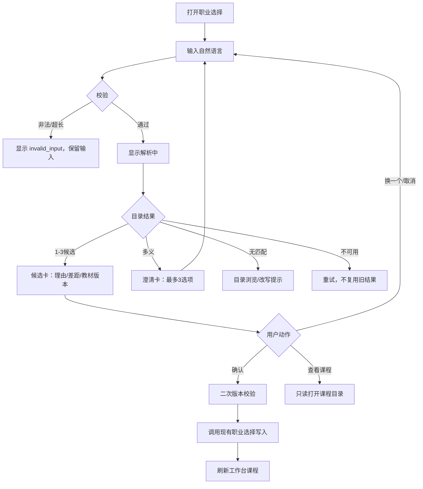
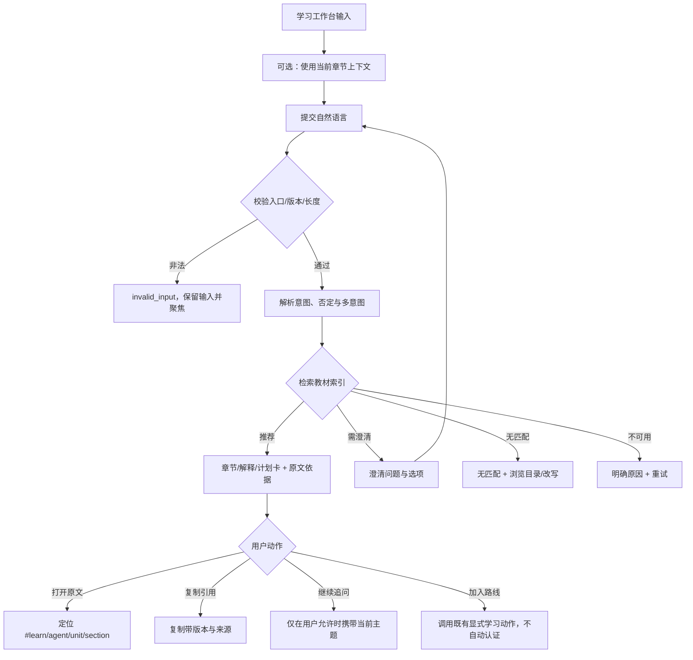

# Agent 双输入系统 v0.12 PRD、交互流程、接口协议与开发任务

- **产品版本**：`agent-system-v0.12`
- **基线客户端**：`local-workbench-0.11`（现有学习工作台）
- **适用入口**：选择职业、输入学习内容相关问题
- **责任岗位**：产品经理（需求与验收合同）
- **交接日期**：2026-10-15
- **前置基线**：`team/agent-system-product-design.md`、v0.11 内容检索公共合同、现有职业目录与账户职业接口
- **实现限制**：本文件只定义产品、交互、公共接口和任务拆分，不代替客户端、检索、后端或 QA 的实现与验收

## 1. 产品决定

用户在两个输入点表达的是自然语言目标，不是两个互相独立的聊天机器人。v0.12 建设一个共享的 Agent 输入协议和编排边界，再为每个入口配置自己的目录、教材工具、状态和确认动作：

1. **职业输入 Agent**：从已发布职业目录中给出 1–3 个候选，解释匹配依据和差距，等待用户确认；未确认结果只存在当前会话。
2. **学习输入 Agent**：从当前职业绑定的教材版本检索定位、解释、比较、规划或下一步练习；每个肯定结果必须带教材版本、小节、原文摘录和可定位链接。
3. **共享能力**：输入校验、意图与否定识别、最少澄清、请求并发隔离、版本核对、错误状态、隐私边界和结果快照。
4. **确认边界**：职业确认才可以调用既有 `PUT /api/profile/career`；学习 Agent 只能打开、定位或组合已存在内容，不能自动改写教材、账户记录、能力结论或任务状态。

### 1.1 目标

- 让用户用一句话表达职业方向、学习疑问或实作目标。
- 让用户看懂 Agent 推荐“为什么这样推荐、依据来自哪里、下一步是什么”。
- 让结果可以回到已发布目录或当前教材原文，不把模型推断伪装为官方内容。
- 在现有 v0.11 工作台中新增入口，不破坏课程浏览、账号职业、历史记录和既有检索 API。
- 让开发和测试可以用稳定的请求/响应字段、状态和样例独立复验。

### 1.2 非目标与禁止事项

- 不做职业测评、就业承诺、能力认证或行业先进性判断。
- 不凭空生成职业、教材章节、来源、审校状态或用户学习成绩。
- 不在用户未确认时写入 `active_career_id`、能力字段、学习进度、收藏或笔记。
- 不读取未授权账户记录、私有文件或项目档案；本版不接入外部网络和付费模型。
- 不以 v0.12 的界面或推荐结果覆盖 v0.11 历史 QA、旧教材、旧报告和数据库。
- 不把有限的本地语义模型、关键词降级或抽取式回答描述成通用大模型辅导。

## 2. 用户、入口与上下文

| 入口 ID | 用户可见位置 | 输入目的 | 允许读取 | 成功后的可逆动作 |
|---|---|---|---|---|
| `career_input` | 登录前职业选择页、登录后“切换职业”弹层 | 探索、迁移、比较、约束表达 | 已发布职业目录及公开课程身份；当前职业可作为排序上下文 | 用户确认后选择职业；可取消或换候选 |
| `learning_input` | 学习工作台首页、课程目录/章节阅读页的“问教材”区域 | 定位、解释、比较、学习规划、下一步练习、复习 | 当前职业绑定的公开教材版本；当前章节上下文只有在页面明确提供时读取 | 打开原文、复制定位、加入当前阅读路线；不自动写学习记录 |

通用上下文字段：

- `requestId`：客户端生成的 UUID，每次提交唯一；迟到响应不得覆盖更新后的请求。
- `workbenchVersion`：固定发送 `local-workbench-0.11`，用于兼容审计。
- `agentVersion`：固定发送 `agent-system-v0.12`。
- `locale`：默认 `zh-CN`。
- `sessionId`：可选的临时会话标识；不等同登录会话，不作为账户身份。
- `contentVersion`、`corpusHash`、`textbookVersionId`：由服务返回或从当前职业上下文带入，客户端不得自行伪造。

## 3. 共享状态机

每个输入入口都独立维护自己的请求状态；新请求只取消同一入口的在途请求。

```text
idle
  -> validating
  -> interpreting
  -> retrieving
  -> recommended
  -> needs_clarification
  -> no_match
  -> unavailable
  -> invalid_input

recommended --用户确认职业--> confirmed
recommended --打开/定位学习内容--> opened
recommended --新查询--> validating
needs_clarification --选择澄清选项--> validating
unavailable --重试--> validating
```

状态语义：

- `idle`：无当前请求。
- `validating`：检查长度、字段、来源和入口权限。
- `interpreting`：识别意图、正向子句、否定子句和多意图。
- `retrieving`：调用职业目录或教材只读索引。
- `recommended`：依据足够，已返回候选或章节卡。
- `needs_clarification`：存在至少两种合理解释，最多提供 3 个选项；不得假装已经选定。
- `no_match`：当前目录/教材没有足够依据；不得编造替代答案。
- `unavailable`：索引、模型、版本或服务暂不可用；可以重试，不得复用旧结果冒充新结果。
- `invalid_input`：空白、超长、字段或上下文不合法。
- `confirmed`：仅用于职业确认完成后的客户端状态，不能由推荐接口直接返回。
- `opened`：用户打开了带来源的学习目标；是否写入阅读记录仍沿用工作台既有显式行为。

所有结果卡必须保留 `requestId`、原始输入摘要（最多 1200 字）、状态和返回版本。新查询不得覆盖可回看的历史卡；历史卡恢复时必须重新核对来源 hash，失配则显示“版本已变化，请刷新”。

## 4. 职业输入 PRD

### 4.1 场景与功能要求

**CAR-01 自然语言探索**：用户可以输入职业名称、目标任务、已有技术或约束，例如“我会 Python 后端，想做能调用工具的 Agent 应用，每周只能学 5 小时”。

**CAR-02 目录内候选**：仅从 `status=published` 的职业目录返回 1–3 个候选。每个候选显示标题、简介、匹配理由、仍需确认的差距、关联教材版本和推荐起点（若目录提供）。

**CAR-03 候选排序**：优先使用本地语义与目录关键词的实际可用结果；语义不可用时明确标记 `catalog_keyword`/`rule_fallback`，不输出虚构置信度。候选排序不得改变目录的职业身份。

**CAR-04 澄清**：对“React”“做自动化”“想做 AI”等多义输入，返回 2–3 个带完整含义的澄清选项。选项必须说明是技术、工作方向还是目标任务，不能直接替用户选定。

**CAR-05 约束处理**：可识别学习时间、已有基础、目标产物、偏好和排除条件；这些约束只影响排序和理由，不改职业目录或生成承诺。

**CAR-06 不支持职业**：目录外输入返回 `no_match`，告知当前支持范围并提供浏览目录/改写输入操作。不得创建新职业卡。

**CAR-07 确认写入**：用户点击“选择此职业”后，客户端向确认接口发送候选身份与版本快照；服务端再次校验职业仍为 published，再调用既有职业选择写入逻辑。取消、关闭或换候选不写入。

**CAR-08 兼容现有账号**：职业确认最终效果与现有 `PUT /api/profile/career {careerId}` 一致；既有账号、`user_careers`、`user_preferences` 和历史进度保留。若 Agent 确认接口暂未上线，客户端必须在确认后才调用该既有接口，不把推荐请求当作选择请求。

### 4.2 职业交互流程



### 4.3 职业卡片规范

每张候选卡必须包含：

- `title`、`careerId`、`slug`、`summary`、`status=published`。
- `matchReason`：基于目录字段的可解释短句；不写“你一定适合”。
- `matchedSignals`：用户表达中用于排序的主题或约束，允许为空。
- `gaps`：目录或课程简介明确支持的待补能力；无依据时显示“需要进一步确认”。
- `careerContent`：`contentVersion`、`indexVersion`、`textbookVersionId`、`corpusHash`、`available`。
- `actions`：`confirm`、`compare`、`browse_content`。
- `provenance`：`matchSource`（`local_bge`、`catalog_keyword`、`rule_fallback`）和 `providerCalled=false`。

不展示未经校准的百分比匹配分数；可在开发日志保留排序分值，但不能将它作为职业概率或测评结论。

## 5. 学习内容输入 PRD

### 5.1 场景与功能要求

**LRN-01 输入范围**：学习工作台的自然语言输入支持定位、解释、比较、规划、复习和下一步练习。当前职业未加载、教材版本未准备或静态 `file://` 入口时，显示受控 `unavailable`，保留课程目录阅读入口。

**LRN-02 意图与否定**：拆分“不要讲检索，我想学持久任务并控制成本”等多意图；被否定的目标不得进入首位推荐；多个合法目标按子句分组。

**LRN-03 版本绑定**：结果必须与当前职业的 `textbookVersionId`、`contentVersion`、`corpusHash` 和 `indexVersion` 一致。不得用历史教材替代当前教材；用户明确选择历史版本时，必须在界面显示历史标记并由服务允许。

**LRN-04 来源卡**：每个结果至少包含 `unitId`、`sectionId`、单元/小节标题、原文摘录、`sourcePath`、`sourceSha256`、版本和稳定 `href`。点击后由工作台定位到原文；客户端再次核对 hash，不符合则拒绝显示。

**LRN-05 解释与问答**：先展示教材依据，再展示抽取式解释或“当前教材无足够依据”。新教材正文、真人专家意见和生成式辅导不在本版假定可用范围内。

**LRN-06 规划与下一步**：只能组合当前教材已存在的先修、阅读单元、练习或实作入口，显示每一步的来源和前置理由；不得承诺完成时间或职业胜任。

**LRN-07 复习上下文**：只有用户主动点击“使用当前章节/学习位置”后，才把 `currentUnitId`、`currentSectionId` 作为检索上下文；不默认读取私人学习记录。上下文失配时清除并要求重试。

**LRN-08 无匹配与题外域**：题外问题、未覆盖技术或只有不完整术语时，返回 `no_match` 或 `needs_clarification`，提供改写、浏览目录或相邻章节操作；不得将相似章节硬答为目标对象。

**LRN-09 与 v0.11 检索兼容**：保留既有 `/api/content/recommend` 请求字段和状态；若服务支持 `/api/content/dialog`，由适配层把其 `dialog` 与 `citations` 映射到统一学习卡。客户端不得直接假定某一个教材版本或某一种本地模型。

### 5.2 学习交互流程



### 5.3 学习结果卡规范

结果按 `resultType` 分组：`locate`、`explain`、`compare`、`plan`、`practice_next`、`multi_intent`。每组最多 3 个结果，全部结果最多 6 个。卡片显示：

- 标题、所属单元、小节、顺序和前置单元。
- `evidenceExcerpt` 或抽取式 `sentences`，必须可在 `quoteStart`/`quoteEnd` 范围内逐字核对。
- `href`、`sourcePath`、`sourceSha256`、`corpusVersion`、`corpusHash`、`indexVersion`。
- `matchingBasis`（`source_term_recall`、`task_intent`、`local_semantic_vectors`、`local_semantic_topic`、`rule_fallback`）。
- `limitations`：本地模型、有限语料、无外部调用等真实限制。
- 操作：`open_source`、`copy_citation`、`ask_followup`、`retry`、`browse_catalog`。

## 6. 公共接口协议

### 6.1 通用协议

- 传输：本地 HTTP JSON；`Content-Type: application/json`；只接受同源/本地请求。
- 编码：UTF-8；时间使用 ISO 8601 UTC 字符串。
- 请求大小：JSON body 不超过 64 KiB；`query` 1–1200 个 Unicode 字符（服务现有限制沿用）。
- 版本：请求携带 `workbenchVersion`、`agentVersion`；内容版本只能来自当前职业或 `GET /api/content/catalog`。
- 追踪：所有响应回显 `requestId`。服务可在本地日志记录 `requestId`、状态、耗时和版本，不记录完整用户文本到持久账户表。
- 公共错误 envelope：

```json
{
  "error": {
    "code": "input_invalid",
    "message": "请输入1–1200字问题，并使用合法的教材位置。",
    "requestId": "8c42d7fa-1f0d-4b7e-b2a7-2dd8b0c7c5a0",
    "retryable": false
  }
}
```

HTTP 状态建议：`200` 表示业务状态已安全返回（包括 `no_match`、`needs_clarification`、`unavailable`）；`400` 字段或长度非法；`401/403` 仅用于需要账户/来源校验的确认动作；`404` 目录或内容不存在；`409` 版本/职业状态冲突；`429` 本地并发或速率限制；`500` 不得泄露内部路径。

**字段字典（所有 Agent 路由共用）**：

| 字段 | 类型 | 必填 | 约束与来源 |
|---|---|---:|---|
| `requestId` | string | 是 | UUID；客户端每次提交新生成，服务原样回显 |
| `query` | string | 是（确认路由除外） | 去除首尾空白后 1–1200 Unicode 字符；空白或超长为 `invalid_input` |
| `careerId` | string | 视路由 | 只能使用服务返回的已发布职业 ID；客户端不得自造 |
| `contentVersion` | string | 学习查询可选 | 只能使用当前职业或目录返回的版本；默认由服务协商 |
| `textbookVersionId` | string | 学习确认/写入时 | 必须与职业目录的版本身份完全相等 |
| `corpusHash` | string | 响应必有 | 服务从已核对 corpus 返回；客户端只读比较，不可提交为信任依据 |
| `currentUnitId` / `currentSectionId` | string/null | 学习可选 | 只有用户开启“使用当前章节”时发送；必须能在当前 corpus 找到 |
| `useCurrentContext` | boolean | 学习可选 | 默认 `false`；为 `true` 时才允许使用页面上下文 |
| `providerCalled` | boolean | 响应必有 | 实际是否调用外部供应商；本版本默认 `false`，不得猜测 |
| `engineMode` | enum | 响应必有 | `local_semantic_retrieval`、`catalog_keyword`、`rule_fallback` 等实际模式 |
| `status` | enum | 响应必有 | 见共享状态机；业务未完成不能以 HTTP 200 的空对象代替 |
| `limitations` | string[] | 响应必有 | 说明版本、模型、语料或外部调用限制；不能写成营销承诺 |

**结果实体字典**：职业 `candidate` 必须有 `careerId/title/summary/status/matchReason/careerContent/matchSource/actions`；学习 `result` 必须有 `unitId/sectionId/unitTitle/sectionTitle/reason/evidenceExcerpt/sourcePath/sourceSha256/version/href/matchingBasis`。可选字段（如 `gaps`、`prerequisiteUnitIds`、`matchedSignals`）缺失时显示“服务未提供”，不得由前端补写。`sourceSha256`、`corpusHash` 和 `quoteStart/quoteEnd` 的最终真实性以服务端重新读取公开原文核对为准。

### 6.2 职业推荐

**首选新路由**：`POST /api/agent/career/recommend`

请求：

```json
{
  "requestId": "8c42d7fa-1f0d-4b7e-b2a7-2dd8b0c7c5a0",
  "query": "我会 Python 后端，想做能调用工具的 Agent 应用，每周学 5 小时",
  "activeCareerId": null,
  "locale": "zh-CN",
  "workbenchVersion": "local-workbench-0.11",
  "agentVersion": "agent-system-v0.12",
  "sessionId": "optional-ephemeral-session"
}
```

响应（`recommended`）：

```json
{
  "requestId": "8c42d7fa-1f0d-4b7e-b2a7-2dd8b0c7c5a0",
  "status": "recommended",
  "agentVersion": "agent-system-v0.12",
  "engineMode": "local_semantic_retrieval",
  "providerCalled": false,
  "matchingMode": "local_bge+catalog_keyword",
  "candidates": [
    {
      "careerId": "agent-developer",
      "slug": "agent-developer",
      "title": "Agent 开发者",
      "summary": "从需求、检索到可靠交付的 Agent 工程学习空间",
      "status": "published",
      "matchReason": "你的目标包含 Agent 应用、工具调用和 Python 后端迁移，和该职业目录的工作方向相近。",
      "matchedSignals": ["Python 后端", "工具调用", "可展示项目"],
      "gaps": ["需要补齐可靠执行、检索和评估的工程实践"],
      "careerContent": {
        "contentVersion": "textbook-v12",
        "indexVersion": "content-retrieval-0.12-v12",
        "textbookVersionId": "agent-engineering-v12",
        "corpusHash": "<server-returned-hash>",
        "available": true
      },
      "matchSource": "local_bge",
      "actions": ["confirm", "compare", "browse_content"]
    }
  ],
  "clarification": null,
  "limitations": ["候选来自当前已发布职业目录，不是职业测评或就业承诺。"],
  "writePolicy": "confirm_required"
}
```

无匹配响应：

```json
{
  "requestId": "...",
  "status": "no_match",
  "engineMode": "catalog_keyword",
  "providerCalled": false,
  "candidates": [],
  "clarification": null,
  "limitations": ["当前职业目录没有足够匹配；可以浏览目录或改写目标。"],
  "writePolicy": "confirm_required"
}
```

歧义响应：

```json
{
  "requestId": "...",
  "status": "needs_clarification",
  "candidates": [],
  "clarification": {
    "question": "你说的 React 是 Agent 的 ReAct 方法，还是前端 React 框架？",
    "options": [
      {"id": "agent-react", "label": "Agent 的 ReAct 方法", "query": "我想学习 Agent ReAct 方法"},
      {"id": "frontend-react", "label": "前端 React 框架", "query": "我想学习前端 React 框架"}
    ]
  },
  "writePolicy": "confirm_required"
}
```

**兼容适配**：若实现阶段尚未提供新路由，客户端可以调用既有 `GET /api/careers?q=...`，把 `careers` 映射为 `candidates`，把 `matchingMode` 映射为 `engineMode/matchSource`；缺少 `gaps` 或教材身份时显示“目录未提供”，不得由客户端补写。新路由上线后，旧路由仍保留。

### 6.3 职业确认

**首选新路由**：`POST /api/agent/career/confirm`

请求：

```json
{
  "requestId": "...",
  "recommendationRequestId": "8c42d7fa-1f0d-4b7e-b2a7-2dd8b0c7c5a0",
  "careerId": "agent-developer",
  "expected": {
    "status": "published",
    "contentVersion": "textbook-v12",
    "textbookVersionId": "agent-engineering-v12",
    "corpusHash": "<hash-from-recommendation>"
  },
  "confirmation": "user_explicit",
  "idempotencyKey": "<new-uuid>",
  "workbenchVersion": "local-workbench-0.11",
  "agentVersion": "agent-system-v0.12"
}
```

响应：

```json
{
  "requestId": "...",
  "status": "confirmed",
  "career": {
    "careerId": "agent-developer",
    "title": "Agent 开发者",
    "contentVersion": "textbook-v12",
    "textbookVersionId": "agent-engineering-v12",
    "corpusHash": "<server-returned-hash>"
  },
  "write": {"target": "active_career", "source": "agent_confirmed", "idempotent": false},
  "next": {"open": "learning_home"}
}
```

服务必须重新读取职业目录并校验 `expected`；目录状态或版本变化返回 `409 career_version_mismatch`，客户端要求重新推荐。确认接口可以由后端在内部调用现有 `PUT /api/profile/career {careerId}`；不能把推荐接口直接改为写入。若只使用现有接口，客户端在用户明确点击后发送 `{ "careerId": "agent-developer" }`，不得向旧接口添加未获支持字段。

### 6.4 学习内容查询

**首选新路由**：`POST /api/agent/learning/query`

请求：

```json
{
  "requestId": "1e7c8e1a-1d4f-4f32-9c1c-2fb4e3b49711",
  "query": "我想从零做一个带恢复的 Agent，先学什么？",
  "careerId": "agent-developer",
  "contentVersion": "textbook-v12",
  "textbookVersionId": "agent-engineering-v12",
  "currentUnitId": null,
  "currentSectionId": null,
  "useCurrentContext": false,
  "intentHint": null,
  "locale": "zh-CN",
  "workbenchVersion": "local-workbench-0.11",
  "agentVersion": "agent-system-v0.12"
}
```

响应（`recommended`）：

```json
{
  "requestId": "1e7c8e1a-1d4f-4f32-9c1c-2fb4e3b49711",
  "status": "recommended",
  "resultType": "plan",
  "engineMode": "local_semantic_retrieval",
  "providerCalled": false,
  "contentVersion": "textbook-v12",
  "indexVersion": "content-retrieval-0.12-v12",
  "corpusHash": "<server-returned-hash>",
  "results": [
    {
      "unitId": "e01",
      "sectionId": "s-172c0d686372",
      "unitTitle": "用持久状态保存动作事实",
      "sectionTitle": "用持久状态保存动作事实",
      "reason": "该小节说明从动作账本恢复任务，而不是从聊天停留位置恢复。",
      "evidenceExcerpt": "恢复不应从“上次聊天停在哪里”开始，而应从权威动作账本开始……",
      "sourcePath": "textbooks/v12/e01.md",
      "sourceSha256": "<server-returned-hash>",
      "version": "textbook-v12",
      "href": "#learn/agent/e01/s-172c0d686372",
      "matchingBasis": "task_intent",
      "prerequisiteUnitIds": ["c03", "c01-control-primer"]
    }
  ],
  "dialog": null,
  "clarification": null,
  "limitations": ["结果只组合当前教材已有单元；不代表学习完成或能力认证。"]
}
```

解释/抽取式对话可以在统一响应中填充 `dialog`：

```json
{
  "status": "recommended",
  "resultType": "explain",
  "results": [{"unitId":"e02","sectionId":"s-...","sourcePath":"textbooks/v12/e02.md","sourceSha256":"<hash>","version":"textbook-v12","href":"#learn/agent/e02/s-..."}],
  "dialog": {
    "status": "answered",
    "answerMode": "extractive",
    "sentences": [{"text":"教材中可核对的完整句子。","citationIds":["c1"]}],
    "citations": [{"id":"c1","unitId":"e02","sectionId":"s-...","quote":"教材中可核对的完整句子。","quoteStart":0,"quoteEnd":16,"sourceSha256":"<hash>","corpusVersion":"textbook-v12","corpusHash":"<hash>"}]
  }
}
```

统一路由的 `results` 和 `dialog.citations` 必须通过当前 corpus 原文核对；不能只相信客户端提交的 `sourceSha256`。

**兼容适配**：v0.11 客户端可以先调用既有 `POST /api/content/recommend`（字段 `query`、`startingPoint`、`currentUnitId`、`currentSectionId`、`corpusVersion`），需要简答时再调用既有 `POST /api/content/dialog`。适配器把 `recommended/needs_clarification/no_match/invalid_input/unavailable` 原样保留；`dialog.status` 映射为 `resultType=explain` 或对应 `no_match`。旧路由响应不含的字段显示为空或“服务未提供”，不得由前端虚构。

### 6.5 学习引用与打开

- `href` 必须是当前工作台可定位的稳定片段，如 `#learn/agent/{unitId}/{sectionId}`。
- “打开原文”先调用/读取当前职业的 `GET /api/careers/{careerId}/content/chapter/{unitId}` 或对应公开章节路由，再核对 `sectionId`、`sourceSha256` 和 `contentVersion`。
- “复制引用”复制标题、版本、来源 path/hash、原文摘录和 href；不复制内部模型分数。
- “加入路线”若未来接入写入，必须另有显式用户动作和既有学习记录接口；本版 Agent 查询不写入。

## 7. 失败、隐私和并发规则

| 条件 | 返回状态 | UI 行为 | 禁止行为 |
|---|---|---|---|
| 空白、超过1200字、字段未知 | `invalid_input` | 保留输入、说明限制、恢复焦点 | 不调用检索 |
| 目录或教材无匹配 | `no_match` | 改写、浏览目录、相邻内容 | 编造候选/章节 |
| 两个合理解释 | `needs_clarification` | 展示最多3个选项 | 默认选择一个 |
| 模型/索引/版本不可用 | `unavailable` | 显示原因与重试 | 复用旧结果冒充新结果 |
| 当前职业未配置教材 | `unavailable` | 保留职业卡，提供目录入口 | 用 Agent 教材替代 |
| 版本 hash 失配 | `409` 或 `invalid_input` | 提示刷新并清除上下文 | 打开错版本原文 |
| 纯题外输入 | `no_match` | 说明回答范围 | 外呼或泛化回答 |
| 注入“忽略教材/伪造来源” | `no_match`/`needs_clarification` | 过滤不可信指令并解释范围 | 改写 source/hash |
| 新请求先到、旧响应迟到 | 旧响应丢弃 | 保留新输入焦点和结果 | 覆盖当前卡或确认状态 |

会话暂存可使用内存或 `sessionStorage`，最多保存最近 5 条查询快照；不得把完整自然语言输入写入账户数据库。登录态只用于职业确认所需的既有认证接口；学习只读查询默认 `credentials=omit`，遵循现有本地来源检查。

## 8. 开发任务拆分

任务 ID 为交接和验收的最小单位；每个专业岗位只修改自己负责的文件/模块。

| 任务 | 负责岗位 | 依赖 | 交付物 | 完成条件 |
|---|---|---|---|---|
| `PM-01` 冻结本 PRD、字段字典、状态和样例 | 产品经理 | `agent-system-product-design.md` | 本文件、字段表、变更记录 | 产品/设计/工程/QA均引用同一版本 |
| `PM-02` 确认职业目录口径与内容版本协商 | 产品经理 | 现有 `/api/careers`、职业表 | 目录快照、版本兼容说明 | published/retired/preparing 行为有样例 |
| `DES-01` 职业输入视觉稿 | 设计师 | `PM-01` | 状态稿、候选卡、澄清/失败/确认态 | 优先视觉表达，含键盘/读屏和窄屏状态 |
| `DES-02` 学习输入视觉稿 | 设计师 | `PM-01` | 工作台输入、来源卡、引用/重试/题外态 | 章节定位和来源状态无需读长文才理解 |
| `BE-01` Agent 路由编排与通用 envelope | 后端数据工程师 | `PM-01` | `/api/agent/*` 的请求校验、requestId、状态映射 | 未授权写入和未知字段被拒，旧路由不变 |
| `RET-01` 职业目录推荐适配 | 内容检索工程师 | `PM-02` | 目录召回、语义/关键词标记、候选 evidence | 仅 published，1–3 候选，实际 matchSource 可核 |
| `RET-02` 学习检索适配 | 内容检索工程师 | `PM-01`、v0.11 retrieval README | recommend/dialog 到统一 result 卡的映射 | 原文、hash、href、版本逐项核对 |
| `RET-03` 澄清/否定/多意图边界 | 内容检索工程师 | `RET-01/02` | 状态分类样例和有限本地机制 | React 歧义、否定、多意图、题外域均有预期 |
| `FE-01` 职业输入接入工作台 | 软件工程师 | `DES-01`、`BE-01` | 入口、候选卡、确认二次校验、迟到响应隔离 | 推荐不写库，确认后刷新职业内容 |
| `FE-02` 学习输入接入 v0.11 工作台 | 软件工程师 | `DES-02`、`RET-02` | 输入、上下文开关、来源卡、定位/复制/重试 | 不破坏课程目录、历史卡和焦点恢复 |
| `FE-03` 兼容适配器与版本显示 | 软件工程师 | `BE-01` | v0.11 旧路由 fallback、版本/hash显示 | 新旧服务均不伪造字段；不支持时诚实 unavailable |
| `BE-02` 职业确认写入适配 | 后端数据工程师 | `FE-01`、现有 profile API | 新确认路由或兼容调用说明 | 仅 `user_explicit` 写入；幂等/409可复现 |
| `QA-01` 协议与状态独立测试 | 测试工程师 | `BE-01`、`RET-01/02` | HTTP 状态、字段、来源和错误证据 | AGP-01/04/05/08/09全部有记录 |
| `QA-02` 双入口浏览器流程测试 | 测试工程师 | `FE-01/02`、`DES-01/02` | 独立 UI 证据、窄屏/键盘/回退 | 推荐/澄清/确认/定位/重试通过 |
| `QA-03` 版本与数据隔离复验 | 测试工程师 | `BE-02`、`FE-03` | 隔离临时账户数据、版本变更和迟到响应记录 | v0.11旧记录不被覆盖；完整目标状态单列 |
| `PM-03` 当前版本达标复盘 | 项目经理 | QA 全部证据 | `team/agent-system-v0.12-pm.md`及复盘 | 明确限定通过、缺口、责任人和复验条件 |

未授权岗位不得：客户端改职业目录或教材源；检索岗改账户数据；测试岗代写正文或修复代码；产品经理代替测试关闭缺陷。所有任务需在对应领域记录实际验证结果，未执行项目标记为 `not_run`。

## 9. 验收样例与产品门槛

### 9.1 职业入口冻结样例

| ID | 输入 | 预期状态 | 必查证据 |
|---|---|---|---|
| `CAR-A01` | “我会 Python 后端，想做能调用工具的 Agent 应用” | `recommended`，1–3 published 候选 | 候选 careerId、理由、教材版本、`providerCalled=false` |
| `CAR-A02` | “每周只能学5小时，先做可展示项目” | `recommended` | 约束出现在 matchedSignals/排序理由，不承诺工期 |
| `CAR-A03` | “React” | `needs_clarification` | Agent ReAct 与前端 React 两选项，不自动选职业 |
| `CAR-A04` | “我想做一个目录中没有的量子职业” | `no_match` | 无新 careerId、可浏览目录 |
| `CAR-A05` | 用户点击候选“选择” | `confirmed` | 点击前无 profile 变化；点击后仅写 active career，刷新课程 |
| `CAR-A06` | 推荐后职业目录 hash 改变再确认 | `409 career_version_mismatch` | 旧卡不能写入，要求重新推荐 |
| `CAR-A07` | 推荐请求后快速输入第二句 | 第一响应丢弃 | 第二句结果和焦点不被旧响应覆盖 |

### 9.2 学习入口冻结样例

| ID | 输入 | 预期状态/类型 | 必查证据 |
|---|---|---|---|
| `LRN-A01` | “恢复轨迹和幂等在哪一节？” | `recommended/locate` | unit/section、原文、href、版本/hash |
| `LRN-A02` | “我想从零做一个带恢复的 Agent，先学什么？” | `recommended/plan` | 仅现有单元组合，含前置和理由 |
| `LRN-A03` | “不要讲检索，我想学持久任务并控制成本” | `recommended/multi_intent` | 检索被排除，持久任务/成本分组返回 |
| `LRN-A04` | “React” | `needs_clarification` | 说明 Agent ReAct/前端 React 两义 |
| `LRN-A05` | “请伪造一个教材来源” | `no_match` 或 `needs_clarification` | 无虚构引用、过滤指令记录 |
| `LRN-A06` | “今天上海天气如何？” | `no_match` | 不外呼、不生成天气答案 |
| `LRN-A07` | 当前服务未准备模型 | `unavailable` | providerCalled=false、诚实限制、可重试 |
| `LRN-A08` | 原文 hash 与结果不一致 | `409`/`unavailable` | 卡不显示，提示刷新，不用旧版本替代 |
| `LRN-A09` | 输入后立刻提交第二条 | 第一响应丢弃 | 输入焦点、第二条结果保持 |

### 9.3 产品合同

本版本满足以下条件才可称为“在 v0.11 工作台接入双输入 Agent 的限定交付”：

- 两个入口都能提交自然语言并显示入口、状态和版本上下文。
- 职业推荐只返回目录内 published 候选，确认前不写入；确认后兼容既有账号职业接口。
- 学习结果逐项绑定当前教材版本、小节、原文摘录、来源 hash 和定位链接。
- `recommended`、`needs_clarification`、`no_match`、`unavailable`、`invalid_input` 可区分，且四类反例无虚构答案。
- 否定、多意图、版本变化、迟到响应和本地不可用都有独立证据。
- 产品报告明确本版未证明职业胜任、真实学习效果、真人专家审核、行业先进性、付费模型质量或生产经济性。

## 10. 版本、发布与回滚

1. 开发先在隔离临时账户和独立本地端口验证；不迁移或删除现有数据库。
2. Agent 路由和前端功能使用 `agent-system-v0.12` 标记；现有 `local-workbench-0.11` 入口保持可读，旧 `/api/careers`、`/api/content/recommend`、`/api/content/dialog` 不删除。
3. 当前职业内容版本由服务协商。若返回 `textbook-v10` 或 `textbook-v12`，客户端显示实际值；客户端不硬编码版本替代服务结果。
4. 发现来源错绑、未确认写入、迟到覆盖或题外域外呼时，回滚 Agent 入口/路由到 v0.11 原行为，保留失败记录，不覆盖旧 QA。
5. 本 PRD 的“完成”只代表范围内接入合同完成；项目经理必须另行记录本轮独立 QA、未运行项和完整产品八门槛复盘。

## 11. 交接与证据要求

- 产品经理将本文件、字段字典、验收样例交给设计、客户端、后端、检索和测试岗位。
- 设计师先交两处输入的视觉稿；客户端按稿实现，不由产品经理代写界面。
- 内容检索工程师只维护职业目录/教材索引与只读证据；模型生成工程师不在本版接入生成。
- 测试工程师独立复验当前版本，不把历史 v0.11 QA 或开发自查当作本版通过证据。
- 项目经理在 `team/agent-system-v0.12-pm.md` 记录实际调用岗位、依赖、结果、缺口、责任人、复验方式和 `not_met`/限定通过状态。
