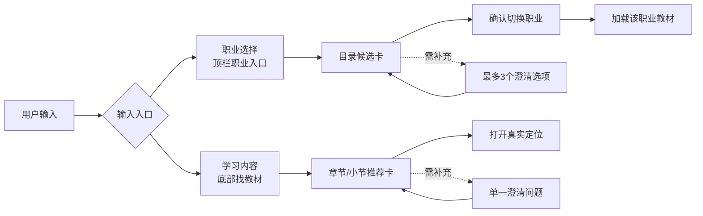
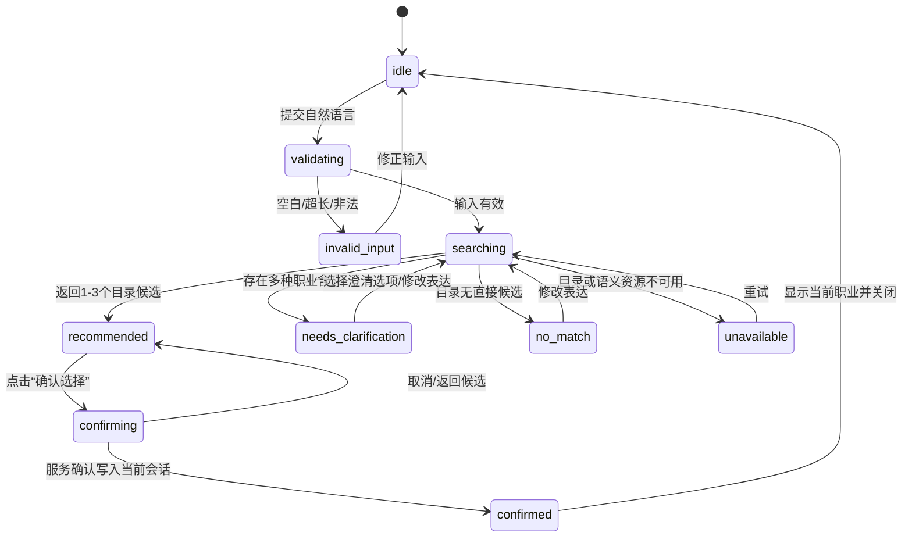
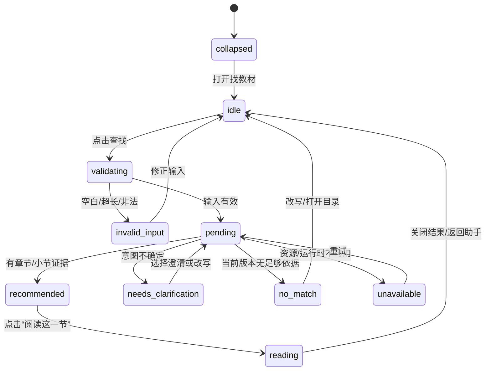

# Agent 系统 v0.12 交互设计交接

- **文档角色**：设计师交接；只定义信息架构、交互、视觉状态、响应式和可访问性，不编写应用代码。
- **版本**：`agent-system-v0.12-ux`
- **日期**：2026-10-15（Asia/Shanghai）
- **适用产品**：现有 `local-workbench-0.11` 学习工作台；两处输入为“选择职业”和“输入学习内容”。
- **设计责任边界**：产品合同、接口字段和验收门槛以产品经理及检索岗位的交接为准；本文不重新定义职业目录、教材内容、检索分数线或账户权限。
- **视觉稿**：[两处输入状态示意 SVG](agent-system-v0.12-ux-states.svg)。示意稿用于表达布局和状态关系，不代表已经实现或通过浏览器 QA。

## 1. 设计结论

两处输入共用一个“意图输入壳”，但各自保留自己的上下文、工具和确认动作：



设计上保留现有 v0.11 的空间关系：

1. **职业入口**仍位于顶栏的职业胶囊，点击后打开可键盘操作的对话框。现有“输入职业或目标，检索已导入职业”的输入方式保留，但候选出现后先进入“候选”状态，不能点击候选就直接写入当前职业。
2. **学习入口**仍是正文底部常驻的“找教材”输入栏。它是非阻断面板，展开或收起不改变阅读位置；结果返回不自动弹开、不抢焦点、不自动跳章。
3. 两处输入的结果都用卡片表达“对象—理由—依据—下一步”，颜色只补充状态；状态文字、边界和操作形状必须同时存在。
4. 未确认的职业推荐只保留在当前会话；未点击“阅读这一节”的学习推荐只保留在当前查询卡。两者都不能被解释成能力认证、职业测评或学习完成。

## 2. 共享输入壳

### 2.1 空间和层级

```text
顶栏（当前位置）                          [当前职业 ▾]
──────────────────────────────────────────────────────
正文 / 路线 / 课程目录（主体，保持 v0.11 阅读优先）
                                                    
                                                    
──────────────────────────────────────────────────────
[找教材：描述你想解决的问题，我来找对应教材] [查找]
```

- 页面主体永远拥有最高视觉权重；Agent 结果是靠近输入点的辅助层，不以全屏聊天覆盖正文。
- 共享输入壳的每个状态都需要短标题、状态标记、主要动作和次要恢复动作；等待和失败不使用空白占位。
- 卡片内“来源”和“用户表达”分开排版。来源使用折叠的次级区域，不把文件路径、hash、内部索引 ID 置于主标题。
- 输入提交后生成唯一请求上下文。新请求只更新其自己的结果区域，旧卡可以收起、恢复和重新核对版本。

### 2.2 共享组件

| 组件 | 视觉含义 | 必须可见的文字/操作 |
| --- | --- | --- |
| `InputShell` | 输入位于当前任务附近 | 可见标签、当前上下文、清除上下文、提交按钮 |
| `ContextPill` | 本次查询会使用的范围 | “当前职业：Agent 开发者”“当前章：持久恢复”；提供“清除” |
| `StatusBadge` | 请求当前状态 | “候选”“需要补充”“无匹配”“暂时不可用”等文字，不能只显示颜色 |
| `EvidenceBlock` | 推荐依据不是生成答案 | “教材原文”“职业目录信息”“查看出处”；默认收起长文本 |
| `PrimaryAction` | 可以推进当前流程 | “确认选择”“阅读这一节”“重新查找” |
| `SecondaryAction` | 修改或退出当前流程 | “换一个”“修改表达”“收起”“返回课程目录” |
| `LiveMessage` | 异步状态反馈 | `role=status`、`aria-live=polite`，不抢焦点 |

### 2.3 视觉语义

- 沿用 v0.11 的职造绿色 `#21734e`、墨色 `#1d2d2a`、纸色背景和白底细边框。主操作为绿色实心，次操作为白底绿色边框。
- 推荐卡使用白底和细边框；澄清卡使用浅纸色背景；错误卡使用带图标和文字的浅红边框；不可用状态使用中性灰绿，不伪装成无匹配。
- 当前职业用绿色圆点加文字；“候选”用带边框的小标签；“已确认”只能在用户确认且服务成功返回后出现。
- 触控目标至少 44×44px；卡片整面不默认可点击，只有明确的“查看候选详情”“阅读这一节”等按钮可操作。

## 3. 职业选择输入

### 3.1 入口和上下文

**入口**：顶栏的当前职业胶囊。未选择时显示“选择职业”，已有职业时显示职业标题和绿色当前点。对话框不改变页面地址，不遮挡正文以外的浏览器返回行为。

对话框首屏视觉结构：

```text
┌──────────────────────────────────────────┐
│ 已导入职业                    [关闭]      │
│ 用一句话说明你想做的工作                   │
│ [职业、工作目标或已有能力……       ] [查找] │
│ 示例：我会 Python，想做能调用工具的应用     │
│                                          │
│ 当前职业：Agent 开发者（若已有）           │
│ [候选] Agent 开发者                         │
│   为什么匹配 · 课程覆盖 · 建议起点          │
│   [查看路径]                      [确认选择] │
└──────────────────────────────────────────┘
```

- 输入框必须有可见 `<label>`，placeholder 只是示例，不承担标签功能。
- 若当前已有职业，当前职业只作为上下文展示；新的候选不会因出现在首位就自动替换它。
- 初次打开可以加载已发布职业目录的简短列表；空查询的目录展示不是“Agent 判断”，卡片状态标为“目录内职业”。

### 3.2 交互流程



具体步骤：

1. 用户打开职业对话框，看到当前职业（若存在）、输入标签和两个可点击示例；示例只填入输入框，不自动提交。
2. 提交后，输入行保留，候选区显示“正在职业目录中查找…”。查找时仍可关闭对话框；关闭不取消已发请求，返回结果不得抢回焦点。
3. `recommended` 显示 1—3 张候选卡。每张卡都写“候选”，显示匹配理由、已知差距、教材版本和建议起点。没有依据的“最适合”“高匹配度”等营销式措辞不出现。
4. 点击“确认选择”后，在当前卡下展开一次确认条：**“将当前学习职业切换为「X」？确认后，学习工作台会加载该职业已发布教材。”** 同时列出当前学习记录不会被推断为能力结果、目录版本会随职业切换重新校验。主要动作“确认切换”，次要动作“返回候选”。
5. 只有确认成功响应后显示“已选择 X”，关闭对话框并触发学习工作台的职业教材加载；加载期间主区显示真实的 `loading` 状态，不能使用旧职业内容冒充新职业。
6. 确认失败时保留候选和输入，显示可恢复错误及“重试确认”；不把按钮状态改成已确认。

### 3.3 职业候选卡

卡片顺序固定，视觉上先对象、后理由、再证据、最后动作：

1. **对象**：职业标题、目录状态（已发布/当前职业）。
2. **为什么匹配**：一至两句，引用用户表达中的任务、能力或约束；不把自述标成测评结果。
3. **你还需要确认的差距**：例如“尚未知道你是否愿意做生产级验证”，只写当前资料缺口。
4. **学习入口**：职业绑定的教材版本和建议开始篇章；只有真实目录存在时才显示链接。
5. **来源说明**：职业目录版本、内容版本；展开后可查看 `career_id` 和版本信息，不在主视图显示内部 JSON。
6. **动作**：`查看路径`（只读预览）、`确认选择`（进入确认条）。当前职业显示“当前职业”并禁用确认切换动作，仍允许查看路径。

### 3.4 职业特殊状态

| 状态 | 画面 | 用户动作 | 不允许的表达 |
| --- | --- | --- | --- |
| `idle` | 输入与示例，已有职业显示当前胶囊 | 填写/提交/关闭 | “系统已经判断你的职业” |
| `recommended` | 1—3 张候选卡，带理由与起点 | 查看路径/确认/换表达 | 直接写入职业 |
| `needs_clarification` | 单一问题，最多 3 个互斥选项；例：“你说的 React 是前端技术，还是想做 Agent 应用？” | 选择选项或修改表达 | 把第一项默认为答案 |
| `no_match` | “当前已发布职业目录没有足够匹配项。”附课程目录入口 | 修改表达/浏览目录 | 创建目录外职业、编造职业页 |
| `unavailable` | “暂时无法读取职业目录。你仍可打开已有职业列表。” | 重试/打开列表/关闭 | 把空结果说成无匹配 |
| `invalid_input` | 输入框旁指出空白、超长或不可接受原因 | 修正输入 | 弹出阻断式失败页 |
| `confirming` | 卡片内嵌确认条，明确切换后果 | 确认切换/返回 | 无确认写入 |
| `confirmed` | 成功标签、当前职业胶囊更新 | 继续学习 | 显示就业/能力承诺 |

### 3.5 职业选择后的工作台衔接

- 对话框成功后，工作台顶栏更新为新职业；课程目录和章节请求绑定新 `career_id`、`textbookVersionId` 与来源版本。
- 工作台切换职业期间显示“正在加载 X 的教材…”，原正文不会悄悄替换；若加载失败显示“当前职业教材未完整加载”，提供重新加载和返回课程目录。
- 切换职业不删除旧阅读记录；本轮设计只消费当前职业上下文，不迁移、删除或推断历史能力。
- 若用户关闭确认条，仍停留在候选结果；再次打开对话框时可以恢复本次会话候选，但不把未确认候选显示为当前职业。

## 4. 学习内容输入

### 4.1 入口和视觉状态

**入口**：v0.11 正文底部的“找教材”输入栏。收起态是一条可聚焦的输入或“打开找教材”按钮；展开态为底部面板，最多约 70dvh，不遮挡全屏正文。

展开态：

```text
┌────────────────────────────────────────────────────────┐
│ 找对应教材                                    [收起]    │
│ 学习范围 [当前职业：Agent 开发者] [当前章：持久恢复 ×]  │
│ [描述你想解决的问题，我来找对应教材……          ] [查找] │
│ 示例：工具超时后怎样避免重复创建工单？                   │
│                                                        │
│ 推荐阅读 · 你的问题涉及“结果未知与恢复”                  │
│ [教材位置] 第…篇 · 实际小节标题                           │
│ 推荐理由 · …                                            │
│ 教材原文  > 展开                                         │
│ 教材 v0.12 · 查看出处                    [阅读这一节]    │
└────────────────────────────────────────────────────────┘
```

- 输入旁始终显示本次查询会使用的职业、当前章和起点；每个上下文都可单独清除。清除当前章后明确显示“在全部教材中查找”，不改变持久学习档案。
- 用户显式问题优先于当前章上下文。结果顶部显示“检索判断：你想解决……”而不是“我已理解”。
- 结果最多 6 张卡，每个独立意图最多 3 张；多意图以分组标题分隔，避免把多个小节拼成不存在的课程。

### 4.2 学习内容流程



步骤和反馈：

1. 用户打开面板，看到输入标签、上下文胶囊和可点击示例。示例填入但不自动提交。
2. 提交后面板显示“正在当前教材中查找…”。输入保持可见；用户可以收起、继续阅读或取消（如果协议提供取消）。
3. 返回 `recommended` 时，结果区标题为“推荐阅读”，每张卡绑定教材版本、篇章、小节、原文摘录、来源和稳定定位链接。结果返回不会自动跳章。
4. 点击“阅读这一节”后，面板收起，页面滚动到真实目标小节，目标 H2/H3 获得焦点并显示轻量“从内容推荐进入”提示。阅读事实是否记入历史按既有产品合同处理，不推导掌握或职业通过。
5. 返回 `needs_clarification` 时，显示一个具体问题和最多 3 个互斥按钮；选项本身是补充提交，不被当作用户已经确认的意图。选择后继续检索，原输入保持可见。
6. 多意图时按意图分组，例如“中断恢复”“任务成本”；被用户明确否定的方向以简短“本次排除”展示，不进入推荐首位。
7. 返回 `no_match` 时，说明当前教材版本与覆盖篇数，并提供“修改表达”和“打开课程目录”；不填充薄弱相关卡。
8. 返回 `unavailable` 时，说明检索资源暂不可用；保留用户输入、上下文和旧结果快照（旧结果标记为历史，不混入新结果），提供重试和课程目录。

### 4.3 学习推荐卡

卡片的视觉顺序：

1. **位置**：实际篇序、篇名、小节标题；标题过长自然换行。
2. **推荐理由**：说明用户问题与该节概念的对应关系，不做通用夸赞。
3. **教材原文**：明确“教材原文”，默认显示 4—6 行；长原文使用“展开原文摘录”，代码不塞入首屏卡片。
4. **来源身份**：教材版本、内容索引版本；展开可见来源文件、`sourceSha256`、稳定 `href`。路径和 hash 是复核信息，不是主操作。
5. **动作**：`阅读这一节` 为绿色主按钮；`查看出处` 为次按钮；没有“标记已掌握”“生成答案”按钮。

解释和规划卡仍然必须先显示引用依据：

- “解释为什么”只总结已存在的教材段落，卡片标题写“基于教材原文的解释”。教材没有对应内容时显示“当前教材无对应内容”，不得把临时生成文本标成教材答案。
- “从零做一个……”可给出现有单元的顺序卡，标为“学习路线建议”；只组合真实章节和实作入口，不承诺时长、职业胜任或行业先进。
- “接下来练什么”只在用户授权且已有学习上下文时读取当前位置；读取事实和推荐依据分开显示。

### 4.4 学习内容特殊状态

| 状态 | 画面 | 用户动作 | 不允许的表达 |
| --- | --- | --- | --- |
| `collapsed` | 单行“找教材”入口，带打开操作 | 打开 | 用图标隐藏输入功能 |
| `idle` | 输入、示例、上下文胶囊 | 填写/查找/收起 | 自动提交示例 |
| `pending` | 输入旁的等待条、结果区骨架；保留阅读 | 收起/取消/继续阅读 | 用旧结果冒充新结果 |
| `recommended` | 章节卡、摘录、理由、出处和阅读按钮 | 打开定位/查看出处/修改查询 | 自动跳章、自动记掌握 |
| `needs_clarification` | 单一具体问题，最多 3 个互斥按钮 | 选择/修改表达 | 自动替用户选项 |
| `no_match` | 诚实说明当前版本无足够对应内容 | 修改表达/浏览目录 | 编造章节或把相邻弱相关当命中 |
| `unavailable` | 中性不可用卡，含重试和目录入口 | 重试/打开目录 | 降级后不标模式、切换教材版本 |
| `invalid_input` | 输入框关联错误文字 | 修正/重新查找 | 将输入错误显示为学习失败 |
| `stale_version` | 结果卡标“来源版本已变化，请重新查找” | 刷新/保留旧卡查看 | 将旧摘录当当前教材 |
| `anchor_unavailable` | “该小节位置暂不可用，可打开本章” | 打开本章/保留查询 | 自动猜相似标题 |

## 5. 两处输入的差异化确认和状态对照

| 维度 | 选择职业 | 输入学习内容 |
| --- | --- | --- |
| 入口位置 | 顶栏职业胶囊 → 对话框 | 正文底部常驻面板 |
| 主要对象 | 已发布职业目录候选 | 当前教材版本的篇章/小节 |
| 主要动作 | 确认切换职业 | 阅读真实定位 |
| 是否写入 | 用户确认后写入当前会话 `career_id` | 默认只保存查询快照；阅读记录沿用既有合同 |
| 结果数量 | 1—3 个职业候选 | 每意图最多3项，总最多6项 |
| 解释内容 | 匹配理由、能力差距、建议起点 | 匹配理由、教材原文、出处 |
| 歧义处理 | 追问职业含义（最多3项） | 追问内容意图（单问题/最多3项） |
| 成功后 | 更新工作台教材上下文并重新校验版本 | 收起面板、聚焦真实小节 |
| 失败后 | 保留候选和输入，不覆盖当前职业 | 保留输入和旧卡，不覆盖当前阅读 |

## 6. 集成 v0.11 学习工作台

### 6.1 桌面布局

- 保留左侧导航、顶栏和正文单列；正文宽度 680—760px，左右留白 24—32px。
- 职业对话框宽度不超过 680px，候选区内部滚动；打开时不把阅读页面替换成新路由。
- 学习面板固定在视口底部，使用轻阴影和细边；展开结果最多占约 70dvh，正文末尾预留 80px 加安全区。
- 课程目录、学习路线、章节正文及 v10/v12 教学图不被 Agent 卡片重排。检索定位只改变滚动和焦点，不改变教材顺序。

### 6.2 手机和窄屏

- `900px` 以下：导航改为带中文文字的顶部入口；职业胶囊仍可见，不只保留图标。
- `760px` 以下：职业对话框左右留 10—16px，候选卡改为单列，确认按钮整行显示；对话框内部可滚动，关闭按钮保持在可见区域。
- `375px` 及以下：学习面板输入、查找、收起操作纵向换行；上下文胶囊允许自然换行；结果卡保持单列，原文折叠。
- 软键盘出现时，输入与查找按钮仍在可见区域；面板不遮住章节末尾操作。面板收起后保留安全区。
- 长标题、章节链接、错误文字使用 `overflow-wrap:anywhere`，页面本身不得产生横向滚动。

### 6.3 路由、后退和并发

- 推荐链接沿用实现交接的 `#learn/agent/<unitId>/<sectionId>` 形式；界面不显示内部路由，但刷新和浏览器后退必须恢复查询卡、当前章和目标小节。
- 每次提交的输入、职业/教材上下文、请求 ID 和版本快照都绑定结果。迟到响应只能更新同一请求区域，不能覆盖新输入、新职业确认或当前阅读焦点。
- 关闭职业对话框和收起学习面板都不清空查询；用户再次打开可恢复最近一次结果。显式“清除”才清除上下文。

## 7. 可访问性和输入法

### 7.1 键盘和焦点

- 职业对话框使用真实 `dialog` 语义；打开时焦点进入输入框，`Esc` 返回打开职业胶囊，关闭后焦点回到原控件。
- 学习面板不是模态框；展开后焦点进入输入框，`Esc` 收起并回到“找教材”控件，不锁住正文。
- 所有卡片按钮、澄清选项、来源展开、定位、重试和关闭均可用 `Tab`、`Enter` 或 `Space` 操作，焦点圈至少 3px 且与背景有足够对比。
- 点击“阅读这一节”后，先执行稳定定位，再把焦点放到真实 H2/H3；目标缺失时焦点落到错误卡的“打开本章”。
- 职业确认条和错误消息出现在触发它们的卡片附近，不把焦点强行移到页面顶部。

### 7.2 屏幕阅读器和状态

- 输入有可见标签；placeholder 不作为唯一名称。上下文清除按钮用完整名称，例如“清除当前章筛选”。
- 请求状态区使用 `role=status`、`aria-live=polite`；等待提示不重复播报百分比，不抢焦点。
- 推荐列表使用有序标题和列表语义；候选卡标题、理由、来源和主要动作按 DOM 顺序阅读。
- 澄清问题以 `fieldset/legend` 或同等语义分组；互斥选项不可只用颜色区别。
- 错误用 `aria-describedby` 关联输入；不可用、无匹配、版本过期和章节失效使用不同文字，不能只播报“失败”。
- 职业确认结果要明确播报“已选择 X”或“切换未完成”；学习定位要播报“已定位到第 N 篇的 Y 小节”。

### 7.3 中文输入法和减少动态效果

- Enter 提交只在中文输入法组合提交完成后触发；组合期间的 Enter 不提交。Shift+Enter 在多行学习输入中换行。
- `prefers-reduced-motion: reduce` 时不使用面板滑入、结果闪烁或自动滚动动画；定位用即时滚动并提供清晰焦点。
- 颜色之外使用文字、边框、图标和布局区分候选、等待、确认、无匹配和错误；对比度满足现有站点可读性基线。

## 8. 设计交接给产品、工程和 QA

### 8.1 给产品经理

- 依据 `agent-system-product-design.md` 的 AGP-01—10 组织验收，本文不新增分数线或覆盖范围。
- “确认职业”是唯一改变当前 `career_id` 的用户动作；“查看路径”与“阅读这一节”是只读导航。
- 结果卡的“来源版本”和“当前上下文”必须来自接口，不由客户端根据文案猜测；版本变化要进入 `stale_version`，不能自动替换为“最新”。

### 8.2 给软件工程师和检索工程师

- 两处输入各保留自己的输入文本、上下文快照、状态和请求 ID；共用卡片视觉组件但不共用确认逻辑。
- 前端需要把职业候选、学习结果、澄清问题、无匹配、不可用和输入错误映射到本文状态；服务返回空结果但未声明 `no_match` 时显示不可用/协议错误，不能静默显示“无匹配”。
- 真实推荐卡必须有稳定 `href` 或可验证的章节定位；目标不存在时按 `anchor_unavailable` 展示。
- 本设计只消费目录与教材只读结果，不触发教材生成、外部搜索、付费模型或账户能力字段更新。

### 8.3 给测试工程师

独立 QA 至少核对以下视觉和行为证据：

1. 顶栏职业输入：探索、迁移、约束、React 歧义、目录外职业、确认取消、确认成功、确认失败。
2. 学习输入：定位、解释、规划、比较、复习、多意图、否定、空白/超长、无匹配、不可用、版本变化、锚点缺失。
3. 桌面、320/375px 手机、中文输入法、键盘完整路径、屏幕阅读器状态播报、缩放 200% 和减少动态效果。
4. 迟到响应不会覆盖新输入；关闭/收起不抢焦点；切换职业不会用旧职业正文冒充新内容；推荐结果不自动写掌握或职业胜任。

## 9. 设计自查、证据和未验证项

**设计自查已完成：**

- 两处输入均有可直接审阅的视觉布局和状态流程；共享输入壳与各自确认动作已分离。
- 推荐、澄清、无匹配、不可用、非法输入、确认成功/失败、版本过期和目标缺失均有明确画面与恢复动作。
- 视觉优先：位置、卡片层级、边界、按钮形状和状态反馈承担意图；文字只补足精确命名、来源和错误原因。
- 方案沿用 v0.11 的职业对话框、正文底部“找教材”、绿色品牌、20 篇课程阅读顺序和非阻断阅读体验。
- 没有新增职业、教材、账户字段、能力认证、生成答案或外部服务承诺。

**当前证据：**

- 依据现有 `app-v11-design.md`、`agent-system-product-design.md`、`DESIGN_COMMUNICATION_STANDARD.md`、现有职业对话框样式和内容检索接口只读交接。
- [agent-system-v0.12-ux-states.svg](agent-system-v0.12-ux-states.svg) 是本轮静态示意，表达候选/确认和推荐/澄清/无匹配的空间关系。

**尚未验证：**

- 本轮没有运行浏览器、真实服务或屏幕阅读器；示意稿不代表 UI 已实现。
- 职业目录候选质量、教材检索命中质量、真实用户理解、中文输入法行为和实际响应时序仍需软件工程师实现后由 QA 独立复验。
- 设计交付不等于产品完整达标、职业能力认证、用户满意或行业先进性。

