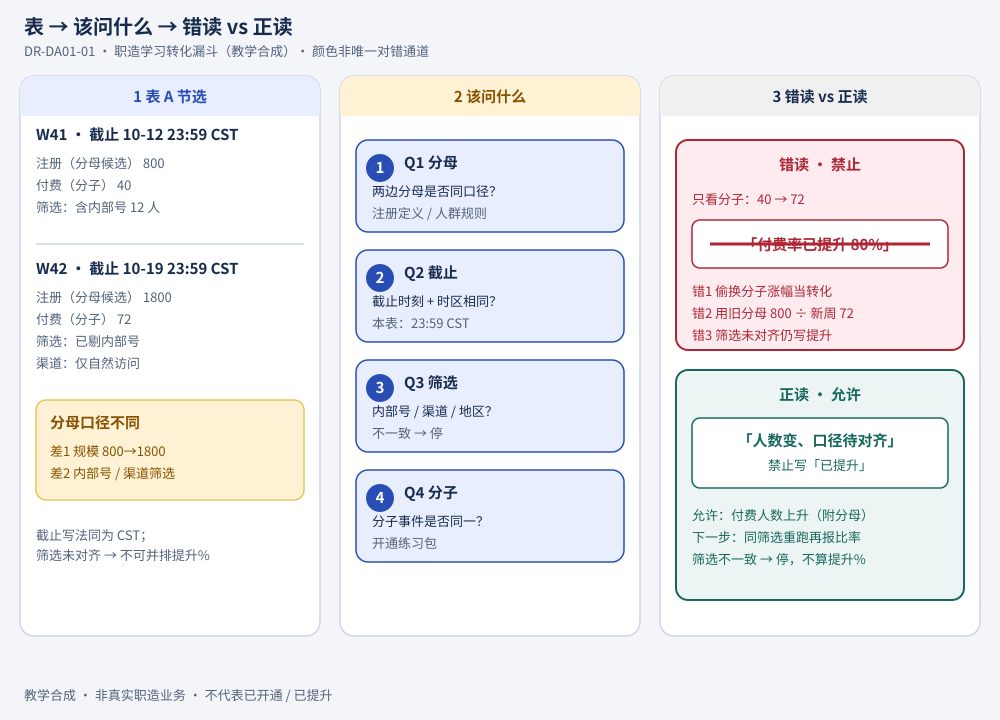
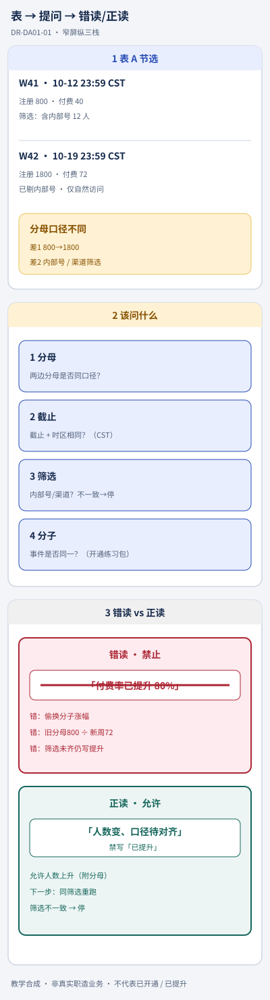
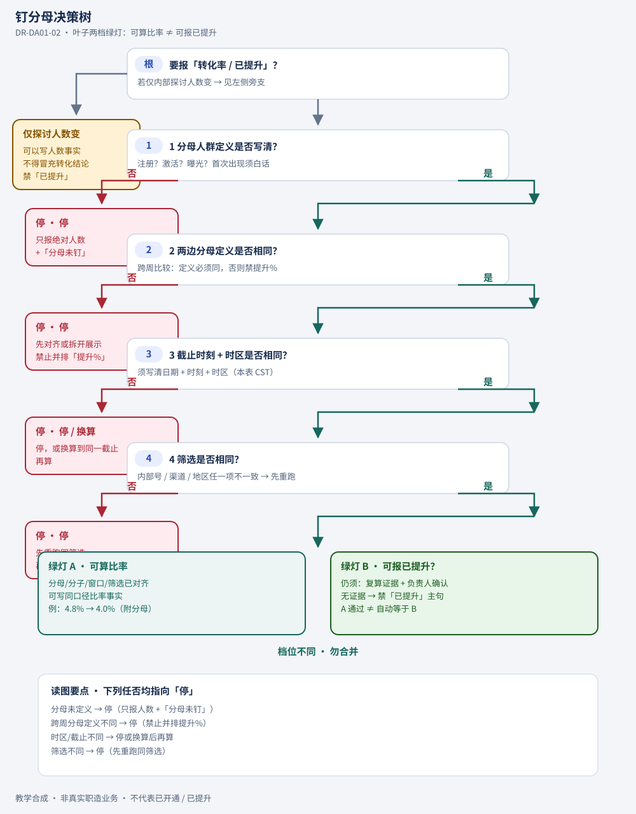
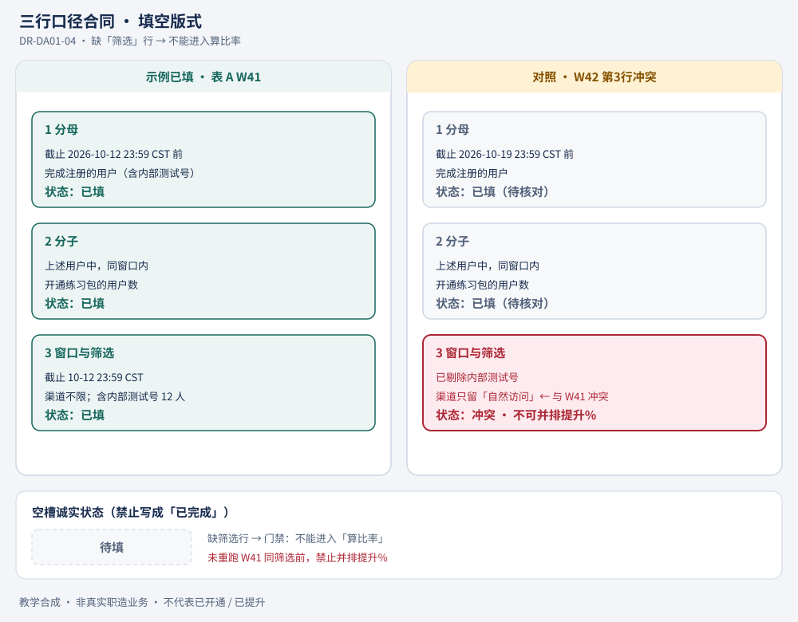
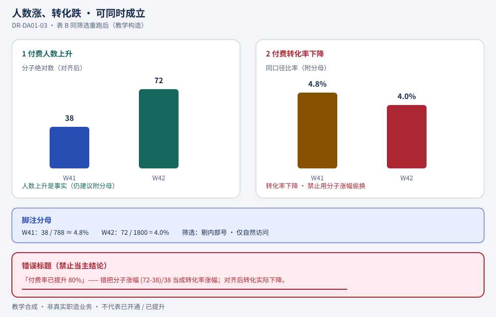
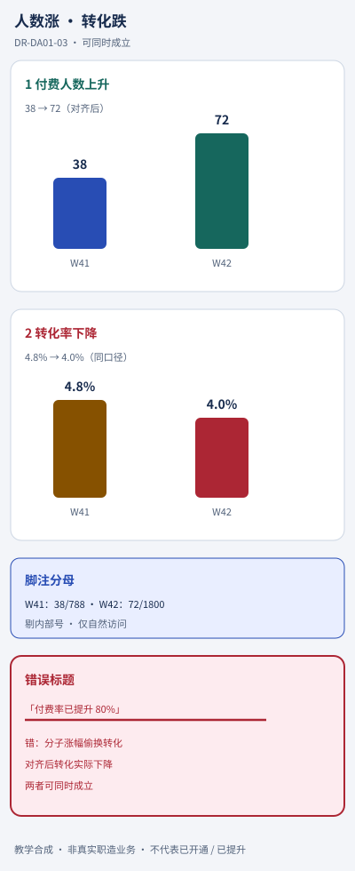
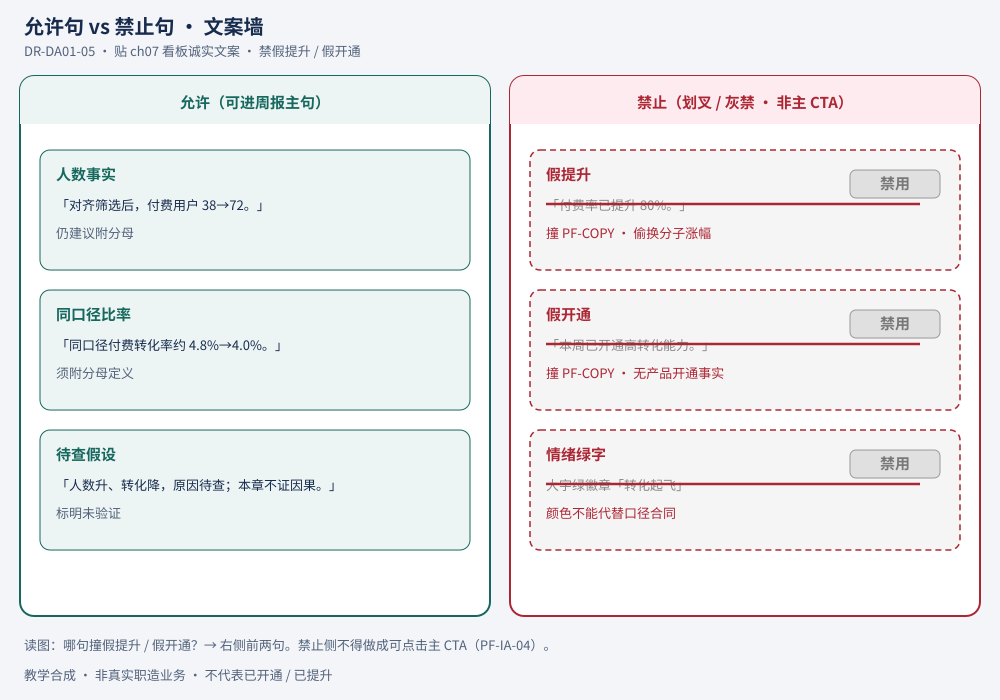

# 01 · 先钉分母，再读转化率

> **本章路径**：`textbooks/data-analyst-v01/01-nail-the-denominator.md`。设计图 DR-DA01-01…05（各 desk+narrow）在 `assets/`。  
> **证据状态**：`reviewed_with_limitations`——作者按易读规范起草并完成读图接线；**未**独立内容审校、**未**完成本轮设计复验签发、**未** QA、未做真人限时探针、未联调真实业务库、未实测看板发布。不代设计签发；不宣称 Ready。  
> **开篇顺序**：机制 → 例子 → 读图（2026-11-04）。仍 `reviewed_with_limitations`。合入与部署保持 Hold，待设计复验、独立内容审校与 QA 后由决策板决定。  
> **课程架构**：章节属最小可教初稿；目标 / 先修 / 能力矩阵 `pending_curriculum_architect`。  
> **底线自拦**：禁假开通 / 假提升 / 假 Ready 文案（PF-COPY）；关键图流内可辨或提供同级文字降级（PF-MEDIA / PF-VIS）。  
> **贯穿案例声明**：下文「职造学习转化漏斗」全部数字、账号、筛选与周报句子均为**教学合成**，不代表真实职造业务结果或已上线实验。

---

## 本节要学会判断什么

1. 报转化率之前，分母、截止时刻、时区、筛选是否已经钉成**同一合同**；否则你该阻断结论还是只披露不确定。  
2. 同一张表上，怎样把「只看分子」的错读与「对齐分母后再算」的正读并排核对，并写出可观察的下一动作。

**成立条件**：有可点数的分子事件、可点数的分母人群、明确截止与时区、筛选条件可复述。  
**边界**：本章**不**教你选 BI 工具、**不**证明真实职造漏斗已提升、**不**替代实验因果（见 stub ch06）。  
**决定权**：分析同学提出可复算口径；业务负责人决定是否对外写「提升」；无人有权在分母未钉时把假提升写进主文案。

> **先记住**  
> - 转化率 = 分子 / **已声明且可复算的分母**（含时段、时区、筛选）。  
> - 分子涨 ≠ 转化变好。  
> - 分母或筛选对不齐时，看板主文案最多写「人数变化，口径待核对」，**禁止**写「已提升」。

### 术语首次白话（后文统一用词）

| 词 | 白话 + 场景 | 后文统一 |
| --- | --- | --- |
| **分母** | 比率底下那群人：你在问「每 100 个**谁**里有多少付费」。表 A 里候选是「注册用户」。 | 分母 |
| **分子** | 你关心的结果事件人数：表 A 里是「付费用户」。 | 分子 |
| **转化率** | 分子 ÷ 分母，且两边定义、时段、筛选已对齐。 | 转化率 |
| **激活** | 本册教学定义：用户**首次打开任意一章教材**（合成事件名 `first_open_textbook`）。 | 激活 |
| **截止时刻** | 统计窗口最后一秒，须带时区。表 A 用 `23:59 CST`。 | 截止时刻 |
| **筛选** | 进不进分母/分子的过滤：内部号、渠道、地区等。 | 筛选 |
| **口径合同** | 把分母、分子、截止、筛选写成别人能按同一规则重算的说明。 | 口径合同 |

连续段落里若只剩术语，停下来用上表白话重说一遍——这是本章写作纪律，也是你面试口述时的纪律。

---

## 例子：一张会骗你的表

运营同学**周衡**甩来一张周汇总，配一句：「付费从 40 涨到 72，转化起飞了，看板大字可以写『付费率已提升 80%』。」

### 表 A · 职造学习转化漏斗周汇总（教学合成）

| 周次（截止时刻） | 注册用户（分母候选） | 激活用户（首次打开教材） | 付费用户（开通练习包） | 备注筛选 |
| --- | ---: | ---: | ---: | --- |
| W41 · 截止 2026-10-12 23:59 **CST** | 800 | 320 | 40 | 含内部测试号 12 人 |
| W42 · 截止 2026-10-19 23:59 **CST** | **1800** | 540 | **72** | **已剔除**内部测试号；渠道只留「自然访问」 |

**错读（只看分子）**：付费 40 → 72，涨了 80%，所以转化变好了。  
**正读（先钉分母）**：W41 注册分母 800，W42 变成 1800；筛选与是否含内部号也不一致。在分母与筛选未对齐之前，**任何**「付费率已提升」都是假提升文案，必须拦。

---

## 先读图：表 → 该问什么 → 错读 vs 正读（DR-DA01-01）

**读图任务（对照机制再看｜对齐 DR-DA01-01 READ-TASK）**

1. 表 A 里，W41 与 W42 的**分母**是否同一口径？差在哪两处？  
2. 若有人用「付费 72 / 注册 800」算 W42 转化，错在哪？  
3. 筛选不一致时，应「停」还是继续算提升%？  
4. 正读主句允许写进周报的，是「已提升」还是「人数变、口径待对齐」？



**窄屏（≤640）用 narrow**



**图注（流内要点，窄屏同级保留）**：左看表 A 节选 → 中问分母 / 截止时区 / 筛选 / 分子 → 右对照错读「+80% 已提升」（划叉）与正读「人数变、口径待对齐」。颜色非唯一对错通道。教学合成；**未**完成本轮设计复验签发；合入与部署保持 Hold。

**图上看不清、须在正文保留的同级要点**

| 节点 | 同级要点 |
| --- | --- |
| 分母定义 | 注册 / 激活 / 曝光不可混用；首次出现须白话 |
| 跨周比较 | 两边分母定义必须相同，否则禁止提升% |
| 截止与时区 | 写清日期 + 时刻 + 时区（本表用 CST） |
| 筛选 | 内部号、渠道、地区任一项不一致 → 先重跑 |
| 文案 | 无对齐证据 → 禁「已提升」「转化起飞」「已开通数据分析能力」 |

### 钉分母决策树（DR-DA01-02）

**读图任务（对照机制再看｜对齐 DR-DA01-02 READ-TASK）**

1. 分母未定义、跨周定义不同、时区不同、筛选不同——箭头是否都指向「停」（或停/换算）？  
2. 「可算比率」与「可报已提升」是否分成两档绿灯（勿合并）？  
3. 「仅探讨人数变了」旁支能否冒充转化结论？




**图注**：对齐后才可算比率；对外「已提升」仍须复算证据 + 负责人确认（绿灯 A ≠ 自动绿灯 B）。点不开图时用下方 ASCII 降级。

> **visual_downgrade（ASCII 树）**：正式图为上方 DR-DA01-02；本树仅作图失败 / 无法加载时的同级替代。

```text
要报「转化率 / 已提升」？
 ├─ 分母人群定义是否写清？（注册？激活？曝光？）
 │    ├─ 否 → 停。只报绝对人数 +「分母未钉」
 │    └─ 是 → 两段比较的分母定义是否相同？
 │         ├─ 否 → 停。先对齐或拆开展示，禁止并排「提升%」
 │         └─ 是 → 截止时刻 + 时区是否相同？
 │              ├─ 否 → 停或换算到同一截止后再算
 │              └─ 是 → 筛选（内部号 / 渠道 / 地区）是否相同？
 │                   ├─ 否 → 停。先重跑同筛选
 │                   └─ 是 → 可以算比率；对外「已提升」仍须有复算证据与负责人确认
 └─ 仅内部探讨「人数变了」→ 可以，但文案不得冒充转化结论
```

### 错读 vs 正读步骤卡（markdown · visual_downgrade）

> 正式总对照图为上方 **DR-DA01-01**。下表缩短为步骤备忘；扫读不得把错读列当成真实结论。

| 步骤 | 错读（新手常做） | 正读（专业做法） |
| --- | --- | --- |
| 1 看表 | 只盯「付费用户」列 | 先圈分母列 + 备注筛选 + 截止 |
| 2 算账 | (72-40)/40 = +80% 当转化 | 先对齐筛选后再算两边比率，或标「尚不可比」 |
| 3 写句 | 「付费率已提升 80%」 | 「付费人数上升；口径待对齐后重报」 |
| 4 下一步 | 看板直接标绿 | 列对齐清单 → 重跑 → 再决定是否报比率 |

---

## 1 为什么「付费涨了」不能直接等于「转化好了」

### 1.1 本节要学会判断什么

分子绝对数上升时，你能否列出至少两个「分母或筛选变化」的替代解释，并决定先核对哪一个。

### 1.2 概念地图：三种看起来像好消息的假象

**读图任务**：指出表 A 的 W42 同时踩中了下面哪几条假象。

```text
假象 A  分子涨、分母涨得更多  →  转化率可能下降
假象 B  分子涨、筛选变严或变松  →  人群已换，比率不可比
假象 C  分子涨、截止/时区错位  →  多算或少算一整段窗口
```

对表 A：注册 800→1800（假象 A 风险）；内部号与渠道筛选不一致（假象 B）；截止写法相同但若有人把一边当成 UTC 就会变假象 C。

### 1.3 小案例：输入 → 动作 → 可观察结果

| 层 | 内容 |
| --- | --- |
| **输入** | 周衡的句子 + 表 A。 |
| **动作** | 你在文档顶部写下：「待钉：分母=注册？两边筛选？时区=CST？」并拒绝把「已提升 80%」贴进看板草稿。 |
| **可观察结果** | 看板草稿主标题仍为「W42 漏斗人数（口径核对中）」；评论区留下三条待钉问题；**无**绿色「已提升」徽章。 |

### 1.4 练习 / 翻车

- [ ] 用一句话向非数据同事解释：为什么付费 40→72 不能直接说转化起飞。  
- [ ] 翻车：把「人数涨」写成「转化涨」——本周是否在你过往周报里出现过？标出来。

| 新手常做 | 专业做法 |
| --- | --- |
| 先做百分比，再回头找分母 | 先写口径合同三行，再算第一个百分比 |
| 用颜色（绿/红）代替口径说明 | 颜色只作辅助；主句必须含分母与时段 |

> **何时别用**  
> - 不要在探索性草算阶段对外发「已提升」。草算可以，文案升级要另一道门。  
> - 不要用「差不多一个意思」混用注册分母与激活分母。

---

## 2 钉分母的最小口径合同（三行就够开工）

### 2.1 本节要学会判断什么

你会不会在打开 SQL / 表格之前，先写出三行合同：分母是谁、分子是什么事件、窗口与筛选是什么。

### 2.2 概念地图：三行合同模板（DR-DA01-04）

**读图任务（对齐 DR-DA01-04 READ-TASK）**

1. 三槽分别是什么？缺「筛选」行能否进入算比率？  
2. 把表 A 的 W41 填进模板；指出 W42 哪一行与 W41 冲突。  
3. 空槽应显示「待填」还是「已完成」？




**图注**：分母 / 分子 / 窗口与筛选三槽；示例对齐表 A W41；空槽诚实标「待填」，禁止写成「已完成」。点不开图时用下方模板。

> **visual_downgrade（文字模板）**

```text
【口径合同 · 最小三行】
1 分母：在 {窗口} 内满足 {人群规则} 的用户集合
2 分子：分母中，在 {同一窗口或约定随访窗} 内发生 {事件} 的用户数
3 窗口与筛选：截止 {日期时刻时区}；包含/排除 {内部号、渠道、…}
```

**表 A · W41 填法（示例）**

1. 分母：截止 2026-10-12 23:59 CST 前完成注册的用户（含内部测试号）。  
2. 分子：上述用户中，在同窗口内开通练习包的用户。  
3. 筛选：渠道不限；**含**内部测试号 12 人。

**W42 冲突**：分母规模规则看似同类，但备注变为「已剔除内部测试号；渠道只留自然访问」→ 与 W41 **第 3 行**冲突。未重跑 W41 同筛选前，禁止并排提升%。

### 2.3 小案例 I→A→R

| 层 | 内容 |
| --- | --- |
| **输入** | 产品经理想对比 W41 / W42 激活率（激活 ÷ 注册）。 |
| **动作** | 你复制三行模板，把两边筛选改成同一套，重拉两行数。 |
| **可观察结果** | 得到「同筛选」两行注册 / 激活；激活率可算。若产品坚持用旧表 A 原文，你在结论旁标注 `incomparable_filters`，并拒绝「激活率已提升」主句。 |

### 2.4 练习 / 翻车

- [ ] 不看正文，默写三行合同标题（分母 / 分子 / 窗口与筛选）。  
- [ ] 给表 A 写一条「不可比」脚注（≤30 字）。

> **请你动手**  
> 假设还有一张日表，截止写成 `2026-10-19` 但没写时刻与时区。先写你会向数据工程追问的**一句**话。

---

## 3 用对齐后的数，重新读表 A

### 3.1 本节要学会判断什么

在筛选对齐之后，怎样报告「人数变化」与「转化率变化」而不越权写成因果或「已提升」。

### 3.2 表 B · 同筛选重跑后的合成结果（教学构造｜DR-DA01-03）

> 下列数字仍为合成，用于演示算法，**不是**真实查询结果。

假设两边都：**剔除内部号**；渠道 = 自然访问；截止规则同表 A。

| 周次 | 注册（分母） | 付费（分子） | 付费转化率 |
| --- | ---: | ---: | ---: |
| W41 对齐后 | 788 | 38 | 38/788 ≈ **4.8%** |
| W42 对齐后 | 1800 | 72 | 72/1800 = **4.0%** |

**读图任务（对齐 DR-DA01-03 READ-TASK）**

1. 付费人数上升与转化率下降是否可同时成立？  
2. 标题写「已提升 80%」错在哪？（把分子涨幅 `(72-38)/38` 偷换成转化率涨幅；对齐后转化实际下降）  
3. 脚注分母分别是多少？（W41 788 · W42 1800）





**图注**：付费 38→72 与转化约 4.8%→4.0% 可同时成立；禁止把分子涨幅画成转化率涨幅。上表为同级数字来源；图为标注说明。

> **visual_downgrade**：desk/narrow 不可用时，以上表 B 三行数字 + 图注三句仍成立——人数↑与转化↓可同立；`(72-38)/38` 不是转化涨幅；分母 W41=788 / W42=1800。

### 3.3 正读主句（允许） vs 假提升（禁止｜DR-DA01-05）

**读图任务（对齐 DR-DA01-05 READ-TASK）**

1. 哪一句撞假提升？哪一句撞假开通？  
2. 允许侧至少能指出：人数事实 / 同口径比率 / 待查假设？  
3. 禁止侧是否做成了可点击主 CTA 样式？（应为划叉 + 禁用徽标，不得当主按钮）




**图注**：禁止侧展示错误句仅供识别，须明显「禁用」标记；扫读不得当成真实结论或主 CTA（PF-COPY / PF-IA）。下表为同级文字备忘。

> **visual_downgrade**：desk/narrow 不可用时，以下对照表即为同级替代——允许人数/比率/待查假设；禁止假提升「已提升 80%」与假开通「已开通…能力」。

| 类型 | 句子 | 是否允许 |
| --- | --- | --- |
| 人数事实 | 「对齐筛选后，付费用户 38→72。」 | 允许（仍建议附分母） |
| 比率事实 | 「同口径付费转化率约 4.8%→4.0%。」 | 允许（须附分母定义） |
| 假提升 | 「付费率已提升 80%。」 | **禁止**（错把分子涨幅当转化；且对齐后转化率实际下降） |
| 假开通 | 「本周已开通高转化能力 / 数据分析能力已提升。」 | **禁止**（PF-COPY；无产品开通事实） |
| 谨慎探讨 | 「人数上升、转化率下降，原因待查（渠道结构 / 供给等），本章不证因果。」 | 允许 |

### 3.4 小案例 I→A→R

| 层 | 内容 |
| --- | --- |
| **输入** | 表 B。 |
| **动作** | 周报主句改为比率+分母；删除「已提升 80%」；另开「待查假设」小节且标明未验证。 |
| **可观察结果** | 主句可被另一人用同一合同重算到相同比率；评论区无绿色「提升」标签。 |

### 3.5 练习 / 翻车

- [ ] 根据表 B 写两句：一句人数、一句转化率；都含分母词。  
- [ ] 指出「已提升 80%」同时犯了哪两类错（口径错 + 文案诚实错）。

> **先记住**  
> - 对齐后仍可能出现「人数涨、转化跌」。  
> - 比率下降时，禁止用分子涨幅的百分比偷换标题。

---

## 4 激活当分母：换分母前先换合同

### 4.1 本节要学会判断什么

有人提议「付费 ÷ 激活才专业」时，你能否要求先改合同再出数，而不是在旧注册分母结果上改口。

### 4.2 决策树

**读图任务**：从「想改用激活分母」走到「可对外报比率」，中间最少经过哪两道门？

```text
提议：付费 ÷ 激活
 ├─ 激活事件定义是否与 ch 术语表一致？（首次打开教材）
 │    ├─ 否 → 先写定义，停算
 │    └─ 是 → 激活是否可能晚于付费？（乱序）
 │         ├─ 是 / 未知 → 先定随访窗与乱序规则
 │         └─ 否（或规则已定）→ 重跑表，不得回改旧「注册分母」结论的标题充新指标
 └─ 对外标题须写明分母=激活，禁止与旧注册转化率裸并排称「提升」
```

### 4.3 小案例 I→A→R

| 层 | 内容 |
| --- | --- |
| **输入** | 增长同学：「激活质量更高，以后都用付费/激活。」 |
| **动作** | 你新建口径合同 v2（分母=激活），保留 v1（分母=注册）并存；周报分栏，不合并成一条「提升」。 |
| **可观察结果** | 文档出现 `metric_contract_v1` / `v2` 两个 ID；任何「已提升」句必须引用其中一个 ID 与复算截图。 |

### 4.4 练习

- [ ] 写一句拒绝裸并排的话术（给非数据同事）。  
- [ ] 列出改分母时至少两个要重问的事件顺序问题。

| 新手常做 | 专业做法 |
| --- | --- |
| 同一个「转化率」词下周换分母 | 换分母 = 新指标名或新合同版本 |
| 删掉旧口径装作一直如此 | 旧口径归档；对比时显式写「定义变更」 |

---

## 5 截止时刻与时区：差 8 小时也能假提升

### 5.1 本节要学会判断什么

两边窗口是否真在同一截止；若一边写日期、一边默认同事电脑本地时区，你该怎么办。

### 5.2 合成事故

数据工程导出 W42 时误用 **UTC** 日界，运营表写 **CST**。付费事件在 10-19 20:00 CST（= 10-19 12:00 UTC）被一边算进 W42、另一边算进下一周。

**可观察教训**：未写时区的「日」不是合同。表头必须出现 `CST` 或偏移。

### 5.3 I→A→R

| 输入 | 动作 | 可观察结果 |
| --- | --- | --- |
| 两份「日」粒度表，无时区 | 阻断合并；要求补 `TIMESTAMP WITH TIME ZONE` 或统一 `Asia/Shanghai` 截止 | 合并 PR / 周报勾选「时区已声明」前不发提升结论 |

### 5.4 练习 / 何时别用

- [ ] 给表 A 表头追加时区，改成你对外粘贴时的标准写法。  
- **何时别用**：不要用「大家心里都是北京时间」代替表头字段。

---

## 6 把错读改成正读：一整条可勾选作业

### 6.1 本节要学会判断什么

给你一张新表，你能否按固定清单在 10 分钟内输出：可比 / 不可比、允许主句、禁止主句。

### 6.2 作业表 C（教学合成）

| 周次 | 曝光人数 | 点击「开通练习包」 | 备注 |
| --- | ---: | ---: | --- |
| W40 | 5000 | 90 | 含广告投放 |
| W41 | 2200 | 88 | **仅**邮件召回；截止写 `10-12` 无时区 |

**读图任务**：哪一项先让你判「不可比」——分母含义、筛选，还是截止？

### 6.3 标准动作清单（请你动手勾选）

- [ ] 写出分母白话：曝光是什么事件？  
- [ ] 标出筛选差异：广告 vs 邮件。  
- [ ] 标出截止缺陷：无时区。  
- [ ] 给出允许主句（示例方向）：「点击人数接近，但人群与窗口未对齐，不报转化提升。」  
- [ ] 给出禁止主句：任何「转化已提升」或「召回已开通高效转化」。  
- [ ] 写下一步：向谁要同筛选重跑、要什么字段。

### 6.4 参考正读（不是唯一措辞）

允许：「W40/W41 点击绝对数接近（90 vs 88），但分母为不同渠道曝光且 W41 截止缺时区，**不可比转化率**；需同渠道、同时区重跑后再报。」  
禁止：「召回转化已提升」「已开通高效召回」。

---

## 7 扫读块汇总（整章纪律）

> **先记住**  
> 1) 先钉分母与筛选，再算转化率。  
> 2) 分子涨可以是事实；「转化已提升」是另一句，要合同 + 复算。  
> 3) 对齐后可能人数涨、转化跌——标题必须诚实。

| 新手常做 | 专业做法 |
| --- | --- |
| 先做漂亮百分比 | 先做三行口径合同 |
| 绿字「已提升」刺激情绪 | 主句含分母词 + 窗口；颜色次要 |
| 换分母不换名字 | 合同版本化 |

> **何时别用本章算法**  
> - 尚未有事件定义时，不要假装已经在做转化分析。  
> - 需要因果结论时，进实验章（stub ch06），不要用本章描述性比率冒充「因为改版所以提升」。

> **请你动手（出口）**  
> 把周衡原话改写成 ≤40 字的正读主句，须含「分母」或具体分母名，且不含「已提升」。

---

## 8 常见翻车清单（可勾选自检）

- [ ] 只读分子列就写百分比标题  
- [ ] 注册分母与激活分母混称「转化率」  
- [ ] 内部号 / 渠道筛选周间不一致仍并排提升%  
- [ ] 截止无时区仍合并两表  
- [ ] 看板大字「付费率已提升」无复算附件  
- [ ] 把教学合成数当成真实职造业务结果对外引用  
- [ ] 在 `pending_curriculum_architect` 阶段宣称「数据分析师教材已开通」

---

## 9 与后章的交接（不提前写完课标）

| 后章（stub） | 本章交出什么 |
| --- | --- |
| ch02 问表五件事 | 三行合同可扩成五问清单 |
| ch03 错读 vs 正读 | DR-DA01-01 对照卡可加深为多指标 |
| ch04 指标合同 | 三行 → 完整字段级合同 |
| ch05 缺失 / 极端 / 截止 | 本章截止与时区是引子 |
| ch06 实验分母 | 描述性比率 ≠ 因果 |
| ch07 看板诚实文案 | 禁止句式在此已练 |
| ch08 交接复验 | 合同 ID + 重跑参数 |

课程目标与能力矩阵仍待架构师确认；上表只是教材岗便于扩写的钩子，**不是**冻结课标。

---

## 10 证据与未验证项（显式）

| 项 | 状态 |
| --- | --- |
| 表 A/B/C 数字 | 教学合成 |
| 真实职造漏斗查询 | **未做** |
| 跨专业读者限时探针 ①②③ | **未做** |
| 设计图 DR-DA01-01…05（desk+narrow） | 已放入 `assets/` |
| 设计复验签发 | **未**完成本轮决策板签发 |
| 独立内容审校 / QA | **未做** |
| 职业产品挂载 | **未做**（本树只有教材文件） |
| Ready / 已提升 / 已开通 | **不得**宣称。合入与部署保持 Hold |

标记：`reviewed_with_limitations` · `visual_downgrade` · `pending_curriculum_architect`

---

## 出口验收（作者自测答案，非真人实测）

| 探针 | 稿内应能直接找到 |
| --- | --- |
| ① 学会什么 | 开篇结论 +「本节要学会判断什么」：先钉分母/筛选/截止再报转化 |
| ② 图在看什么 | DR-DA01-01 四问 + DR-DA01-02 停算条件 + DR-DA01-03/04/05 各读图任务；降级表/树仍可用 |
| ③ 下一步练什么 | §6 表 C 勾选清单；§7 出口改写周衡原话 |

若真人限时答不上 → **改结构**，不单加装饰图。
