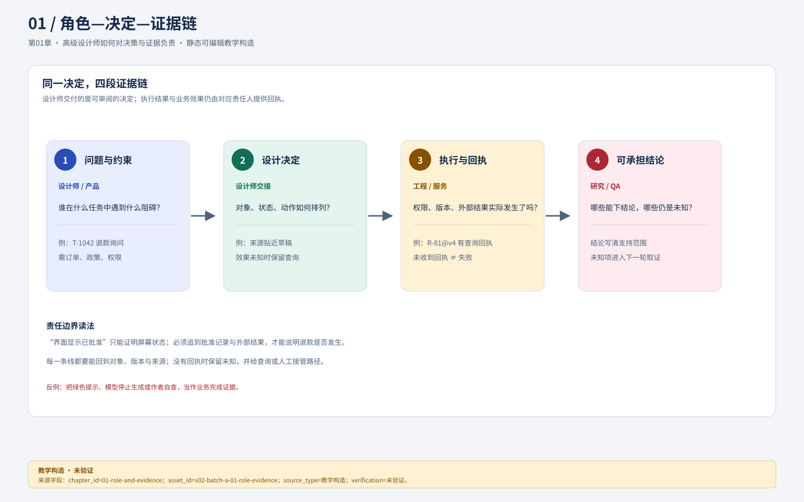
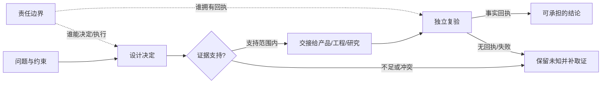

# 01 高级设计师如何对决策与证据负责

设计师的责任不是把需求变成一张好看的屏幕，而是把一个有约束的问题转成**可以审阅、可以推翻、可以交接的决定**。界面负责让用户理解对象、采取动作和辨认后果；用户目标是否实现、业务是否受益、服务是否真正执行，则分别需要任务证据、业务证据和工程回执。能够指出这些证据之间的断点，是高级设计训练的起点。

本书以“澄明售后工作台”为统一教学构造：租户 `t-lotus` 为“云帆家居·美国站”，另有 `t-maple`；客服林晓处理客户 Maya Chen 的工单 `T-1042`，关联订单 `O-7819`、政策 `P-07@v3`、回复草稿 `Draft-17` 和退款申请 `R-81`。R-81 的 CNY 268.00 是人民币教学结算金额，不是美国站应当使用人民币的业务建议。全部人物、研究记录、事件与数字均为合成。我们用它练习判断，不把它写成真实用户成效。

## 先看边界：决定、证据、责任与未知

**独立视觉资产记录：** `asset_id=v02-batch-a-01-role-evidence.svg`；设计师批次A交付，图中对象、数字和回执均为教学构造。文字替代是“问题与约束先进入设计决定，再由责任方执行并返回回执；证据不足时保留未知，独立复验后才形成有范围的结论”。该图不证明真实用户、浏览器、服务或权限运行；窄屏、键盘和读屏尚未验证，关系无法保持时沿用下方编号关系（`visual_downgrade`）。

**概念图（教学构造，未验证运行或用户理解）**

**文字替代：** 从问题进入设计决定；只有证据支持的范围才能交接并复验，缺证据或冲突时回到“未知”；责任边界分别标明谁能决定、谁执行、谁拥有回执。箭头表达教学关系，不是系统调用或真实审批记录。

这张图回答“作品为什么必须同时交决定和证据”，不表示四个节点天然属于同一岗位。设计师可提出结构与状态表达，产品负责人决定范围，服务端执行权限，研究或运营提供真实任务证据。`未知`不是失败的同义词：超时、来源过期和尚未观察都要保留其具体原因与下一步。若图在窄屏或读屏环境无法保持箭头关系，本节降级为编号顺序“问题→决定→证据检查→交接→复验”，并以责任表为准（`visual_downgrade`；未完成浏览器、键盘或读屏验证）。

## 从“做漂亮一点”到一个可以承担的决定

假设产品负责人交来一句话：“客服说系统很乱，把售后页做漂亮一点，再放一个AI。”直接开始换色，有三个未回答的问题：乱发生在找单、理解政策还是等待主管？AI应帮助理解还是代替做决定？哪个用户、哪种任务应优先改善？这三个未知会改变页面结构，不能留到画完后再问。

先把任务拆成四层。**用户目标**是林晓准确回应Maya的退款询问，并知道哪些动作还需许然批准。**业务结果**是问题得到妥善解决且没有错误退款。**界面产物**是工单详情、来源卡、草稿编辑器和退款确认。**组织决定**是是否支持这类退款、谁有批准权以及本期实现哪些能力。设计师可以提出证据和可行方案，不能用一个按钮替产品决定退款政策，也不能用“按钮已禁用”代替服务端权限。

下面的责任表就是第一份交付，不需要先打开绘图工具。

| 待决问题       | 设计师交什么          | 决定或实现责任         | 需要什么证据才能推进      |
| ---------- | --------------- | --------------- | --------------- |
| 用户在哪里失去上下文 | 观察计划、任务分解、候选结构  | 研究岗位执行，设计解释     | 有任务、角色和时间位置的记录  |
| 林晓能否批准R-81 | 权限显示、受限动作、交接流程  | 产品定规则；服务端执行     | 角色权限合同，而非屏幕截图   |
| 草稿是否有依据    | 逐句来源与核对状态的表达    | 内容责任者核论断；服务提供版本 | P-07@v3原文及其支持关系 |
| 退款是否已发生    | 区分批准、发送、效果未知、回执 | 退款服务及独立验证       | 与R-81及具体版本匹配的回执 |
| 是否降低工作负担   | 指标口径与受控评价设计     | 研究、运营、产品共同判断    | 可比任务及真实结果，非作者感受 |

**图链记录：** `asset_id=06-role-state-swimlanes.svg`；来源为本教材 v0.2 `assets/DESIGN_HANDOFF.md`；静态教学合成，箭头不代表真实事务，尚未做浏览器/辅助技术/用户效果验证。

图中读法是沿同一对象追踪责任，而不是只从左看到右：客服提交申请，并没有取得主管批准；主管批准，也没有得到外部退款回执。出现等待时先看下一步责任落在哪条泳道。如果流程“结束”却找不到满足条件的外部结果，应修改结束节点，而不是换成绿色。

## 证据台账让判断可以被别人接手

一条证据应保留来源对象、取得方式、支持的主张和限制。不要给“已验证”设一个总开关。以下台账来自教学输入，其中的“已知”只表示在案例内给定，不表示在真实项目已观察。

| ID  | 输入及类型                 | 能支持的判断          | 不能支持的判断        | 下一步          |
| --- | --------------------- | --------------- | -------------- | ------------ |
| E01 | 教学任务：林晓需回答T-1042的退款询问 | 该任务需要订单与政策上下文   | 这类任务在所有客服中最常见  | 真实项目核任务分布    |
| E02 | 教学屏幕：原页把订单、草稿、审批散在三处  | 该布局存在跨区域比较成本的可能 | 用户一定迷失或效率下降    | 用找依据任务观察行为   |
| E03 | P-07@v3包含适用条件         | 可设计来源定位与条件核对    | 草稿所有句子均被政策支持   | 逐句核支持关系      |
| E04 | R-81发送超时              | 当前页面没得到结果       | 退款失败，或尚未执行     | 查R-81状态或升级核对 |
| E05 | 作者能快速完成原型             | 作者熟悉自己的结构       | 陌生用户能理解或高级能力达标 | 交独立参与者与评审    |

证据不是越多越好。十条重复意见不能替代一次正确记录的风险事件；一张成功截图不能证明失败恢复。高级工作常需要先保护决策质量：明确现有证据能让团队决定哪一步，把暂时未知的部分保持开放，避免假精确。

## 四项诊断决定从哪里补学

这四题不用于认证或排名。先独立写，再与分析对照；如果只会答案名词，仍回到对应章节做实际产物。

**诊断一：视觉。** 原工单把客户名、系统版本、退款金额、广告横幅全部设为24px粗体。你会先改什么？参考分析：先确定当前任务是回复和核对退款，随后将工单身份、当前状态、金额币种和主动作形成一级关系；系统版本移到低频信息区，广告不占核心工作区域。不能只把所有文字缩成14px，那会消除层级而未解决优先级。需进一步查看第09章的实际前后对照。

**诊断二：状态。** 许然点击“批准”后请求超时，页面显示“退款失败，可重试”。错在哪里？参考分析：本地未获响应只证明结果未知。若外部已执行，重试可能产生重复效果。保留R-81身份、批准版本和已发送时间，显示“结果待核对”，提供查询或升级入口。批准与执行结果各自显示。第07章把这个判断写成完整状态合同。

**诊断三：研究。** 五位同事说“想要一键AI退款”，能否立刻做？参考分析：这只是一组偏好表达，且同事不是自然覆盖的用户样本。需追问最近一件具体退款任务，观察查证、批准与外部等待各占何种负担。若痛点是审批人不在线，一键生成不会解决；若痛点是政策定位，则候选来源卡可能更合适。第03—04章分别训练取证与解释。

**诊断四：工程词汇。** 前端已收起弹层，是否表示退款取消？参考分析：弹层可见性是界面状态；用户停止等待是本地意图；退款服务执行是业务效果。三者不等价。设计稿必须区分“返回工作台”与“撤回尚未发送的申请”，并交代实际后端能否撤回。第06、07章训练这种交接。

## 同一作品，三种不同的能力证据

初级训练先在明确条件下完成一条完整任务：给定权限和政策，画出林晓从选中T-1042到提交R-81待批的所有状态，能解释每个动作。独立交付训练要能发现缺口：若政策过期、订单不一致、网络失联，主动改变方案并给评价计划。高级训练增加决定的不确定性与跨团队代价：在旧组件无法传版本、主管要求省一步、多个租户已有定制时，提出兼容迁移、保留异议、明确谁承担风险。

因此两种学习路径都合理。有经验但证据断裂的读者，可以先审查自己的作品，带着缺口进入研究、状态或治理章节；没有端到端作品的读者，应先完成第01—11章的单任务，再进入系统治理。前者不能靠经验跳过未知机制，后者不必在第一次练习同时解决全组织变更。二者最终都要接受不同约束的独立任务，不能用照抄作者图证明迁移。

## 分层练习与完整参考分析

**基础题。** 分类六条陈述：①“R-81页面显示已批准”；②“因此已到账”；③“来源显示P-07@v3”；④“这说明所有建议都正确”；⑤“若把政策贴近草稿，可能减少跨页查找”；⑥“本样例为教学合成”。

参考分析：①是关于界面显示的观察，仍需查批准记录；②是无效推断，缺外部回执；③是来源身份观察，缺内容支持判断；④越过了③的证据范围；⑤是可检验假设，需要相同任务下观察定位行为与错误；⑥是材料属性，应留在引用与作品说明中。最重要的不是分对标签，而是说清每次推断缺哪一段连接。

**迁移题。** 一个作品有精美稿和“效率提升30%”，却无原始记录。只剩一天，优先补哪三项？参考解法：第一撤下数字或改成未验证目标，保存旧声明以便追溯；第二选一个真正影响方案的任务，补对象、输入、正常和失败过程，使评审至少能检查机制；第三整理已有真实记录的出处、口径与个人贡献，若确实没有就给可执行的取证方案而不补造访谈。一天内不可能重新证明长期增长，优先消除误导和暴露设计决定。

**综合题。** 评审一份没有失败分支的作品，应判“作者不会处理异常”吗？参考解法：现有证据只能判“未展示”，先给一个含超时或权限变化的受限任务，要求作者解释对象、状态、动作和完成证据。若仍把未知当失败并建议盲重发，才记录该任务中的具体能力缺陷。判断应绑定表现而非人格或职级；完整参考答案可以指导评审，但不能替作者实际完成。

### 基础补学入口

“用户目标”是用户想改变的现实处境；“任务”是为目标采取的一组动作；“对象”是具有身份和生命周期的事物；“状态”是某时刻可核对的事实；“假设”是有可能被新证据推翻的解释；“产物”是稿件、模型或记录；“效果”是它在真实使用中造成的变化。遇到术语时回到T-1042逐个指出它对应什么，胜过背诵定义。下一章从这张责任和证据表出发，把模糊目标写成可检验的问题。
