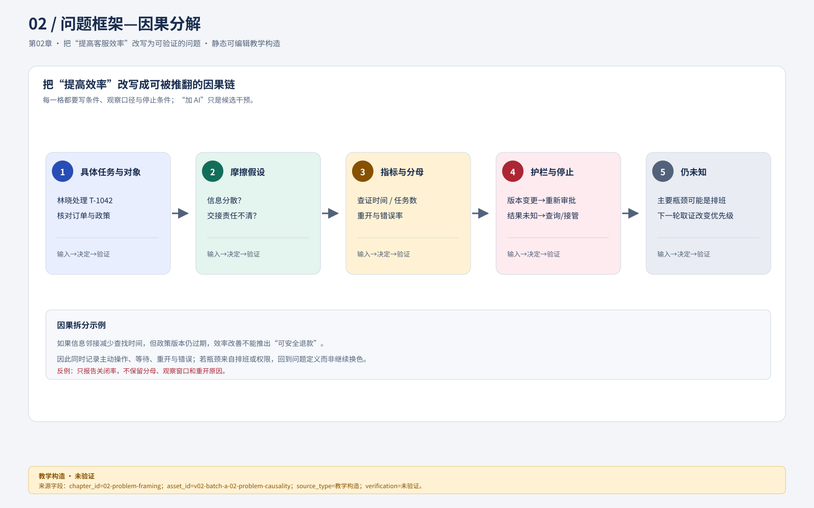
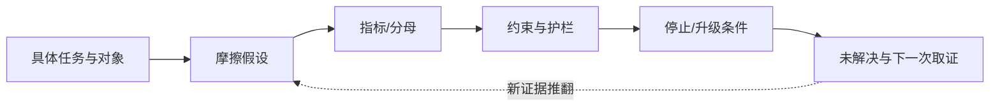

# 02 把“提高客服效率”改写为可验证的问题

“效率”不足以决定设计。只有把**谁在何种任务里受到什么阻碍、阻碍为何发生、哪些变量可改变、成功怎样辨认**写清楚，才知道应改界面、政策、排班还是数据。对澄明，本章先选择“客服在退款询问中定位依据并交给正确审批人”这一完整任务；它成立的条件是订单和已发布政策可查、角色责任明确。若真正瓶颈是无法联系到主管，重新排版不会自动消除等待。

## 一图看清：口号问题如何变成可验证链

**独立视觉资产记录：** `asset_id=v02-batch-a-02-problem-causality.svg`；设计师批次A交付，箭头表达论证依赖，不证明真实因果或效率提升。文字替代是“具体任务进入摩擦假设，再连接指标/分母、约束/护栏和停止条件；新证据可回头推翻假设并留下未知项”。图稿尚未完成浏览器重排、键盘、读屏或真实任务验证；关系在窄屏不可读时按编号链阅读并保留 `visual_downgrade`。

**对照图（教学构造，未验证真实效率）**

**图链记录：** `asset_id=01-workbench-before-after.svg`；来源为本教材 v0.2 `assets/DESIGN_HANDOFF.md`；左侧是刻意失败例，右侧是候选方案，二者不是同一时刻的运行截图。图只承担“信息结构与行动风险的差异”，不能证明效率提升、权限成立或退款已执行。

**文字替代：** 左侧把草稿、金额、发送、退款和关闭挤成同等动作，并把超时写成失败；右侧固定租户和工单身份，邻接来源与草稿，保留“效果未知”并只提供查询/接管。读者应沿“任务→判断→安全动作”检查每处改动，而不是按颜色判断好坏。若图在窄屏无法同时呈现左右关系，按“失败例四个断点→候选方案四个对应修复”分步阅读；这是 `visual_downgrade`，未完成浏览器重排、键盘、读屏或真实任务验证。

将问题写成链条：**任务对象 → 可改变的摩擦 → 指标与分母 → 约束/护栏 → 停止条件 → 仍未知**。链条中的每一格都要能被反例推翻；“加 AI”只是候选干预，不是起点。

这张图是可复演的教学结构，箭头不表示因果已经成立；真正的因果需要可比任务、观察窗口和原始记录。

## 用任务还原问题，不从AI能力倒推

给定合成输入：林晓收到Maya Chen的消息：“The outer box and cup arrived damaged. Can you refund the full amount?” 工单为T-1042，订单O-7819的教学结算为CNY 268.00；退款仍需核对政策P-07@v3、证据和权限。原页将订单详情、政策和草稿放在分离区域，管理者希望“处理更快”。这里既有用户需要，也有未经证实的解释。

把原诉求逐层展开：用户需对客户给出可负责的回复；当前替代方法是切换到订单、查政策、复制证据、询问主管；可能摩擦包括上下文丢失、来源过期、审批交接不清；可由设计改变的是对象关系、信息邻接、状态表达和可执行入口。政策内容错误、主管人数不足、退款网关无回执则需相应责任岗位解决。设计可以暴露它们、提供恢复流程，不能画一个“已处理”掩盖它们。

### 本章实际问题brief

| 字段 | 教学版本PB-02内容 |
| --- | --- |
| 主要使用者 | t-lotus客服林晓；协作角色为主管许然 |
| 触发 | 客户提出需核实政策和订单的退款询问 |
| 要完成的任务 | 对照O-7819与P-07@v3形成可审查回复；需退款时提交绑定版本的申请给许然 |
| 当前障碍假设 | 信息分散导致找错对象或遗漏依据；审批状态使客服不能判断下一责任人 |
| 本期可改变 | 同屏工作上下文、来源定位、草稿编辑与审批交接、错误恢复 |
| 本期不承诺 | AI自动批准；真实支付；取消即撤回；把教学数据解释成实际收益 |
| 依赖 | 订单/政策/权限服务提供可识别对象与版本；结果未知有查询或人工核对流程 |
| 反证 | 若观察表明主要时间花在拍照补证或等待排班，降低本方案优先级 |
| 决策人 | 产品负责人定范围；政策责任人定适用条件；设计师交两方案和取证理由 |

这不是填表结束。它改变了第一张稿应画什么：必须保留订单、政策、草稿、审批对象的关系，而不是先画一个泛用聊天框。信息位置只是干预，是否有价值还须评价。

## 分开四种“完成”，避免优化错误目标

| 结果口径 | 可观察条件 | 不能冒充它的信号 |
| --- | --- | --- |
| 草稿准备好 | 内容可编辑，来源身份与逐句支持待核/已核清楚 | 模型停止生成 |
| 审批已完成 | 许然批准R-81具体版本，权限与记录可查 | 客服按了申请按钮 |
| 退款效果确认 | 匹配R-81的有效外部结果 | 页面弹出绿色Toast |
| 客户问题解决 | 按约定窗口核对客户问题及后续记录 | 工单被关闭 |

本例的**合理停止**是：缺证据时保存草稿、告知下一责任人及所需材料；结果未知时等待核对；超出权限时交主管。合理停止不是失败，也不是成功。如果评价只奖励关闭工单，客服会受到尽快“关掉”的激励，即便客户问题仍在。

用一组小数据检验口径。教学旧方案A处理10张可比任务，关闭8张，其中3张重开；新方案B关闭9张，其中5张重开。若只看关闭率，B是90%对80%；若暂用“关闭后未重开”作有限代理，A为5/10、B为4/10。后者也不证明真实解决，因为“未重开”可能来自客户放弃。设计决定不能由一个漂亮百分比承担。应同时看关键错误、重开原因、主动操作时间、等待时间与客户结果，且保留分母和观察窗口。

## 把假设变成能推翻自己的取证问题

| 假设 | 若成立会观察到什么 | 可推翻的证据 | 当前动作 |
| --- | --- | --- | --- |
| H1 信息分散导致找错政策 | 用户在政策与草稿间切换，引用不同版本或漏看条件 | 能正确快速定位，主要困难在理解规则 | 观察当前任务并追问最后一次具体事件 |
| H2 不知道谁负责使交接停滞 | 用户重复私聊多人，申请没有下一责任人 | 负责人清楚，停滞来自无人值班 | 读交接轨迹，再决定是否改界面 |
| H3 AI草稿节省查证工作 | 可定位支持每个关键句，净编辑和查证负担减少 | 反复纠错超过手写，来源无法支撑 | 先测来源卡，不先承诺一键发送 |
| H4 批量分派降低重复操作 | 相似任务可一次选定、逐项返回结果 | 高比例异质任务需单独核对 | 测快照选择与异常理解 |

风险表不能只写“隐私、安全”。这里具体有：切租户后显示旧工单，影响跨租户隔离；草稿来源过期却显示已核验，影响错误建议；批准后改金额沿用旧批准，影响错误退款；窄屏隐藏币种，影响核对；键盘无法到达返回按钮，影响任务退出。每项都能成为反例，而不是项目末尾的合规装饰。

## 两个真可行方案如何选择

**方案F：先改固定分派与交接。** 给列表清楚的筛选、责任人、逐项批量结果和审批队列。它不依赖模型质量，适合H2/H4证据较强、政策内容治理尚未稳定时。代价是它不解决复杂政策理解，也未形成AI差异。

**方案K：先改政策查证与草稿。** 工单旁显示版本化来源与可编辑候选，关键句需逐项检查，再交退款审批。适合H1/H3被观察支持、来源可维护时。代价是增加核对工作、来源治理和状态复杂度；若只增加长答案，可能反而更慢。

在当前有限教学条件下，本书以F保证基本任务完整，同时用一个政策P-07做K的窄范围演示。不是两个都全做：限制在一种询问、一条政策和一条审批路径，不做自动批准、多渠道机器人或长期记忆。若真实取证发现查政策才是主要可改变成本，应调换投入顺序；若退款服务不能查询结果，仍保留冻结重发与人工核对，不能为MVP删除它。

## 失败复盘：平均时长下降为何可能是坏消息

事件顺序为：团队奖励“点击关闭耗时”→林晓遇复杂退款先关闭再私聊主管→仪表盘时间缩短→客户重开、审查者无法从工单看到决定依据。可观察信号是关闭与真实处理轨迹分离，重开原因集中为“未回应退款结果”。根因既有激励口径，也有界面把关闭放成唯一醒目动作。

修复要两层同时进行：产品修改完成定义，区分等待客户、待审批、待核对与已解决；设计把下一责任人和缺失证据放到状态区，关闭前要求选择符合事实的结束原因。原例复验需要重新走复杂任务：客服能否选择合理停止，主管能否从记录继续处理，统计能否保留等待而不把它混入主动操作时间。仅让关闭按钮变小不会修复统计和责任断裂。

## 分层练习与参考解法

**基础：** 把“我们需要AI自动回答来提高效率”重写为不预设方案的问题。参考稿：“t-lotus客服处理退款询问时，需要在当前订单和适用政策之间建立可核对的依据，并判断是否交审批；我们尚不知道主要负担来自查找、理解、重复输入还是等待，因此先观察完整任务，再比较同屏查证和固定交接。”这里保留用户、触发、任务和未知，把AI降为待比较的候选。

**迁移：** 如果真实观察表明八成等待来自许然离线，怎样改当前选择？参考解法：先把主动时间与等待分开，别将“缩短总时长”全归设计；向产品/运营交接排班或代理审批的政策问题。界面仍可显示预计责任人与升级路径、保存现场、异步返回，但不承诺审批加速。在获得合法代理规则前，不能给林晓临时批准按钮。若后续发现反复找证据也显著，保留K的窄试点；两个问题不互相排除。

**综合：** 预算减半，但主管要求降低错误退款、客服要求少一步。参考解法：保留一条完整人工工作流，删除多政策生成、自动分派预测和装饰动效；订单/金额/币种/理由/版本确认、权限重核、效果未知、人工核对不能删除。可把重复确认合并为同一摘要内的明确动作，而非取消确认。责任人记录“更少步数”服从“正确批准对象”的约束；用一个旧版批准后改金额的反例检验。若服务连版本都不提供，当前方案只能显示不可提交并交工程补能力，不能假定UI自己可靠地冻结了服务器对象。

### 基础补学

“指标”是按口径计算的观察量；“代理指标”只是暂时代替真正结果的量；“护栏”是优化主指标时不得破坏的结果；“范围”决定本期承诺；“不做”用于保护完整任务，不能删去剩余任务不可缺的失败恢复。下一章把H1—H4写成可执行研究计划。
