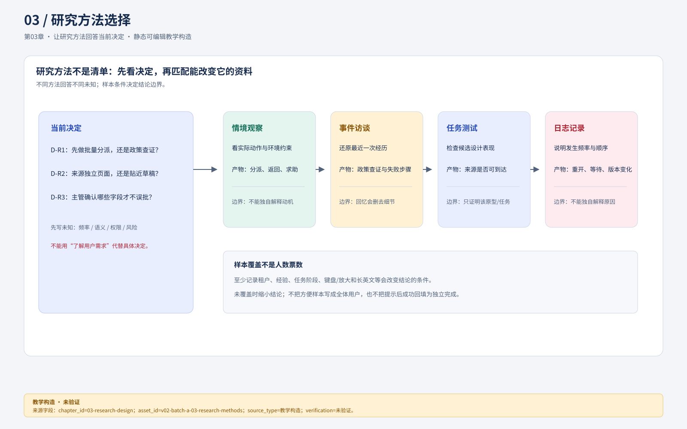
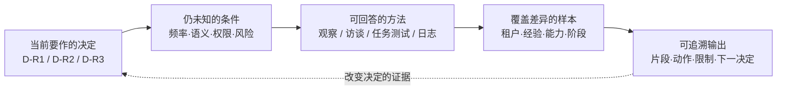

# 03 让研究方法回答当前决定

研究设计的核心不是“做几场访谈”，而是**哪一个决定尚无依据、什么观察会改变它、如何取得不会被问题本身污染的证据**。访谈适合还原经历与解释；情境观察适合看实际操作和环境约束；任务测试适合检查特定设计；日志能说明发生频率与顺序，却不能独自解释动机。方法可以组合，但每种资料承担的推断必须清楚。

本章为澄明设计一轮研究，并提供完整合成记录供第04章分析。这里没有招募、访问或录制真实参与者，所示片段不能写进真实研究成果。将来执行时须由有授权的研究人员取得同意、适当去标识并保管资料。

## 先写决定，再选方法

### 视觉入口：决定—未知—方法—样本—输出



图注：`asset_id=v02-batch-a-03-research-methods.svg`，来源为设计师批次A交付的可编辑 SVG；图内示例是教学合成研究计划，不是实际招募、访谈、日志或用户结果。文字替代为：“决定连接到未知，未知约束方法，方法产生带限制的输出；输出可回到决定并改变下一步，样本覆盖条件位于方法与输出之间。”资产已存在且可从本章打开；浏览器、读屏、窄屏、灰度和真实研究效果尚未验证，保留 `visual_downgrade`。



**读图任务。** 从左到右检查一条研究链：若“输出”不能改变当前决定，回到“未知”重写问题；若样本没有覆盖会改变结论的条件，不能靠增加访谈数量补救。上方 SVG 是设计师交付的主图，Mermaid 是可复制的补充草图；两者都是教学构造，保留 `visual_downgrade` 以标记尚未完成浏览器、读屏、窄屏和真实研究验证。图中的箭头表示论证依赖，不表示必然的时间顺序；实际研究可在方法与样本之间迭代。

图例：实线表示需要先明确的选择关系；虚线表示新证据可能回到决定；节点内的斜杠表示可替代方法，不是四个必做阶段。文字替代为：“决定连接到未知，未知选择方法，方法约束样本，样本产生带限制的输出，输出可反过来改变决定。”

当前待决D-R1是“先做批量分派，还是先做政策查证”；D-R2是“来源应留在独立页面，还是贴近草稿”；D-R3是“主管确认哪些字段才不误批”。把“了解用户需求”缩成这三个决定，才能判断一轮研究是否产生足够信息。

| 未知 | 观察/提问 | 方法及产物 | 推断限制 |
| --- | --- | --- | --- |
| 分派重复动作是否集中且同质 | 最近一批工单怎样交给同事，哪些不能一起交 | 当前流程观察、逐动作记录 | 一天不能代表旺季 |
| 找政策是查找难还是理解难 | 请重建最近一次退款查证，指出最终采用的原文 | 事件访谈+材料走查 | 回忆可能删去失败步骤 |
| 草稿旁来源是否帮助核对 | 在给定T-1042中说明哪句可以发、依据在哪里 | 中保真任务测试 | 只证明这个原型与任务的表现 |
| 主管为何拒批 | 展示最近一次退回的申请，说明缺失 | 主管访谈+去标识记录 | 不能以主管观点替代客服行为 |

[GOV.UK的研究规划指南](https://www.gov.uk/service-manual/user-research/plan-user-research-for-your-service)强调围绕团队需要知道的问题安排研究，并按阶段和所需信息选活动。这里据此采用“决定—未知—方法”表，不把某种固定研究流程当成所有项目的必经仪式。

## 采样是覆盖机制，不是收集同意票

### 视觉降级：样本条件覆盖表

本章没有专门的样本覆盖图稿，先用下表作为 `visual_downgrade`。它表达“条件→可能改变的结论”，不把人数画成代表性比例；待设计师提供可审阅覆盖图后，需保留本表的条件和缺口。

| 条件差异 | 可能改变的结论 | 当前计划 | 未覆盖时的限制 |
| --- | --- | --- | --- |
| 熟练客服 / 新客服 | 快捷方式与结构理解是否不同 | t-lotus 各 2/1 | 不能归因于全体客服 |
| 新询问 / 进行中工单 | 自动分派是否会破坏归属 | t-maple 各类任务 | 不能推出统一分派规则 |
| 键盘、放大、长英文 | 来源入口和阅读密度是否可达 | 各 1 个条件，允许重叠 | 不等于无障碍合规 |
| 两个租户政策 | 共同流程与本店政策边界 | t-lotus / t-maple | 不能估计市场分布 |

读表时先看“可能改变的结论”，再看“当前计划”；如果只能招募单一条件，应缩小结论而不是把缺口隐藏在平均数里。

教学招募计划拟8位，而非已经访谈8位：t-lotus熟练客服2、新客服1、主管1；t-maple客服2、主管1；跨租户管理员1。客服中计划包含一位主要使用键盘、一位习惯放大阅读、一位处理英语长消息者。这些条件可重叠，不把使用辅助技术当单一人格标签。真实执行不应要求参与者公开诊断，只询问参与和材料所需的合理安排。

为何这样取样？熟练客服可能用个人快捷方式补偿产品缺陷，新人更容易暴露结构理解；两个租户可区分“共同流程”与“本店政策”；主管能解释审批，但不能证明前线负担；管理员能解释权限更改，却未必代表每天处理工单者。这是为机制差异取样，不是为了用8人估计市场比例。

排除条件也要记：不招研究方案作者，不以直属领导在场为条件，不展示真实客户支付信息，不要求参与者执行真实退款。若最终只能接触t-lotus熟练客服，就把跨租户、新人和辅助技术结论列为缺口，不能把方便样本写成“全体用户需求”。

## 可以直接执行的中立脚本

### 视觉降级：执行与反馈的分支

```text
[中立任务] --记录无提示表现--> [观察/原话/动作]
      |                         |
      +--统一一级提示-----------> [提示后恢复]
                                  |
                         分开报告：发现性 ≠ 可恢复性
```

这是教学构造的文字流程，标记 `visual_downgrade`；没有浏览器、读屏或真实参与者证据。它提醒作者不能把提示后的成功回填为独立完成，也不能用脚本图替代同意、停止和资料保管说明。

以下为脚本，不是访问实录。开场：“我们研究工具怎样支持工作，不考核你的表现。今天使用教学数据，不会发生真实退款。你可以跳过问题或停止；是否允许记录操作和音频？资料的保存期限、接收人和退出方式按本次同意说明执行。”若参与者不同意录音，改笔记并说明丢失逐字细节，不暗中记录。

1. **事件回放，约10分钟。** “请选最近一件需要查政策的退款询问，从收到它开始讲。你先看了什么？哪一步让你停下来？最后如何知道可以继续？”在参与者说“总是”时追问“能用刚才那一件举例吗”；不问“这个页面是不是太乱”。
2. **当前材料走查，约10分钟。** “请指出你当时依据的订单和政策。如果找不到，按你平时的方法继续。”研究员记录入口、犹豫、返回、求助；用户认为某政策适用不等于政策事实正确，另交内容责任者核对。
3. **教学任务，约12分钟。** “客户Maya想知道损坏杯子是否能退款。请检查T-1042，准备你愿意提交主管的材料。完成后告诉我现在已发生什么、还未发生什么。”不把操作步骤写进任务，不使用界面按钮名称，不催促快一点。
4. **异常任务，约8分钟。** 主持人展示预设条件：“申请金额变更，主管仍看旧页面。”请参与者继续。仅说明任务环境，不提示“请重新审批”。若卡住，先记录无提示结果，再提供统一一级提示“还有哪些信息会影响你继续”，标记提示后表现。
5. **反事实回看，约5分钟。** “若不能使用这个工具，你会怎样完成？刚才你最不愿自动交给系统的是哪一步？何种证据会让你改变看法？”这能发现替代方案和信任条件，而非只收满意度。

[GOV.UK的深度访谈指南](https://www.gov.uk/service-manual/user-research/using-in-depth-interviews)支持使用开放问题、围绕具体经历追问，并留意研究者对回答的影响。本脚本中的中立任务和事件追问是本案例设计；它们不能消除全部社会期许偏差，仍需对照行为。

## 六段可读的合成原始记录

每段区分`说`、`做`与`主持`。编号稳定，下一章的编码必须引用编号，不能只保留主题结论。原始片段和编码另存于[研究工件包](../exercises/03-04-research-evidence.md)。

**S01，林晓，t-lotus熟练客服，当前流程。** 09:02:10 说：“同一批损坏单我会一起转，但要先看有没有已经退过。”09:02:24 做：选三单后打开T-1042，返回列表时三项选择消失。09:02:41 说：“那我又得记是哪三单。”主持未提示。观察到的是选择丢失与重建行为，不是批量功能必定有效。

**S02，教学新人客服，t-lotus。** 09:11:03 说：“我怕选错，宁愿一单一单看。”09:11:18 做：在订单O-7819停留，查找付款币种；看到`¥268`后问“这是人民币还是日元？”09:11:43 主持答：“请按页面现有信息决定能否继续。”参与者停止提交，写下“需核币种”。这个停止对风险任务是合理反应，不能按超时失败简单惩罚。

**S03，许然，t-lotus主管。** 10:04:08 说：“按钮叫批准，我理解是放行，不是已经到账。”10:04:30 做：在旧申请v3上停留；主持切入合成变更，金额从CNY 238.00改为268.00，当前为v4。10:04:44 说：“我不知道它改过，刚才那份凭什么继续让我批？”问题是批准内容身份，不是再加一次无内容的确认。

**S04，t-maple客服。** 10:22:02 说：“自动分派对我们不合适，售后会跟客户很久。”10:22:29 做：按客户历史找出两张关联工单，然后说：“新询问可以进队列，进行中的要还给原客服。”这是生命周期条件，不能只编码成反对自动化。

**S05，林晓，来源原型任务。** 11:03:12 做：在Draft-17句子“将在24小时内到账”旁打开P-07@v3。11:03:36 说：“这里写批准后的处理安排，没有保证到账时间。”11:03:48 做：删除该句，改成“我们会在审批后通知处理进度”。这里只能记为合成任务中的支持核对行为，不证明实际政策内容或真实效果。

**S06，教学键盘使用者，t-maple。** 11:21:01 做：按Tab穿过导航、筛选和12条工单，才到草稿来源入口。11:21:46 说：“来源在旁边，但我每次都要绕一圈。”11:22:05 做：用浏览器查找`P-07`定位可见文字。截图中的空间邻近没有保证键盘可达效率；需要读序、快捷跳转或合理组块。

这些片段故意包含冲突：熟练客服要批量、新人要逐条；有人赞成自动分派而另一个租户反对；来源视觉上已贴近，键盘路径仍很长。研究的价值正在于揭示条件，不是平均出一个“用户想要批量”的口号。

## 分析前的质量控制

记录至少保留参与者代号与条件、任务版本、时间、动作、原话、提示级别、异常注入和研究者解释栏。若只有“用户很困惑”而无原话或动作，回看录制；无法回看则标记解释待证。提示前、提示后结果分开，不能把研究员教学后的成功算成独立完成。沉默不一定是不懂，也可能在阅读或被环境打断，必须结合行为和追问。

两个可行方案之间，本轮若能接触现有流程，就先观察再用小原型检查；若只能远程展示原型，任务测试仍可推进D-R2/D-R3，但不能结论当前工作的真实时间分布。对调查问卷也一样：只有已有清晰选项和合适抽样才能测分布，不能用一句“你想要AI吗”探索复杂行为。

## 分层练习与参考解法

**基础：** 将“你是不是觉得审批弹窗很麻烦？”改成中立问题。参考：“请回想最近一次审批，哪些信息让你决定继续或退回？如果刚才停顿了，请说说在找什么。”它不预设麻烦，也允许参与者认为确认有用。仍须观察实际操作，不能把流畅讲述当真实熟练度。

**迁移：** 只能研究4人，保留谁？参考选择取决于待决：若主决定是来源卡与批准版本，选熟练客服、新客服、主管和主要键盘使用者，保留跨租户样本缺口；若主决定是自动分派，至少覆盖两个租户和进行中归属差异，不能全选熟练t-lotus客服。人数缩小要缩小结论，不是把每个人当两倍样本。

**综合：** 主管要求主持人在每步教参与者“正确用法”以获得好反馈。参考处理：说明教学测试与可用性测试可分别做；先按固定无提示脚本记录发现性，再给统一提示观察可恢复性；若目标本就是培训后工作流，应明确先训后测并记录培训内容。两者都可行，但结果不可混算。负责人若拒绝保留无提示记录，应在研究报告说明方法被改变，不能发布“无需培训也可使用”的结论。

### 基础补学

访谈不是用户投票；观察不是偷看；任务测试不是证明用户足够聪明；抽样也不是凑齐人数。用本章六段记录练习区分可见事件与解释，再读第04章怎样将冲突转成设计决定。
