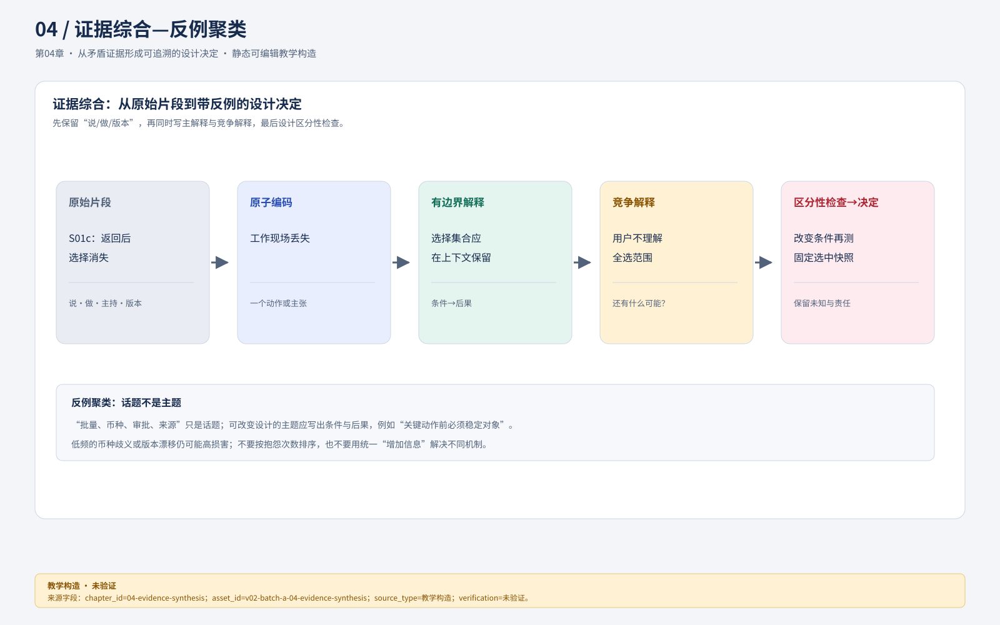
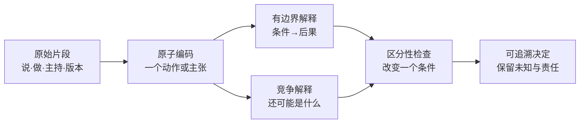
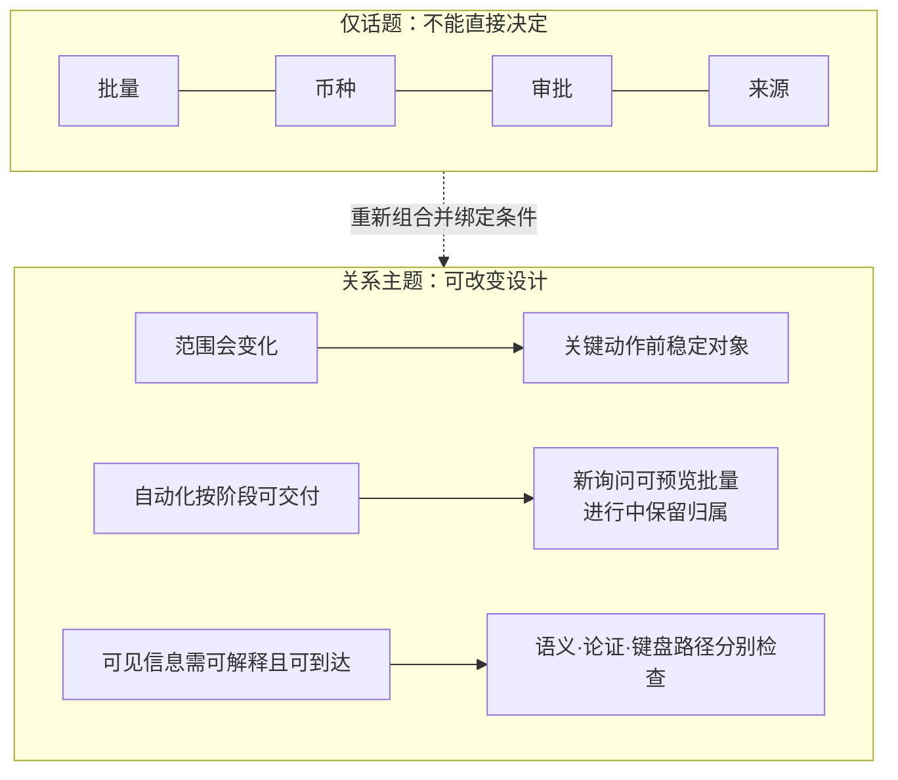

# 04 从矛盾证据形成可追溯的设计决定

分析研究资料不是把便利贴按关键词归类。它要把**观察—解释—竞争解释—设计决定—下一轮检查**连起来，并保留会推翻主结论的资料。同一句“我想自动分派”，可能是在说减少重复点击，也可能是在说想有人替自己承担选择责任；这两种机制需要不同设计。

本章只分析第03章S01—S06合成片段，不将它们包装为真人发现。完整工件见[研究证据与编码](../exercises/03-04-research-evidence.md)。[GOV.UK的分析指南](https://www.gov.uk/service-manual/user-research/analyse-a-research-session)区分观察、发现和行动，并建议保留观察依据、协作分析。本章采用这一分离，但优先级和假设均是澄明的教学决定。

## 先原子化，再编码，防止一个标签吞掉因果

### 概念图：片段—编码—解释—竞争解释

图注：`asset_id=v02-batch-a-04-evidence-synthesis.svg`，来源为设计师批次A交付的可编辑 SVG；图示 S01–S06 的合成记录链，不是真人研究或设计效果证据。文字替代为：“原始片段被拆成原子编码，编码同时形成有边界解释和竞争解释，经改变条件的区分性检查后，才可形成保留未知与责任的设计决定。”资产已存在且可从本章打开；浏览器、读屏、窄屏、灰度和真实研究效果尚未验证，保留 `visual_downgrade`。

**读图任务。** 沿一条片段向右追踪：编码必须仍能回到原话和动作；解释与竞争解释都要进入区分性检查，检查结果才可支持决定。上方 SVG 是设计师交付的主图，Mermaid 是可复制的补充草图；两者都是教学构造，保留 `visual_downgrade` 以标记尚未完成浏览器、读屏、窄屏和真实研究验证。箭头表达分析依赖，不表示因果已被真实研究证明。文字替代为：“原始片段产生原子编码，编码同时支持有边界解释和竞争解释，两者经改变条件的检查后形成带未知项的决定。”

S01包含三个不同单元：S01a“同类单愿意一起转”；S01b“先核是否已退”；S01c“开详情返回后选择丢失”。如果整段只标“批量需求”，会抹掉前置核对与现场保留。一次编码应指向一个可解释动作或原话，而不是参与者的性格。

| 单元 | 原始依据 | 初始编码 | 有边界的解释 | 竞争解释 |
| --- | --- | --- | --- | --- |
| S01b | “先看有没有已经退过” | 逐项风险检查 | 批量前需可核对的退款状态 | 也可能因当前状态不可信才逐项打开 |
| S01c | 返回后三项选择消失 | 工作现场丢失 | 选择集合应在同一上下文保留 | 用户也可能不理解全选范围 |
| S02 | 看到¥268问币种并停止 | 金额语义不明 | 金额应显示CNY而非只靠符号 | 新人业务知识缺口可能同时存在 |
| S03 | 旧v3仍可批当前v4 | 审批对象不稳定 | 确认需绑定版本并呈现变化 | 主管是否愿意读变化尚待验证 |
| S04 | 新询问可排队，进行中给原客服 | 生命周期分派规则 | 不同阶段采用不同归属策略 | 租户文化也可能影响接受度 |
| S05 | 原文不支持24小时到账 | 主张与依据脱节 | 逐句核支持，不能总标已核验 | 任务特意放错句，无法估频率 |
| S06 | 来源近却Tab路径长 | 空间邻近≠交互可达 | 分组与跳转需含键盘路径 | 熟悉快捷方式后路径可能不同 |

编码不是最后结论。若另一位分析者认为S02应标“币种知识不足”，不要投票删除异议。两种解释可以并存，再设计区分性检查：向熟练客服展示同样符号；向新人展示CNY 268.00；观察识别币种是否改变。没有这一步，团队可能错误地把训练问题全当UI问题，或把UI缺陷全归给新人。

## 从代码到主题，主题必须有关系命题

### 对照图：话题聚类不能替代关系命题

图前问题：“这组标签说出了什么条件和后果？”图后答案必须指出至少一个反例和下一次取证。该对照图是教学构造，保留 `visual_downgrade`；不把主题数量或箭头当作证据强度，也不替代 S01—S06 的逐条引用。

“批量、币种、审批、来源”只是话题。能指导设计的主题应该说明条件和后果：

- **T-A：工作范围会变化，因此关键动作前必须稳定对象。** S01c的选中集合、S03的申请版本都是对象漂移；前者是界面现场，后者涉及批准效力，后果不可混同。
- **T-B：用户不是拒绝自动化，而是在区分可交给系统的阶段。** S01愿意批量但先核风险，S04允许新询问排队却保护原归属，支持“有条件批量”，不支持无条件自动分派。
- **T-C：可见信息只有能解释和到达才是可用证据。** S02币种不明、S05来源不支持、S06焦点路径长分别是语义、论证和可达性问题，不能用统一“增加信息”解决。

用三个主题形成有条件的旅程：进入队列→确定当前租户及选择范围→逐项查风险→提出分派/退款→核当前版本→交接→等待结果。旅程每步同时列行为、障碍和下一责任人。不要画一条没有原始资料支持的情绪曲线，再把“焦虑3分”当测量事实。

## 不用虚构人格替代具体条件

本案例更有用的行为画像是两种工作模式：**连续处理者**面对多张相似新单，关注快速筛选、稳定选中集合和少重复输入；**关系维护者**追踪已有客户，关注历史归属、关联工单和不能被自动重派。一个客服可在不同时间进入两种模式。它们来自S01/S04的条件对比，不需要虚构年龄、家庭和爱好。

若用JTBD表述，可写：“当我把一批待处理询问交给合适同事时，希望在确认前看清每项当前归属和风险，并在查看详情后保留选择，以便减少重建工作且不误派。”这比“用户想要一键分派”多出触发、控制条件和结果。它仍是待真实研究检验的合成解释，不能作为真实市场需求。

## 优先级考虑损害、覆盖与证据，不按抱怨次数排序

六段材料中只有一次币种歧义，却可能导致错误批准；只有一次版本漂移，却会让批准失效。频次低不等于优先级低。先将问题分为“阻断正确完成”“增加成本”“增加学习负担”，再看影响范围、复现条件、修复依赖与证据强弱。不要用任意权重乘一个看似科学的分数隐藏价值判断。

| 决定ID | 采纳变化 | 依据与反证 | 为什么现在做 | 不采取的替代 |
| --- | --- | --- | --- | --- |
| D04-1 | 选中快照固定，详情返回保留 | S01c；尚不知其他人是否也丢失 | 对批量正确性和重复工作都有影响 | 不把新进入列表的工单自动加入选择 |
| D04-2 | 金额显示CNY 268.00，批准绑定v4 | S02/S03；新人培训也可能必要 | 避免批准对象不可辨 | 不仅增加“确定吗”弹窗 |
| D04-3 | 逐句来源核对，未支持句单列 | S05；人工成本需测试 | 防止来源链接被误作全面背书 | 不用整体绿色“AI已验证” |
| D04-4 | 保留按原归属工作模式 | S04与S01条件差异 | 跨租户不应强推同一自动分派 | 不简单取消全部批量能力 |
| D04-5 | 来源分组加入跳转及回焦说明 | S06；实际实现尚未测试 | 视觉邻近之外还有任务路径 | 不仅再把来源移近几像素 |

“为什么现在做”不是宣称已有收益，而是解释在有限证据下怎样降低风险与取得下一步信息。实现依赖和验证负担若很大，也可先做更小的可审阅原型。

## 让分析真正改变设计

原方案中，一个大“AI处理”按钮生成完整回复并自动勾选整页。分析后，工作台左侧保留租户、筛选和固定选中数；中间逐条草稿显示来源支持；右侧订单金额与当前退款版本持续可见。批量入口明确“已选10项”，进行中工单可因归属规则被排除；批准按钮显示“批准R-81 v4”，不是“完成”。这几个变化分别对应D04-1—5，不能把设计改动总结成“更清爽”。

图注：`asset_id=02-ticket-ai-evidence.svg`，来源为本教材现有资产，版本与状态见 [`source-index.md`](../source-index.md) 和资产内置说明；它用于展示“来源邻接、对象身份和逐条支持”的候选视觉关系，不是 S01—S06 的研究结果，也不是可操作产品。文字替代为：“工作台把工单身份、草稿句子和逐条依据并置；来源支持仍需逐句判断，静态图不证明键盘路径或用户理解。”当前未有该图在浏览器、读屏、灰度和真实任务中的证据，保留 `visual_downgrade`。

图是当前合成证据推动的设计候选。它的可读布局不能反过来证明研究假设正确。下一轮要让不同工作模式、键盘路径和长文本任务实际检验：选择能否保留、能否发现不支持句、是否知道批准后尚未到账。

## 失败分析：主流意见如何吞掉严重反例

假设工作坊把S01“想批量”写了四张便笺，S04“保留原客服”只有一张，于是投票定“自动重派所有工单”。问题不是少数没有服从多数，而是重复笔记被误当独立样本，且生命周期条件被删除。可观察信号是决定无法指向“进行中工单也应重派”的任何原始依据。

修复时先合并重复观察，保留S04的完整条件；将待决改为“哪些阶段可自动分派”；设计新询问/进行中两组任务比较，并让参与者说明归属变化的后果。若新证据显示t-maple确需人工确认，就形成租户策略，而非把差异藏进一个不可解释的偏好开关。原例复验应特别检查进行中关联工单，不能只测批量操作成功。

## 分层练习与完整参考分析

**基础：** 将S05推到设计决定。参考链：观察是林晓找到原文但无法从中支持“24小时到账”；编码为主张—依据脱节；解释是来源身份不等于语义支持；决定是每句保留支持状态、去掉未支持承诺、让人工编辑留痕；验证任务是在含支持与不支持句的草稿里让参与者决定能发什么。不能推断“AI准确率低”或“这个工具一定能降低错发率”，因为未测总体分布。

**迁移：** 另一研究者认为S06只需培训快捷键。参考解法：保留两解释，设计同一内容两条进入路径，先观察未培训键盘用户，再在统一培训后观察重复任务；记录按键序列、绕行和关键依据遗漏。若培训改善但首次任务仍高成本，采用合理结构与可发现跳转，不把培训当界面可达性的替代。是否增加快捷键还取决于频率和冲突，不能单一片段决定。

**综合：** 写一份反对“全面自动分派”的决定备忘录。参考正文：“现有S01支持同质新单批量，S04反对进行中客户关系被转走，两者不矛盾。建议本期只对新询问做可预览批量，将原归属冲突列为逐项排除原因；不自动改派进行中工单。若之后的跨租户观察证明原归属可安全替换，再调整规则。当前缺真实频率和跨周期结果，不能用本轮合成片段估收益。”备忘录让团队仍能行动，同时明确何种证据会改变决定。

### 基础补学

代码是给资料的标签；主题是关于关系的解释；洞察是会改变决定的有条件发现；决定还包含成本和责任。它们不是同一层。完成本章后，每个设计变化都应能沿D→T→S回到材料，下一章再把变化落实成对象与导航。
