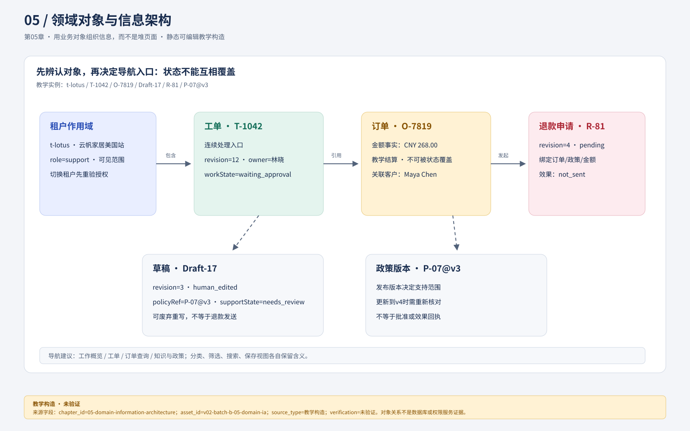
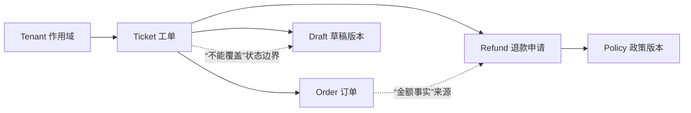
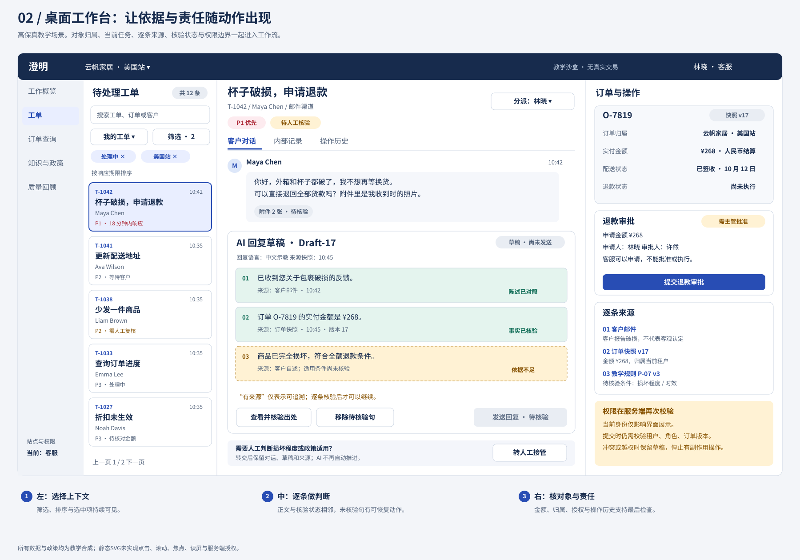
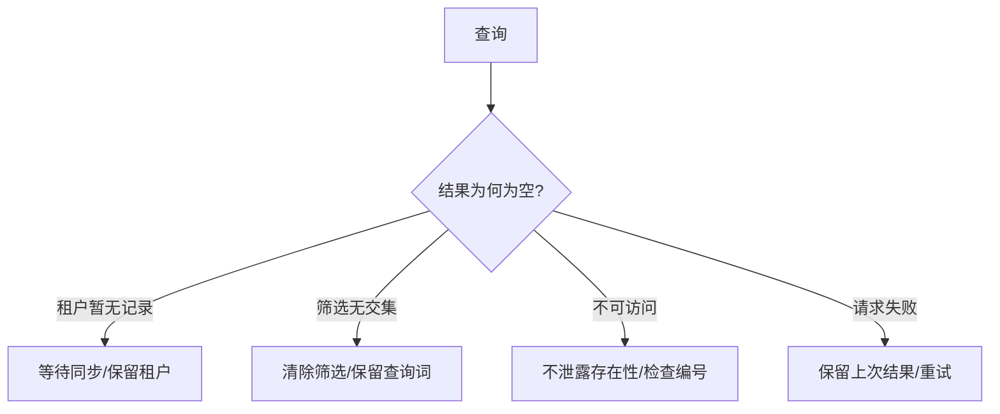
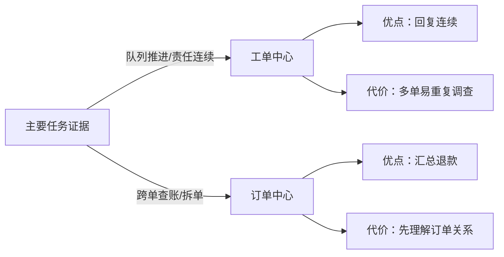

# 05 用业务对象组织信息，而不是堆页面

信息架构首先要帮助人分清“正在处理谁的哪件事”，其次才是把菜单排整齐。澄明应以工单作为客服连续工作的入口，同时允许从订单调查关联工单；退款拥有独立生命周期，政策拥有发布版本，不能把它们都压缩为一个“处理状态”。这个选择适用于客服以队列推进任务的场景；若主要工作是跨订单查账，订单或客户可能成为更好的主入口。



**核心关系图记录。** `asset_id=v02-batch-b-05-domain-ia.svg`；source 为设计师批次 B 交付的可编辑 SVG（v0.2 资产目录）；短替代文本是“租户限定工单、订单、草稿、退款和政策版本的关系与状态边界”；长替代文本是“图从左到右连接 t-lotus、T-1042、O-7819 与 R-81，并在下方连接 Draft-17 与 P-07@v3，标出金额事实、版本和效果不能互相覆盖”。图中对象、金额、角色和状态均为教学构造；SVG 为静态设计，尚未完成浏览器、760px/窄屏、键盘、读屏、灰度或真人理解验证，不能证明数据库或权限已实现（`visual_downgrade`）。

**本章补充图与降级说明（`visual_downgrade`）。** 课程要求先用对象关系图回答“什么对象彼此关联、哪些状态不能互相覆盖”。上方批次 B SVG 承担首要对象关系；下图 Mermaid 作为可复演的补充，进一步表达对象→状态边界，不能当作数据库、权限服务或真人研究证据。后文复用的 `02-ticket-ai-evidence.svg` 和 `07-edge-state-board.svg` 各自只回答一个局部问题，并在图注中保留来源与未验证边界。



文字替代：租户限定可见范围；工单连接订单、草稿和退款申请；退款引用政策版本；每条虚线表示来源或边界关系，不表示对象已在系统中实现。图为教学构造/未验证（`visual_downgrade`）。

## 从一个任务抽出稳定对象

**关系图读法（`visual_downgrade`）。** 本节的核心不是三栏页面，而是对象可独立变化。先沿“租户→工单→订单/草稿/退款→政策”的实线读关系，再用表格核对身份、版本和状态；没有专门对象关系资产，因此以编号关系和下表补足。补图条件：设计师交付专门对象关系图后，再由 QA 核桌面、760px、窄屏和非颜色编码。

林晓打开T-1042不是只读一段聊天。她要知道它属于t-lotus、客户是Maya Chen、关联O-7819、参考P-07@v3、当前正在编辑Draft-17，并可能创建R-81。各对象的生命周期不同：工单可以在等待客户时保持打开；草稿可以废弃重写；政策可发布v4；R-81即使完成，工单仍可能有后续问题。

| 对象 | 身份与必要字段 | 关系 | 用户需要辨认的变化 |
| --- | --- | --- | --- |
| 租户 | tenantId、显示名、可访问角色 | 包含本域工单/订单/政策 | t-lotus切至t-maple不能沿用旧对象 |
| 工单 | ticketId、tenantId、revision、负责人、工作状态 | 引用客户与订单，可有多份草稿/申请 | 改派、等待、关闭、重开 |
| 订单 | orderId、tenantId、金额/币种、商品项 | 被工单引用 | 部分退款不能改写原交易金额 |
| 政策版本 | policyId、version、发布/过期状态、正文范围 | 支持或不支持具体主张 | v3引用不能自动变成v4已核 |
| 草稿版本 | draftId、revision、作者、输入修订、支持记录 | 属于一个工单和租户 | 人工编辑与生成不可相互覆盖 |
| 退款申请 | refundId、revision、orderId、金额/币种、理由、政策版本 | 由工单发起，主管批准其版本 | 申请、批准、发送与效果不同 |

领域模型是设计协作模型，不代表已实现的数据库。它能被审查的价值在于：同名字段不再具有模糊含义。`status=done`必须被追问是工单关闭、草稿发送，还是退款确认成功。

## 一份可直接核对的对象实例

下面是教学合同，不是现有接口格式。它显式保留关系，避免页面靠复制文本猜对象。

```json
{
  "scope": {"tenantId": "t-lotus", "label": "云帆家居·美国站", "role": "support"},
  "ticket": {"id": "T-1042", "revision": 12, "customer": "Maya Chen", "owner": "林晓", "workState": "waiting_approval", "orderId": "O-7819"},
  "order": {"id": "O-7819", "currency": "CNY", "amount": "268.00", "amountMeaning": "教学结算"},
  "draft": {"id": "Draft-17", "revision": 3, "author": "human_edited", "policyRef": "P-07@v3", "supportState": "needs_review"},
  "refund": {"id": "R-81", "revision": 4, "orderId": "O-7819", "currency": "CNY", "amount": "268.00", "approvalState": "pending", "effectState": "not_sent"}
}
```

这里工单等待审批，但草稿仍待核，退款未发送；界面必须允许这三个事实并存。若把`waiting_approval`直接显示成“快完成了”，会让人误以为不再需要核对草稿。

## 导航、筛选、搜索和保存视图各自解决什么

主导航给稳定任务域：“工作概览、工单、订单查询、知识与政策、质量回顾”；低频的成员/权限/配置另放管理区。主导航不跟着每份新草稿增长，也不把数据库每张表都变成菜单。

进入工单域后，**分类**区分我的、未分派、待我审批；**筛选**缩小当前集合，如工作状态、渠道、负责人；**排序**决定集合的呈现顺序；**搜索**按已知标识或文字寻找对象；**保存视图**保存本租户的一组筛选与排序。它们应能组合，但不能互相偷偷替代：输入T-1042不应无提示切换租户，保存“退款待批”也不应永久复制一批当时的工单。

一个具体视图合同是：`tenant=t-lotus; type=tickets; filter={workState:waiting_approval, owner:me}; sort=responseDeadline; selectedIds=[T-1042,T-1045]`。筛选结果是动态集合，选中项却是明确快照。列表刷新可以增加结果，不能自动把新行加入此前“选中2项”的动作范围。



**图注与资产记录。** `asset_id=02-ticket-ai-evidence.svg`；来源为本教材现有静态 SVG，设计交接与版本见 [`source-index.md`](../source-index.md) 和 [`assets/DESIGN_HANDOFF.md`](../assets/DESIGN_HANDOFF.md)。短替代文本是“左侧工单入口、中间草稿、右侧逐条依据与责任”；长替代文本是“从左到右选择 T-1042，查看 Draft-17 与政策 P-07@v3 的依据，并保留退款需批准/未执行事实”。该图是教学构造/静态设计/未验证：不证明三栏是普适 IA、权限已执行或用户效率已提升；窄屏或读屏无法保持邻接时按‘入口→对象→证据→责任’编号阅读（`visual_downgrade`）。

图左侧负责选择，中间负责当前任务，右侧负责对象事实和责任。这样布置不是普适三栏模板：它来自连续处理任务需要保持列表位置、回复内容需要足够宽度、订单与政策需要同步核对的条件。若窄屏承载不了，应按任务顺序重排，而不是缩小每栏字体。

## 无结果不是只有一种原因

**原因—恢复流程（`visual_downgrade`）。** 本节没有专门的无结果状态图，先用文字流程把“空集合、不可访问和请求失败”分开；补图条件是交付可审阅的无结果/权限状态板，并复验每条恢复动作。



文字替代：查询先分流到四种原因，每种原因对应不同恢复动作；“请求失败”不能伪装成零记录。图为教学构造/未验证。

“没有工单”可能意味着本租户确实为空、筛选没有交集、输入不存在、权限已变化或请求没成功。这些情况下一步不同。

| 情形 | 显示与动作 | 保留内容 |
| --- | --- | --- |
| 本租户暂无记录 | “当前站点暂无工单”；说明可等待同步 | 租户和查询上下文 |
| 筛选零结果 | “没有符合‘待批+我的’的工单”；清除单项或全部筛选 | 搜索词与可见筛选条 |
| 标识不在可访问范围 | “在当前可访问范围找不到该记录”；可检查编号或切换获准站点 | 编号；不泄露其他租户是否存在 |
| 请求失败 | “列表未更新，展示的是上次结果”；重试读取 | 上次更新时间；不假装零工单 |
| 权限收回 | 关闭受限正文，解释当前访问变化 | 非敏感定位与恢复入口 |

区分这些状态的目的不是增加提示数量，而是让恢复动作针对原因。按钮“刷新”不能修复不适用筛选，按钮“清空”也不能修复服务不可用。

## 跨租户与深链接的完整轨迹

**边界图复用说明。** 本节复用现有 `07-edge-state-board.svg` 的租户、迟到响应和权限边界示例；它不是本节的完整跨租户实现图。若图中文字关系在窄屏不可读，按“旧作用域冻结→授权切换→新作用域加载→迟到响应丢弃”编号阅读，保留 `visual_downgrade`。


**图注与资产记录。** `asset_id=07-edge-state-board.svg`；source 为 [`assets/DESIGN_HANDOFF.md`](../assets/DESIGN_HANDOFF.md) 中的 v0.2 静态设计交接；短替代文本是“旧租户、过期来源、权限与迟到响应的边界卡”；长替代文本是“独立反例快照分别显示旧租户迟到、来源过期、批准失效和冲突，不可拼成同一时间线”。状态均为教学构造/未验证，不证明服务端隔离或并发拦截。

先固定授权，再讨论切换。本节使用独立的合成权限/时序场景 `XS-01@v1`：教学演员顾宁在t-lotus和t-maple均有基础客服授权，在这份隔离场景里分别获派T-1042和T-2041，可读取处理所需字段、编辑自己的草稿及申请退款，两域都没有退款审批权。该场景的工单分派只用于隔离演示，不改写主线中林晓处理T-1042的记录；林晓仍只有t-lotus权限，不能访问t-maple。

顾宁在t-lotus筛选“美国站+我的待批”，选中该场景的T-1042，再从已授权站点列表切换t-maple。切换前界面说明未保存草稿将保留在原工单；切换后清除旧结果呈现，按新租户授权加载T-2041所在视图。若“美国站”选项在新租户不存在，应明确显示“1项筛选在当前站点不适用，已移除”，不能悄悄保留导致空列表。回到t-lotus时恢复的是该租户的视图与草稿身份，非从t-maple携带的结果。切换合法不意味着旧响应可以写入新任务，迟到响应的隔离见第07章T01。

相反，林晓尝试通过粘贴t-maple深链接或修改URL切换时，应在读取业务内容前由服务拒绝；页面保留当前合法上下文，给出不泄露其他租户记录存在性的说明。不能先展示T-2041再遮罩，也不能把“有切换器”当作已授权的证据。合法切换与拒绝未授权访问是两条不同验收路径。

深链接也包含作用域，例如教学路径`/t/t-lotus/tickets/T-1042?view=refund&refund=R-81`。打开后先确认有权访问t-lotus，再解析对象关系；若无权，显示无法在当前访问范围打开，而非先短暂展示后遮罩。链接只是定位线索，不是授权凭证。返回动作恢复来源列表的筛选、排序与滚动位置；链接没有来源时回本租户默认工单列表。

## 两种架构方案及改变选择的条件

**方案对照图（`visual_downgrade`）。** 当前没有“工单中心/订单中心”的专门对照资产；用下面的 Mermaid 先表达入口选择与代价，文字继续承担研究条件、迁移成本和可逆性。补图条件：交付独立对照板，包含同一任务在两种入口的路径和可测结果。



文字替代：同一产品可因主要任务不同选择工单或订单作为主入口；每个入口同时带来收益和代价。图为教学构造/未验证。

工单中心的优点是队列、责任、回复与状态连续；代价是同一订单多单时容易重复调查，因此详情提供关联工单且金额事实来自订单对象。订单中心适合查账、拆单和跨渠道调查，能汇总多次退款；代价是客服先要理解订单关系才能回复一个简单问题。当前选工单中心，保留订单查询域与双向链接。如果实际研究发现大多数任务跨多张工单对账，主入口可转为订单中心，原工单深链仍需有效。

## 分层练习与参考解法

练习读图要求（`visual_downgrade`）：基础题在对象关系中指出“工单关闭”与“退款到账”的不同节点；迁移题改变订单项或租户权限后重画受影响边；综合题在统一导航下保留租户边界。当前以对象表、关系编号和文字流程代替专门练习图，不能把练习完成推断为真实 IA 能力。

**基础：** “T-1042已关闭，所以R-81已到账”应怎样修正？参考：关闭属于工单，到账属于退款结果；先查看R-81的匹配回执。页面应显示两条带对象标签的状态，并阻止工单关闭覆盖退款未知事实。若工单只是客服流程结束，可另建持续核对队列，不能删掉未决退款。

**迁移：** 一个订单有两个包裹，客户只退损坏杯盖，应如何改模型？参考：给O-7819增加订单项与包裹引用；R-81绑定可退项目、数量、金额和币种，累计退款从订单事实中核对。工单仍是沟通入口，不能把整单金额复制成默认退款值。确认摘要同时显示“杯盖×1、CNY 38.00教学金额、O-7819”，旧“全额退款”深链只打开旧版本详情，不能自动转成新申请。

**综合：** 合并两个租户后台但不合并权限，怎么做？参考：可统一导航壳、组件和查询入口，所有业务对象仍带tenantId；跨域列表只能来自明确授权的聚合合同，并在每行与确认摘要显示归属。保存视图不能省略租户，批量动作不得混入无权对象。若没有跨域聚合授权能力，只能提供由当前用户已授权租户构成的逐站入口；像林晓这样只有一个租户授权者，不开放另一租户的访问。待验证项是角色组合与工作效率，不能把界面统一当作权限模型已完成。

### 基础补学

对象是“什么东西”，页面是“某种观察和操作方式”，分类是稳定类别，筛选是当前集合条件。先把T-1042、O-7819和R-81画成三个能独立变化的对象，再设计页面，下一章才能定义可靠任务流。
