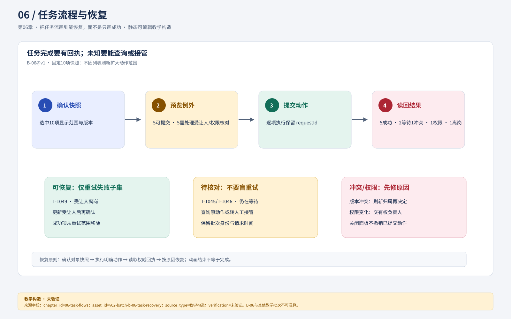
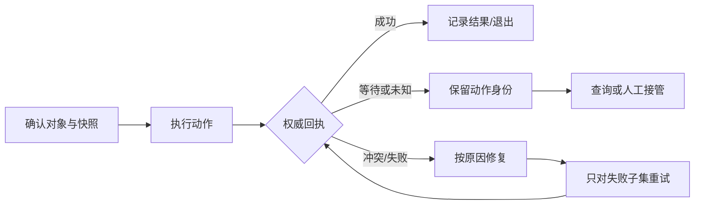
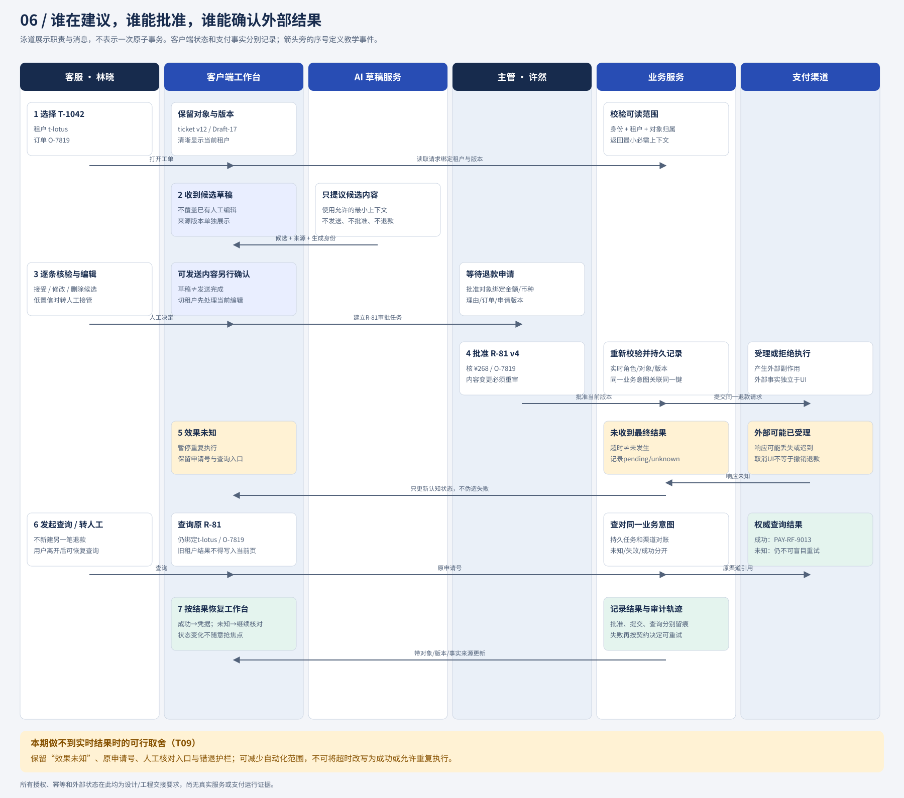

# 06 把任务流画到能恢复，而不是只画成功

任务流需要让用户知道当前负责什么、完成凭什么成立、中断后从哪里继续。澄明用固定步骤处理分派与退款：用户确认对象，系统执行明确动作，再用结果决定下一步。AI候选可以帮助准备内容，却不能跳过权限、批准或效果核对。对低风险只读浏览，流程可以更轻；对外部副作用，必须保留恢复路径。



**核心恢复流程图记录。** `asset_id=v02-batch-b-06-task-recovery.svg`；source 为设计师批次 B 交付的可编辑 SVG（v0.2 资产目录）；短替代文本是“B-06@v1 从确认快照、预览例外、提交到结果与恢复”；长替代文本是“流程固定十项快照，依次经过确认、例外预览和提交，再分出成功、等待、冲突、权限变化与可恢复失败；只有有明确原因的子集进入恢复”。图中批次、状态和动作是教学构造；SVG 为静态设计，尚未完成浏览器、760px/窄屏、键盘、读屏、灰度或真实服务验证，不能证明幂等、权限或外部回执已实现（`visual_downgrade`）。

**本章补充图与降级说明（`visual_downgrade`）。** 课程要求把正常、等待、超时、回退和人工接管放在同一条可追踪链上。上方批次 B SVG 承担首要恢复流程；下图 Mermaid 作为可复演的补充，表达最小事件关系，仍属于教学构造/未验证。现有 `06-role-state-swimlanes.svg` 与 `03-refund-state-board.svg` 在对应小节复用，不能替代本章全部流程验收。



文字替代：用户先确认对象快照，动作必须得到权威回执；等待/未知进入查询或人工接管，冲突/失败只对可修复子集重试。静态图不证明幂等、权限或外部服务已实现。

## 先给每一步一个进入和退出条件

**流程图读法（`visual_downgrade`）。** 先按表格检查每一步的进入条件、用户动作和退出依据，再按“选择快照→预览例外→提交→逐项结果→恢复”编号阅读；当前没有标题级独立恢复流程资产，补图条件是设计师交付独立恢复流程图后做桌面、760px、窄屏复验。

林晓要将同类工单交给同事。流程不能只是“选择→点击分派→成功”，还要回答列表刷新、受让人离岗、权限变化、部分成功时怎么办。

| 步骤 | 进入条件 | 用户动作 | 可见反馈与退出依据 |
| --- | --- | --- | --- |
| 确定范围 | t-lotus已加载且权限有效 | 选中明确工单集合 | “已选10项”，显示范围；刷新不扩大集合 |
| 预览分派 | 10项身份与版本可读 | 选择在岗受让人并看例外 | 确认摘要列出受让人、可提交数、排除数 |
| 提交 | 权限与对象版本重新核对 | 确认这一快照 | 逐项执行状态；不得将按钮回弹当完成 |
| 阅读结果 | 返回各项结果或待核事实 | 查看冲突、等待或失败项 | 成功项取消选择，待处理项保持可辨 |
| 恢复 | 某项具备可修复原因 | 更新版本/受让人或稍后核对 | 新动作明确对应失败子集 |

取消预览尚未提交的动作可以返回原选择；提交后“关闭结果面板”只改变可见性，不撤销已经改派的工单。图中的箭头必须说明这层差别。



**图注与资产记录。** `asset_id=06-role-state-swimlanes.svg`；source 为本教材现有静态 SVG，版本与限制见 [`source-index.md`](../source-index.md) 和 [`assets/DESIGN_HANDOFF.md`](../assets/DESIGN_HANDOFF.md)。短替代文本是“客服、客户端、AI、业务服务与支付渠道的角色泳道”；长替代文本是“林晓选择并核验，系统/AI给出候选，许然批准，服务与支付返回未知或结果，最后由查询/接管恢复”。箭头是教学事件，不是原子事务；静态图为教学构造/未验证，窄屏或读屏无法保持泳道关系时按角色编号顺序阅读（`visual_downgrade`）。

## 一个10项批量结果的完整输出

**部分成功状态图（`visual_downgrade`）。** 现有资产没有专门绑定 B-06@v1 的十项批量结果；下图以事件表的计数为准，避免把“批量完成”误读为单一状态。补图条件：设计师交付含成功、冲突、权限、失败、等待五类状态且可展开例外的批次图。

```mermaid
flowchart TD
  B[B-06@v1：10项快照] --> S[5 已分派]
  B --> C[1 版本冲突]
  B --> P[1 权限变化]
  B --> F[1 受让人离岗]
  B --> W[2 待核对]
  C --> C1[刷新归属后再决定]
  P --> P1[交给有权负责人]
  F --> F1[改受让人后仅重试该项]
  W --> W1[查询原动作，禁止盲重试]
```

文字替代：十项快照分成五类结果，只有受让人离岗项具备当前重试条件；图为教学构造/未验证。

以下是独立教学批次 `B-06@v1`：提交前快照固定10项，结果记录不是实时列表总数。成功5、冲突1、权限变化1、确定失败1、仍在等待2；总和必须是10。第07章引用的图07另有视觉批次 `VIS-07-T05@v1`（4完成、2等待、2失败、2权限变化），它与B-06不是同一批次，也不是本批次更新后的结果；两者不能合并计算或互换标签。

| 工单 | 结果 | 下一步与是否重试 |
| --- | --- | --- |
| T-1042、T-1043、T-1044、T-1045、T-1046 | 已分派给林晓 | 不再加入重试集合，保留回执 |
| T-1047 | 版本冲突：已由另一客服接手 | 重新加载归属，比较后另作决定 |
| T-1048 | 权限变化：当前无分派权 | 不自动重试；交有权负责人 |
| T-1049 | 确认未执行：受让人离岗 | 重新选有效受让人后可提交新动作 |
| T-1050、T-1051 | 结果待核对 | 查询原动作，不直接重新分派 |

汇总文案是“10项中5项已分派，2项待核对，3项需处理”，而不是“批量分派完成”。“重试”按钮只有T-1049满足当前条件；T-1047需先查看新版本，T-1048没有权限，T-1050/51结果未知。即使分派可逆，也不能用可逆掩盖重复触发通知、打断同事工作等代价。

两种交互都可行：整批预览一次提交适合同质、低风险任务且有逐项结果；先剔除疑难项再提交适合权限和归属混杂。当前方案在预览中主动列出例外，不强迫所有项逐页确认，也不让“不适用项”静默消失。若批量大到逐项浏览不现实，仍需展示分类计数、展开例外和可下载范围，而非用“全选所有”模糊实际对象。

## 退款从准备到外部效果的完整路径

**副作用时序图复用说明。** 本节复用 `03-refund-state-board.svg` 的批准、发送中、效果未知和查询后结果状态；它回答“状态链如何保留”，不证明支付接口、幂等或对账已实现。读图时按“准备→批准→版本再核→发送→回执→查询/人工接管”编号，关系无法保持时使用文字替代（`visual_downgrade`）。

R-81不是普通分派。教学正常路径如下：

1. 林晓在T-1042检查O-7819、CNY 268.00、理由“破损核验完成”和P-07@v3；全额退款描述额度/类型，不替代该理由字段。发现缺证据就保存草稿并请求材料，不进入提交。
2. 创建R-81 v4，状态为待主管审批。林晓能修改申请，但修改金额、币种、订单、理由或政策版本将产生新版本并使旧批准失效。
3. 许然打开当前v4摘要，确认权限，明确执行“批准R-81 v4”。批准记录绑定这些内容，不能只保存一个`approved=true`。
4. 发送前再次确认版本仍为v4。若已变v5，进入重审，不能借用旧批准。
5. 发送动作后显示发送中；收到匹配回执，才能分别显示外部已受理、已成功或明确失败。若只有受理回执，就不能显示“到账”。
6. 网络失联进入结果待核对，保留R-81与动作身份；先查询，再决定可否恢复。用户可离开页面，未决事项仍在工作队列。


**图注与资产记录。** `asset_id=03-refund-state-board.svg`；source 为 [`assets/DESIGN_HANDOFF.md`](../assets/DESIGN_HANDOFF.md) 的 v0.2 静态教学资产。短替代文本是“R-81 从确认、发送中、效果未知到权威查询结果的状态板”；长替代文本是“R-81@v4 绑定租户、工单、订单、金额和政策，批准后发送，失联进入效果未知，查询回执才决定成功/失败/持续未知”。图为教学构造/静态设计/未验证；不能把视觉状态当作真实退款结果或用户理解证据。

这里的“人工核对”必须有内容：交给谁、带哪些字段、如何回写结果。交接卡至少包含tenant、T-1042、R-81、v4摘要、发送时间、动作标识、已知错误和缺失回执。负责人取得可匹配凭据后记录结论；无结果不能由人工按“看起来应该失败”结束。

## 两个容易漏掉的失败轨迹

**失败—恢复对照（`visual_downgrade`）。** 本节可复用 `07-edge-state-board.svg` 的迟到、冲突和边界卡，但该资产不是刷新扩大范围或退款失联的逐步流程图。以下两条文字轨迹承担事件顺序；补图条件是交付含“快照冻结”和“未知保留”的独立恢复图。


图注：`asset_id=07-edge-state-board.svg`；source 为现有 v0.2 静态 SVG；短替代文本是“迟到、冲突、批准失效与批量边界卡”；状态为教学构造/未验证。读者应把每张卡当独立反例，不拼成一条真实时间线；关系不可读时按“事实保留→原因分类→安全下一步”编号降级（`visual_downgrade`）。

**刷新扩大范围。** 09:00选择当前页10项，09:01新来2项，页面仍勾选“全选”，提交变成12项。错误来自选择语义，不是按钮样式。修复是选中ID快照，标注“新增2项未选”；预览显示确切数量；提交用已确认集合。复验须在刷新前后检查新增项没有被操作，不能只看汇总成功。

**退款失联后回到编辑页。** 用户点击“取消”，页面清空R-81并允许再建申请；外部稍后实际成功。修复是把取消分成发送前撤回和发送后停止等待：后者显示“已停止当前等待，结果仍待核对”，保留未决卡。若后端不支持按动作查询，冻结再次提交并升级人工。把按钮改名但仍删除未决记录，不构成修复。

## 分层练习与完整参考解法

练习读图要求（`visual_downgrade`）：基础题在 B-06 状态图中指出成功/待核/需处理的分母；迁移题改变回执或版本条件后重画受影响分支；综合题同时处理断网、权限收回和未知结果。当前以 Mermaid、状态表和文字轨迹代替独立练习资产，不能据此声称已完成浏览器、辅助技术或真实任务验证。

**基础：** 为批次B-06@v1的预览加取消与部分成功。参考：预览取消回到相同筛选与选中10项，不产生提交；提交后5成功移出待处理选择，其余5按原因分组；“返回队列”保留结果入口。不能让成功项仍在“重试全部”里，也不能只剩一条Toast而失去逐项事实。若换用图07的VIS-07-T05@v1，须按其4/2/2/2逐项记录重新判定，不能沿用本题5项成功的答案。

**迁移：** 许然已批准R-81 v4，林晓把金额改为CNY 238.00。参考：产生v5，展示差异“268.00→238.00”、理由是否变化和旧批准不再适用；回到待批状态，旧批准记录留存；若v4已经发送，不把它改成v5覆盖，先核对v4结果，再按业务规则建立独立后续处理。只改UI金额而保留批准是错误的。

**综合：** 确认后断网，同时分派权被收回。参考先按时间和对象分开：本地尚未发出且可证明未发送的项可保留待办；已发出的项查询原结果，不把权限变化解释为未执行；恢复网络后重新取权限，有权只读结果则显示结果，无权读敏感内容则保留非敏感定位并引导有权者核对。禁止自动再发。若数据服务不能区分是否已发，按未知处理。这是对未知的保守表达，不是声称前端能证明网络的全部时序。

### 基础补学

流程节点是可解释的状态或动作，箭头是有条件的转换；一个“否”分支要有原因与恢复位置。把每个终点问一遍“谁凭什么知道完成”，如果答案只有“动画结束”，流程仍未完成。
