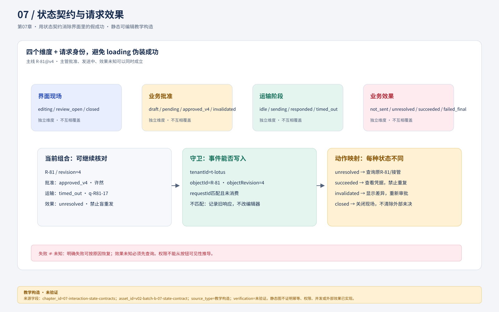
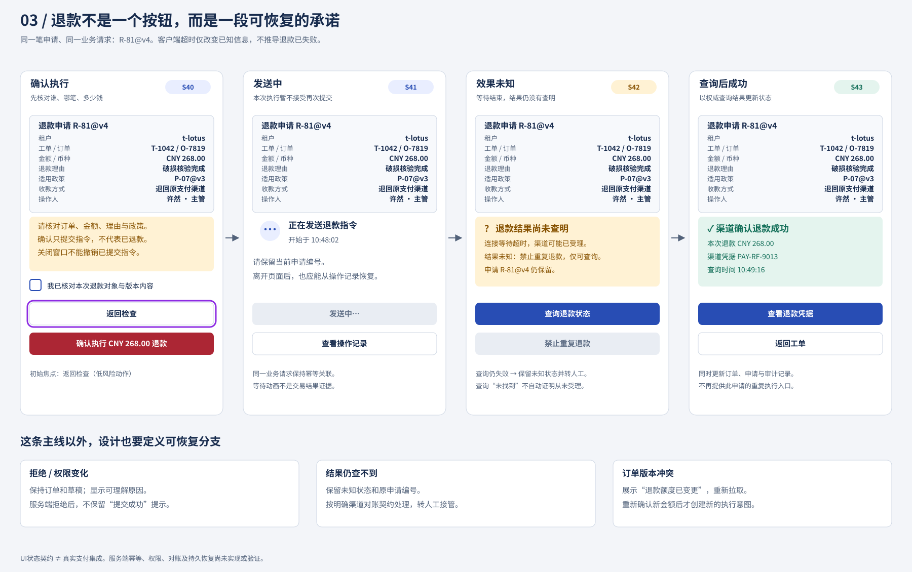
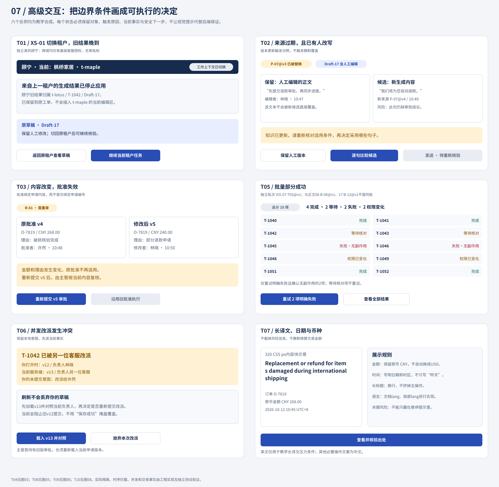

# 07 用状态契约消除界面里的假成功

可靠的交互不是状态越多越好，而是不能把需要不同动作的事实合并。退款超时与明确失败、来源过期与没有匹配、关闭弹层与撤回业务动作，分别需要不同恢复路径。对澄明这类有审批和外部效果的任务，应采用显式状态与事件合同；对于可丢弃的只读搜索，较轻的请求序号与状态枚举也可以。选择依据是丢失或重复动作的后果，而非技术时髦程度。

## 先分开四个维度，避免一个loading统治全部

> **图注元数据**  `asset_id`：`uiux-v02-batch-b-07-state-contract@v1`；`source`：`../assets/v02-batch-b-07-state-contract.svg`（设计师批次B独立SVG）；`alt`：同一退款动作沿请求、批准、运输和业务效果四条状态轨道展开，显示处理中、未知、成功与失败的允许动作和禁止误导；`status`：教学构造／静态图，未验证浏览器、读屏、真实服务或用户理解。

> **visual_downgrade｜四维状态叠加（教学构造，未验证）**  本节暂无独立状态叠加资产，先用下表承担“同一动作同时处于不同事实维度”的读图任务；它不证明运行时状态机或辅助技术表现。
> `alt`：界面现场、业务批准、运输阶段、业务效果四条互相独立的状态带；同一退款动作可同时处于 review_open、approved_v4、sending、unresolved。
> `asset_id`：`uiux-v02-ch07-four-dimensions-downgrade@v0.2`；`source`：本节状态表（无外部资产）。

同一时刻，退款可以是“主管已批准v4、发送中、效果未确认、当前用户只有查看权”。若只有`loading=true`，页面无法决定可否编辑、可否取消、是否能重试。设计师先定义四个维度：

| 维度 | 示例值 | 回答的问题 |
| --- | --- | --- |
| 界面现场 | editing / review_open / closed | 用户正在看或改什么 |
| 业务批准 | draft / pending / approved_v4 / invalidated | 哪份内容获得了什么授权 |
| 运输阶段 | idle / sending / responded / timed_out | 本次请求发生到哪里 |
| 业务效果 | not_sent / unresolved / accepted / succeeded / confirmed_no_effect / failed_final | 外部究竟发生什么 |

权限是另一个约束，不能从按钮可见性推导。模型来源也有自己的核对维度，不能借用退款成功状态。维度可组合，但有非法组合：`approved_v4`不能授权发送v5；`unresolved`不能提供不受控“重新退款”；`closed`不能清除尚待核对的外部效果。

## 对象与请求都需要身份

> **visual_downgrade｜身份守卫关系（教学构造，未验证）**  未提供独立对象—请求关系图，以下文字与事件字段表是降级证据；不要把它当作并发隔离已实测。
> `alt`：租户、工单、对象版本和请求ID从左到右组成守卫链，任一不匹配都把迟到响应送入旧任务记录而不写入当前编辑器。
> `asset_id`：`uiux-v02-ch07-identity-guard-downgrade@v0.2`；`source`：本节事件字段与守卫描述（无外部资产）。

R-81是逻辑业务动作，v4是待批准内容版本；一次发送尝试有requestId，查询尝试也有自己的requestId。新的请求ID不自动代表新的退款意图。若每次点击重试都新建R-82，会把“恢复R-81”错误升级为“再做一次退款”。

教学事件至少携带：`tenantId、ticketId、objectId、objectRevision、requestId、eventType、receivedAt`。草稿响应还携带输入修订与来源版本。界面接收响应时要有明确守卫：当前对象、租户、输入版本是否仍相符；响应是否已被消费；当前状态是否允许该事件。设计师无需替工程实现并发控制，但交接不能只写“处理旧请求”。

## 退款状态矩阵：文案、动作和证据一起定义

| 状态 | 进入证据 | 主要可见内容 | 允许动作 | 禁止误导 |
| --- | --- | --- | --- | --- |
| 草稿 | R-81尚未提交 | 可编辑金额、理由、订单、政策 | 保存、提交审批、放弃草稿 | 不称已申请或已批准 |
| 待审批v4 | 当前v4已提交 | 审批人许然、摘要、提交时间 | 查看、按规则撤回未发送申请 | 不称退款处理中 |
| 已批准v4待发送 | 有匹配v4批准记录 | 批准范围、批准人、尚未发送 | 发送；修改则批准失效 | 不称退款成功 |
| 发送中 | 发送尝试记录存在 | R-81/v4与发送时间 | 停止等待、查看摘要 | 不暗示停止能撤回 |
| 结果待核对 | 超时/断线，效果未决 | “未确认结果，先核对后处理” | 查询原R-81、转有权者核对 | 不给盲重发，不写失败 |
| 外部已受理 | 匹配受理回执 | 受理事实及后续等待 | 查询进展、离开后返回 | 不把受理等同到账 |
| 确认成功 | 匹配成功回执 | 订单、金额币种、结果时间和凭据 | 查看记录、回工单 | 不开放重复提交 |
| 确认无效果 | 可追溯查询证实未执行 | 依据、时间和原因 | 重核权限/批准后受控恢复 | 不自动假设批准仍有效 |
| 最终失败 | 明确不可恢复结果 | 原因与业务处理入口 | 查记录、升级或新业务决定 | 不无限自动重试 |
| 批准失效 | 金额/币种/理由/订单/政策变化 | 版本差异及失效原因 | 返回核对、重新提交审批 | 不静默沿用旧批准 |

没有网络时允许打开本地摘要，但应标明“上次状态”和时间，不把缓存称当前事实。多标签页打开同一申请时，重新聚焦或执行关键动作前需读取最新版本；真正拒绝旧版本动作仍由权威服务执行。

> **图注元数据**  `asset_id`：`uiux-v02-03-refund-state-board@v1`；`source`：`../assets/03-refund-state-board.svg`（本仓库既有静态资产）；`alt`：R-81 从批准待发送到发送中、结果待核对、受理、确认成功或最终失败的状态板，分别标出允许动作与禁止误导；`status`：教学构造／静态图，未验证浏览器、读屏或真实服务。

## AI与检索状态不能借绿色标签跨过核对

> **visual_downgrade｜来源核对状态（教学构造，未验证）**  当前资产集中在退款与边界状态，没有独立 AI 来源状态板；本节状态表保留“无匹配、冲突、过期、不支持、人工接管”等分支。
> `alt`：输入澄清、检索中、无匹配、低置信、来源冲突、来源过期、不支持、服务不可用与人工接管按可恢复动作分组。
> `asset_id`：`uiux-v02-ch07-source-status-downgrade@v0.2`；`source`：本节来源状态表（无外部资产）。

检索、来源身份与主张支持分开。一个来源卡可以“定位成功”，但草稿仍“未核对”；也可以“原文可读”，但某句“不支持”。来源的ID、版本、节与范围用来定位；支持关系记录哪条主张、supported/unsupported/conflicting/not_checked、谁在何时如何核对。

| 状态 | 给用户什么 | 可行下一步 |
| --- | --- | --- |
| 输入需澄清 | 两个会改变结果的明确含义 | 选择或补充，不代选 |
| 检索/生成中 | 当前任务、可停止等待 | 保留输入；旧响应到达仍核身份 |
| 无匹配 | 现有内容没有匹配依据 | 改表达、目录查找、人工处理 |
| 低置信/依据不足 | 具体缺失条件，不给伪概率 | 补条件或核候选 |
| 来源冲突 | 两段来源与冲突点 | 交内容责任者，不择一伪装确定 |
| 来源过期 | P-07@v3及当前版本状态 | 对照新版重新核，不覆盖人工编辑 |
| 不支持 | 哪句缺依据或与原文相反 | 删除、修改或找到新依据 |
| 服务不可用 | 当前能力不可调用，输入保留 | 重试只读查询或人工路线 |
| 拒绝处理 | 简明范围/权限原因 | 合法替代或有权者处理 |
| 已取消等待/忽略 | 不再显示本次候选 | 保留草稿；迟到结果不覆盖 |
| 请求人工接管 | 交接包内容与接收状态 | 可修改待交材料，确认接收后跟进 |

“已请求接管”与“人工已接收”是两个事实。未获接收时，不能把客服任务从工作队列中删除。相同原则适用于AI输出：模型停止生成只证明生成结束，不证明内容可发送。

## 两条逐事件故障轨迹

**T01，合法切换后的跨租户晚到。** 沿用第05章的独立合成场景XS-01@v1：顾宁对t-lotus和t-maple均有基础客服授权，在该场景分别获派T-1042与T-2041，两域均无退款审批权。t-lotus/T-1042输入rev7发出q31→顾宁合法切到t-maple/T-2041→q31返回原任务草稿候选。守卫先检查tenantId和ticketId；不匹配则记为旧任务响应，不写入新编辑器。原租户草稿仍可通过原工单恢复。提示只在必要处说明原任务结果已到，不泄露内容到新租户。若只比较“当前最后一个请求时间”，仍可能污染，因为不同任务时间并非授权。该隔离场景不改变主线林晓的单租户权限或T-1042分派。

**T01的未授权对照。** 林晓没有t-maple权限。她修改URL试图打开T-2041时，服务应拒绝读取，页面不得先显示该租户业务数据；此时根本不应形成“已合法切换到T-2041”的状态。拒绝未授权访问与阻断合法切换后的旧响应互不替代，两条路径都需要验证。

**T02，过期与人工编辑。** Draft-17 rev2由P-07@v3生成→林晓将第二句改成rev3→政策更新v4→旧生成请求返回rev2候选。正确结果是保留rev3、标明来源待重核，在旁边提供差异候选；确认采用后生成rev4，不改写历史。只加“来源已更新”Toast而覆盖人工内容，会同时损失工作与核对责任。

> **图注元数据**  `asset_id`：`uiux-v02-07-edge-state-board@v1`；`source`：`../assets/07-edge-state-board.svg`（本仓库既有静态资产）；`alt`：租户切换、来源过期、并发晚到和批量结果的边界状态，区分合法切换、未授权拒绝与旧响应隔离；`status`：教学构造／静态图，未验证权限服务、浏览器或读屏。

图07的T05单独命名为视觉教学批次 `VIS-07-T05@v1`：10项中4完成、2等待、2失败、2权限变化。其逐项信息与第06章的 `B-06@v1`（5已分派、2待核对、3需处理）不同，不能读成同一批次的两份摘要。图中仅重试已确认无副作用且当前可恢复的2项明确失败；B-06中则只有T-1049满足当时恢复条件。复验时先绑定批次身份，再核分母、逐项事实和允许动作，不能为统一数字改写任何一份输入。

## 焦点和状态通知也是事件输出

> **visual_downgrade｜焦点与状态消息（教学构造，未验证）**  暂无焦点时序资产，使用文字规则替代；需要真实键盘与读屏复验后才能升级。
> `alt`：打开弹层焦点进入标题或检查入口，提交错误焦点到错误摘要，关闭后返回触发位置；异步状态消息被辅助技术感知但不抢焦点。
> `asset_id`：`uiux-v02-ch07-focus-announcement-downgrade@v0.2`；`source`：本节焦点与状态通知段落（无外部资产）。

打开审批弹层时焦点进入明确标题或低风险检查入口；提交校验出错时定位错误摘要/字段；关闭回到触发该申请的行，若该行已不在集合则回到列表标题并说明状态变化。普通异步结果不应任意抢焦点；提供能被辅助技术感知的状态消息。WCAG 2.2的[4.1.3状态消息](https://www.w3.org/WAI/WCAG22/Understanding/status-messages.html)要求这类不取得焦点的状态能被程序识别，不能仅换颜色。具体角色、更新时机与重复播报必须在实际实现中检查，本表不是读屏测试结果。

## 分层练习与完整参考解法

**基础：** 将`loading/error/success`改写以支持退款。参考：至少区分草稿、待批、已批准待发、发送中、效果未知、已受理、确认成功、确认无效果、最终失败、批准失效；error不能同时承担未知与无效果，因为前者先查询而后者才可能恢复。保留对象与批准版本是这些状态能够成立的前提。

**迁移：** 查询R-81返回成功，但回执订单为O-9999。参考：不得转确认成功；标记结果无法匹配，保留原记录并继续核对或升级。收到一个success字符串不够，必须匹配租户、动作、订单及批准金额币种。用户看到的是“返回结果与当前申请不一致，尚未确认本次退款”，不是“成功但数据异常”。

**综合：** 另一标签页已批准v5，当前页仍显示v4草稿。参考：保存或提交遇到版本变化后，展示本地修改与当前v5差异，提供复制本地内容、重新基于最新版编辑或放弃本地稿；不自动合并金额、币种和理由等批准字段。若本地仅改备注，可按明确字段合并规则提出候选，仍让用户检查。刷新不能丢掉用户未保存文字，版本冲突也不能被最后保存成功掩盖。权威服务缺版本检查时，应登记高风险缺口，界面预检不能承担最终保证。

### 基础补学

状态是当前事实，事件是变化的输入，守卫是是否允许变化的条件，动作是变化伴随的效果。把它们分开后，一张图才可能同时说明正常和失败，而不只是把按钮文案串起来。
