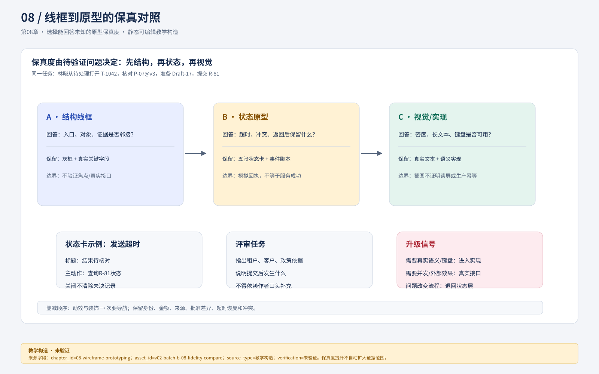
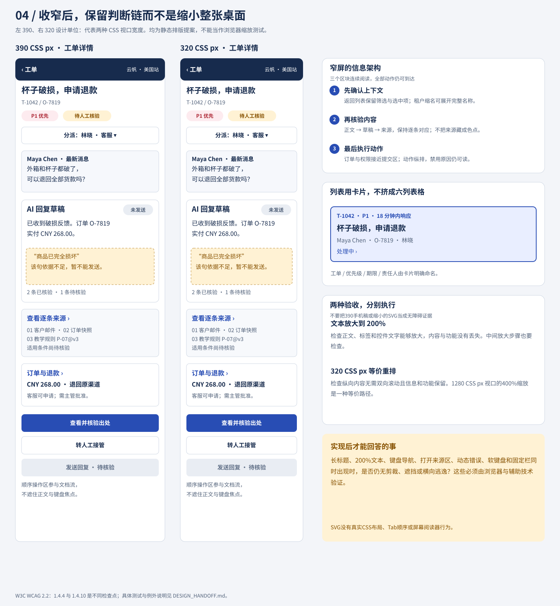

# 08 选择能回答未知的原型保真度

原型的保真度应由待验证问题决定。颜色像成品，不代表状态真实；点击能跳页，不代表键盘可用；显示一张成功页，也不证明服务会成功。对澄明，先用结构稿检查范围和关系，再用真实内容状态稿检查错误恢复，最后才投入精确视觉。若视觉已确定而流程改变，应回到状态层，不受已画好屏幕的沉没成本限制。

## 保真度有五个独立维度

> **图注元数据**  `asset_id`：`uiux-v02-batch-b-08-fidelity-compare@v1`；`source`：`../assets/v02-batch-b-08-fidelity-compare.svg`（设计师批次B独立SVG）；`alt`：五个保真度维度按待验证问题对照低、中、高成本方案，标出可回答的问题与不能跨越的证据边界；`status`：教学构造／静态图，未验证真实原型、浏览器、辅助技术或用户效果。

> **visual_downgrade｜保真度选择矩阵（教学构造，未验证）**  本节没有独立的保真度对照资产，保留五维表作为低保真决策图；它不证明任一原型已通过用户或辅助技术测试。
> `alt`：视觉、交互、内容、数据、行为五条保真度轴分别对应待验证信号，只有未知条件需要提升时才增加成本。
> `asset_id`：`uiux-v02-ch08-fidelity-matrix-downgrade@v0.2`；`source`：本节五维表（无外部资产）。

| 维度 | 低成本表达 | 需要提升的信号 |
| --- | --- | --- |
| 视觉 | 灰框、层级字号、主要间距 | 需要比较密度、识别和风险显著性 |
| 交互 | 主持切换状态卡 | 需要检验焦点、键盘、返回、滚动 |
| 内容 | 真实短标题和关键字段 | 长译文、金额、来源会改变布局 |
| 数据 | 固定T-1042与几个异常样本 | 需要大量项、筛选、空结果和异质集合 |
| 行为 | 显式模拟等待和冲突 | 需要验证并发、真实接口或外部效果 |

如果待决是“查看详情后是否知道选中了哪些单”，黑白稿配真实选中数就足够；如果待决是“读屏能否感知结果待核对”，必须进入有真实语义的实现。工具品牌不会改变证据边界。

## 从空白到第一份可评审线框

任务输入固定为：t-lotus客服林晓从待处理列表打开T-1042，检查Maya的退款询问，查P-07@v3，准备Draft-17，再交R-81。第一轮暂不设计阴影和品牌，只给每个区域一个职责。

| 结构区 | 第一轮真实内容 | 为什么放这里 | 不能塞入的内容 |
| --- | --- | --- | --- |
| 全局顶栏 | 云帆家居·美国站；林晓·客服 | 身份先于所有对象 | 不占位为“公司名” |
| 左侧集合 | 待处理；筛选2；T-1042已选 | 随时能返回来源集合 | 不显示无关仪表盘图表 |
| 中央任务 | 客户原话；草稿；来源检查 | 当前读写任务需要主面积 | 不把操作历史插到段落中间 |
| 右侧事实 | O-7819；CNY 268.00；R-81 v4 | 核对对象与批准范围 | 不复制成另一份可编辑金额 |
| 任务底部 | 保存草稿；提交审批 | 让动作与当前编辑对象邻接 | 不用“完成”合并全部动作 |

这张表已经是能被实现的结构输入：区域职责、真实文本、对象和禁止混用都确定。可对应查看设计师的[前后结构对照图](../assets/01-workbench-before-after.svg)。它是教学静态设计，不能以图中的箭头或按钮声称已有点击行为。

> **图注元数据**  `asset_id`：`uiux-v02-01-workbench-before-after@v1`；`source`：`../assets/01-workbench-before-after.svg`（本仓库既有静态资产）；`alt`：左侧为功能堆叠的失败工作台，右侧按租户、工单、草稿、来源与退款动作重组结构，并标出主要阅读关系；`status`：教学构造／静态图，未验证点击行为、响应式或真人理解。

第一轮评审不是问“好看吗”，而是给同伴任务：“指出当前租户；说明Maya问什么；找出支撑草稿的政策；说出点击提交后发生什么。”若回答依赖作者讲解，说明结构或标签仍有缺陷，需改稿再进入下一轮。

## 第二轮：把真实状态放进同一个骨架

> **visual_downgrade｜五张状态卡（教学构造，未验证）**  当前章节没有独立“五卡”资产，以下文字注释作为状态板降级；请保留等待、过期、待批、超时和冲突五种不同恢复路径。
> `alt`：同一工作台骨架依次承载来源核对中、来源过期、退款待批、发送超时、批量冲突五种卡片；每卡同时给触发、可用动作和返回后的内容保留规则。
> `asset_id`：`uiux-v02-ch08-five-state-cards-downgrade@v0.2`；`source`：本节五张状态卡注释（无外部资产）。

中保真不是把灰框涂色，而是把内容与异常补全。为相同布局给出五张状态卡：①来源核对中，草稿不可标已核验；②P-07@v3过期，人工修改保留；③R-81 v4待批，显示许然与摘要；④发送超时，显示结果待核对及查询；⑤两条工单已分派、一条冲突，保留失败项。每张卡包含触发事件、可用动作、返回后保留内容。

例如卡④的完整交互注释为：“触发：发送R-81 v4后8秒教学模拟超时。显示：摘要保留，标题‘结果待核对’，说明未确认外部效果。主动作‘查询R-81状态’，次动作‘返回工单’。关闭不清除未决记录。查询得到匹配成功则转结果卡；确认无效果则重新核对权限与批准后恢复；无结果则保持待核对并交人工。该模拟时间不是服务承诺。”这比一张写着“网络错误”的图能多回答真正的判断。

## 第三轮：只提升尚未知的部分

设计师的[实际工作台图](../assets/02-ticket-ai-evidence.svg)用于检查内容层级与邻接。

> **图注元数据**  `asset_id`：`uiux-v02-02-ticket-ai-evidence@v1`；`source`：`../assets/02-ticket-ai-evidence.svg`（本仓库既有静态资产）；`alt`：工单任务、AI草稿、逐条来源证据与人工动作在同一工作台中的邻接关系；`status`：教学构造／静态图，未验证内容层级的真实任务效果。

设计师的[退款状态板](../assets/03-refund-state-board.svg)用于检查相同对象的不同后果。

> **图注元数据**  `asset_id`：`uiux-v02-03-refund-state-board@v1`；`source`：`../assets/03-refund-state-board.svg`（本仓库既有静态资产）；`alt`：同一退款动作在批准、发送中、结果待核对、成功与失败之间的状态差异及允许动作；`status`：教学构造／静态图，未验证真实服务与辅助技术。

设计师的[响应式图](../assets/04-responsive-390-320.svg)用于检查窄屏顺序。

> **图注元数据**  `asset_id`：`uiux-v02-04-responsive-390-320@v1`；`source`：`../assets/04-responsive-390-320.svg`（本仓库既有静态资产）；`alt`：同一任务在约390px与320px窄屏中的区域重排与保留顺序；`status`：教学构造／静态图，未验证浏览器CSS、键盘或读屏。读者应把它们作为不同问题的工件，而非“保真度越来越高就越来越对”。

若要验证信息密度，可在同骨架下做高密度表格与分层卡片两个方案；若要验证长来源，必须把P-07真实长度放入，不用“说明文字”四个字占位。若要验证多语言，把“Approve R-81 revision 4 after reviewing the current request”这类长标签写进去，而非假定英文一定更短。

## 一个原型能证明什么，不能证明什么

> **visual_downgrade｜证据边界流程（教学构造，未验证）**  暂无独立“原型证据等级”流程图，以下判断规则是文字降级；静态截图不能证明真实服务、焦点顺序或用户独立完成。
> `alt`：纸面状态切换、点击热区、前端模拟、真实接口原型分别能观察理解顺序、入口发现、模拟异常或连接行为，但各自不能跨越到生产能力结论。
> `asset_id`：`uiux-v02-ch08-prototype-evidence-boundary-downgrade@v0.2`；`source`：本节证据边界段落（无外部资产）。

纸面状态切换可以显示参与者是否理解顺序，但主持人知道下一步，会不自觉帮助。点击热区可以观察找入口，但不会自然暴露Tab顺序、焦点丢失或权限变更。前端模拟可以重复触发超时和冲突，但不能证明真实服务幂等或隔离。真实接口原型能测交互连接，但也不能替代生产规模、辅助技术组合和真实业务评价。

因此在原型旁标“模拟输入/输出”及限制，记录哪些行为由主持人触发。若参与者因主持提示才找到查询入口，保留为“提示后恢复”，不能写“独立完成”。原型越像真实产品，越需要避免诱导评审把模拟成功当真实能力。

## 两种成本分配及失败修复

> **visual_downgrade｜成本—未知对照（教学构造，未验证）**  没有独立成本分配图，保留“半天导航评审／状态明确交工程”两条文字路径；不得把低保真等同低质量或高保真等同正确。
> `alt`：导航未知选择纸面或静态状态卡，焦点与内容保留未知选择中保真可操作原型；每种选择标出可回答与无法回答的问题。
> `asset_id`：`uiux-v02-ch08-cost-unknown-downgrade@v0.2`；`source`：本节成本分配段落（无外部资产）。

半天内检验导航时，选纸面/静态状态卡：易改、能看整体，但无法验证真正焦点。已有清楚状态且需交工程时，选中保真可操作原型：能检查返回和内容保留，但成本更高，也必须明确异步是模拟。二者不是谁高级谁低级，而是回答不同未知。

失败例是先花两天精修唯一成功页，然后仅让同事点击“提交→完成”，得出“流程清晰”。修复先补失败输入：旧批准、过期来源、部分成功、超时。保留原结构重放任务；若参与者再找不到安全恢复，不必为保留美观而硬塞Toast，应回到状态与区域职责重新设计。复验检查同一异常能否被理解，而非只比较新版评分。

## 分层练习与参考解法

**基础：** 三个问题各用什么原型？①用户是否理解工单和退款不是同一状态；②320 CSS px下能否核对币种；③屏幕阅读器是否正确通知待核对。参考：①静态状态卡加中立解释任务即可初测；②用真实文本和布局的窄屏实现或至少精确重排稿，静态稿只能查设计；③需要真实语义实现与目标辅助技术，不可用截图证明。把所有问题都交高保真画面既昂贵又缺证。

**迁移：** 为旧来源返回补完整注释。参考：使用第05/07章XS-01@v1的顾宁，而非只有t-lotus权限的林晓；顾宁在两个租户均有基础客服授权、在场景中分别获派T-1042/T-2041，两域均无退款审批权。T-1042 rev7发请求、顾宁合法切t-maple/T-2041、旧响应到达；界面不显示旧内容，记录归属t-lotus；返回原工单时展示独立候选，若输入已变则标与旧输入有关，不覆盖该场景的人工草稿。另设林晓尝试打开t-maple的拒绝路径，不能用合法切换的原型代替未授权检查。模拟原型用控制面板明确触发顺序；独立检查时不让操作者先知道“正确按钮”。

**综合：** 半天内准备评审，删什么保留什么？参考：删非必要动效、插画、多主题精修和非核心导航；保留当前身份、真实金额、来源状态、批准差异、超时恢复、关闭返回与至少一项冲突。交付一页结构、五张状态卡、一个事件脚本和边界说明。若视觉是本次唯一未知，则保留字号/间距而削减次要功能；任务决定删减，不是统一低保真。

### 基础补学

线框表明信息与动作的关系；原型让人经历关系变化；设计稿约定视觉和内容；产品实现连接真实状态。四者可重叠，但不能互相自动证明。
