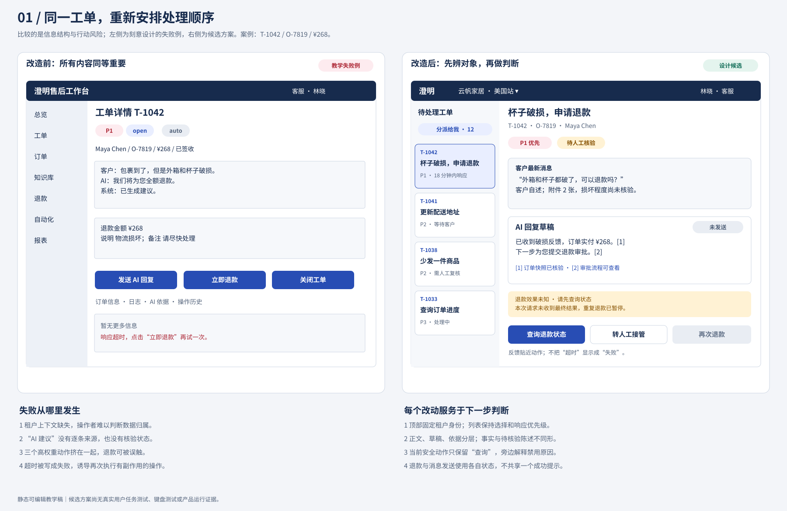

# 09 让视觉层级支持快速而正确的判断

视觉层级的任务是让用户按正确顺序看到正确对象，而非把最重要的内容一律放大涂红。澄明需要客服先辨认当前租户和工单，再读客户请求、核对证据，最后采取有条件的动作。紧急程度、选中状态、业务风险和执行结果是不同维度，必须可以同时辨认。本章用真实教学屏幕、具体尺寸与失败对照说明怎样实现。

## 注意、分组和视觉搜索为何影响任务

当屏幕同时有十几个强调点，强调本身不再指路。用户只能不断比较“哪个更像重要内容”，而不是直接读任务。我们把稳定上下文放在固定位置，把当前异常放在任务附近，用局部对比吸引注意；但不声称一个颜色能让所有人自动发现所有风险。经典视觉搜索研究区分单一特征与特征组合的寻找情形，提醒我们不要让人反复靠颜色加形状再加位置识别目标；原研究对象与实际业务界面不同，仍需任务验证。[Treisman与Gelade，1980](https://www.sciencedirect.com/science/article/pii/0010028580900055)

**接近和边界**让内容被理解为一组。把“CNY 268.00”放到R-81标题下，比放在页面另一端更容易建立属于关系；如果“已核验”徽标跨在整张草稿卡上，用户可能误认为每一句都被核验。因此分组不仅降低搜索成本，也能造成错误归因。我们将状态放在具体句旁，汇总只写“2条已核验、1条待核验”，不能用绿色容器包住全部内容。

**对齐**建立可预测的扫描通道。列表中标题左对齐、响应期限固定列、金额数字靠右且币种独立显示，用户不必每行重新找字段。对齐也不能取消语义：多币种金额按小数点对齐看似便于比较，却可能让人忽略币种不同。因此跨币种列表应把币种紧邻数值，分组或增加币种列，不能显示总和而无换算依据。

**识别与回忆**的区别在于线索是否留在当前任务中。客服从订单页记住金额，再切草稿页凭记忆批准，是把核对变成回忆；保留订单、币种、政策版本与当前动作摘要，让用户进行可见匹配。Nielsen的[识别而非回忆启发式](https://www.nngroup.com/articles/ten-usability-heuristics/#6-recognition-rather-than-recall)支持提供可见或易取回的必要线索；它是经验性评审原则，不能替代实际任务测量。

## 不要把Hick或Fitts变成万能公式

Hick的经典选择反应实验研究选项不确定性与反应时间，不能直接推出“菜单永远不超过7项”或“把功能都藏进更多菜单更快”。对澄明，选项是否熟悉、标签是否可预测、任务是否需要比较，都会改变搜索成本。本章不代入未经测量的常数估算客服速度；需要比较的是“有清楚分组的8项”与“隐藏后的两层路径”在同一任务中的表现。[Hick，1952，论文记录](https://doi.org/10.1080/17470215208416600)

Fitts研究目标距离与尺寸下的定向动作。其设计启发是：频繁动作不要做成相距遥远、狭小难点的目标；但把危险退款按钮无限放大，会提高误触的后果。对本例，44px高的默认操作区、清楚间隔和位置稳定可以减少精细瞄准，危险动作仍需要对象确认及语义隔离。不能仅凭目标尺寸推算真实完成时长，更不能用它支持取消确认。[MacKenzie对Fitts目标获取研究及适用条件的说明](https://www.yorku.ca/mack/hhci2018.html)

## 同一屏幕的改前与改后

左图是刻意构造的失败例：菜单、标签、回复、立即退款和关闭都争夺注意；“响应超时，点击立即退款再试”把未知误当可重试失败。右图先标租户和角色，将T-1042的客户消息、AI草稿、逐条依据和退款未知分组。请注意，右图中的“未发送”说的是草稿，“效果未知”说的是R-81，两种状态并存并不矛盾。

下表是可用来复做该结构的尺寸决策。数值是本教学系统建议，不是所有产品的标准。实际资产画布用于说明布局，画布缩放后的像素不能直接当运行时CSS。

| 决策 | 原失败方案 | 本章候选规格 | 所解决的判断 |
| --- | --- | --- | --- |
| 内容层级 | 多个标题同粗同大 | 页标题24px/1.3；正文16px/1.6；次要信息14px/1.5 | 区分对象、任务内容与辅助信息 |
| 结构间距 | 每段统一8px | 同组8/12px；组内16px；任务组间24/32px | 近者关联，远者分组 |
| 栅格 | 信息任意浮动 | 16px内边距为基础，面板24px；列间24px | 建立稳定扫描线 |
| 密度 | 所有行固定单行 | 摘要可两行；金额与风险不截断 | 防止为齐整隐藏决策内容 |
| 动作 | 三个实心大按钮并排 | 保存为次级；提交审批为主级；外部退款独立受控 | 不把不同后果画成同等动作 |
| 颜色 | 红色同时表示P1、选中和失败 | 选中用品牌浅底+边；P1有文字；危险独立红语义 | 减少一种颜色的多重解释 |

对应的[高保真教学工作台](../assets/02-ticket-ai-evidence.svg)提供可直接查看的内容与空间关系；[tokens.json](../assets/tokens.json)给出底层值。不要为了让缩略图“高级”而将辅助文字设到10px：任务是否可读优先于一屏放下多少卡片。

## 两张关键屏的具体视觉判断

**工单列表。** 先固定每行“标题→身份→期限/负责人”的阅读关系。T-1042标题“杯子破损，申请退款”，身份行保留T-1042/O-7819，紧急标签写“P1优先”，不能只有红点。选中使用浅品牌底、2px边界和当前项标记，不替换紧急语义。长标题允许两行，摘要最多两行但可打开全文；唯一ID不可被只剩省略号的同名标题替代。20条时可显示完整行，200条时需要筛选和分页或经过实现验证的虚拟列表，不靠缩字体解决规模。

**退款确认。** 标题是“批准R-81 v4”，其下依次为订单、CNY 268.00、理由、政策版本、批准人。金额不是页面最大广告式数字，它要与币种、对象和范围一起读。主要动作明确“批准R-81 v4”，返回检查是邻近次级动作；结果区使用独立标题“结果待核对”，不复用批准色。若金额很长，允许整组换行，不让CNY留在上一行而数字独立出现。

正常轨迹为：定位T-1042→看客户请求→在句旁核依据→审查R-81摘要→执行明确动作→从结果区判断下一步。每一次视觉强调都有任务理由，而非简单地“这里重要”。

## 色彩、对比与非颜色通道

当前教学token为正文`#172B4D`、次文`#52627A`、品牌`#284DB4`、警告`#865100`、危险`#AC2634`，分别配白底或约定浅底。WCAG 2.2的[1.4.3对比度最低要求](https://www.w3.org/WAI/WCAG22/Understanding/contrast-minimum.html)对一般文字要求至少4.5:1，大号文字至少3:1，并有明确例外；这里不能把“看着够深”当计算。token文件的配对数学自查只覆盖列出的前景/背景，不证明整页合规。

“已核验”同时使用勾形图标和文字；“待核验”用不同图标和文字；“错误”说具体对象；“结果待核对”不冒充错误。去色后仍要能够完成任务。图标补充状态，不单独承担必须学习的含义；问号图标更不能成为唯一来源入口。

动效可用于表示展开关系或确认局部更新，例如160ms教学反馈参数；对等待不循环暗示进展，对未知结果不播成功动画。用户选择减少动态效果时，移除非必要位移缩放，保留结构、文字与进度事实。是否需要动效由任务判断，不按动画数量评价精致度。

## 失败修复：红色同时表示紧急与失败

旧稿中P1工单和退款失败都用同一红底，结果未知也塞进红条。用户快速扫描看到红，无法知道是尽快处理、不要操作还是系统坏了。修复是拆开维度：P1标签保留等级与期限；失败解释可恢复原因；未知显示需核对的事实和查询入口；选中项使用品牌边界。验证任务不能只问“哪个更好看”，应给用户混合状态列表，要求指出最急工单、已失败退款、未知退款和当前选中项，记录误分类型及理由。静态稿只能评审这些区别，真实正确率需独立任务证据。

## 分层练习与完整参考分析

**基础：** 一个页面有六个等大的蓝按钮：保存、发回复、退款、关闭、分派、更多。怎样改？参考：先按当前任务分组，草稿区只有保存和发回复，退款在独立摘要并受审批约束，分派在负责人处，关闭在任务结束区；蓝色主动作随当前任务只强调一个，其他用中性。不能只把五个按钮藏到“更多”，因为高频分派和必要退出会失去发现性。最后用实际任务检查位置和含义。

**迁移：** 200条工单且姓名变长。参考：保留稳定ID与重点列，标题两行，姓名可在详情展开；先筛选再扫描，提供明确总数和已选数。保留跨项比较时选表格，主要逐项阅读时选列表+详情。两者都不能删币种、期限语义和异常提示。测输入应包含重复姓名、长名字和跨币种，不能只放同长占位符。

**综合：** t-maple品牌要求红色主色，与危险冲突。参考：允许品牌入口保持红，但危险不再仅凭色相识别，采用独立图标、位置、文字和边界；若仍不能区分，限制品牌红用于非风险层，将业务主动作映射到中性或另一个经批准的语义色。记录品牌需求与正确理解的冲突，比较灰度/焦点/混合状态任务，不以品牌负责人喜欢为唯一通过条件。

### 基础补学

“层级”是阅读优先关系，“密度”是单位空间中的信息与操作负担，“对比”不只指颜色，还包括字号、字重、位置和留白。先解释用户如何判断，再选视觉参数；这比记住某套万能字号更可迁移。
