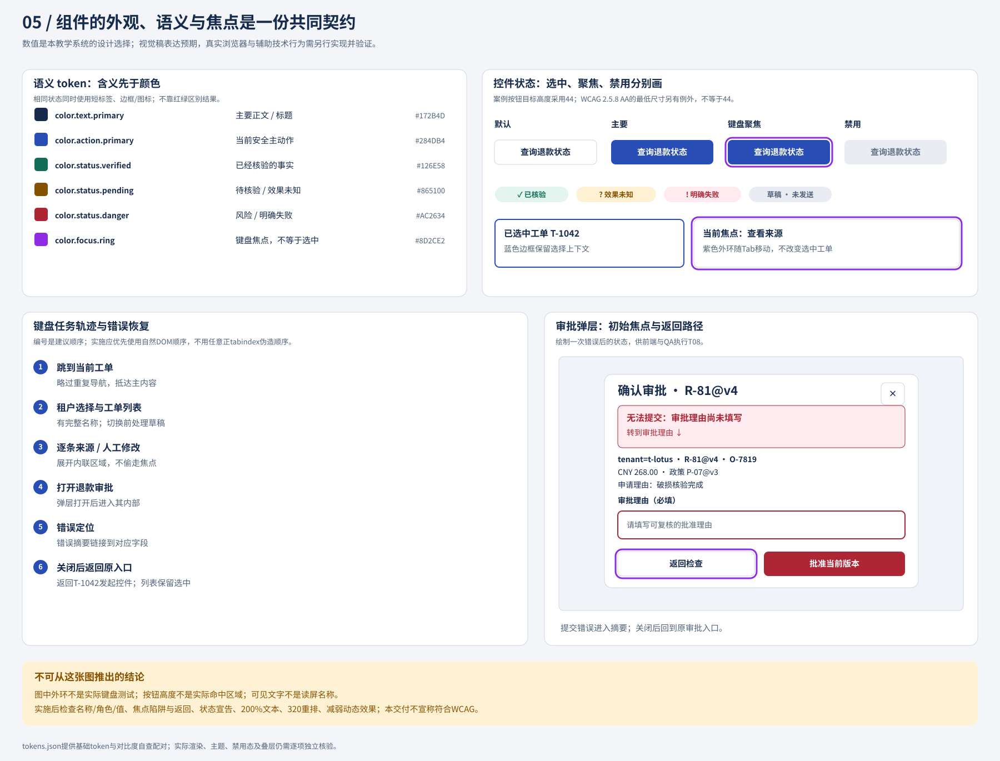

# 11 把稳定的设计决定做成组件合同

值得复用的不是矩形外观，而是稳定的语义、状态和交互。澄明的按钮可以共用外观原语，但退款确认不能缩成任意`title/body/confirm`文本，否则订单、币种、版本和批准范围会在某个调用点被省略。组件系统应让正确设计容易复用、错误组合难以产生；它不能替服务端授权或保证业务成功。

## 从三层token看改变会影响什么

底层值回答“具体是什么”，语义层回答“为什么使用”，组件层回答“在哪里使用”。例如`#284DB4`是值，`action.primary`是用途，`ApprovalAction.review.background`是组件绑定。业务状态不能直接绑定品牌色：t-maple改成青色品牌后，危险和待核对仍要有独立含义。

| 层 | 本教学系统实例 | 允许变化 | 必须检查 |
| --- | --- | --- | --- |
| 基础值 | color.brand=#284DB4；space=4/8/12/16/24/32/48 | 品牌、尺寸系统的基础参数 | 所有受影响语义映射 |
| 语义 | text.primary→ink；status.pending→warn；focus.ring→focus | 主题中的用途表达 | 含义是否仍一致、对比与非颜色识别 |
| 组件 | SourceCard.warningText→status.pending；ApprovalAction.focus→focus.ring | 组件局部表现 | 所有状态、长文案、响应和焦点 |

[tokens.json](../assets/tokens.json)是实际教学工件，包含正文16px/1.6、标题24px/1.3、默认44px控件及36px密集控件。设计师记录的配对对比度仅是指定色值组合的数学自查。组件若覆盖了背景、加透明度或使用图片，就不能继承该组合的结论。

## 五种组件先定职责，再定外观

| 组件 | 必需输入 | 发出的意图/交互 | 不负责什么 |
| --- | --- | --- | --- |
| TicketRow | tenant、ticketId、revision、标题、工作状态、负责人、期限、选中状态 | 打开指定工单、选择指定项 | 不自动把新刷新行加入选择 |
| FilterBar | 当前tenant、可用条件、有效条件、不适用条件、结果数/更新时间 | 修改某条件、清除、保存本域视图 | 不切到另租户寻找更多结果 |
| StatusTag | 语义类型、可读标签、对象归属、必要说明 | 可选的解释入口 | 不由颜色推断业务效果 |
| SourceCard | 来源身份、范围、主张支持状态、核对信息、时效 | 打开原文、核对、报告冲突 | 不凭相似分数宣布正确 |
| ApprovalAction | 申请身份与版本、完整摘要、权限状态、批准/发送/效果分层 | 打开检查、确认当前版本、返回 | 不自行授权，不宣布外部成功 |

职责决定组合。TicketRow可以包含StatusTag，但不能因为StatusTag是绿色就触发工单关闭。SourceCard与ApprovalAction共享间距和焦点原语，不共享“成功”业务枚举。组件输入缺失时应暴露缺失，不以默认假数据补齐。



## 把非法布尔组合改成语义分支

若SourceCard接受`loading、verified、expired、error`四个布尔值，共有16种组合，其中“loading且verified且expired”该如何显示没有答案。更稳妥的合同用明确维度和约束：

```text
SourceIdentity = locating | located(id, version, section, range) | unavailable(reason)
SourceFreshness = current | outdated(currentVersion) | unknown
ClaimSupport = not_checked | supported(checker, checkedAt) | unsupported(reason) | conflicting(refs)
```

这些不是可以任意拼接的标签：只有identity=located才可能展示可定位的原文；只有freshness=current且support=supported才可展示“该句已核验”；outdated必须把核验降为“需重新核对”，但保留历史谁曾核过什么；unavailable不展示假链接。这样既保留独立维度，又有明确合法性规则。

### Draft-17的完整组件实例

主张A是“已收到你反馈杯子破损”，来源是Maya邮件，support=supported；主张B是“订单O-7819教学结算为CNY 268.00”，来源是订单快照，support=supported；主张C是“商品已完全损坏”，只有两张尚未核验的附件，support=not_checked。卡片显示前两条可定位依据，第三条提示“损坏程度尚未核验”，提供“查看附件/修改该句”。汇总写“2条已核验、1条待核验”，不显示“草稿已核验”。

如果P-07从v3更新到v4，相关句子的freshness变outdated；历史supported记录仍可查，但当前标记不能继续绿色通过。重新核对是一次新记录，不改写旧判断的时间。若林晓修改主张C，必须核对新句，不能继承旧句的support。

## ApprovalAction不能只发一个“确定”事件

本章采用教学合同：`reviewRequest`打开当前摘要；`confirmApproval`带用户确认的R-81/v4及字段指纹提交批准意图；`submitted`仅表示批准请求已交付相应处理流程。它们都不等于退款成功。真正的批准结果来自授权服务，外部退款结果从独立效果状态呈现。

输入摘要是完整结构，而不是任意富文本：租户t-lotus、工单T-1042、订单O-7819、申请R-81、版本v4、金额CNY 268.00、理由“破损核验完成”、政策P-07@v3、审批人许然。缺任一决定字段，组件显示无法核对及补充入口，不能以空字符串继续批准。权限未知时允许查看但不确认；无权时说明职责并引导有权者，服务端仍须再次校验。

| 合法状态 | 主动作 | 退出/恢复 |
| --- | --- | --- |
| 可查看且待审 | 检查R-81 v4 | 返回工单 |
| 确认区且权限有效 | 批准R-81 v4 | 返回检查 |
| 版本发生变化 | 查看v4→v5差异 | 基于新版本重审 |
| 已批准待发送 | 按合同进入发送 | 改内容则旧批准失效 |
| 发送中/效果未知 | 查询或等待结果 | 返回不抹去未决记录 |
| 无权/权限未定 | 不提供确认 | 说明原因或重取权限 |

焦点、名称、关闭行为是合同的一部分，而不是每个页面自由发挥。标题和按钮含同一对象版本；关闭回原触发点；错误定位到缺失字段；普通结果不抢焦点。图中焦点环只是视觉提案，真实键盘与读屏行为仍需实现后检查。

## 何时应抽象，何时保留局部

稳定原语加业务组合适合多个场景已共享语义但存在领域差异：Button、Field、Dialog提供基础行为；RefundApproval组合负责退款摘要。优点是避免每处重做焦点和间距，代价是要维护两个层级的合同。需求未稳定时可先做局部组件，留下重复并记录变化；等两三个真实用例显示一致部分再抽取。这个“两三个”是本案例的工作节奏，不是通用统计门槛。

错误抽象通常表现为属性越加越多：`showCurrency、noCurrency、forceApproved、hideVersion、skipReview`。其中有些只是布局变体，有些直接改变安全语义。正确处理不是给每种组合补截图，而是把业务范围分开，对必要字段禁止隐藏，不能支持的场景另做组件。

## 失败分析：通用确认吞掉了批准对象

旧ConfirmDialog只接受“确定退款吗？”与回调。退款页忘传币种，批量页忘传申请版本，按钮点击后统一发`success`。修复先从调用点找缺失语义，再建立结构化摘要与状态合同；默认布局也必须显示对象；`success`拆成批准请求已提交、批准结果、外部结果。复验包含R-81改金额后旧弹层、缺币种、权限变化、长理由、来源过期和关闭回焦。仅更新组件截图而不更新消费事件的页面，仍会错显示已退款。

## 分层练习与完整参考解法

**基础：** `isApproved=true,isEditing=true,isSuccess=true`如何处理？参考：先问各值所属对象。编辑中的申请若已改内容，应使旧批准失效；退款success不能由批准布尔值推出。改为申请revision、approval.forRevision、effect.state三个明确字段，视图根据匹配关系显示。不要只规定“不许同时为true”，因为那没有解释业务变化。

**迁移：** 新页面要用退款确认做封号，哪些可复用？参考：Dialog、字段布局、焦点和返回等原语可复用；退款金额/币种、外部退款状态不可复用。封号需要账户范围、影响渠道、期限、可逆性和授权对象，新建业务摘要及批准合同。若只替换title/body，重大后果会被缺省字段吞掉。

**综合：** 来源卡既有可定位的P-07@v3，又有不支持的“24小时到账”，如何呈现？参考：保留原文入口和版本；该主张标“不支持”，解释原文只涉及处理安排，不能推导到账时点；允许删除或改成有依据的表述；草稿汇总保留未完成状态。另一方案是将不支持句从可发送草稿移到建议区，但必须保留用户查看与恢复关系。两者都不能让有链接等于已核验。

### 基础补学

原语解决基础交互，业务组件解决领域任务，token传递可变视觉决定。三者协作但不互相代替。下一章检查当这些合同改变时，旧页面、租户主题与外部流程怎样迁移。
