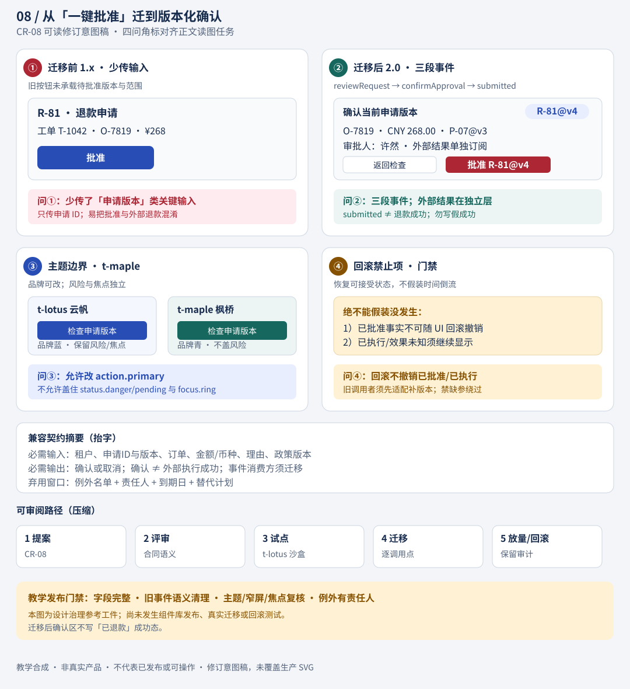
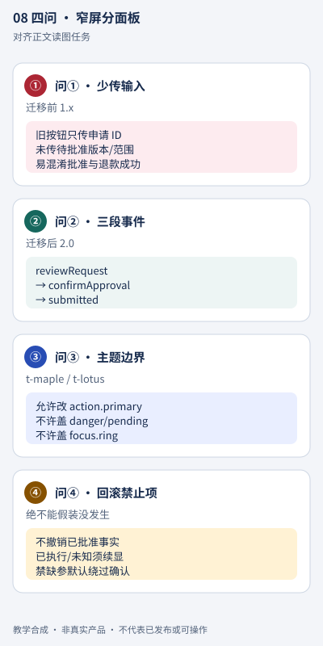
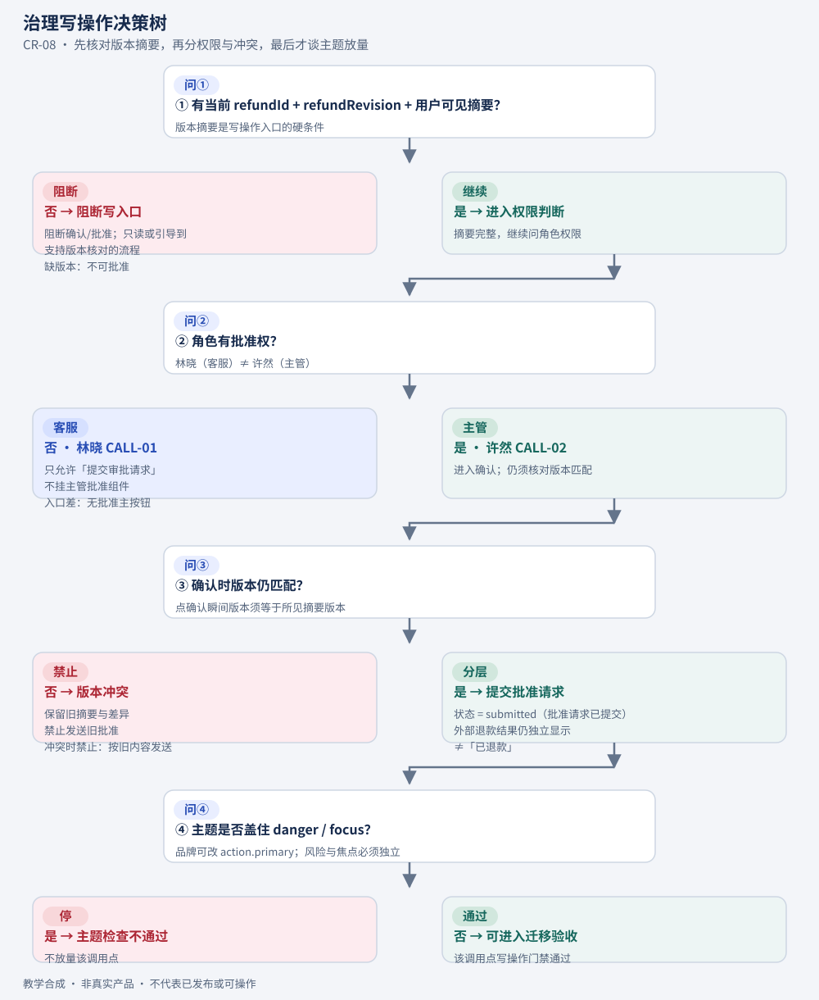
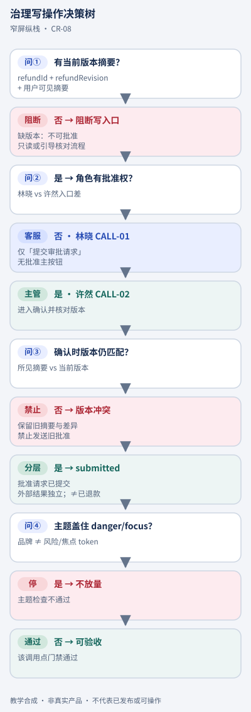
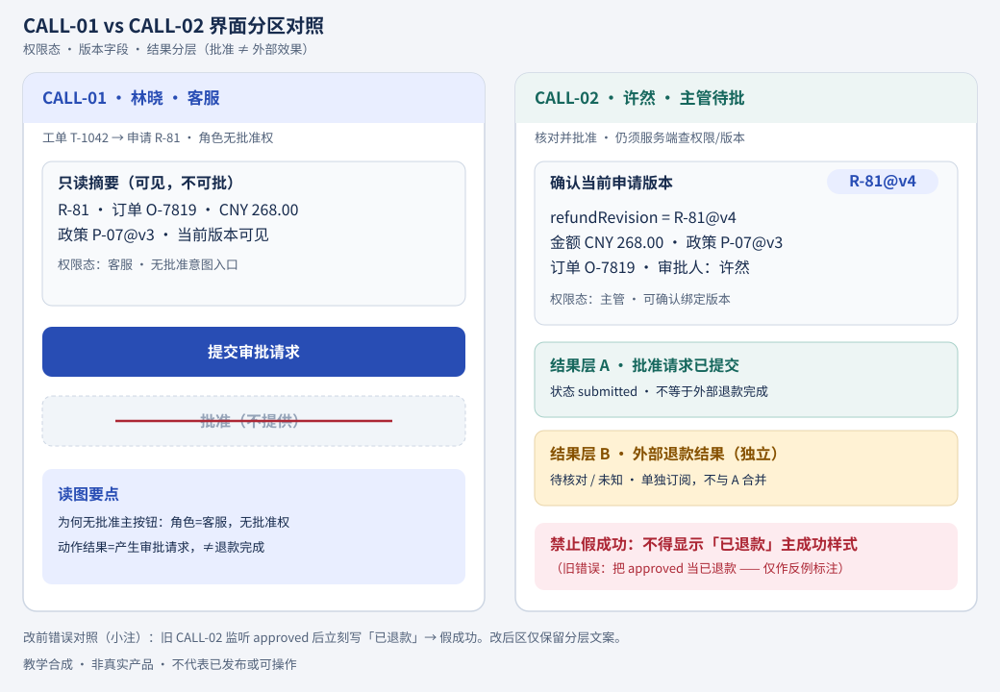
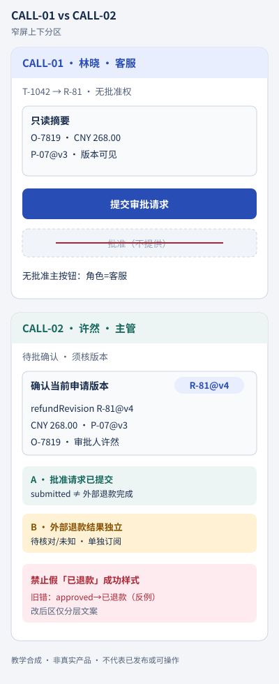
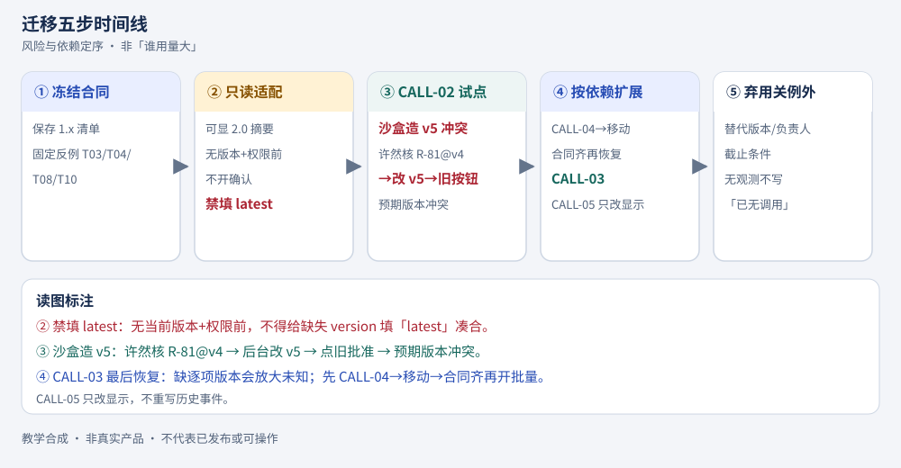
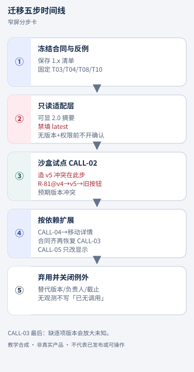
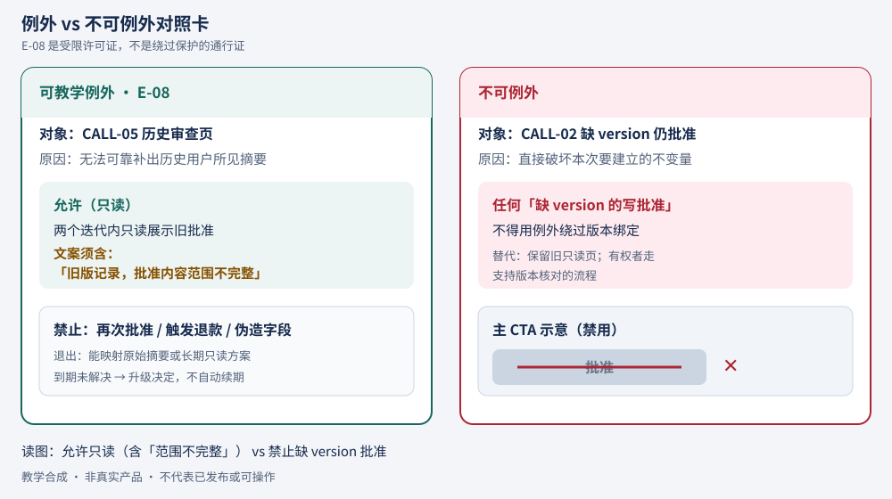
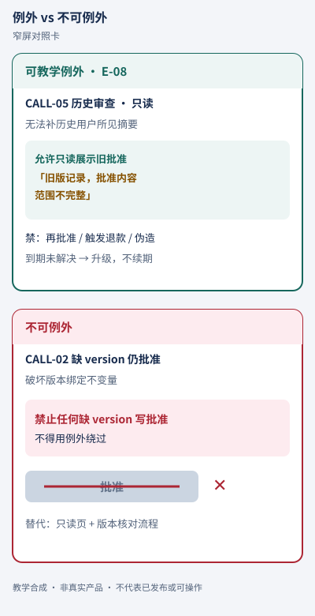

# 12 让设计系统变更能迁移、能例外、能回滚

> **本章路径**：`textbooks/uiux-design-v02/chapters/12-design-system-governance.md`。图在 `../assets/`（DR-12-01…05，各 desk+narrow）。  
> **证据状态**：`reviewed_with_limitations`——作者按易读规范重组；设计图 5/5 已接入本章。**未**经独立内容审校、**未**经本轮设计复验签发、**未**经 QA 复验。未做真实浏览器/发布演练、未实测迁移。全部对象为澄明售后工作台教学合成。不宣称 Ready。  
> **开篇顺序**：机制 → 例子 → 读图（2026-11-04）。仍 `reviewed_with_limitations`。合入与部署保持 Hold，待设计复验、独立内容审校与 QA 后由决策板决定。  
> **底线自拦**：禁假开通/假成功文案（PF-COPY）；关键图须流内可辨或提供同级文字降级（PF-MEDIA / PF-VIS）。

---

## 本节要学会判断什么

1. 设计系统升级有没有**可核对的公共合同**（对象身份、版本、事件分层、风险/焦点语义），而不只是「新画了一个弹层」。  
2. 五个真实调用点里，哪一步必须**阻断写操作**、哪一步只允许**只读例外**、回滚时哪些业务事实**绝不能清空**。

**成立条件**：有可盘点的调用方、可核对的版本字段、权限/批准/外部效果分开、独立 QA 用原反例复验。  
**边界**：本章**不实现**支付服务，**不证明**真实发布或回滚已成功；所有编号、时间、记录均为合成。  
**决定权**：设计负责人提出变更；产品与风险责任者决定业务暂停或例外；发布负责人协调回退；QA 按原例复验。设计师不能私自决定忽略金额或权限。

> **先记住**  
> - 组件整齐 ≠ 系统有效；旧调用者能否保持正确含义才算有效。  
> - `submitted`（批准请求已提交）≠ 退款成功；不得被文案翻成「已退款」。  
> - 例外不能用来绕过「必须绑定当前版本」这类不变量。

---

## 例子：一次会翻车的点击

主管**许然**打开待批列表里的退款申请 **R-81**。摘要显示订单 **O-7819**、金额 **CNY 268.00**、政策 **P-07@v3**、申请版本 **v4**。她还没点确认，后台有人把同一申请改成了 **v5**。她点下旧页面上那个叫「批准」的按钮。

**正确可观察结果（教学预期）**：界面报告**版本冲突**，保留她刚看过的旧摘要与差异，**禁止**按旧内容发送批准；页面**不得**立刻显示「已退款」。

如果旧组件只传了申请 ID、旧页面又把 `approved` 当成退款成功——上面这场点击就会装成成功。用合同、盘点、门禁、例外和回滚拦住这类假成功，就是上面机制块要你学会的判断。

---

## 先读图：CR-08 迁移前 → 迁移后 → 主题 → 门禁（DR-12-04）

**读图任务（对照机制再看｜对齐 DR-12-04 READ-TASK）**

1. 迁移前面板里，旧按钮**少传了哪一类关键输入**？  
2. 迁移后事件链是哪三段？外部结果画在哪一层？  
3. `t-maple` 主题允许改什么、**不允许**盖住什么？  
4. 回滚限制条写了哪两件「绝不能假装没发生」的事？



**窄屏（≤640）用 narrow。既有 `08-approval-component-migration.svg` 本轮不覆盖**



> 脚注：既有 `../assets/08-approval-component-migration.svg` 本轮不覆盖；本章主引用为可读版 `../assets/08-approval-component-migration-readable-desk-v01.svg` 与 `../assets/08-approval-component-migration-readable-narrow-v01.svg`。合入与部署保持 Hold。

**图上看不清、须在正文保留的同级要点（窄屏/点不开大图时仍成立，PF-MEDIA-02 / PF-VIS-04）**

| 区块 | 同级要点 |
| --- | --- |
| 迁移前 1.x | 只传申请 ID；单步触发；易把批准与外部退款成功混淆 |
| 迁移后 2.0 | `reviewRequest → confirmApproval → submitted`；外部结果**单独**订阅 |
| 主题 | 品牌可改 `action.primary`；`status.danger/pending` 与 `focus.ring` **独立** |
| 门禁 | 旧调用者先适配补版本；不给缺参页默认绕过确认；回滚不撤销已批准/已执行事实；**效果未知须续显** |

### 写操作放行决策树（DR-12-01）

**读图任务（对照机制再看｜对齐 DR-12-01 READ-TASK）**

1. 缺版本（无 `refundId`+`refundRevision`+用户可见摘要）时，是否可批准？  
2. 林晓与许然的入口差在哪？  
3. 版本冲突时禁止什么？





**同级要点（图失败时仍成立）**

| 判断 | 同级要点 |
| --- | --- |
| 缺版本/摘要 | **阻断**确认/批准写入口；只读或引导到支持版本核对的流程 |
| 林晓（客服） | 只允许「提交审批请求」，**不**挂主管批准组件 |
| 许然（主管） | 可进入确认；版本不匹配 → 保留旧摘要与差异，**禁止**发送旧批准 |
| 匹配且主题安全 | `submitted` ≠ 外部退款成功；主题不得盖住 danger/focus |

> **visual_downgrade（文字决策树｜图失败时的降级，勿删）**  
> 当你需要判断「这一调用点能不能放行写操作」时，按下面顺序走（正式图为上方 DR-12-01；本树仅作图失败/无法加载时的同级降级）：

```text
有当前 refundId + refundRevision + 用户可见摘要？
 ├─ 否 → 阻断确认/批准写入口；只读或引导到支持版本核对的流程
 └─ 是 → 角色有批准权？
      ├─ 否（如客服林晓）→ 只允许「提交审批请求」，不挂主管批准组件
      └─ 是（如主管许然）→ 确认时版本仍匹配？
           ├─ 否 → 版本冲突：保留旧摘要与差异，禁止发送旧批准
           └─ 是 → 提交批准请求（submitted）→ 外部退款结果仍独立显示
                    主题是否盖住 danger/focus？
                    ├─ 是 → 主题检查不通过，不放量
                    └─ 否 → 可进入该调用点的迁移验收
```

---

## 身份速查（合成教学对象｜可跳读）

读正文时遇到编号，回这张表。它们**不表示**澄明已在真实产品发布过这些变更。

| 名称 | 表示什么 | 进入本章的方式 |
| --- | --- | --- |
| **CR-08** | 「审批组件变更提案」教学编号 | 把 `ApprovalAction` 从 1.x 迁到 2.0，并规定迁移、例外、回滚边界 |
| **1.x / 2.0** | 旧/新**调用合同**版本（不是「已上线成功」标签） | 1.x：常只有申请 ID、`approved` 易被当退款成功；2.0：绑定 `refundId`+`refundRevision` 等，分层事件 |
| **DEF-01/02/03** | 三条原始失败（旧稿 C1–C3） | 无版本 / 假「已退款」/ 主题盖风险与焦点 |
| **CALL-01…05** | 五个调用点（旧稿 C-01…C-05） | 客服详情、主管待批、批量、主题工作台、只读历史 |
| **R-81 / T-1042 / O-7819 / P-07@v3** | 申请、工单、订单、政策版本 | 沙盒先处理 `R-81@v4`，再故意改成 v5 |
| **林晓** | `t-lotus` 客服 | CALL-01：只能发起审批请求、读摘要；**无**批准权 |
| **许然** | 主管 | CALL-02：核对并批准；仍须授权服务查权限/版本/当前内容 |

阅读顺序固定：**DEF-01–03 → CR-08 提案 → CALL-01–05 适配与迁移 → 例外 E-08 → 保留事实的回滚**。

---

## 1. 用可复现失败开提案，而不是用「样式不统一」开提案

### 1.1 本节要学会判断什么

提案输入必须是**可复现、会伤语义**的失败，而不是「看起来不齐」。若三条 DEF 未被五个 CALL 暴露，变更范围会假缩小。

### 1.2 概念对照（先看）

**读图/读表任务**：指出哪一条 DEF 会直接制造「假已退款」文案；哪一条会用主题盖住风险与焦点。（无权角色批准入口见 §3 CALL-01 盘点，不在本 DEF 表内。）

| 原始失败 | 暴露调用点 | 用户侧可观察伤害 |
| --- | --- | --- |
| **DEF-01** 旧组件只传 R-81，不知用户批的是 v3 还是 v4 | CALL-01 / CALL-02 | 批错版本；冲突时无法证明「当时所见」 |
| **DEF-02** 旧页面监听 `approved` 后立刻显示「已退款」 | CALL-02 / CALL-03 | **假成功**（撞 PF-COPY / 诚实反馈底线） |
| **DEF-03** 租户主题把危险状态和焦点盖成品牌色 | CALL-04 | 风险不可辨、键盘焦点丢失 |

### 1.3 小案例：输入 → 动作 → 可观察结果

| 步骤 | 内容 |
| --- | --- |
| **输入** | DEF-01–03 + CALL-01–05 盘点；目标合同 2.0 |
| **动作** | 写下 CR-08：批准意图绑定当前摘要与版本；提交/批准结果/外部退款结果分开；品牌不覆盖风险与焦点 |
| **可观察结果（教学）** | 提案写清**非目标**（本轮不实现支付、不改退款政策、不自动迁移真实历史批准）与**成功条件**（每调用点必要字段齐、事件消费正确、未决可保持、同一组异常轨迹可复验） |

### 1.4 练习 / 常见翻车

- [ ] 用一句话区分「样式债」和 DEF-02。  
- [ ] 指出：CALL-03 把一个 `approved` 当整批成功，属于哪类语义伤害？  
- **翻车**：把「加一个二次确认弹层」写成已修复 DEF-01——若仍无 `refundRevision`，确认的仍是不稳定对象。

> **新手常做 vs 专业做法**  
> - 新手：先画新弹窗，迁移「以后再说」。  
> - 专业：先冻结合同与反例，再让看得见的 UI 跟着合同走。

---

## 2. 先改合同与身份，再改按钮长相

### 2.1 本节要学会判断什么

1.x → 2.0 表示**调用合同不兼容**；组件包版本、申请版本、政策版本是三种对象，互不替代。没有公共合同，就无法判断「能不能无修改替换」。

### 2.2 合同差异图（先看 diff，再读说明）

**读图任务**：圈出被删的隐式成功语义；写出 `submitted` 允许证明什么、禁止暗示什么。

```diff
 ApprovalAction
- input: requestId, title?, body?, brandColor? // 仅1.x旧名；值是申请ID；下称 legacyRequestId
- event: approved(requestId) // 旧调用者常误当退款完成
+ input: tenantId, ticketId, refundId, refundRevision
+ input: orderId, amount, currency, reason, policyVersion
+ input: permissionState, approvalState, effectState
+ event: reviewRequest(refundId, refundRevision)
+ event: confirmApproval(refundId, refundRevision, reviewedFields)
+ event: submitted(refundId, refundRevision, requestId) // 本次批准请求已提交，不是退款成功
+ outcome: 独立接收授权服务批准结果与外部效果结果
- visual: theme.brand 直接覆盖所有强调状态
+ visual: action.primary 可随主题；status.danger/pending 与 focus.ring 独立
```

> **何时别用**  
> - 不要把历史 1.x 的 `requestId`（本例曾错误命名的申请字段）原样当成 2.0 的 `requestId`。核实值为 R-81 后映射到 `refundId`，旧名标作 `legacyRequestId`。  
> - 不要拿发送尝试 ID（如 `send-01`）填 `refundId`。  
> - `reviewedFields` 只记录「用户确认了哪份摘要」，**不是**前端拥有审批权的证明。

### 2.3 小案例：同一申请，两次尝试

| 步骤 | 内容 |
| --- | --- |
| **输入** | 申请仍是 `R-81@v4`；先发退款尝试 `send-01`，失联后再发查询尝试 `query-02` |
| **动作** | 每次尝试各自记尝试 ID，但始终关联同一 `refundId` 与申请版本 |
| **可观察结果** | 查询**不**创建 R-82；`submitted` 只证明该次批准请求已提交；实际退款发送另有自己的尝试 ID |

### 2.4 练习 / 常见翻车

- [ ] 把「组件升级到 2.0 包」与「旧批准自动获得新业务版本」打成对错题——后者为错。  
- [ ] 若消费者只认识 `success`，能否由适配层把 `submitted` **编造**成成功？——不能；必须迁移消费者。  
- **翻车（假开通/假成功）**：结果区写「已退款」但外部效果仍是未知/待核对 → 违反内容诚实（PF-COPY）。

---

## 3. 先盘点消费方，避免只升级看得见的页面

### 3.1 本节要学会判断什么

桌面新版看起来对，不等于移动页、邮件深链、嵌入面板、批量页、后台历史都对。高级设计师不必亲自改所有页面，但必须把影响讲清并让责任人签收。

### 3.2 调用点盘点表（先看）

**读表任务**：找出「本期必须冻结写入口」的调用点；找出「只改显示、不重写历史」的调用点。

| 教学调用点 | 现有依赖 | 迁移动作 | 阻断条件 / 责任 |
| --- | --- | --- | --- |
| **CALL-01** 林晓客服工单详情 | 仅有 R-81；客服无批准权 | 保留「提交审批」，不挂主管批准；补当前摘要读取 | 无权角色不得出现批准意图；客户端负责人 |
| **CALL-02** 许然主管待批 | 有金额，缺申请版本；`approved` 触发「已退款」 | 读当前版本、开摘要；结果区拆批准与外部效果 | 版本缺失阻断确认；客户端+数据服务 |
| **CALL-03** 批量审批 | 一次 `approved`=整批成功 | 先停用整批批准；补逐项版本/结果/异常后再启用 | 产品定范围；组件不能抹平部分成功 |
| **CALL-04** `t-maple` 主题 | `brandColor` 覆盖危险与焦点 | 品牌映射留 `action.primary`，恢复独立风险/焦点 token | 主题检查不通过不放量；设计系统负责人 |
| **CALL-05** 只读历史审查 | 旧批准与旧文案 | 标「历史批准记录」+原版本；结果从独立记录取 | 不重写历史事件；审查页负责人 |

### 3.2b 先读图：CALL-01 vs CALL-02（DR-12-03）

**读图任务（对齐 DR-12-03 READ-TASK）**

1. 林晓页为何**没有**批准主按钮？  
2. 许然确认区如何展示 `refundRevision`、金额、政策？  
3. 为何结果区**不能**写「已退款」？





**同级要点（窄屏/点不开大图时仍成立）**

| 侧 | 同级要点 |
| --- | --- |
| CALL-01 林晓 | 角色=客服、无批准权；只提供「提交审批请求」与只读摘要；**无**批准主 CTA |
| CALL-02 许然 | 显式 `R-81@v4`、CNY 268.00、P-07@v3；结果分 A `submitted` 与 B 外部独立 |
| 禁假成功 | `submitted` ≠ 外部退款完成；「已退款」仅可作旧错误/反例标注，不得作成功主样式（PF-COPY） |

### 3.3 小案例：林晓在 CALL-01

| 步骤 | 内容 |
| --- | --- |
| **输入** | 工单 **T-1042** 指向申请 R-81；林晓角色=客服 |
| **动作** | 她提交「请主管审批」；界面**不**提供主管批准组件 |
| **可观察结果** | 产生审批请求；林晓**不能**发出批准意图，也不能把提交当成退款完成 |

### 3.4 练习 / 常见翻车

- [ ] 列出至少两个「隐藏消费方」类别（例：邮件深链打开页、嵌入式面板）。  
- **翻车**：只改 CALL-02 桌面，旧移动页仍省略版本 → 盘点不合格。

---

## 4. 按依赖分阶段迁移（完整可走通轨迹）

### 4.1 本节要学会判断什么

迁移顺序由**风险与依赖**决定，不由「谁用量大」决定。批量缺逐项结果会放大未知，不应最先切换。

### 4.2 五步地图（先看｜DR-12-02）

**读图任务（对齐 DR-12-02 READ-TASK）**

1. 哪一步禁止给缺失 version 填 `latest`？  
2. 沙盒在哪一步故意制造 **v5** 冲突？  
3. **CALL-03** 为何最后才恢复？





**同级要点（图失败时仍成立｜ASCII 降级缩短）**

| 步 | 同级要点 |
| --- | --- |
| ① | 冻结合同与反例（含 T03/T04/T08/T10） |
| ② | 只读适配；**禁**给缺失 version 填 `latest`；无版本+权限前不开确认 |
| ③ | 沙盒 CALL-02：`R-81@v4` → 改 v5 → 点旧按钮 → 预期版本冲突 |
| ④ | CALL-04 → 移动 → 合同齐后再恢复 CALL-03；CALL-05 只改显示 |
| ⑤ | 弃用并关闭例外；无观测能力时不写「已无调用」 |

> **visual_downgrade（文字流程｜图失败时）**

```text
① 冻结合同与反例 → ② 只读适配（禁 latest）→ ③ 沙盒造 v5 冲突
→ ④ 主题/移动/齐合同后再恢复 CALL-03 → ⑤ 弃用并关例外
```

### 4.3 小案例：许然沙盒试点（本章最小完整轨迹）

| 步骤 | 内容 |
| --- | --- |
| **输入** | 注入 R-81 **v4**、CNY 268.00、P-07@v3；许然有主管权 |
| **动作** | 打开确认后把申请改成 **v5**，再点旧批准按钮；另注入一次发送超时 |
| **可观察结果** | ① 版本冲突，保留旧摘要与差异，**不发送**旧批准；② 超时后显示**待核对**，**不能**再次退款。测试记录由独立岗位按实填；本章只交固定脚本 |

> **请你动手**  
> 把上述轨迹写成四行验收句：环境 / 步骤 / 期望 Pass / 若显示「已退款」则 Fail（对齐 PRODUCT_FLOOR 验收句式）。

### 4.4 练习 / 常见翻车

- [ ] CALL-03 本期拿不到逐项版本：应冻结批量写入口，还是给每项填同一个全局 version？——前者。  
- **翻车**：验收时为了放行删掉难例（T03/T04…）。  
- **翻车**：适配层把旧 `approved` 直接改名 `refundSucceeded`。

---

## 5. 例外是受限许可证，不是绕过保护的通行证

### 5.1 本节要学会判断什么

什么样的例外可以短期存在；什么样的「赶进度」请求必须拒绝。

### 5.2 对照树（先看｜DR-12-05）

**读图任务（对齐 DR-12-05 READ-TASK）**

1. E-08 **允许**什么（只读侧文案须含哪句「范围不完整」）？  
2. 什么**不可**成例外（缺 version 的批准）？图上有无批准主 CTA？  
3. 退出条件是什么（到期未解决能否自动续期）？





**同级要点（窄屏/点不开大图时仍成立）**

| | **可教学例外 E-08** | **不可例外** |
| --- | --- | --- |
| 对象 | CALL-05 历史审查页 | CALL-02 缺 version 仍批准 |
| 原因 | 数据迁移不能可靠补出历史用户所见摘要 | 直接破坏本次要建立的不变量 |
| 允许 | 两个迭代内**只读**展示旧批准；文案必须含「旧版记录，批准内容范围不完整」 | —— |
| 禁止 | 再次批准、触发退款、伪造历史字段；**无**可点击批准主 CTA | 任何「缺 version 的写批准」；禁止可点击批准主 CTA（PF-IA-04 / PF-COPY） |
| 退出 | 能映射原始历史摘要，或批准长期只读方案；到期未解决则**升级决定**，不自动续期 | 替代：保留旧只读页，让有权者走支持版本核对的流程 |

### 5.3 小案例

| 步骤 | 内容 |
| --- | --- |
| **输入** | 历史记录缺「当时所见摘要」；产品负责人批准 E-08；责任人=历史页维护者 |
| **动作** | 页面只读展示 + 范围不完整提示 |
| **可观察结果** | 无批准按钮、无退款触发；到期未映射则升级，不静默续期 |

### 5.4 练习 / 常见翻车

- [ ] 用一句话解释：少一个入口为什么比伪装安全更诚实。  
- **翻车**：把 E-08 写成「历史页已修好并可批准」。

---

## 6. 回滚恢复可接受状态，不假装时间倒流

### 6.1 本节要学会判断什么

已经批准、已发送或结果未知的 R-81，**不能**随组件库回到 1.x 而消失。回滚 UI 与修数据是不同决定。

### 6.2 回滚决策表（先看）

**读表任务**：找出两行「禁止动作」若违反，会分别造成假成功或假失败。

| 触发 | 可执行回退 | 必须保留 | 禁止动作 |
| --- | --- | --- | --- |
| 新布局严重遮挡确认字段 | 停 2.0 写入口，恢复能完整查看摘要的兼容页 | 当前版本、未决结果、原审计 | 恢复缺摘要的一键批准 |
| `t-maple` 主题覆盖危险/焦点 | 回退主题映射到安全默认值 | 租户身份与业务状态 | 以品牌为由去掉风险文字 |
| `submitted` 被消费为退款成功 | 冻结受影响显示/写操作，恢复分层结果适配 | 实际请求与结果记录 | 批量把 success 改成 failure |
| 外部查询服务不可用 | 保持结果待核对，转人工 | R-81、批准 v4 与发送尝试 | 给所有未知项自动重试 |
| 2.0 某浏览器焦点异常 | 回退到页面式确认或经验证的对话框 | 用户输入与当前任务 | 用隐藏焦点环掩盖问题 |

> **先记住**  
> 没有实际回滚执行时，只能称**回滚设计**，不能写「已验证可恢复」。

### 6.3 小案例：误显示「未批准」

| 步骤 | 内容 |
| --- | --- |
| **输入** | 发布后发现新组件把旧**已批准** R-81 显示成未批准 |
| **动作** | 先冻结误导写操作 → 读原记录与版本 → 区分「字段映射缺失」与「真实未批准」→ 恢复只读正确显示 |
| **可观察结果** | 外部结果保留；对无法映射的历史标「范围不完整」并人工核对；**不**重复批准或退款。复验至少含：一笔成功、一笔未知、一笔历史缺字段 |

### 6.4 练习 / 常见翻车

- [ ] 「清空数据重建」可否作为首选？——否。  
- **翻车**：回滚后重新打开一键批准且无摘要。

---

## 7. 第二个例子：来源卡 v1→v2（语义迁移常比换皮难）

### 7.1 本节要学会判断什么

旧 `verified=true` 可能只检查「链接存在」。迁到带 `claimSupport` / freshness 的 v2 时，不能用旧核验填满所有主张。

### 7.2 改前改后对照（先看｜visual_downgrade）

| | SourceCard v1 | SourceCard v2 适配 |
| --- | --- | --- |
| 字段 | `url, title, verified` | 来源 ID/版本/范围、freshness、每条 claimSupport |
| 错误迁法 | 用 `verified=true` 填所有主张 | —— |
| 正确迁法 | —— | 保留原链接与历史标签；新 support=`not_checked`，freshness=`unknown`；文案：「历史来源已登记，当前主张待核对」 |
| 可观察副作用 | 「已核验比例」可能下降 | 同时报告历史口径、新口径、待核对数；**不**偷偷换分母证明改善 |

### 7.3 练习

- [ ] 解释：口径更真实 ≠ 产品质量忽然下降。  
- 完整提案卡 / 迁移工作单 / 例外与回滚脚本见生产练习稿 `exercises/12-governance-records.md`（练习接收与审查用；签收与运行结果须另填真实证据）。

---

## 8. 度量治理成效，不要只报采用率

**先记住**：5/5 调用点接入，只能得到「接入率」，**推不出**「退款更安全」。

同时看：合同完整率、迁移缺陷（误消费）、例外存续、重复适配成本、因迁移阻断的功能、以及由真实评价取得的任务成功与操作负担。合成盘点不能冒充生产成效。

---

## 9. 分层练习（短、可勾选）+ 参考要点

**基础**  
- [ ] 为什么「新弹层 + 二次确认」仍可能不够？  
  **要点**：若输入仍无版本，确认的是不稳定对象；若事件仍叫 `approved` 且被当退款成功，文案仍错；若主题盖警告、焦点丢失，用户无法正确检查。须修对象合同、事件消费与可达性；弹层只是表达之一。

**迁移**  
- [ ] CALL-03 本期无逐项版本怎么处理？  
  **要点**：冻结批量批准写入口；保留筛选、预览、跳转单项；不填全局假 version。产品记降级范围；工程补逐项版本/结果；QA 用部分成功与旧版本反例复验后再恢复。若业务必须当期批量，只能另寻**已有可靠服务路径**，不由设计虚构能力（禁假开通）。

**综合**  
- [ ] 新组件把旧已批准显示成未批准，能否清空重建？  
  **要点**：不能。冻结误导操作 → 读原记录 → 区分映射缺失与真实未批准 → 只读恢复 → 保留外部结果；缺字段标范围不完整；复验含成功/未知/历史缺字段。回滚 UI 与修数据分责。

### 基础补学（可跳过）

贡献=提出变更；评审=合同是否成立；发布=新消费者采用；迁移=旧消费者正确适配；弃用=结束旧承诺；回滚=恢复可接受状态。任一步都不能靠「组件已画完」自动完成。

---

## 本章证据边界（作者声明）

| 主张类型 | 本章状态 |
| --- | --- |
| 教学合同、合成轨迹、反例脚本 | 已写入正文，供练习 |
| 设计图 DR-12-01…05（desk+narrow） | 已放入 `../assets/`（desk+narrow） |
| 既有迁移图 | `08-approval-component-migration.svg` 本轮不覆盖 |
| 真实组件发布 / 浏览器演练 / 外部退款 | **未执行** |
| 独立内容审校 / QA | **未执行** |
| 合入与部署 | **Hold**；待设计复验、独立内容审校、QA 与决策板 |

状态标签：**`reviewed_with_limitations`**（作者自洽重组 + 底线自拦 + 设计图已接入本章；非独立审校通过，非本轮设计复验签发，非 QA 通过，**非 Ready**）。
