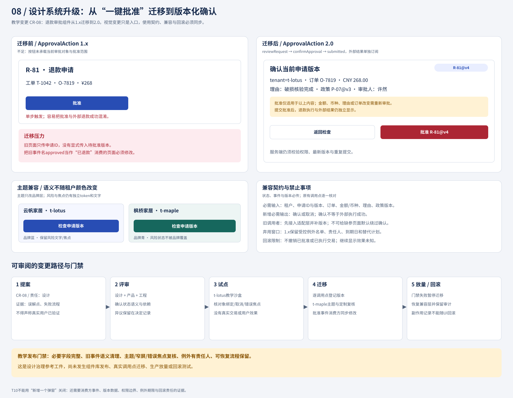

# 12 治理设计系统的变更、迁移与例外

## 本章案例背景/先读这张表

本章使用“澄明售后工作台”这一教学构造：客服林晓、主管许然和审查人员在同一个工作台处理退款申请。它包含客服工单详情、主管待批列表、批量审批、租户主题工作台和只读历史审查五类调用点。下表先定义本章所有编号、版本和人物；它们都是合成的教学对象，不要求读者先读其他章节，也不表示澄明已在真实产品中发布过这些变更。

| 名称                   | 在案例中表示                                                                         | 如何进入本章                                               |
| -------------------- | ------------------------------------------------------------------------------ | ---------------------------------------------------- |
| **CR-08**            | “审批组件变更提案”的教学编号                                                                | 把旧的 `ApprovalAction` 合同从 1.x 迁到 2.0，并规定迁移、例外和回滚的治理边界 |
| **1.x**              | 旧调用合同版本：只有申请 ID（旧字段名为 `requestId`），`approved` 常被消费成退款成功，主题还可能覆盖风险与焦点语义         | 代表迁移前的组件和页面；旧调用者不能无修改替换                              |
| **2.0**              | 本章设计的目标合同版本：以 `refundId`、`refundRevision` 和权限/状态字段绑定具体摘要，分层表达检查、确认、提交，独立记录外部效果 | 代表迁移后的组件、事件和状态；不是自动完成的真实发布版本                         |
| **DEF-01（旧稿 C1）**    | 旧组件只传 R-81，无法知道用户看到的是 v3 还是 v4                                                 | 这是 CR-08 的第一条原始失败；迁移后必须绑定 `refundRevision`           |
| **DEF-02（旧稿 C2）**    | 旧页面监听 `approved` 后立即显示“已退款”                                                    | 这是第二条原始失败；迁移后必须拆开提交、批准和外部效果                          |
| **DEF-03（旧稿 C3）**    | 租户主题把危险状态和焦点覆盖成品牌色                                                             | 这是第三条原始失败；迁移后风险语义和焦点 token 独立                        |
| **CALL-01（旧稿 C-01）** | 客服工单详情：只有退款申请 ID，客服林晓无批准权，却可能看见直接批准入口                                          | 先保留“提交审批”，补当前摘要和权限检查，不让无权角色发出批准意图                    |
| **CALL-02（旧稿 C-02）** | 主管许然的待批列表：有金额但缺申请版本，旧页面收到 `approved` 就显示“已退款”                                  | 需要读取当前版本，并把批准提交与外部退款结果分开                             |
| **CALL-03（旧稿 C-03）** | 批量审批页：一个 `approved` 被当成整批成功，无法区分逐项冲突、成功和未知                                     | 在逐项版本和结果齐全前冻结批量写入口                                   |
| **CALL-04（旧稿 C-04）** | `t-maple` 租户主题工作台：`brandColor` 覆盖危险状态和键盘焦点                                     | 只允许品牌定制动作色，恢复独立的风险、待决和焦点 token                       |
| **CALL-05（旧稿 C-05）** | 只读历史审查页：旧批准记录缺少当时用户所见摘要，历史文案可能被误读为当前结果                                         | 保留原版本和“范围不完整”提示，不重放历史事件或触发退款                         |
| **R-81**             | 退款申请的身份；本章沙盒先处理 `R-81@v4`，随后故意改成 v5                                            | 用来演示版本冲突、批准提交、发送尝试和查询尝试必须保持同一申请身份                    |
| **T-1042**           | 售后工单身份，指向申请 R-81                                                               | 林晓从 CALL-01 打开这张工单并提交“请主管审批”的请求；工单不是退款申请本身           |
| **O-7819**           | 与 R-81 关联的订单身份                                                                 | CALL-02 由主管许然核对的摘要必须同时显示订单、金额和币种，避免只凭申请 ID 批准        |
| **P-07@v3**          | 批准时适用的政策版本                                                                     | 作为 R-81@v4 的核对输入；政策版本不能被组件包版本或申请版本替代                 |
| **林晓**               | `t-lotus` 客服角色，只能在 CALL-01 发起审批请求、读取摘要                                         | 体现 CALL-01 的权限边界；她不能取得主管批准权，也不能把提交当退款完成              |
| **许然**               | 主管角色，负责在 CALL-02 核对并批准 R-81@v4                                                 | 她的批准仍须经过授权服务的权限、版本和当前内容检查，不由组件自行授予权限                 |

本章的四句定位是：**核心问题**——设计系统如何在真实产品变化中持续有效，而不变成不可质疑的规则库；**本章结论**——用公共合同、调用盘点、迁移门禁、受限例外和保留事实的回滚来维持语义；**成立条件与边界**——必须有可核对的版本字段、可盘点的调用方、分开的权限/批准/外部效果和独立 QA 复验，本章不实现支付服务，也不证明真实发布成功；**决定权**——设计负责人提出变更，产品与风险责任者决定业务暂停或例外，发布负责人协调回退，QA 按原例复验。

### 本章最小完整轨迹

先由客服林晓在 **CALL-01** 提交“请主管审批”请求，再从 **DEF-01** 看旧组件只携带 R-81、没有 `refundRevision`；随后由 **CR-08** 提出 2.0 合同，主管许然在 **CALL-02** 沙盒打开并核对 `R-81@v4`，故意改成 v5 后点击旧按钮；教学预期是版本冲突，保留旧摘要和差异、禁止发送旧批准，补齐当前版本后再由 QA 用同一反例复验。这个轨迹是阅读入口，后文再展开其他调用点、例外和回滚；它不是已经执行的真实迁移。

旧稿把 `C1`–`C3`（三条失败）和 `C-01`–`C-05`（五个调用点）写得过于相近；本修复将它们明确改称为 **DEF-01–DEF-03** 与 **CALL-01–CALL-05**。因此本章没有独立的“C4/C5 缺陷”：若在旧记录中看到 C1/C2/C3，分别按 DEF-01/02/03 阅读；若看到 C-01…C-05，按 CALL-01…05 阅读。阅读顺序固定为：**旧组件问题（DEF-01–03）→ CR-08 变更提案 → 只读适配与分阶段迁移（CALL-01–05）→ 受限例外 E-08 → 保留事实的回滚**。沿这条路径阅读，读者会先看到旧语义为何不可靠，再看到合同如何改变、哪些调用点必须阻断、何时允许只读例外，以及回滚时哪些业务事实不能被清空。

设计系统是否有效，不取决于组件库是否整齐，而取决于业务改变后，旧调用者能否保持正确含义。澄明把“一键批准”改为“检查具体版本后批准”，会同时影响页面事件、权限、主题、文案、旧链接和工作方式。只画一个新弹窗，没有迁移计划，旧页面仍可能把批准当已退款。本章完整演示教学变更CR-08；所有调用点、时间和记录均为合成，并未在真实产品发布或执行回滚。

## 变更提案从具体失败开始

CR-08的输入是三条可复现原始缺陷（DEF-01–DEF-03），并在五个调用点（CALL-01–CALL-05）暴露：旧组件只传R-81，客服林晓无批准权且不知用户批的是哪一版本；旧页面监听`approved`后立即显示“已退款”；租户主题把危险状态和焦点覆盖成品牌色。CALL-03还把一个`approved`当成整批成功，CALL-05无法可靠还原当时用户所见摘要。它们不是“样式不统一”，而是对象、权限、结果和历史含义都不可靠。

提案目标：批准意图必须绑定当前摘要与版本；批准提交、批准结果、退款外部结果分开；品牌定制不覆盖风险语义和焦点。非目标：本轮组件变更不实现支付服务、不改变退款政策、不自动迁移真实历史批准。成功条件是每个调用点能够给出必要字段、消费正确事件、保持未决结果，且能通过同一组异常轨迹。



## 实际差异：输入、事件和视觉都改变

以下是教学合同差异，不是可部署应用代码。删去的隐式成功语义必须在消费方同步处理。

```diff
 ApprovalAction
- input: requestId, title?, body?, brandColor? // 仅1.x旧名，值是申请ID；下称legacyRequestId
- event: approved(requestId) // 仅1.x申请参数；旧调用者常误当退款完成
+ input: tenantId, ticketId, refundId, refundRevision
+ input: orderId, amount, currency, reason, policyVersion
+ input: permissionState, approvalState, effectState
+ event: reviewRequest(refundId, refundRevision)
+ event: confirmApproval(refundId, refundRevision, reviewedFields)
+ event: submitted(refundId, refundRevision, requestId) // 本次批准请求已提交，不是退款成功
+ outcome: 独立接收授权服务批准结果与外部效果结果
- visual: theme.brand 直接覆盖所有强调状态
+ visual: action.primary 可随主题；status.danger/pending 与 focus.ring 独立
```

版本名采用本案例自己的治理约定：1.x到2.0表示调用合同不兼容，旧页面不能无修改替换。组件包版本、R-81申请版本和P-07政策版本是三种不同对象；组件升级不会让旧批准自动获得新业务版本。没有明确公共合同，就无法判断是否兼容。

身份也必须迁移，不只改事件名。本章2.0统一使用`refundId="R-81"、refundRevision=4`表达申请R-81@v4；这对应第21章批准/发送接口中的`actionId="R-81"`与其`expectedVersion=4`或匹配的`approvedVersion=4`。第07章的`requestId`仍表示一次请求尝试，第21章的`attemptId`表示一次执行尝试，二者都不是申请身份。一次批准提交、退款发送或结果查询各自记录尝试ID，但始终关联同一refundId及相关申请版本。

例如先发退款尝试`send-01`、失联后发查询尝试`query-02`，申请仍是R-81@v4，不能因新尝试产生R-82。上面的`submitted`携带该次批准请求的requestId，只能证明这次请求已提交；实际退款发送另有自己的尝试ID。历史1.x的`requestId`是本例曾错误命名的申请字段，本章将该旧名标作`legacyRequestId`以免混同2.0；迁移时确认其值确为R-81后映射到refundId。不得把历史字段原样沿用成2.0的requestId，也不得拿发送尝试ID填入refundId。批准版本、草稿版本和政策版本保持各自身份，互不替换。

`reviewedFields`并不是前端拥有审批权的证明，而是用户确认了哪份摘要的意图记录。授权服务仍要检查权限、申请版本与当前内容。`submitted`也不能被文案系统翻成“已退款”；若消费者只认识`success`，它必须迁移，不能由适配层编造成功。

## 先盘点消费方，避免只升级看得见的页面

| 教学调用点                | 现有依赖                     | 迁移动作                               | 阻断条件/责任             |
| -------------------- | ------------------------ | ---------------------------------- | ------------------- |
| CALL-01 林晓客服工单详情     | 仅有R-81 ID；客服无批准权         | 保留“提交审批”，不挂主管批准组件；补当前摘要读取          | 客户端负责人；无权角色不得出现批准意图 |
| CALL-02 许然主管待批列表     | 有金额，但缺申请版本；approved触发已退款 | 读取当前版本，打开摘要；结果区拆批准与外部效果            | 客户端+数据服务；版本缺失阻断确认   |
| CALL-03 批量审批页        | 一次approved代表整批成功         | 先停用整批批准；补逐项版本、结果和异常后再启用            | 产品决定范围；组件不能抹平部分成功   |
| CALL-04 t-maple主题工作台 | brandColor覆盖危险与焦点        | 品牌映射留action.primary，恢复独立风险/焦点token | 设计系统负责人；主题检查不通过不放量  |
| CALL-05 只读历史审查页      | 显示旧批准与旧文案                | 加“历史批准记录”及原版本，结果从独立记录取             | 审查页负责人；不重写历史事件      |

盘点必须含隐藏消费方：移动页、邮件深链打开页、嵌入式面板、批量页、后台历史。否则桌面新版看似正确，旧移动页仍能省略版本。高级设计师不需要亲自写所有页面，但要能把变化的影响讲清并让责任人签收。

## 分阶段迁移的完整演算

**第一步，冻结合同与反例。** 保存1.x调用清单，提交2.0输入/事件定义与状态板；固定T03内容改变、T04超时未知、T08焦点错误恢复、T10主题与迁移四类反例。不要在验收时为了放行删除难例。

**第二步，建立只读适配层。** 旧调用点可以先显示2.0摘要，但只有数据服务提供当前版本及权限后才开放确认。适配层不能给缺失version填`latest`，因为“最新”不是用户看过的具体内容；也不能把旧`approved`直接改名`refundSucceeded`。

**第三步，沙盒试点CALL-02/t-lotus。** 由主管许然注入并核对R-81 v4、CNY 268.00、P-07@v3，打开确认后改成v5，再点旧按钮。预期为版本冲突，保留旧摘要与差异，不发送旧批准。再注入发送超时，预期显示待核对且不能再次退款。测试记录按实际执行由独立岗位填写，本章只交固定脚本。

**第四步，按依赖扩展。** 先迁CALL-04主题，再迁移动详情，最后在逐项合同完整后恢复CALL-03批量。CALL-05仅变显示，不重写旧记录。顺序来自风险与依赖：批量缺逐项结果会放大未知，不应因为用量大就最先切换。

**第五步，弃用并关闭例外。** 每个1.x调用点登记替代版本、负责人和截止条件；移除前通过引用清单与实际运行观察确认没有消费。没有观测能力时不能写“已无调用”，应保持保守兼容但冻结新接入。

## 例外不是绕过保护的许可证

教学例外E-08：CALL-05历史审查页在两个迭代内仍显示旧批准记录，因为数据迁移不能可靠补出历史用户所见摘要。批准人是产品负责人，责任人为历史页维护者；允许范围仅只读历史展示，必须显示“旧版记录，批准内容范围不完整”，不允许再次批准或触发退款。退出条件是能映射原始历史摘要，或提供经过批准的长期只读展示方案。到期未解决时升级决定，不自动续期。

相比之下，CALL-02“为了赶进度缺version也能批准”不能成为例外，因为它直接破坏本次变更要建立的不变量。合理的替代是保留旧只读页面、让有权者到支持版本核对的流程处理；少一个入口比伪装安全更诚实。

## 回滚到什么状态，保留什么事实

回滚不是时间倒流。已经批准、已发送或结果未知的R-81不能随组件库恢复到1.x而消失；数据和外部事实必须保留。

| 触发                | 可执行的回退                | 必须保留           | 禁止动作                |
| ----------------- | --------------------- | -------------- | ------------------- |
| 新布局严重遮挡确认字段       | 停2.0写入口，恢复能完整查看摘要的兼容页 | 当前版本、未决结果、原审计  | 恢复缺摘要的一键批准          |
| t-maple主题覆盖危险/焦点  | 回退主题映射到安全默认值          | 租户身份与业务状态      | 以品牌为由去掉风险文字         |
| submitted被消费为退款成功 | 冻结受影响显示/写操作，恢复分层结果适配  | 实际请求与结果记录      | 批量将success改成failure |
| 外部查询服务不可用         | 保持结果待核对，转人工流程         | R-81、批准v4与发送尝试 | 给所有未知项自动重试          |
| 2.0某浏览器焦点异常       | 回退到页面式确认或经过验证的对话框     | 用户输入与当前任务      | 用隐藏焦点环掩盖问题          |

回滚决策由发布负责人协调，业务能力暂停由产品与风险责任者确认，组件负责人提供兼容方案，QA按原例复验。设计师记录何种体验退化被接受，不能私自决定忽略金额或权限。没有实际回滚执行时，只能称回滚设计，不能写“已验证可恢复”。

## 来源卡也要治理：v1到v2的第二个例子

旧SourceCard v1只有`url、title、verified`。新v2增加来源ID/版本/范围、freshness和每条claimSupport。迁移不能用`verified=true`填满所有主张：旧“核验”可能只检查链接存在。正确适配是保留原链接与历史标签，但新support=not_checked，freshness=unknown；页面显示“历史来源已登记，当前主张待核对”。只有实际完成逐句核对才转supported。

这个变化会降低看板上的“已核验比例”，但它是口径更真实，不是产品质量忽然下降。应同时报告历史口径、新口径和待核对数，不通过偷偷更换分母证明改善。此类语义迁移常比外观迁移更难，因为它改变团队如何理解证据。

完整可复用的提案卡、迁移工作单、例外与回滚脚本见[CR-08治理记录参考产物](../exercises/12-governance-records.md)。它可用于练习接收与审查，签收和运行结果需另填真实证据。

## 度量治理成效而不是只数采用率

组件覆盖率说明多少调用点接入，合同完整率说明必需字段与合法状态是否具备，迁移缺陷说明哪里产生误消费；用户任务成功与操作负担还要由真实评价取得。教学盘点5个调用点全部接入，只能得到“5/5接入”，不能推出退款更安全。也要记录例外存续、重复适配代码、团队维护成本和因迁移阻断的功能，用于决定下一轮投入。

## 分层练习与完整参考解法

**基础：** 为什么新弹层增加一个二次确认不够？参考：若输入仍无版本，确认的还是不稳定对象；若事件仍叫approved且消费方当退款成功，文案依然错误；若旧主题覆盖警告、键盘焦点丢失，用户甚至不能正确检查。修复对象合同、事件消费和可达性，弹层只是其中一种表达。

**迁移：** CALL-03批量页本期拿不到逐项版本，怎样处理？参考：冻结批量批准写入口，保留筛选、预览和跳到单项审批；不要给每项填同一个全局version。产品记录降级范围，工程补逐项版本/结果，QA再用部分成功与旧版本反例复验后恢复。若业务必须当期批量，只能另寻已有可靠服务路径，不由设计虚构能力。

**综合：** 发布后发现新组件把旧已批准R-81显示成未批准，能否清空数据重建？参考：不能。先冻结误导操作，读取原记录及对应版本，区分字段映射缺失和真实未批准；恢复只读正确显示，保留所有外部结果。对无法映射的历史记录标范围不完整并人工核对，不重复批准或退款。回滚UI与修数据是不同决定，由各自责任者处理，复验必须含一笔成功、一笔未知、一笔历史缺字段记录。

### 基础补学

贡献是提出变更，评审是决定合同是否成立，发布是让新消费者采用，迁移是让旧消费者正确适配，弃用是结束旧承诺，回滚是恢复一个可接受状态。它们都属于设计系统，但没有任何一步能靠“组件已画完”自动完成。
