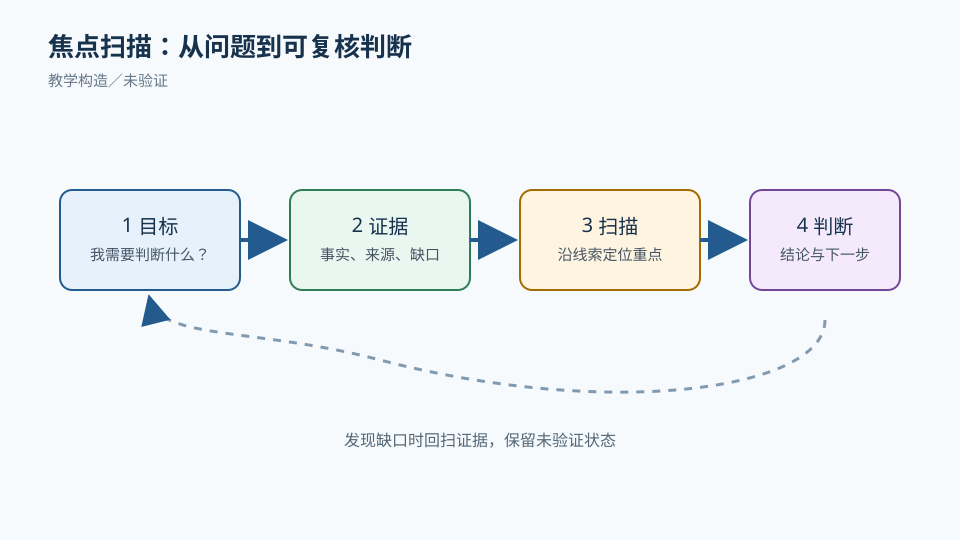
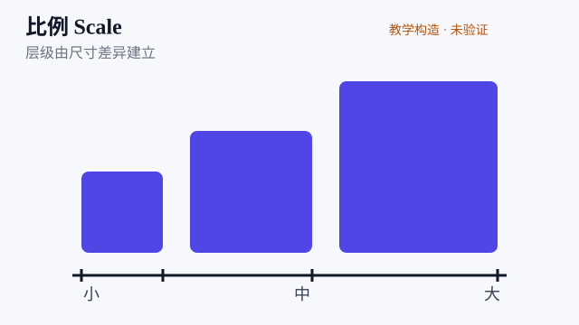
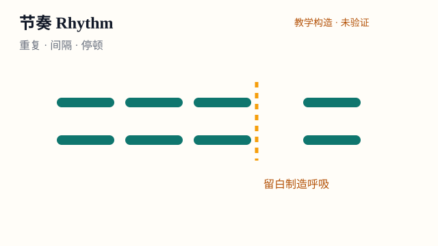
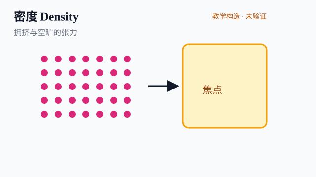
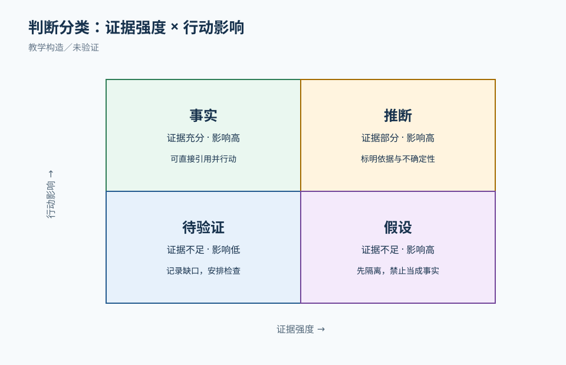
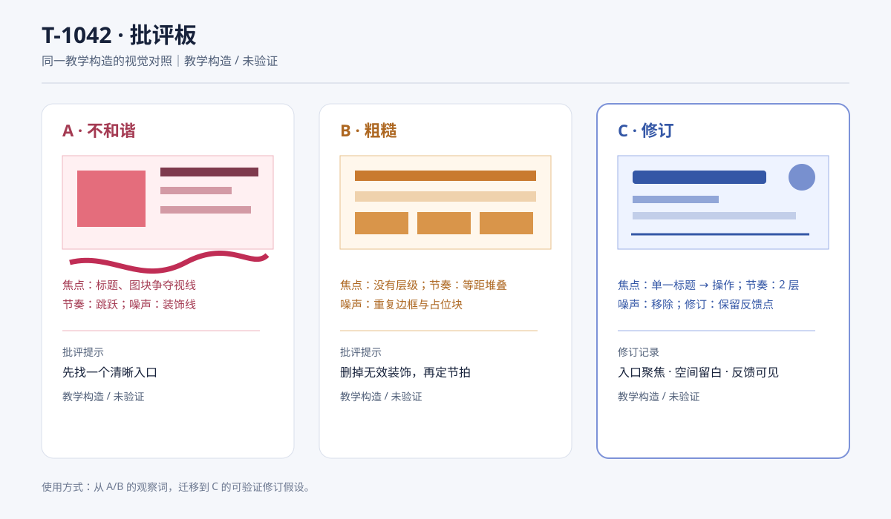

# VA01 视觉感知与审美判断：把“好看”变成可讨论的观察

## 本章要回答的问题

同一界面为什么有人说“舒服”，有人说“凌乱”？  
本章把这种感受拆成可观察、可改变、可复验的变量。  
核心结论是：视觉判断必须同时回到任务、受众、渠道和约束。  
焦点、扫描路径、比例、节奏、密度、张力与和谐是分析工具，不是装饰清单。  
审美选择只有在语义正确、可用且包容的前提下才有意义。

本章使用 T-1042“售后工单列表”合成案例。  
T-1042 不是现有产品的真实数据，也没有真实用户研究记录。  
案例中的客户姓名、金额、状态和时间均为教学构造。  
所有视觉对照板、A/B 截图描述和练习答案都标记为教学构造。  
它们可训练推理，却不能证明上线效果、品牌批准或职业胜任。

## 先建立观察语言

### 焦点与扫描

焦点是观察者在有限时间内最先获得的视觉对象。  
首看点可能是标题、风险状态、金额或主按钮。  
设计师要先写任务，再判断首看点是否正确。  
客服主管的首要任务是找出高风险未解决工单。  
因此，若“退款风险”比普通工单更晚出现，焦点就与任务冲突。  
扫描路径描述视线如何从首看点移动到第二、第三信息。  
可以用箭头、编号或口述记录路径，不必假装有精确眼动数据。  
缩略图检查可发现整体焦点；放大检查可发现文字、边界和图标问题。

对应练习图（见上方焦点与扫描板）。教学任务：先遮住版本结论，在三秒内标出首看点、第二看点和风险扫描路径，再说明它们是否服务主管的任务。状态：**教学构造/未验证**，不代表真实眼动、上线效果或用户研究结果。

### 比例与尺度

教学任务：在 T-1042 中比较标题、风险状态、金额与主动作的相对面积，标出一次服务任务优先级的比例调整，并写明长姓名或窄屏下的变化。状态：**教学构造/未验证**，图示比例是假设夹具，不代表品牌规范、浏览器布局或真实用户效果。

比例是元素与元素、局部与整体之间的相对关系。  
标题太大可能压住工单信息，标题太小又无法建立入口。  
按钮面积应与操作重要性、点击精度和文本长度共同决定。  
黄金比例可以作为探索候选，不能当成所有屏幕的普遍法则。  
真正的判断要问：改变比例后，阅读、操作或状态辨识发生了什么？  
桌面列表可容纳更多列，窄屏则需要重排，而不是等比缩小。  
长姓名、四种币种和大字号会改变原先看似稳定的比例。

### 节奏、间隔与停顿

教学任务：沿工单列表标出重复节拍、风险前的停顿和一处可能造成噪声的过度变化，说明它们如何影响扫描与分组。状态：**教学构造/未验证**，间距阶梯和停顿是课堂假设，未经过浏览器、眼动或真人任务验证。

节奏来自重复、间隔和变化的可预测组合。  
相同状态卡片保持相近间距，读者能快速分组。  
在风险工单前加入明显但克制的停顿，可让风险被看见。  
每一行都用粗边框、亮色和大图标，会消除停顿，形成噪声。  
间距不是空出来就自动有益；过大的空白可能把关联信息拆开。  
建议先定义间距阶梯，再记录偏离阶梯的原因。  
例如 8、12、16、24 CSS px 是候选 token，不是硬性美学真理。

### 密度与张力

教学任务：比较普通工单与退款风险工单的承载密度和视觉对比，指出一处张力不足或过强的位置，并提出不依赖颜色的修订。状态：**教学构造/未验证**，密度与张力关系用于训练推理，不证明可读性、误判率或上线效果。

密度是单位空间承载的信息量和视觉刺激量。  
高密度可支持比较任务，低密度可支持叙事和聚焦。  
密度应沿任务优先级变化，而不是整页统一“通透”。  
张力来自有意的差异：大小、粗细、明暗、形状或方向形成对比。  
张力过弱，所有内容同样重要；张力过强，元素互相争抢。  
和谐不是消除差异，而是让差异属于同一语义和视觉系统。

### 六类判断不要混在一起

个人偏好是“我喜欢圆角”或“我觉得蓝色高级”。  
它可以提出探索方向，却不能单独否决方案。  
语义适配关注视觉是否帮助受众理解任务、状态和产品气质。  
可用性与无障碍问题关注是否可读、可操作、可感知和可重排。  
例如低对比正文、只靠颜色区分状态、键盘焦点不可见，属于风险问题。  
工艺缺陷是字距、对齐、裁切、溢出、图标光学尺寸等可修复错误。  
同一元素可能同时涉及几类判断，必须写出证据和优先级。

四类判断的对照仍使用上方四类判断板：把板上观察分别归入个人偏好、语义适配、可用性/无障碍或工艺缺陷，并为每项写出可复核证据。该图是**教学构造/未验证**，教学任务只训练归因，不证明任何真实用户偏好或任务成功。

## T-1042 合成案例合同

对象：售后工单列表，默认显示 20 条工单。  
字段：工单号、客户、金额、状态、风险、更新时间、下一动作。  
状态：待处理、处理中、待客户、已解决、结果未知。  
任务一：主管在 10 秒内定位所有退款风险且未解决的工单。  
任务二：客服打开工单后确认下一动作，不误把草稿当已发送。  
约束：中文姓名可能很长，金额使用人民币、美元、日元和欧元。  
约束：窄屏宽度 320 CSS px 等价场景；允许折叠次要字段。  
约束：状态不能只靠颜色表达，需文字、形状或位置冗余编码。  
约束：教学案例不代表真实业务、浏览器、读屏或品牌规范已验证。

## 版本 A：美观但误导

A 版使用深蓝渐变背景、玻璃卡片和大号“查看详情”按钮。  
每张卡片都有相同强度的亮边和阴影，风险标签也使用蓝色。  
客户姓名、金额和状态被放在同一字号，视觉上没有主次。  
退款风险只以橙色小圆点表示，灰度下无法区分。  
更新时间放在左上角，主管首先看到时间而非风险。  
20 张卡片之间间距完全相同，风险工单没有停顿。  
桌面上卡片三列排布，窄屏时整列缩小，文字变得难读。

A 版的第一眼路径可记录为：渐变标题→亮色按钮→时间→客户姓名。  
这条路径没有进入高风险状态，任务失败是结构性的。  
“更高级”的玻璃效果属于个人偏好，不能抵消风险误读。  
橙色点的辨识问题同时是语义适配和无障碍问题。  
按钮过大、字距不齐和卡片边缘不齐属于工艺缺陷。

### A 版的修订诊断

先保留任务合同，不急着换色板。  
用灰阶缩略图标出第一、第二和第三看点。  
把风险字段改成“退款风险”文字加警示形状和位置标记。  
让未解决风险行拥有更强的结构差异，而不是仅增加饱和度。  
把主按钮从每张卡片移到详情页，减少动作竞争。  
将金额、客户与更新时间按比较任务重排为稳定列。  
在长姓名和多币种数据上检查列宽、折行和对齐。

## 版本 B：可用但粗糙

B 版改成白底黑字，风险行有“退款风险”文字和三角图标。  
标题、字段和按钮层级清楚，主管可以快速定位风险。  
灰度打印后仍能读出状态，键盘焦点位置有明确边框。  
但是所有边框都是 1px 黑线，卡片间距只有 4px。  
字体行高过小，长姓名与金额相互挤压。  
图标与文字基线没有对齐，表头和正文边缘也未统一。  
没有品牌气质，页面显得像临时表格。

B 版证明“可用”不等于“完成度高”。  
清晰的语义和结构先保护任务与包容性。  
随后才能处理工艺、节奏、材质与产品气质。  
不应为了追求质感而撤掉 B 版的文字和冗余编码。

## 第三版：在约束内建立和谐

第三版保留 B 版的文字状态和非颜色编码。  
背景使用低对比中性色，风险组增加一条稳定的左侧结构线。  
标题、风险结论、客户和金额形成四级层级。  
间距采用 8/12/16/24 的阶梯，风险组前后使用 24 的停顿。  
普通工单使用轻边界，风险工单使用较厚但不过亮的边界。  
“退款风险”文字、警示形状、位置和排序共同承担状态。  
主动作只在详情页出现，列表提供“打开工单”的次级动作。

第三版的桌面构图是表头固定、风险组置顶、普通组可滚动。  
760px 时金额与更新时间折到第二行，风险状态仍在第一行。  
320 CSS px 等价场景中，字段改为标签—值纵向组。  
长姓名完整显示或明确省略并提供可访问名称。  
多币种金额带币种代码，不用符号猜测货币。  
大字号和高对比模式保持状态文字与结构线。

第三版的视觉命题是“可信的处理秩序”。  
可信来自稳定层级、克制材质和可追溯状态，而非渐变本身。  
这是教学构造的方向说明，不是品牌批准或用户偏好结论。

## 两种可行设计方向

### 方向一：高密度比较工作台

适用条件是主管每天处理大量工单，需要横向比较。  
使用稳定表格列、紧凑间距、风险置顶和固定筛选栏。  
优点是扫描成本低，长列表中能保持位置记忆。  
代价是初次学习成本较高，小屏需要明确重排。  
不可接受的实现是缩小字体来保留所有列。  
应提供列折叠、横向滚动或纵向标签值方案，并注明选择理由。

### 方向二：分层叙事与风险聚焦

适用条件是工单量较少，但每笔需要解释上下文和下一动作。  
首屏显示风险摘要、客户、金额和下一动作，细节进入详情。  
优点是能让新手按故事理解工单，品牌表达空间更大。  
代价是跨工单比较较慢，主管可能频繁进入详情。  
不可接受的实现是把关键状态藏在装饰性摘要后面。  
当风险数量上升到 200 条时，应迁移为分组列表或增加比较视图。

选择方向前，先记录工单量、任务时限、设备、受众和风险。  
两种方向都可成立，结论会随这些条件改变。

## 可审阅视觉工件

配套对照板：

。  
该文件展示同一 T-1042 内容的 A、B、C 三个教学构造版本。  
A 代表视觉吸引力与任务焦点冲突的方案，B 代表语义清楚但工艺粗糙的方案，C 代表在既定约束下的第三版修订。  
对照板不是当前应用截图、品牌定稿、真实用户结果或浏览器实现证据。  
读者查看时先遮住版本结论，分别写下首看点、第二看点、风险状态和下一动作。  
再打开注释，核对自己是否把个人偏好误写成语义、可用性或工艺问题。  
最后沿同一任务检查灰度、长姓名、多币种、760px 和 320 CSS px 等价场景。  
文件本身只支持课堂观察；浏览器、键盘、读屏、性能、真人理解和上线效果仍未验证。

## 正常轨迹与失败轨迹

### 正常轨迹

第一步，写明受众、任务、状态和渠道，不先挑颜色。  
第二步，做 A/B 同内容对照，记录首看点和扫描顺序。  
第三步，把“凌乱”改写为对齐、比例、节奏或密度变量。  
第四步，提出至少两个可行方向，并写清代价。  
第五步，在灰阶、长姓名、多币种、760px 和窄屏中复查。  
第六步，保留第三版、A/B 版本、修改理由和未验证项。  
第七步，把实现限制交给工程和 QA，不能用静态稿代替实测。

### 失败轨迹

设计师看到 B 版后说“太廉价”，要求恢复玻璃和渐变。  
评审追问：廉价是材质问题、品牌问题，还是个人偏好？  
若问题是工艺，可调整边界、字距和间距，而不是隐藏状态。  
若问题是语义气质，可降低边框噪声并建立有限材质规则。  
若问题是偏好，保留为候选，不把它写成任务缺陷。  
若加入渐变导致风险对比下降，则退回并记录反例。  
修复后要重跑原任务与受影响变体，不能只看新截图。

## 分层练习与参考分析

### 基础练习：找出视觉变量

给出 A、B 两版教学构造板。  
请圈出首看点、第二看点、重复、对齐线和最大噪声。  
参考分析第一步：A 的首看点是渐变和按钮，风险没有进入路径。  
第二步：B 的首看点是标题和风险文字，状态可由灰度复核。  
第三步：A 的问题不是“风格不好”，而是焦点与任务冲突。  
第四步：B 的问题是间距、基线和材质粗糙，属于可修工艺。  
第五步：修订应先保护 B 的语义，再处理边界、行高和节奏。  
仍未知：没有真实用户盲看数据，不能声称扫描更快。

### 迁移练习：改变数据条件

把工单从 20 条改为 200 条，姓名改为最长 18 个汉字，加入四种币种。  
参考分析第一步：200 条使卡片叙事方向的比较成本上升。  
第二步：稳定列、分组和筛选更适合密集比较，但需小屏降级。  
第三步：长姓名要求明确折行或省略规则，不能靠裁切。  
第四步：金额带币种代码，并保持小数位规则一致。  
第五步：在窄屏将列转为标签—值组，风险仍置于首屏。  
可行替代是保留叙事详情并增加比较视图，代价是实现复杂度增加。  
仍未知：实际主管是否愿意切换视图，需要研究记录支持。

### 综合练习：品牌色与警告色冲突

品牌规定高饱和红不可使用，但退款风险必须突出。  
参考分析第一步：列出不可变语义，风险不能依赖红色或颜色单独表达。  
第二步：采用文字“退款风险”、警示形状、排序和结构线的组合。  
第三步：品牌色可用于标题或选中态，但不得覆盖风险对比。  
第四步：检查灰度、色觉差异、200% 字号和窄屏折行。  
第五步：比较高密度工作台与叙事聚焦两套方案，按工单量选择。  
第六步：若品牌坚持全屏低对比，则记录冲突并交产品/品牌负责人决定。  
不能用“设计师觉得更和谐”替代责任交接。  
仍未知：品牌方与真实用户的气质评价未取得。

## 来源、合成与未验证边界

本章能力要求来自 `uiux-v03-visual-aesthetics-curriculum.md` 的 VA01 交接。  
产品场景与接收条件来自 `uiux-visual-harmony-product-v01.md` 的 VH-U/VH-P 合同。  
视觉表达和写作义务参考 `uiux-visual-aesthetic-design.md` 与 `UIUX_TEXTBOOK_WRITING_STANDARD.md`。  
WCAG 2.2、Reflow 和 Status Messages 仅作为规范入口，需按具体成功标准核对。  
本稿未联网逐条核验规范原文，故不把链接写成合规证明。  
T-1042、A/B/第三版和所有视觉对照板均为教学构造。  
本稿没有运行浏览器、读屏、键盘、性能或真人用户测试。  
静态推理不能证明真实用户更快、更喜欢或更少出错。  
产品品牌、字体许可、组件实现和工程交付仍需责任岗位确认。

提交作品时应留下：收到稿、独立批评、作者返修、复验版本和哈希。  
评审记录要区分个人偏好、语义适配、可用性/无障碍风险和工艺缺陷。  
不要把课堂 0–3 描述量规平均分当作职业认证或就业结论。  
下一章 VA02 将继续处理构图、比例、节奏与空间和谐的跨屏重排。
