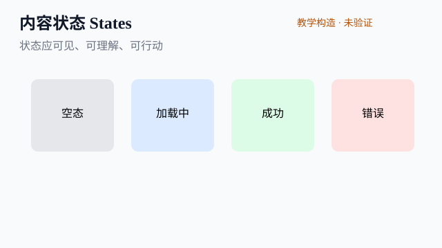
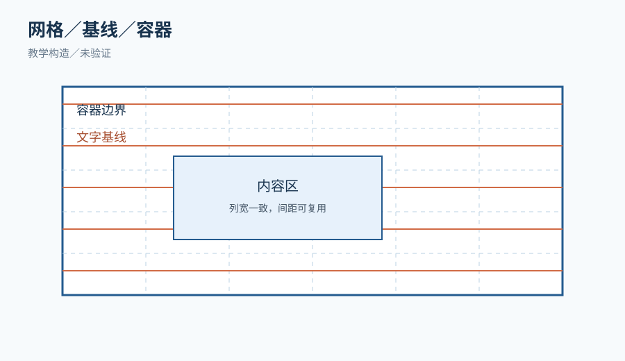
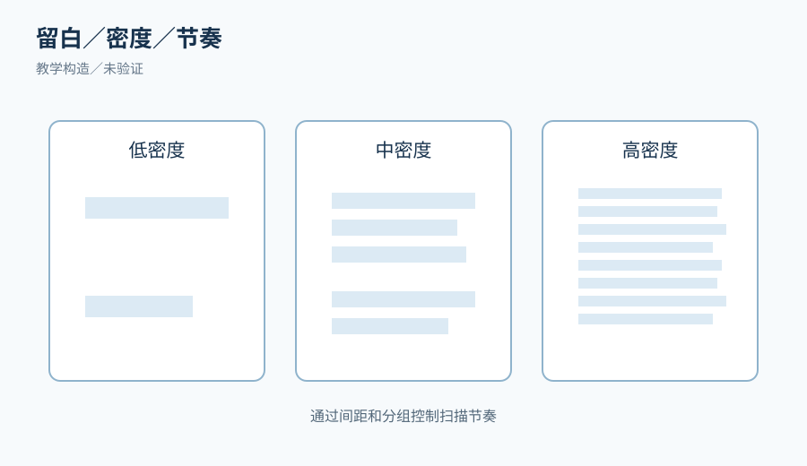
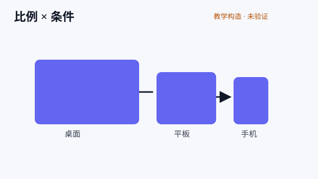
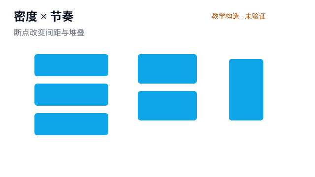
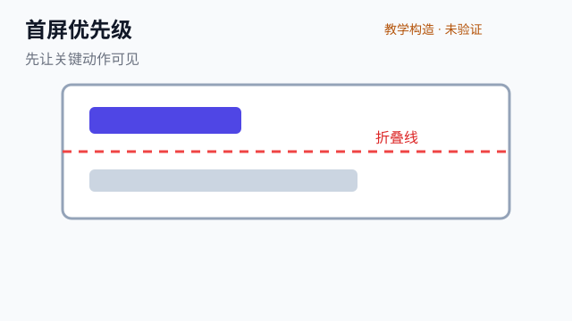
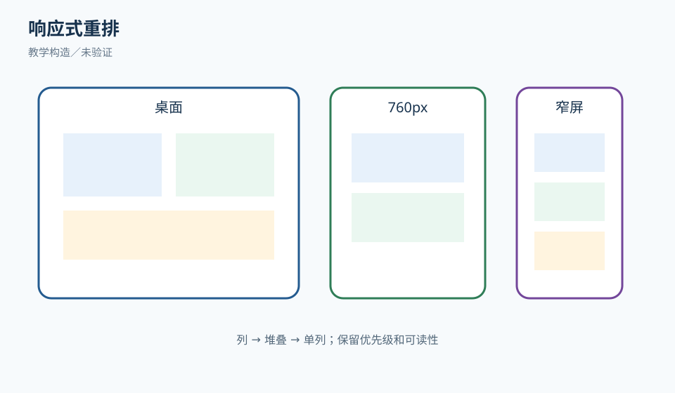
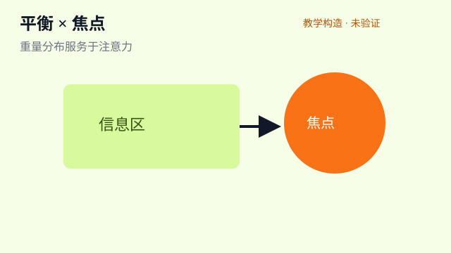
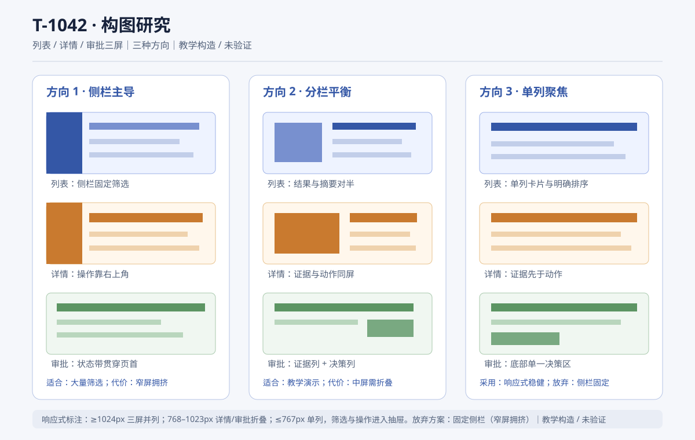

# VA02 构图、比例、节奏与空间和谐

## 本章要解决的问题

本章讨论一个具体问题：在高密度内容、不同屏宽和多种业务状态下，怎样让界面既有秩序、呼吸和记忆点，又不牺牲任务判断。

这里的“美”不是把页面变空、把字体变小或叠加装饰，而是让内容的权重、空间关系和视觉路径支持当前任务。

本章以合成的“澄明售后工作台”工单 R-81 为共同案例。

R-81 包含客户、退款金额、证据来源、当前状态、风险提示、负责人和下一步动作。

案例是教学构造，不代表真实客户、真实退款服务或已上线界面。

读者应先具备 VA01 的视觉观察语言和第 09 单元的任务层级知识。

如果尚未掌握任务、状态和可访问性基础，应先补学，而不是用本章的构图技巧覆盖逻辑问题。

完成本章后，应能标出网格、基线、容器、边界、留白、折叠线和密度梯度。

还应能提出至少两个在约束下成立的构图方向，解释代价并保留被放弃的方案。

最终交付不是一张“漂亮截图”，而是一组有版本、条件、来源和未验证边界的构图研究。

## 先固定内容和状态

教学任务：在 R-81 图中圈出首要判断、危险状态、证据与动作，核对哪些内容必须保持在同一任务组。状态：**教学构造/未验证**，状态关系和字段是合成案例合同，不代表真实业务或服务契约。

构图以前先固定信息合同，否则每次换布局都会偷偷改变任务。

R-81 的首要任务是判断退款是否可以进入人工确认。

次要任务是查看金额、客户身份、证据来源和历史动作。

危险状态是“远端结果未知”：发送后等待超时，系统不能声称成功或失败。

可执行动作是“查询状态”“停止本地等待”和“转人工核对”，而不是无条件“再试”。

每个状态至少用位置、形状、边界和文字四类线索表达，颜色只作辅助。

这一步决定哪些内容必须留在首屏，哪些内容可以折叠，哪些留白不能删除。

如果把未知状态缩成一个灰色小点，构图再和谐也会造成错误判断。

## 网格与基线：秩序的可复演机制

网格不是把所有元素强行排成棋盘，而是给对齐、宽度和分组提供共同参照。

桌面版可先假设 12 列容器，外侧边距 32 CSS px，列间距 16 CSS px。

这个数值是本案例的候选假设，不是所有产品的通用规范。

详情主栏占 8 列，状态与动作栏占 4 列；两栏共享顶部基线。

在 760px 版本，12 列可收缩为 8 列，动作栏移到内容之后但仍在同一任务组内。

窄屏不保留“看起来像桌面”的列数，而是把列关系重排为单列顺序。

基线网格控制文字行、按钮和卡片标题的垂直关系。

例如标题行高 32、正文行高 24、说明行高 20，间距阶梯采用 8 的倍数。

如果一个卡片底部出现 13px 的随机空隙，先问它是否表达状态分隔，再决定保留或修正。

有理由的偏离要写进决策记录，否则下一个页面无法复现。

网格也应覆盖失败、无结果和长姓名版本，不能只对齐理想短文本。

网格与基线练习图：。教学任务：在同一 R-81 内容上叠加列线、基线和间距标尺，标出一处有理由的偏离，并写明它如何保持状态与动作的关系。状态：**教学构造/未验证**，图中尺寸和布局是假设夹具，不是工程实现或浏览器验证。

## 容器、边界与留白

容器定义阅读范围，边界定义哪些内容属于同一责任或状态。

R-81 的证据列表与退款动作不能共用一张没有分隔的长卡片。

动作卡需要明显的边界和标题，证据卡需要来源和时间线结构。

边界可以是背景层、细线、间距或标题层级，避免每个区域都同时使用阴影和描边。

留白的作用是分组、停顿和降低误触，不是追求“空得高级”。

如果留白把“未知”状态推到折叠线下，它就隐藏了必要信息。

如果两个按钮之间没有足够间距，视觉紧凑会转化为错误点击风险。

判断一段留白是否有价值，要说明它隔开的对象、减少的混淆和付出的滚动成本。

留白、边界与密度的对照：。教学任务：圈出一个有助于分组的停顿和一个隐藏必要状态的错误留白，分别写出减少的混淆与增加的滚动成本。状态：**教学构造/未验证**，不代表真实阅读速度、误触率或用户理解。

容器宽度还受行长影响；长文说明不应铺满 12 列导致眼动往返过长。

在大字号模式下，容器可以增长高度，但不能用裁切保持原高。

## 比例工具的条件

教学任务：选择一个适合使用比例工具的区域和一个应让位于语义层级的区域，分别写出假设、代价与长标题/窄屏复查条件。状态：**教学构造/未验证**，比例线索是探索候选，不是通用美学规则或实现证据。

黄金比例、三分法或 1:1.618 可以提供初始候选，但不能替代任务和内容证据。

当页面有单一主视觉、内容量稳定、品牌允许叙事留白时，比例工具较有帮助。

当页面包含审批、金额、风险和错误原因时，语义层级优先于数学比例。

例如把风险卡缩成黄金比例的窄侧栏，可能使警示标题换行并降低可见性。

比例应被当作假设：它预计让焦点稳定、层次清楚或品牌更易识别。

随后要在长标题、窄屏、灰度和大字号条件下检查假设是否仍成立。

如果比例工具与关键状态冲突，应保留状态并改比例，同时记录被牺牲的装饰或叙事空间。

## 密度梯度、节奏与停顿

教学任务：为摘要、时间线和原始日志标注低/中/高密度及一处有语义理由的破拍，说明折叠后仍保留的判断信息。状态：**教学构造/未验证**，梯度和节奏为课堂夹具，未验证阅读速度、误触率或真人理解。

密度不是“内容越少越好”，而是让高密度区域和低密度区域承担不同任务。

R-81 顶部摘要区密度低，用于快速定位客户、金额和结果未知状态。

中段时间线密度中等，重复结构帮助扫描多个证据事件。

底部原始日志密度高，但可以折叠，默认显示最新三条及“展开全部”。

密度梯度要有方向；如果每个区域都高密度，页面会没有视觉呼吸。

节奏来自重复的卡片标题、固定间距、相近行高和可预测的操作位置。

停顿来自分组间较大的间距、阶段标题或一个明确的空状态。

重复太多会像表格噪声，变化太多会破坏预测；要找到稳定重复与有意破拍的边界。

可以把时间线做成“日期标题—事件—来源”的三拍结构，风险事件用形状和边界破拍。

破拍必须有语义理由，不能只为制造视觉兴奋。

## 首屏、折叠线与可见范围

教学任务：在给定视口和字号条件下标出折叠线，确认 R-81 标识、金额、状态与下一步动作仍可见，并记录一个需要浏览器复验的假设。状态：**教学构造/未验证**，折叠位置不代表真实浏览器、辅助技术或用户结果。

首屏不是固定像素高度，而是特定视口、字体和浏览器条件下的第一可见范围。

在桌面 1440×900 的合成视口中，首屏必须露出 R-81 标识、金额、状态和下一步动作。

在 760px 宽度下，首屏优先露出状态摘要和查询状态动作，证据列表可下移。

在窄屏下，金额与状态必须先出现，客户长资料可以折叠但不能消失。

折叠线下的内容不等于次要内容；用户仍需要有清晰的“还有什么”和展开控制。

不要通过缩小字号、减少行高或裁掉错误原因来强行把内容塞入首屏。

首屏决策应记录视口、字体缩放、浏览器工具栏和内容版本，否则无法复验。

响应式构图仍以  为课堂夹具。教学任务：比较桌面、约 760px 和窄屏的折叠线，确认金额、状态与查询动作没有因重排而消失，并记录一个待实测假设。状态：**教学构造/未验证**，尚未经过浏览器、辅助技术或真人用户验证。

## 局部突出与全局平衡

教学任务：指出 R-81 中应先被看到的判断和仍需保留的上下文，比较局部突出对全局平衡的影响，并写出一个灰度复查条件。状态：**教学构造/未验证**，突出与平衡是分析假设，不代表品牌批准、无障碍或真实任务成功。

局部突出是让一个判断或动作先被看到，全局平衡是让其他区域仍可解释。

R-81 的“结果未知”应突出，但不能让警示条夺走客户、金额和查询动作的上下文。

可用较深边界、图标、短标题和空间隔离形成突出，而不是只用饱和红色。

全局平衡不要求对称；主栏 8 列、侧栏 4 列可以是不对称但有任务依据。

如果按钮比退款金额更大更亮，局部焦点已偏离判断任务。

可用缩略图、灰度或遮掉文字做焦点检查：缩略图先看到什么，应该与任务首问一致。

平衡还要跨状态成立；成功、等待、拒答和无结果不能靠同一大色块表达。

## 同一案例的三种构图方案

### 方案 A：高密度比较

方案 A 将客户、金额、状态、证据和动作放在同一 12 列网格中。

左侧 8 列为摘要和时间线，右侧 4 列为状态与动作卡。

优点是审批者能在一屏对比关键字段，适合熟练运营人员快速处理。

代价是长标题会压缩时间线，右侧动作卡在窄屏需要重排。

它要求证据项拥有稳定的三拍结构，否则密度会变成噪声。

### 方案 B：分层阅读

方案 B 首屏只放客户、金额、结果未知状态和查询动作，证据与日志分为第二、第三层。

每层使用较大的组间距和清晰标题，适合需要先理解状态再决定动作的用户。

优点是新手的扫描路径短，风险状态不容易被日志淹没。

代价是熟练用户需要更多滚动，跨层比较金额与证据的成本提高。

它要求折叠标题能准确说明层内内容，不能用“更多”掩盖重要信息。

### 方案 C：品牌叙事

方案 C 使用一条贯穿页面的时间线，把客户请求、证据、审批和退款结果组织成故事。

状态节点用形状、编号和文字表达，背景层次较强但装饰受限。

优点是能强化产品记忆点，适合展示复杂案件的过程与责任交接。

代价是直接编辑动作不如方案 A 明显，异常分支可能需要额外分叉说明。

它要求时间线顺序真实反映业务顺序，不能为了视觉连续性伪造事件先后。

## 选择与放弃

若目标是高频审批、字段比较和低培训成本，方案 A 更可行。

若目标是降低误判、先解释未知状态，再决定是否查询，方案 B 更可行。

若目标是解释过程、交接责任和品牌记忆，且用户接受滚动，方案 C 更可行。

本案例首轮选择方案 B，因为“结果未知”是高风险状态，先确认状态比展示更多日志重要。

同时吸收方案 A 的固定金额/状态栏，避免分层后找不到关键判断。

方案 C 被保留为探索方向，待有真实叙事需求和时间线数据后再验证。

放弃方案 D：把所有信息做成无边界的瀑布卡片，并用大渐变背景制造纵深。

放弃原因一是边界不清，用户难以判断哪些动作属于哪个状态。

原因二是渐变与阴影制造多个视觉焦点，灰度和低亮度下层级更弱。

原因三是窄屏会把装饰高度推长，却没有增加可操作信息。

记录放弃方案可以防止下一轮把“有视觉冲击”误当成解决方案。

## 可审阅视觉工件

配套视觉工件为 。

请先查看图中的同一 R-81 内容，再对照 A 高密度比较、B 分层阅读和 C 品牌叙事三个方向。

图中另列放弃方案 D，读者需要指出它在哪些边界、节奏或状态表达上失败。

该 SVG 是教学构造，用于练习比较构图变量，不是当前应用截图、品牌定稿或真实用户结果。

图稿尚未由真实浏览器、读屏、键盘、窄屏、RTL、大字号、灰度或真人用户验证。

查看任务是：标出首看点、主要网格、组间停顿、折叠线假设和状态动作的关系，然后写下你会选择的方向及条件。

如果图与正文中的条件发生冲突，以正文明确的业务状态和未验证边界为准，并在批评记录中登记冲突。

## 响应式与多条件适配

桌面版本允许 8/4 列关系；760px 版本改为 5/3 列，并把动作卡固定在状态摘要之后。

窄屏版本采用单列：标识、金额、状态、查询动作、证据摘要、完整时间线、日志。

这是重排，不是把桌面截图缩小；每次移动都要说明阅读顺序是否改变。

长标题允许自然换行，按钮标签不能依赖截断显示全部含义。

RTL 版本镜像主次方向，但警示图标、数字书写和时间线方向需按语言规则核对。

不能把“左右镜像”当作完整 RTL 适配；焦点顺序、图标含义和数值格式也要检查。

大字号或 200% 文本间距下，卡片高度应增长，操作不能重叠或被裁切。

灰度检查要求状态仍可通过文字、形状、位置和边界识别。

缺图时，容器应保留标题、替代文本和来源，不用空白洞或破图图标冒充内容。

字体回退时，重新检查行长、基线、按钮高度和折叠线，不能假设字宽不变。

响应式重排练习沿用上方的 `VA02-responsive-reflow.svg` 图，避免同一概念在本章重复嵌图。请分别标注桌面、760px 和窄屏的内容顺序，并说明长文、RTL、大字号和灰度条件下哪些关系需要重新验证。

## 正常轨迹

第一步写明任务、状态、用户、视口和不可删除字段。

第二步叠加网格和基线，给每个偏离写语义理由。

第三步做 A、B、C 三个构图，并用同一内容和同一状态比较。

第四步在桌面、760px、窄屏、长文和灰度版本复查首屏与节奏。

第五步记录扫描路径、滚动成本、状态可辨性和响应式风险。

第六步选择满足当前任务的方向，保留被否决方案和选择条件。

第七步输出关键屏、标注稿、决策记录、来源和未验证清单。

## 失败轨迹与修复

失败开始于“为了通透”把正文缩到 12px，并把状态卡推到折叠线下。

观察信号是用户先看到装饰标题，却找不到结果未知和查询动作。

第二个信号是 200% 字体间距后摘要重叠，窄屏出现横向滚动。

修复不是再加一个红色警告，而是恢复最小可读字号、重新排序首屏字段。

把动作放回状态摘要旁，减少装饰背景层，增加状态与证据之间的组间距。

再用同一长标题、长姓名和失败状态复查，确认问题确实来自构图而非单纯颜色。

若修复后滚动增加，应记录这是为避免误判付出的代价，而不是宣称“体验全面提升”。

另一个失败是用统一卡片高度裁切长文案，导致退款原因只显示半句。

修复应允许高度自适应，并为超长内容提供展开控件和完整文字替代。

## 分层练习一：基础识别

给出一张边缘不齐、间距随机、标题与按钮同样突出的 R-81 草图。

任务是标出网格线、基线、三处分组边界、首看点和两个节奏断裂。

参考分析先指出可观察事实：卡片左缘不一致、标题行高混乱、动作与来源没有边界。

再解释机制：对齐不稳会增加扫描成本，等权重会掩盖状态优先级。

接着提出改动：统一容器、建立 8 的间距阶梯、把状态与动作绑定为一组。

最后写代价和验证：可能增加纵向高度，需要在窄屏和长标题下复查。

“看起来更整齐”不是完整答案，必须写出对象、变量和任务影响。

## 分层练习二：迁移条件

把方案 B 迁移到 4:5 运营卡和窄屏审批页面，内容仍为 R-81。

4:5 卡片只能展示摘要、状态、金额和一个查询入口，不能裁掉状态原因。

窄屏审批页面允许滚动，但查询动作必须在状态标题之后可见。

参考分析应比较两个渠道的可见范围、触控尺寸、文字长度和品牌留白。

运营卡可用固定比例，但需要完整文字替代或链接到详情；不能把裁切称为响应式。

窄屏应采用单列重排，保留字段顺序和展开关系，而不是等比缩放桌面布局。

如果品牌要求大图，必须说明它如何不抢走状态焦点，以及缺图时怎样降级。

## 分层练习三：综合未知题

给定品牌禁止高饱和红，却必须突出退款风险；同时要求支持 RTL、长文和灰度。

请提交两个方向：一个偏结构边界，一个偏背景层次，并写出选择条件。

结构方向可用粗边界、风险图标、编号、短标题和动作分组表达风险。

背景方向可用明暗层、纹理密度和局部留白表达分区，但必须保留文字和形状冗余。

参考分析要检查两方向在灰度、低亮度、RTL 镜像和大字号下是否仍可辨。

若背景纹理在灰度中消失，应回退到边界、位置和文字，而不是恢复高饱和红。

若 RTL 镜像导致风险图标方向误读，要为该图标写独立语义规则。

独立评审还应要求长标题、缺图、结果未知和键盘焦点顺序的证据。

## 参考分析的通用路径

先写关键条件：任务、受众、状态、内容长度、渠道和不可牺牲字段。

再写机制：网格如何减少对齐成本，留白如何分组，节奏如何建立预期。

然后比较至少两个可行方向，说明扫描成本、首屏可见性、品牌表达和响应式代价。

再追踪一个失败：触发条件、可观察信号、错误后果、修复动作和复验输入。

验证必须区分静态标注、离线渲染、真实浏览器、辅助技术和真人理解。

最后列出仍未知：用户是否更快、是否更喜欢、是否更少误判，均不能由合成案例推出。

## 来源、合成与未验证边界

本章结构来自 `uiux-v03-visual-aesthetics-curriculum.md` 的 VA02 交接与 VQG 要求。

场景约束来自 `uiux-visual-harmony-product-v01.md` 的 VH-U03、VH-U06、VH-P02、P03、P05、P06。

写作与证据边界来自 `UIUX_TEXTBOOK_WRITING_STANDARD.md` 的 D01–D10。

网格数值、R-81 字段、三种方案和放弃方案均为合成教学材料。

WCAG 2.2、Reflow、Status Messages 和 ARIA Grid 是规范入口，具体合规结论仍需按对应成功标准和真实实现核对。

本章没有运行浏览器、读屏、键盘、性能或真人用户测试。

静态稿、离线 SVG 或设计工具预览不能证明折行、字体回退、RTL、灰度和辅助技术实际成立。

练习答案是条件化参考分析，不是唯一审美答案，也不授予职业认证或就业结论。

提交作品时必须附版本号、源文件、渲染条件、决策记录、失败版本、来源和未验证清单。

## 交付检查表

确认关键状态和动作在每个目标视口都有可见或可发现路径。

确认网格、基线、容器和间距阶梯能由他人复演，偏离有理由。

确认至少两个方向和一个放弃方向使用同一内容合同比较。

确认长文、RTL、大字号、灰度、缺图和窄屏没有通过缩字、裁切或删除必要信息伪装适配。

确认视觉突出不覆盖金额、风险、来源和错误原因的语义。

确认状态不只依赖颜色、悬停或动效，且文字替代与焦点路径有记录。

确认作者自查、内容审校、QA 和真实用户证据分别记录，未验证项没有被写成通过。
