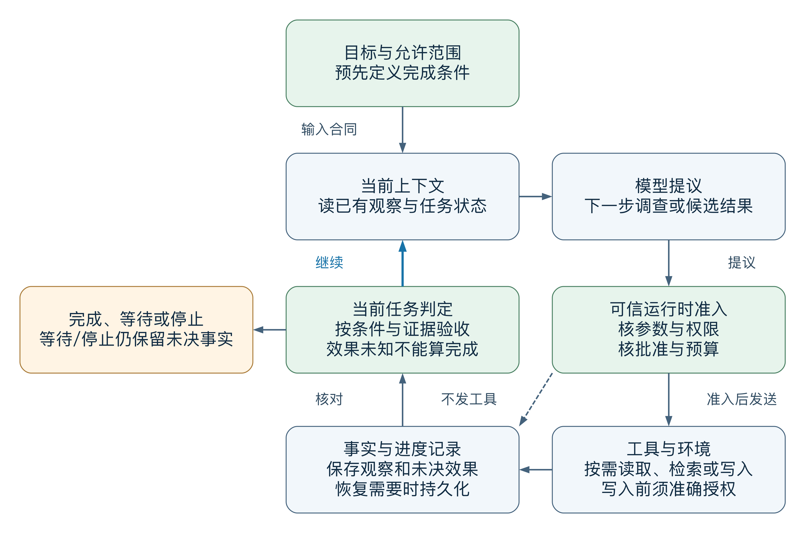
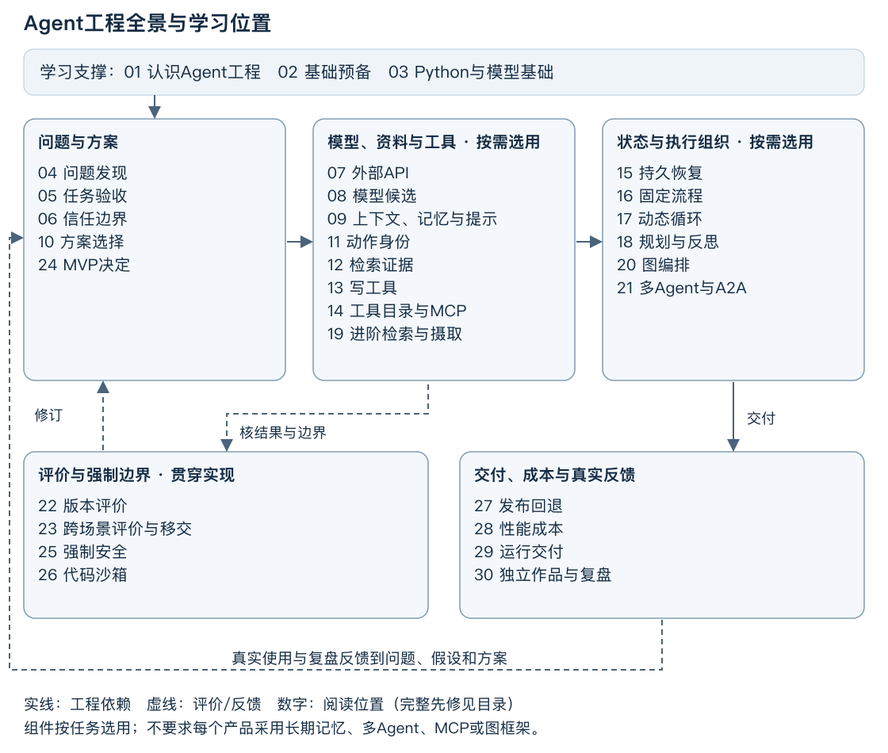

# 认识 Agent 工程

> **本篇先看结论**：需求 → 控制 → 证据 → 交付。先判断当前任务缺少哪一环，再选择工具或模型；图示为教学结构，不代表外部服务已实测。

**读图任务**：从左到右指出每一步产生的事实、决定或证据，并写出一个会让流程停止的条件。图中颜色只辅助层级，节点文字和下方替代说明才是完整含义。

**图示文字替代**：需求 → 控制 → 证据 → 交付。若图片不可用，按同一顺序阅读上面的字段；任何未验证的外部调用、真实用户效果和浏览器表现仍须单独记录。

Agent 是一种围绕目标、依据新观察选择下一步，并通过工具与环境交互的软件系统。本书讨论基于大语言模型的 Agent：模型解释当前信息，提出下一步调查或候选结果；运行 Agent 的应用程序（下文称宿主程序）限定允许范围，决定能否执行，记录实际观察，再根据完成条件继续、等待或结束。它的价值来自把语言理解接到可核对的任务过程。

例如，排查一次构建失败时，先读到的日志可能决定下一步该看依赖配置还是某个调用者；第一轮材料不足以写出整条路径。Agent 可以帮助选择下一处调查对象，但读取权限、调查预算和结果核对仍由应用掌握。模型提出“创建工单”，只是一项提议；准确批准和确认工单存在分别需要自己的依据。

“Agent”在不同产品中有不同用法。本书采用控制路径的区分：固定工作流由代码预列步骤与合法分支，动态 Agent 让模型根据新观察提议业务路径。这与 Anthropic 的架构定义一致；本文进一步采用宿主准入与事实记录的工程约束。这里仅以该文支持概念区分与最小足够方案原则。[Building effective agents](https://www.anthropic.com/engineering/building-effective-agents)

## 哪些需求值得采用动态 Agent

先看任务中哪些变化必须由新观察决定，再选能够满足同一目标的简单方案。下面是选型情境，不是实测效果或产品排名。

| 需求与具体任务 | 可以从何种方案开始 | 何时需要重新判断 |
| --- | --- | --- |
| 按已确认公式计算费用，或同步确定字段 | 普通程序；规则与输入校验由代码完成 | 合法路径仍能合理枚举时，自动化本身不要求增加模型 |
| 从已经提供的报告抽取字段、生成一次有据说明 | 一次模型调用，加结构与业务校验；确定的缺项可按规则读取 | 输入齐全的一次归纳不需要自主调查；若下一个资料对象依赖刚读到的语义，才考虑动态路径 |
| 收集固定材料、生成草稿、校验、人工确认后交付 | 固定工作流；可以有分支、循环、多次模型调用和等待 | 多步骤不决定架构；只有预列分支难以覆盖目标内变化时，动态选择才可能有收益 |
| 依据失败现象追查相关文件，或依据来源矛盾改变检索问题 | 有资源范围、预算与停止条件的动态 Agent | 需要环境反馈改变调查方向；能否提高合格结果仍要在相同条件下比较 |
| 调查后创建工单，或核对一次发送是否已生效 | 最小足够的调查方案，加可信批准、写工具合同及回执核对 | 业务动作的权限与调查方式分别设计；有模型参与不会扩大允许范围 |

动态选择也会增加错误路径、等待、调用费用和恢复负担。若固定流程已经满足要求，就保留固定流程；若阻碍是两份同级业务规则冲突，正确下一步是请求权威确认，追加模型不能取得裁决权。完整条件比较在[方案选择](c01-selection.md)展开。

多 Agent 是可选的组织方式。可独立调查的子问题可能适合分工，但要加总预算、统一资料版本、处理交接失败，并保留唯一写入所有者。把一项任务交给多个模型，不会自动产生独立事实或更高正确率。只读任务也无需为配齐组件而增加写工具；短时、可重做的任务未必需要长期持久平台。

> **中段视觉停顿｜认识 Agent 工程**
> 
> **状态卡**：输入/观察 → 当前决定 → 允许动作 → 可核证据 → 合理停止。
> 
> **阅读任务**：找到正文中第一次出现“未知、拒绝、缺证或需要人工确认”的位置，说明它为什么不能被当成完成。
> 
## 一次任务怎样形成反馈闭环

[放大SVG](assets/agent-runtime-loop.svg) · [可保存的DOT语义源](assets/agent-runtime-loop.dot)

图中实线表达本次运行的信息与控制流，蓝线表示继续时把新观察反馈到上下文。虚线是可不调用工具的旁路：候选、拒绝或等待先进入记录，再按任务条件判定。它们不是已发生的业务效果。工具中的检索、读取或写入按任务采用；需要跨中断恢复时，再为权威记录选择持久机制。

上下文是模型本次可见的信息，事实记录保存的是已有观察、动作与未决事项。模型可以从工具结果调整调查方向，不能凭摘要覆盖事实。ReAct研究展示了任务动作与推理交错、从环境追加信息的机制；本书把授权、记录和停止另交运行时兑现，不从该研究推导任何供应商或业务保证。[ReAct](https://arxiv.org/abs/2210.03629)

用一条构造轨迹读图：

1. 维护者要求定位构建失败并形成有据说明；目标同时限定可读项目，只有准确批准后才可创建一条工单。
2. 第一份日志显示依赖加载异常。模型提议读取依赖配置；宿主核资源范围和剩余预算，允许的读取结果进入事实记录。
3. 新配置说明依赖由另一个模块注册，模型据此改查该模块。若路径可由稳定映射直接确定，固定流程也能完成这一步；这里要比较的是新观察是否需要语义判断，而不是读取次数。
4. 说明仍缺关键版本时，记录缺项并等待。若证据齐全、准确批准后发送创建请求，却没有收到回执，则保留效果未知，核对原操作；不能为了闭环“继续”再创建第二条。只有对应效果已确认且验收条件满足，才声明完成。

“继续”还须有目标内理由与资源额度。没有新信息时应补来源、请求澄清或合理停止；循环不是用重复请求掩盖未知的许可。[固定流程](c01-fixed-workflow.md)使用相同组件与边界，但合法路径由代码规定；[完整动态循环](c01-control-loop.md)解释观察驱动的控制与恢复。版本评价和服务发布属于工程生命周期，不是每轮必须调用的工具。

## 一套可交付系统还需要哪些工程工作

运行闭环回答一次任务如何推进，工程全景回答怎样设计、实现、评价和交付这种能力。本版以30个阅读单元补齐软件/模型先修、记忆、规划、协议、检索、图编排和协作，并连接安全、运营与独立项目。图中的组件按任务选择，箭头不表示每个产品都必须使用全部组件，也不是先修顺序。

[查看全景SVG](assets/agent-engineering-landscape-v12.svg)。运行闭环仍使用上图，工程全景已独立扩展为本版30单元；没有把旧20单元图冒充新版。

学习支撑并非线上部件。先用问题发现、任务验收和信任边界确定目标，再以安全教学夹具实现组件；固定流程先于完整动态循环，规划/检索策略、图编排与协作在理解状态之后展开。评价随后支持MVP决定；安全并不是到后期才考虑，首次真实敏感读取/写入前须完成强制边界并取得实际授权，运行生成代码还须完成沙箱。独立项目要有真实问题、已有方案比较、差异假设、实现、实际反馈和迭代，不能只呈现面试答案。

### 章节在全景中的位置

| 阅读位置 | 正文 | 工程环节 |
| --- | --- | --- |
| 1 | [认识 Agent 工程](00-learning-route.md) | Agent定义、适用需求与工程全貌 |
| 2 | [把文本输入变成可运行可判错的小程序](01-foundation.md) | 程序、异常、断言与基础诊断 |
| 3 | [让 Agent 的语言运行时与模型输出具有可解释的边界](n01-python-model-foundations.md) | 对象、并发、LRU与模型推理/输出契约 |
| 4 | [从真实任务取得值得解决的问题证据](p01-discovery.md) | 真实问题、现有方案与可证伪假设 |
| 5 | [动手前定义任务成功与合理停止](02-task-acceptance.md) | 任务成功、停止和证据条件 |
| 6 | [分清事实资料与动作授权](03-trust-boundary.md) | 事实与授权来源分离 |
| 7 | [外部 API 请求的可判错边界](f01.md) | 外部请求与受控错误边界 |
| 8 | [把模型响应变成经校验的业务候选](f02.md) | 模型候选结构与业务核验 |
| 9 | [让跨轮上下文保留事实，让长期记忆可以被纠正](n02-context-memory-prompt.md) | 提示、记忆生命周期与任务切换 |
| 10 | [为一个任务选择最小可用方案 程序 单次模型 流程与动态 Agent](c01-selection.md) | 普通程序、单调用、流程与Agent选型 |
| 11 | [在重复提议和发送中识别同一个动作](c01-control-primer.md) | 提议、动作、发送与效果身份 |
| 12 | [构造符合版本和权限的证据包](c02.md) | 权限和版本正确的证据包 |
| 13 | [把模型提议变成可授权可去重的写工具](c03.md) | 授权、去重与效果核对 |
| 14 | [工具增长到上百个时，怎样发现、选择并安全接入](n04-tools-mcp.md) | 工具目录、MCP与第三方接入 |
| 15 | [用持久状态保存动作事实](e01.md) | 持久账本、恢复和并发事实 |
| 16 | [用固定路径完成同一受控任务](c01-fixed-workflow.md) | 连接组件的固定路径 |
| 17 | [Agent 控制循环 设计一个可恢复 受控并能验收的运行时](c01-control-loop.md) | 依据观察推进的受控完整循环 |
| 18 | [让计划依据观察前进，而不是在反复规划中空转](n03-planning-reflection.md) | ReAct、计划、重规划与反思 |
| 19 | [从原始文档到可比较的自适应检索链](n05-retrieval-ingestion.md) | 摄取、向量/索引、重排与Agentic RAG |
| 20 | [把控制循环映射为可恢复的状态图](n06-graph-orchestration.md) | LangGraph状态、子图与流消费 |
| 21 | [让多个 Agent 协作而不稀释任务责任](n07-multiagent-a2a.md) | 协作模式、交接和A2A |
| 22 | [判断版本改动是否改善任务结果](e02.md) | 版本结果、轨迹与回归评测 |
| 23 | [用新场景、分层实验和独立移交检验工程能力](n10-evaluation-projects.md) | 客服/研究迁移、跨语排错、技术移交 |
| 24 | [依据问题和评价证据冻结 MVP 决定](p01-mvp.md) | 依据问题和评价冻结MVP |
| 25 | [在数据返回和动作发送前强制执行权限](e03.md) | 数据与动作的强制权限 |
| 26 | [把模型生成代码限制在可验证的执行边界内](n08-sandbox-security.md) | 生成代码的隔离与准入 |
| 27 | [发布回退时保住在途任务事实](e04.md) | 发布、迁移和回退 |
| 28 | [在质量护栏下比较性能与成本](e05.md) | 质量约束下的性能与成本 |
| 29 | [让长任务在故障、容量和成本约束下交付](n09-runtime-delivery.md) | 长任务、补偿、熔断、内存与推理服务 |
| 30 | [用独立作品证据判定交付并复验改进](p02.md) | 真实作品、独立复验和迭代 |

## 从哪个起点进入实作

先做第2篇 [基础预备的入口诊断](01-foundation.md#先做入口诊断)。能解释文本与对象、追踪函数返回，并在独立目录运行程序、定位断言失败的读者，可跳过本基础预备正文，保留诊断记录后，仍按[Python与模型基础](n01-python-model-foundations.md)对应能力自检并补缺，再进入问题发现；缺哪项就补哪项，再做相同诊断。专业章需要阅读Python、接口类型和状态迁移，预备课不替代完整的软件工程训练。

贯穿项目在这些工程环节之间保留同一任务：读取固定仓库修订与已有失败报告，形成有据的缺陷说明，经维护者批准后创建唯一工单并核对结果。教学源 `refund(days)` 返回 `days < 7`，报告 `test_refund_day_7` 输入7、expected=True、actual=False，修订为 `repo@8e12`、报告为 `test-report-71`。这些构造事实支持“实现行为与断言不同”，真实业务规则仍需确认，任务不授权修改代码。

先交三份初始材料：在 [问题发现](p01-discovery.md)保存问题与替代证据；在 [任务验收](02-task-acceptance.md)区分完整资料、缺证与未知效果的允许结局；在 [信任边界](03-trust-boundary.md)列出资源与禁止动作。没有真实用户记录时，产品价值保持待验证，教学夹具仍可用于学习工程机制。

| 学习阶段 | 应交出的产物 | 进入下一阶段前要能回答的问题 |
| --- | --- | --- |
| 起点与问题 | 基础诊断、问题档案、允许结果和风险边界 | 能否分清真实观察、构造练习与自己的解释 |
| 程序与模型边界 | 可判错的读取适配器、经结构和业务校验的候选 | HTTP成功或合法JSON为什么仍可能没有合格结果 |
| 选型与组件 | 最小方案决定、证据包、写工具合同和持久账本 | 谁能提议、谁准入，超时后为什么仍可能有工单 |
| 固定与动态流程 | 完整固定流程，再按需要采用动态控制循环 | 新观察为什么要求换路径，复杂度是否带来目标内收益 |
| 评价与产品决定 | 同条件版本比较、MVP契约、安全与运维设计、任务账目 | 质量或用户负担的变化由什么证据支持 |
| 交付与迭代 | 可复现作品、独立判定、原问题复验和未知任务 | 新版本是否真的关闭了失败，结论能适用到哪里 |

练习：团队每次都读取同样两份材料，生成草稿，等待批准后创建工单，却把它称为“必须用动态Agent解决的任务”。失败时通过增加三个模型角色继续生成。给出当前足够方案，以及什么新证据才支持升级。

参考分析：稳定材料与可枚举分支可以先用固定流程；若只需生成候选，一次模型调用也可能足够。批准和工单核对的责任应保留。升级证据应是下一步调查对象确实依赖新观察、事前规则难以覆盖，并在同任务、权限和预算下改善合格结果；多个角色仍不能解决缺业务权威或回执未知。没有这些证据，先定位候选、材料或工具边界的实际失败。

继续到 [基础预备](01-foundation.md)，已有基础并留诊断证据者先按[Python与模型基础](n01-python-model-foundations.md)自检并补缺，再进入[问题发现](p01-discovery.md)。[分章目录](README.md)提供概要与深读入口，完整阶段交付方法见 [实作路径](../../team/textbook-v12-curriculum.md)。

## v12新增训练如何接到原实作

[Python与模型基础](n01-python-model-foundations.md)补对象/并发/输出边界；[记忆与提示](n02-context-memory-prompt.md)使跨轮数据有生命周期；[规划与反思](n03-planning-reflection.md)、[工具与MCP](n04-tools-mcp.md)、[进阶检索](n05-retrieval-ingestion.md)建立可检验组件；[图编排](n06-graph-orchestration.md)和[协作](n07-multiagent-a2a.md)按问题选择组织方式；[沙箱](n08-sandbox-security.md)与[运行交付](n09-runtime-delivery.md)限制代码和长任务风险；[跨场景实训](n10-evaluation-projects.md)要求把这些机制迁移到客服或研究任务，并交给独立者复现。

每个新增单元给出机制、失败路径、练习及作品。原19篇专业正文完整保留，末尾新增当前导航；旧代码历史验证不能当本版新运行。新例区分标准库策略、真实离线框架和外部服务：策略模型不证明真实LLM、MCP/A2A互操作、系统沙箱或GPU性能。正文能够支持解释，仍需学员实际实现、未知任务评估、真人反馈与求职证据，才可进一步判断岗位能力。

## v13 取舍与失败停顿

把本篇的核心判断写成四行：**前置条件**、**允许动作**、**观察信号**、**停止/升级条件**。如果其中一项没有来源或运行证据，状态应保留为未知或待补证。

| 状态 | 先做什么 | 不能宣称什么 | 复验材料 |
| --- | --- | --- | --- |
| 正常 | 保存输入、版本与关键输出 | 不把示例当生产保证 | 运行记录或来源定位 |
| 拒绝/缺证 | 记录原因，缩小范围或等待 | 不用换模型掩盖缺口 | 拒绝码、缺项和下一步 |
| 超时/未知 | 核对原动作或原快照 | 不重建第二个效果 | 原操作查询与账本 |

## v13 分层练习与一页复盘卡

**基础**：指出图中每个节点对应的输入、状态和证据。

**迁移**：改变一个会影响结论的条件（版本、权限、输入、故障或预算），重写下一步和停止条件。

**综合**：提交一份可由另一位读者复现的作品，包含入口、选择理由、正常/失败/未知轨迹、来源或运行记录，以及仍待验证的事项。

复盘卡：

- 我的任务与完成条件：____
- 当前控制路径与放弃条件：____
- 关键状态、来源或权限：____
- 正常、失败、未知、停止分别是什么：____
- 已运行/有来源与仍未验证：____
- 交付文件与下一次复验：____

## v13 编辑交接说明

- 本稿保留 v12 的正文、来源、正式先修、原练习和未验证边界；v12 原文未修改。
- 开篇图为教材结构草图；中段视觉停顿用于打断连续阅读，需由设计师复核目标尺寸、箭头避让、色彩对比、窄屏和文字替代。
- 本稿中的 11 行及以上代码已用 `
` 标记为默认折叠候选；产品确认最终交互，开发实现，测试独立核默认状态、键盘、读屏、刷新、深链和脚本不可用降级。
- 需要设计师制作/复核的资产：`assets/00-learning-route-demand-control-evidence-v01.svg`，邻近正文为开篇结论与首次机制转折；图示任务是读者指出状态和停止条件。
- 本稿未声明真实模型、外部 API、框架、浏览器渲染、真人学习效果或职业能力已验证。
