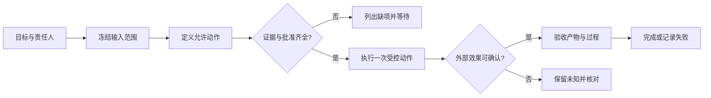
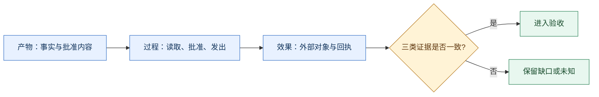

# 动手前定义任务成功与合理停止

> **本章先给结论**：任务完成不是“模型写出了答案”或“接口返回了 201”，而是产物、过程和业务效果都有对应证据。缺证、缺批准和效果未知时，合理停止本身就是正确结果。

## 先看一张图：从目标到可验收结果


**图注**：静态候选图把任务合同、证据检查和合理停止放在同一条阅读路径上；它不表示真实系统已经执行。当前未验证浏览器渲染、窄屏布局、字体回退、无障碍操作和真人读者理解。下方 Mermaid 图与文字说明是图像不可用时的降级表达。



> 文字降级说明（图像或脚本不可用时）：先固定目标、输入和允许动作；检查证据与批准，不齐全就列出缺项并等待；齐全后执行一次受控动作；外部效果能确认才进入验收，不能确认就保留 UNKNOWN 并核对。

图示是本章教学构造，未验证浏览器渲染、窄屏布局和真实服务契约。阅读顺序是“目标 → 输入 → 动作 → 证据 → 停止”，不要从最后一列倒推成功。

## 一个统一任务合同

贯穿案例：从指定失败报告形成有据说明，经准确批准创建唯一缺陷工单。任务不包括改代码、替维护者决定退款规则、发布报告或发送通知。

<details>  
<summary>展开YAML代码（25行；教学示例，未运行）</summary>  
\`\`\`yaml  
task: 从指定失败报告形成有据说明，经准确批准创建唯一缺陷工单  
input:  
  revision: repo@8e12  
  report: test-report-71  
  source: src/refund.py  
known:  
  \- 源函数返回 days < 7  
  \- test_refund_day_7 输入 7，报告 expected=True、actual=False  
allowed:  
  read: 指定修订的源文件和指定报告  
  write: refund-maintenance 中的一条准确批准工单  
forbidden:  
  \- 修改代码或替维护者决定真实退款规则  
  \- 读取范围外资料，发布报告或发送通知  
  \- 创建未经准确批准或重复的工单  
accepted_completion:  
  \- 报告事实与推断分开，引用可读回同一修订  
  \- 项目、标题、正文与批准内容一致  
  \- 服务确认工单与本次意图对应  
  \- 未遗留未知效果或第二条工单  
valid_stops:  
  missing_evidence: 列出缺项，停止写入  
  missing_permission: 拒绝动作，不扩大读取范围  
  missing_approval: 等待准确内容批准  
  unknown_effect: 核对原操作，仍未知则等待  
\`\`\`  
</details>

这份记录只定义应观察到的性质，不把 `expected=True` 升格为业务政策。目标强弱必须由任务责任人确认；模型不能为了通过验收自行降级目标。

## 三类证据要分开

| 证据层 | 要回答的问题                | 常见误判           |
| --- | --------------------- | -------------- |
| 产物  | 说明中的事实是否有来源，批准正文是否一致？ | 文本流畅就当根因已证实    |
| 过程  | 读了哪些对象、谁批准、实际发出什么动作？  | 只保存聊天记录        |
| 效果  | 外部对象是否按本次意图创建或更新？     | 收到 201 就当整条链完成 |

### 中段视觉卡：三类证据要彼此对上



> 文字降级说明（图像或脚本不可用时）：分别收集产物、过程和效果证据；三类证据一致才进入验收，否则保留缺口或未知。

**读图提示**：蓝色节点表示需要收集的证据，黄色节点表示验收判断，绿色节点表示下一步结果；颜色只是辅助，节点文字仍完整表达含义。该图为教学构造，未验证浏览器渲染、窄屏布局和真人理解。


**中段图注**：静态候选卡把三类证据和 `WAIT_*`、`UNKNOWN`、`COMPLETED` 的停止判断放在同一张卡上，帮助读者从“有一份答案”转向“证据链是否闭合”。当前未验证浏览器渲染、窄屏布局、字体回退、无障碍操作和真人读者理解；下方状态文字继续作为图像不可用时的降级表达。

## 四种结局，用同一张状态卡表达

```text
READY       材料和条件齐全，可进入动作
WAIT_INPUT  缺规则、版本或对象，列明缺项
WAIT_APPROVAL 候选已形成，等待准确内容批准
UNKNOWN     请求可能已发出，效果尚未核实
COMPLETED   产物、过程和效果证据均满足合同
```

| 已有条件                 | 合理结果           | 不应宣称                  |
| -------------------- | -------------- | --------------------- |
| 证据完整、批准准确、服务确认唯一对应工单 | 提交说明与回执，进入完整验收 | 不能仅靠文本推导根因已证实         |
| 报告可读但业务规则缺失          | 指出缺少规则并等待补证    | 不能把 `<` 改成 `<=` 后声称修复 |
| 候选有据但批准尚未取得          | 保留候选并等待批准      | 不能把模型说“用户同意”当事实       |
| 创建请求超时               | 查原操作；仍未知则等待核对  | 不能说无工单，也不能换键重建        |

## 机制：完成条件如何进入运行时

```text
任务合同 → 输入快照 → 候选产物 → 人工/规则验收 → 外部回执 → 终态
      ↘ 缺证/缺批 → WAIT_*       ↘ 超时 → UNKNOWN → 查询或人工核对
```

短时只读实验可以保留内存状态；包含外部写操作、审批或重启时，需要持久动作记录和恢复依据。把“低成本”当成“没有恢复风险”会掩盖重复写入问题。

## 练习

### 基础：补齐验收证据

把“生成工单正文并返回 HTTP 201 即通过”改写成至少三项独立证据，并说明响应丢失后的状态。

**参考解法**：正文必须受同修订资料支持，批准必须绑定准确项目与内容，回执必须对应原创建意图和唯一工单。丢响应标为 `UNKNOWN`，先核对原操作；不能由“没收到 201”推出未执行。

### 迁移：目标能否事后变弱

只有函数和失败报告，参与者把目标从“确认第七天应退款”改为“描述边界差异”。

**参考解法**：后者可以是另一项较弱任务，但须由责任人确认并保存新条件。原任务仍缺业务规则，应等待，不能靠改题掩盖未完成。

### 综合：写出你的合同

为一个真实但允许使用的资料任务填写输入范围、预期产物、禁止动作、合理停止、证据来源和未知处理。

## 一页复盘卡

| 项目               | 你的记录 |
| ---------------- | ---- |
| 谁对目标和批准负责？       |      |
| 哪些资料固定到版本或快照？    |      |
| 完成需要哪三类证据？       |      |
| 哪些情况必须等待？        |      |
| 外部效果未知时如何核对？     |      |
| 什么结果只能算候选，不能算完成？ |      |

下一篇[信任边界](03-trust-boundary.md)把“资料提供事实”和“身份授予动作”分开。示例与图均为教学材料，未由此验证真实外部服务。

---

## v13 编辑交接说明

- 保留 v12 的任务合同、四种结局、产物/过程/资源证据和两道原练习。
- 新增流程图、状态卡、统一案例、分层练习和复盘卡；图示为候选，需设计师复核箭头、色彩、窄屏和文字替代。
- 本稿未覆盖 `v12/02-task-acceptance.md`，未改变历史验证结论。
