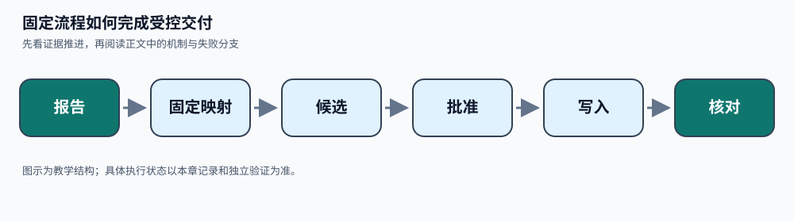

# 用固定路径完成同一受控任务
> **本章先看结论**：固定路径把可预先列出的分支交给代码；候选、批准、发送和核对仍需分别留痕。



> **读图提示**：图中从左到右表示本章的证据推进顺序。颜色只辅助分组，节点文字和箭头共同表达含义。图示是教学结构，不表示外部服务已运行或生产结果已验证。

固定流程可以完成有据候选、准确批准、创建与核对，只要所有业务分支由代码事前列出。固定不意味着没有等待和中断；共享工具和恢复条件仍需兑现。下一处资料必须随观察语义决定时，才考虑升级动态调查。

先完成 [模型候选](f02.md)、[证据包](c02.md)、[写工具](c03.md)和 [持久状态](e01.md)。本篇把这些局部合同连接为完整分析及交付流程，接口级伪代码不作为可直接运行SDK。TaskContract来自任务责任人，Result同时表达候选、等待和实际完成；候选不会自己取得写权限。

### 中段视觉卡：固定流程如何完成受控交付

本节先用一张小图把 **报告 → 固定映射 → 候选 → 批准 → 写入 → 核对** 放在同一条线上，再回到正文核对每个节点的责任和失败状态。


> 文字降级说明（图像或脚本不可用时）：固定 workflow 由代码按预列分支推进读取、生成、校验、审批和创建；每个节点的输入输出固定，失败进入明确等待或拒绝状态，不由模型临时改业务路径。

> **阅读任务**：读完本节后，指出哪一个节点能证明“已经发生”，哪一个节点只能说明“准备发生”，并写出证据缺失时的停止条件。
## 完整任务与结果合同

<details>
<summary>展开typescript（29 行；教学伪代码，是否运行以正文标注为准）</summary>

```typescript
interface TaskContract {
  task_id: string;
  goal_revision: number;
  repo_revision: "repo@8e12";
  report_id: "test-report-71";
  readable_paths: string[];          // 可信运行时注入的资源范围
  supplied_evidence_ids: string[];
  target_project: string;
  effect_slot: "defect_issue";       // 每目标修订只允许一条工单
  required_claims: string[];
  analysis_deadline: number;
  max_model_attempts: number;
  max_read_attempts: number;
  model_config_version: string;
}
type AnalysisCandidate = {
  repo_revision: string; report_id: string; failed_test: string;
  expected: string; actual: string; hypothesis: string | null;
  source_refs: string[]; missing_fields: string[];
}
type Result =
  | { kind: "CANDIDATE"; analysis_candidate: AnalysisCandidate;
      candidate_hash: string; evidence_ids: string[];
      hypotheses: string[]; missing_fields: string[] }
  | { kind: "WAIT_INPUT"; missing_fields: string[]; reason: string }
  | { kind: "WAIT_APPROVAL"; action_id: string; intent_hash: string }
  | { kind: "CREATED"; action_id: string; receipt_ref: string }
  | { kind: "WAIT_RESOLUTION"; action_id: string; reason: string }
  | { kind: "STOPPED"; reason: string; partial_refs: string[] };
```

</details>

这里 `CANDIDATE` 只表示分析阶段产物，不算完整任务成功。完整目标还须批准匹配、实际回执、无未决效果和唯一工单槽位。只比较“写了一个好看答案”的方案与真正创建了工单的方案，会把任务不同误当架构优劣。更合理的是先比较分析阶段，再在所有方案上使用同一写工具与恢复路径，测端到端结果。

`required_claims` 由目标定义，例如“失败测试、输入、预期、实际与修订”；不是模型自己降低要求。根因可以保持假设，缺少业务规则时请求补证。不允许为了提高完成率删去证据不足题或把等待算成功。

## 一个固定流程的完整决策骨架

先假定报告已列出待读文件，而且关联路径不需要语义探索。固定流程一次性读报告、按已知映射读文件、生成候选并校验。以下伪代码仅表达分析阶段，不执行写操作；后续候选进入已经学习的准确批准与动作账本。

外部接口的合同如下：`read_report/read_source` 返回 `OK` 加不可变证据或错误分类，不执行写；`parse_report` 按冻结报告格式返回失败事实及确切路径，拒绝无法解析的报告。`model_once` 适配 [模型响应闸门](f02.md)：将真实入口的 `verdict` 解包成内部结果；保留 `CANDIDATE.value`字典、`WAIT_INPUT.fields`、`REFUSED.code` 和 `REJECTED.code`，将网络/供应商错误归为带 `code` 的 `REQUEST_UNKNOWN/PROVIDER_ERROR`，不得丢掉等待。`verify` 核必需事实、证据归属和版本，专业未知列缺项。读取和模型接口都有有限阻塞/返回期限，调用前检查不是端到端期限保证，模型返回后还需检查是否超时。这里的模型和存储接口不是现成 SDK API。

`record`保存当前目标修订、报告/仓库修订、完整结果和已用证据清单。成功分支必须把完整 `analysis_candidate`字典提交为 [e01的candidate事件](e01.md)，不是只存摘要：同一run的 `candidate_json`保存候选全部字段，事务返回的 `candidate_hash`才是权威值。内部候选摘要使用 e01 的 `digest`：键排序、`ensure_ascii=True`、紧凑JSON的UTF-8摘要；它与 c03 写意图摘要是两种明确不同的身份。`record`在该事务成功后填入返回Result的candidate_hash；提交不确定时按同事件读回，不能返回未持久候选。`store.load(run_id)`从 `runs.candidate_json`还原 `state.analysis_candidate`，从同一run读goal_revision及candidate_hash，不依赖模型对象或进程全局变量。结果/证据清单审计由外层记录保存，本例e01保存完整候选及其source_refs，不提供全套调查日志。

```python
def fixed_analysis(contract, reader, model, verifier, record, clock):
    evidence = []
    read_attempts = 0
    model_attempts = 0

    def stop(reason):
        return record(contract, {
            "kind": "STOPPED", "reason": reason,
            "partial_refs": [item.id for item in evidence]})

    if clock.now() >= contract.analysis_deadline:
        return stop("DEADLINE")
    if contract.max_read_attempts < 1:
        return stop("READ_BUDGET")
    read_attempts += 1
    report = reader.read_report(contract.report_id, contract.repo_revision)
    if report.kind != "OK":
        return stop("REPORT_" + report.code)
    parsed = reader.parse_report(report)
    if parsed.kind != "OK":
        return record(contract, {"kind": "WAIT_INPUT",
            "missing_fields": ["supported_report"], "reason": parsed.code})
    evidence.append(report)
    paths = sorted(set(parsed.source_paths))
    if not paths:
        return record(contract, {"kind": "WAIT_INPUT",
            "missing_fields": ["source_mapping"], "reason": "NO_FIXED_MAPPING"})
    for path in paths:
        if path not in contract.readable_paths:
            return stop("RESOURCE_DENIED")
        if clock.now() >= contract.analysis_deadline:
            return stop("DEADLINE")
        if read_attempts >= contract.max_read_attempts:
            return stop("READ_BUDGET")
        read_attempts += 1
        source = reader.read_source(contract.repo_revision, path)
        if source.kind != "OK":
            return stop("SOURCE_" + source.code)
        evidence.append(source)
    if clock.now() >= contract.analysis_deadline:
        return stop("DEADLINE")
    if model_attempts >= contract.max_model_attempts:
        return stop("MODEL_BUDGET")
    model_attempts += 1
    generated = model.model_once(contract, evidence)
    if clock.now() >= contract.analysis_deadline:
        return stop("DEADLINE_AFTER_MODEL")
    if generated.kind == "WAIT_INPUT":
        return record(contract, {"kind": "WAIT_INPUT",
            "missing_fields": generated.fields, "reason": "MODEL_MISSING_FACTS"})
    if generated.kind != "CANDIDATE":
        return stop("MODEL_" + generated.code)
    verdict = verifier.verify(contract, generated.value, evidence)
    if verdict.kind == "MISSING":
        return record(contract, {"kind": "WAIT_INPUT",
            "missing_fields": verdict.fields, "reason": "EVIDENCE_INSUFFICIENT"})
    if verdict.kind != "ACCEPT":
        return stop("CANDIDATE_" + verdict.code)
    return record(contract, {
        "kind": "CANDIDATE", "analysis_candidate": generated.value,
        "evidence_ids": [item.id for item in evidence],
        "hypotheses": ([generated.value["hypothesis"]]
                       if generated.value["hypothesis"] is not None else []),
        "missing_fields": []})
```

这段流程没有把语义路径选择藏进 `parse_report`：报告须有冻结格式和确定映射，否则返回缺项。也没有让 `verify` 在拒绝后调用另一个模型偷偷继续探索。如果要增加修正次数，可明确定义固定反馈节点及总预算；一旦让模型从反馈中任意选新调查路径，就应按动态循环评估。

分析之后的固定交付顺序也必须完整。下面是同一run的持久流程节点，接口语义使用c03的提交/批准/发送/核对与e01的事务；它不再调用模型选择路径。`analysis_candidate`有报告事实、单独hypothesis和证据ID，固定渲染器按字段生成标题/正文，不创造新根因；批准绑定这份不可变文本。`verifier`检查原修订/报告/批准指纹与工单版本，返回通过、拒绝或等待。所有网络返回先持久记录再推进：

```python
def fixed_delivery(run_id, store, services):
    state = store.load(run_id)
    if state.unresolved_actions_or_attempts:
        # 只查询原操作；UNKNOWN仍写入等待，不分配另一动作。
        resolution = services.reconcile_original_operation(state)
        store.record_resolution(state, resolution)
        state = store.load(run_id)
        if state.unresolved_actions_or_attempts:
            return Result("WAIT_RESOLUTION", action_id=state.unresolved_action_id,
                          reason="ORIGINAL_EFFECT_UNKNOWN")
    if state.stop_intent:
        return store.finish_stopped(state)
    if state.analysis_candidate is None:
        return Result("WAIT_INPUT", missing_fields=["analysis_candidate"],
                      reason="ANALYSIS_NOT_ACCEPTED")
    candidate = state.analysis_candidate
    args = {
        "project": state.contract.target_project,
        "title": "Failure: " + candidate["failed_test"],
        "body": ("Revision: " + candidate["repo_revision"] + "\nReport: " + candidate["report_id"]
                 + "\nExpected: " + candidate["expected"] + "\nActual: " + candidate["actual"]
                 + "\nRoot-cause hypothesis: " + (candidate["hypothesis"] or "unconfirmed")),
        "evidence_ids": candidate["source_refs"],
    }
    action = store.commit_or_reuse_issue_intent(state, args)  # 唯一槽位/指纹原子检查
    if action.kind == "CONFLICT":
        return Result("STOPPED", reason="INTENT_CONFLICT", partial_refs=candidate["source_refs"])
    if not store.current_approval_matches(action):
        return Result("WAIT_APPROVAL", action_id=action.action_id, intent_hash=action.intent_hash)
    if action.effect_resolution == "NOT_SENT":
        dispatch = store.begin_authorized_attempt(action)    # 当前权限/期限/取消/预算
        if dispatch.kind != "DISPATCH":
            return dispatch.as_result()
        outcome = services.invoke_issue(dispatch)            # 含超时→UNKNOWN适配
        store.record_outcome(dispatch, outcome)
        action = store.load_action(action.action_id)
    if action.effect_resolution == "UNRESOLVED":
        return Result("WAIT_RESOLUTION", action_id=action.action_id, reason="RECEIPT_UNKNOWN")
    if action.effect_resolution != "CONFIRMED_SUCCESS":
        return Result("STOPPED", reason="ISSUE_NOT_ACCEPTED", partial_refs=candidate["source_refs"])
    verdict = services.verifier.check(state.contract, candidate, action)
    store.record_verdict(action, verdict)
    if verdict.kind != "ACCEPT":
        return verdict.as_result()                           # 等待/拒绝保留差异
    # 事务重读取消、目标/候选/回执版本与未决状态，过期verdict不可用。
    completed = store.complete_current_goal(run_id, verdict)
    if completed.kind != "COMPLETED":
        return completed.as_result()
    return Result("CREATED", action_id=completed.actions[0].action_id,
                  receipt_ref=completed.actions[0].receipt_ref)
```

这里存储/服务方法的原子性、错误及权限合同在[c03](c03.md)和[e01](e01.md)展开；不是可直接执行的SDK。`unresolved_action_id`来自权威账本，本任务只有一个写槽位；`complete_current_goal`把e01事件结果转换为内部记录。只有其 `COMPLETED`返回的唯一动作及回执引用，才能映射到对外 `CREATED`。`receipt_ref=actions/{action_id}/receipt`是本教学存储的记录引用，由获准读回入口解析到该动作的不可变已确认回执，不是供应商URL。WAIT_RESOLUTION保留原action_id，取消结果按STOPPED/WAIT_RESOLUTION映射，不因一个晚到回执宣告CREATED。

沿正常夹具演算：f02返回完整字典，`expected="True"/actual="False"`、两个冻结source_refs和允许为空的hypothesis；分析验收后 `record`提交完整candidate事件。交付重读字典，渲染准确参数，用 c03唯一规范计算意图，等待批准，再由 e01 begin/适配器/outcome记录同一动作。验收verdict绑定存储候选哈希、目标修订、意图及回执版本；complete重读这些绑定后返回同一action和receipt_ref，外层才返回CREATED。规则缺失而仍有必需字段时走WAIT_INPUT，不能把这条演算当实际成功数据。固定流程的控制路径仍由代码列举；动态Agent的不同只在调查路径决定权，共享写操作条件不能删减。

对这类输入，程序先提取事实，再让单次模型组织文本，通常能减少把基础字段交给模型猜测的机会。这是设计推理，不是测量结果。若最终说明仅由固定字段组成，连组织文字也可使用模板；是否需要模型取决于目标是否要求超出模板的解释。


用完整资料、缺规则和写后未知三种输入逐节点解释允许结果，保留当前候选、准确批准与原回执的关联。随后读 [完整动态循环](c01-control-loop.md)，比较调查路径由代码还是模型选择；本篇的固定路径不是提前声称动态方案更差的成绩。


---

## v12 学习衔接

本单元为30单元路线的第16单元。正式先修：[模型候选](f02.md), [检索证据](c02.md), [写工具](c03.md), [持久恢复](e01.md)。按v12完整路线，下一单元为[动态循环](c01-control-loop.md)；上文保留的旧版关联仍可作主题参考。本篇原专业正文与代码完整迁移，历史验证仍只适用于原记录范围，不因复制获得新的执行结论。
