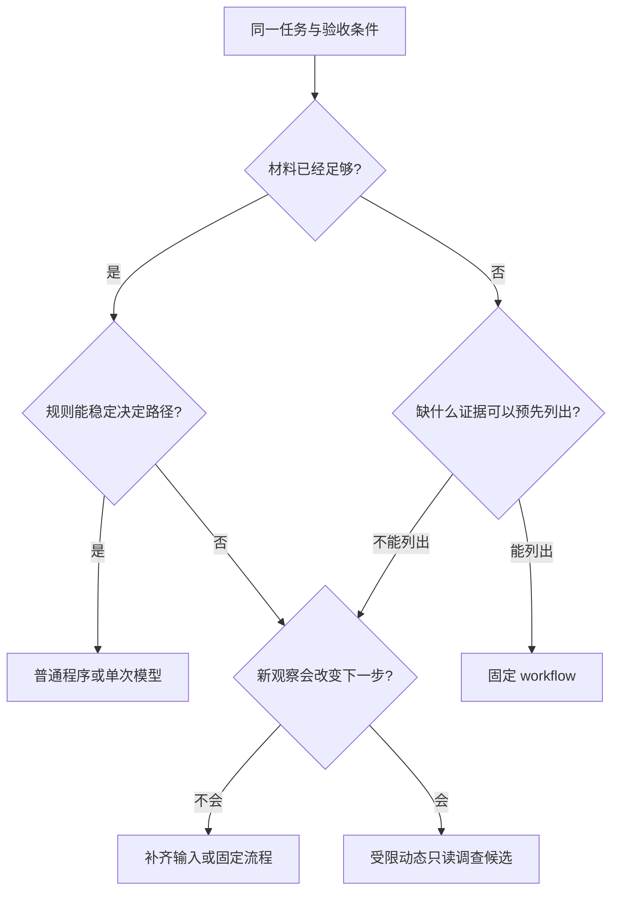

# 为一个任务选择最小可用方案：程序、单次模型、流程与动态 Agent

> **本章先给结论**
>
> 需要解释自由文本，不等于需要动态 Agent；需要多次模型调用，也不等于需要多 Agent。只有当**下一步必须依赖新的观察，而且预先列出的路径无法合理覆盖这些变化**时，动态决策才有独立价值。
>
> 先冻结任务、输入、权限和验收，再选择能完成同一目标的最小方案。方案越动态，探索能力越强，路径、权限、预算、恢复和验证成本也越高。

## 先看一张图：谁决定下一步？


**图注（候选视觉稿）**：按图中 ①→②→③ 阅读：先冻结共同条件，再判断“下一步”由谁选择，最后只用共同证据决定是否升级。四种方案从普通程序到动态 Agent，表达的是控制权逐步交给运行时；底部共同证据框表示所有方案都应在同一任务、权限、材料和验收条件下比较。颜色用于区分控制权层级，箭头和文字已按视觉规则分离。

**状态说明**：这是静态设计候选稿，不是已接入界面。当前未验证浏览器渲染、窄屏排版、真实字体回退、无障碍操作和真人读者理解；图中没有实测性能排名。

读图时只问一个问题：**下一步由谁决定？**

- 已知字段和规则足够，代码决定路径。
- 材料已经齐全，只需生成一次候选，单次模型足够。
- 分支可以预先列出，由代码选择，模型只完成指定节点，适合固定 workflow。
- 下一步必须根据新观察来决定，才有理由试动态 Agent。

## 本章的任务和边界

读完 [模型候选](../v12/f02.md) 和 [任务验收导读](../v12/02-task-acceptance.md) 后，先决定控制路径由谁选择。本章只交付**有条件的选型理由、升级条件和放弃条件**；完整固定流程在工具和存储之后实作。

本文的比较是推理演算，不是实测排名。没有运行数据时，不填写“快了 30%”、成本倍数或架构排行榜。

## 一个统一例子：分析测试缺陷并决定后续动作

四种方案都处理同一类任务：读取失败报告，判断是否已有足够证据，必要时取得允许范围内的新证据，最后生成可复核的缺陷说明或等待补充信息。

### 四种方案的控制权

| 方案              | 下一步由谁选             | 同一任务中的可用实现                          | 何时升级或放弃                    |
| --------------- | ------------------ | ----------------------------------- | -------------------------- |
| **普通程序**        | 确定性代码              | 解析固定测试格式，填报告和工单模板                   | 必须解释现有规则覆盖不了的语义，规则维护成本明显上升 |
| **单次模型**        | 模型只写候选；输入由代码一次构造   | 文件、报告和规则已齐全，一次生成缺陷说明                | 需要回到环境取得新证据，或必须分步隔离不同验证    |
| **固定 workflow** | 代码选分支；模型完成指定节点     | 读报告 → 读报告所列文件 → 生成 → 校验 → 等待审批 → 创建 | 相关文件选择不能稳定表达，新增分支持续依赖新观察   |
| **动态 Agent**    | 模型提议调查路径；运行时裁定能否执行 | 先读失败报告，再判断需读实现、调用者或规则文件             | 额外探索没有提高合格率，权限、预算或恢复代价超过收益 |

这张表只表达机制，不表示动态程度越高越好。固定 workflow 可以有条件分支、循环、重试和审批；把 `while retry` 写进程序不会自动变成动态 Agent。区别在于循环内是否让模型重新决定业务行动路径。

## 两个判断轴：材料是否齐全，路径是否可预先列出

把任务放进下面的判断框，而不是先问“要不要 Agent”。



> 文字降级说明（图像或脚本不可用时）：先固定同一任务和验收条件，再问材料是否足够、规则能否稳定决定路径以及新观察是否会改变下一步；材料齐且路径稳定用程序或单次模型，分支可预列用固定 workflow，只有新观察会改变路径才考虑受限动态调查。

**图示性质**：这是本章的教学构造，用于表达判断顺序；未由产品运行、模型调用或用户实验验证。实际产品仍需由产品经理定义门槛，由测试工程师独立验收。

判断结果可这样写：

> 因为输入是\___\_，验收要求是\___\_，下一步需要/不需要新观察；预先列出的路径能够/不能够覆盖变化。因此先用\___\_，只有当\___\_出现时才升级到\___\_。

## 三种输入情形：同一个“缺陷任务”会得到不同结论

### 情形 A：材料完整，字段固定

报告、实现、业务规则和测试失败字段都已齐全。普通程序可以输出失败事实；需要解释时，一轮模型足够。动态 Agent 再读取同样材料，只增加路径和失败面，除非对照实验显示它改善了事先定义的缺陷。

**可观察信号**：没有新的证据需求，结果只是在同一材料上换一种措辞。此时增加探索没有目标内收益。

### 情形 B：报告指向位置，但根因可能在关联文件

报告只给出 `service.py` 的栈位置，根因可能在调用者的日期单位或实现边界。若规则能稳定列出“实现 + 调用者 + 配置”三处，固定 workflow 仍够用。

只有当下一处相关文件必须依据刚读到的参数来源来判断、路径树又无法合理穷举时，动态只读 Agent 才是候选。它仍要受证据包、资源范围和最大调查次数约束；“不知道读哪里”不等于“允许读所有东西”。

### 情形 C：同级规则冲突

两份同级规则互相冲突，且无法判断哪份适用。更多 Agent 不会创造业务权威。正确输出是 `WAIT_INPUT`，列明冲突范围和需要确认的版本。

让几个模型投票选一个规则，只是给未经授权的裁决增加票数。这里的停止条件比“生成一个答案”更重要。

## 动态 Agent 的限制：探索和写入要分开

一个任务可以拆成两个控制段：

```text
动态只读调查：模型提议要查看的证据 → 运行时检查权限/预算/范围 → 记录观察
固定写入流程：校验证据包 → 等待审批 → 单一写入者创建或更新
```

这样可以分别测量探索效果和副作用控制。动态性不意味着无限授权；动态 Agent 可以只读、最多调查若干文件，并在超时、冲突或预算用尽时返回未知状态。

## 多 Agent 的升级点是可分工，不是人数

只有存在可独立核对的证据子问题，才考虑多 Agent。例如：一位调查实现控制路径，另一位调查测试夹具生成方式，再由整合者比对。两个模型都说“根因相同”不等于有两份独立事实，因为它们可能共享同一份错误材料。

每份交接至少包含：`subtask_id`、目标修订、输入证据清单及哈希、允许资源、输出主张与逐项引用、缺项、实际消耗和状态。整合者先核对版本与权限，再整合结论；`INCOMPLETE` 或超时不能当成“没有问题”。发现修订不一致时保留冲突，拒绝合并。

写操作始终只有一个所有者，子代理只交建议。所有模型和读取尝试计入同一任务预算。若交接上下文比直接分析更长、分工互相等待或重复解释同一证据，说明拆分没有带来有效并行。

把升级写成可证伪假设：

> 两类证据可以独立调查，在总预算不增加的情况下减少漏掉测试夹具问题，同时不增加无支持根因和越权读取。

若实验只显示说明更长、引用更多，但关键错误没有减少，就放弃升级。外部写调用成为唯一瓶颈时，多 Agent 也不能移除它。

## 怎样做公平且能定位原因的比较

四种方案必须完成同一任务集，标记材料完整、需要动态调查和证据冲突三类输入。固定资料和工具版本、权限、验收器、模型快照与采样配置、总期限和资源上限。不能让某一方案偷偷取得测试集答案。

至少记录以下结果：

| 记录项              | 用来判断什么          |
| ---------------- | --------------- |
| 候选合格、完整目标合格      | 方案是否满足不同层级目标    |
| 正确等待、错误完成        | 是否能在未知或冲突时停下    |
| 读取次数、模型尝试次数、资源用量 | 探索和成本边界         |
| 端到端延迟、未完成与未知结果   | 真实交付是否可恢复       |
| 每题失败类型和完整轨迹      | 失败来自路径、分析还是写入边界 |

先按失败类型拆解：固定映射没覆盖，是路径表达能力问题；证据已齐却误读，是分析问题；候选正确但写入恢复失败，是共享工具边界问题。只比较平均成功率，会把三种原因混在一起。

重复试验要保留每次输入和随机性，不能用一个最好的轨迹代表稳定能力。测量方法和不确定性见 [评价章节](../v12/e02.md)。

## 练习：从最小方案开始推理

### 基础：固定字段还是 Agent？

报告格式稳定，所需说明只有输入、预期和实际，维护者禁止推断根因。

**参考解法**：普通程序加模板满足目标；单次模型和动态调查没有目标内收益。仍需保留错误解析、缺项和验收分支，不能因为不用模型就省掉验收。

### 迁移：未知路径

失败报告给出 `service.py`；读后发现它调用动态注册的处理器，实际处理器随配置变化。

**参考解法**：先判断配置和注册关系是否能用确定规则解析。能，就扩充固定 workflow；不能，再试受限动态只读 Agent，并保持同一修订、资源范围和最大调查次数。一次题目复杂，不足以证明整个产品应全面 Agent 化。

### 综合：协作失败与版本冲突

代码调查员使用 `repo@8e12`，测试调查员交来 `repo@9a01` 的报告，但两者结论一致。

**参考解法**：版本不匹配，整合者应拒绝合并，重新取得同一修订的证据。一致结论没有消除条件差异；换成更强模型也不能修复输入合同。

### 综合：升级实验

设计同预算的固定 workflow 与动态循环对照，写出支持升级和保留固定流程的结果。

**参考解法**：支持升级的证据必须是：新观察选路带来目标内合格改善，且错误完成、越权和成本护栏仍满足事前要求。保留固定流程的证据包括：材料完整题优势相近；动态题失败来自模型误读而非缺路径；或新增调查没有可验证收益。具体产品门槛由产品责任人定义，本文不自创认证分数。

## 一页复盘卡

完成选型前，填完这张卡：

| 问题                   | 你的答案 |
| -------------------- | ---- |
| 任务和验收条件是什么？          |      |
| 已有材料是否足够？缺什么？        |      |
| 谁拥有下一步控制权？           |      |
| 预先列出的路径能否覆盖变化？       |      |
| 方案的最大权限、预算和停止条件？     |      |
| 什么结果会支持升级？什么结果会使你放弃？ |      |
| 结果如何记录，才能定位失败原因？     |      |

下一篇 [动作身份概览](../v12/c01-control-primer.md)解释重复提议与业务效果的区别；现阶段不实现批准或存储事件。

---

## v12 学习衔接

本单元为 30 单元路线的第 10 单元。正式先修：[模型候选](../v12/f02.md)、[任务验收](../v12/02-task-acceptance.md)。按 v12 完整路线，下一单元为[动作身份](../v12/c01-control-primer.md)；上文保留的旧版关联仍可作主题参考。本篇为 v13 视觉化重排稿，未覆盖 v12 原文或历史记录。
