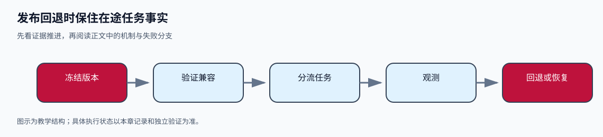

# 发布回退时保住在途任务事实
> **本章先看结论**：版本切换必须兼容状态读取和未决动作；镜像能启动不代表任务可以安全恢复。



> **读图提示**：图中从左到右表示本章的证据推进顺序。颜色只辅助分组，节点文字和箭头共同表达含义。图示是教学结构，不表示外部服务已运行或生产结果已验证。

Agent 服务的发布成功，不能只看新进程是否启动。还要证明：新版本只领取自己能够解释的任务；旧工作者退出后，新的所有者能从持久记录恢复；回退不会把已发动作当成未执行；故障记录能解释卡在哪个阶段。程序版本可以回退，已经发生的工单效果和已经写入的新状态不能靠换镜像撤销。


先完成 [持久状态](e01.md)、[评价](e02.md)及 [安全实现](e03.md)。本篇把已学动作、尝试及恢复语义放到发布版本边界；控制器与配置是接口设计例，不是已部署服务。应交别人能够执行的版本兼容、暂停、排空、回退及维护说明。

### 中段视觉卡：发布回退时保住在途任务事实

本节先用一张小图把 **冻结版本 → 验证兼容 → 分流任务 → 观测 → 回退或恢复** 放在同一条线上，再回到正文核对每个节点的责任和失败状态。


> 文字降级说明（图像或脚本不可用时）：先冻结版本并验证状态、事件和工具兼容，再分流新任务并观察；只有证据支持时才扩大或回退，未决任务保留事实并进入恢复或暂停。

> **阅读任务**：读完本节后，指出哪一个节点能证明“已经发生”，哪一个节点只能说明“准备发生”，并写出证据缺失时的停止条件。
## 发布对象是一组相互兼容的版本

一个容器镜像之外，任务还依赖状态格式、工具契约、模型配置、上下文构建、权限政策和资料快照。它们变化的后果不同：提示版本变化可能改变决策；工具版本变化可能改变返回错误；状态格式变化可能让旧代码无法判断 `UNRESOLVED`；权限政策变化必须在下一次发送前重新核对。

本方案发布清单使用如下结构，示例 ID 都是教学标识。

<details>
<summary>展开yaml（15 行；教学伪代码，是否运行以正文标注为准）</summary>

```yaml
release_id: runtime-r12
artifact_digest: sha256-of-built-artifact
runtime: python-3.12-locked
dependency_lock: lock-r12.sha256
config_schema: config-v3
state_reader_versions: [1, 2]
state_writer_version: 2
event_reader_versions: [1, 2]
tool_contracts: [read_source/v1, read_test_report/v1, create_issue/v2]
reconciliation_contracts: [create_issue/v1, create_issue/v2]
model_config_ref: model-config-12
context_builder_ref: context-builder-12
policy_ref: policy-9
fixture_manifest: fixture-main-8e12.sha256
rollback_target: runtime-r11
```

</details>

不能用版本数字大小推断兼容。`state_reader_versions=[1,2]` 必须由对两种真实状态夹具的读取和恢复检查支持；如果只测试 JSON 能 parse，却没有测试旧动作恢复，这只是格式读取证据。`state_writer_version=2` 表示启用后可能产生旧版本不认识的状态，因而直接回退 `r11` 未必可行。

任务创建时固定执行语义清单：代码/提示、工具契约和证据快照。权限不永久冻结，发送前仍检查当前有效政策。需要更换执行语义时，形成明确的迁移决定和版本记录，而不是新工作者自行用“最新配置”继续旧任务。否则批准针对旧正文构建规则，恢复却按新规则重新解释动作，难以解释差异。

## 分环境配置在启动前验证

开发、隔离测试和生产分别使用配置、凭据和数据目标。发布包保存配置 schema 与示例引用，秘密值由目标环境的受控配置服务注入；不能把本地 `.env` 打包进镜像。启动时校验配置，不等第一个用户任务到来才发现写工具指向另一个环境。

本方案的 `ConfigContract` 规定：环境名只能是约定枚举；存储和任务队列引用属于该环境；工单服务目标由允许清单解析；模型与工单凭据用不同引用；工作者容量、总任务期限和关停宽限均为有界正数；生产配置不得使用无网络替身，测试配置不得指向生产写服务。安全输出只显示配置引用、校验错误码和有效配置摘要，不能打印凭据或完整连接串。

启动分三个状态：配置已验证；持久存储及所需版本可读；允许接收新任务。第三步之前不开放接受任务的入口。启动失败保留组件和错误类别，例如 `CONFIG_WRONG_ENVIRONMENT`、`STATE_SCHEMA_UNSUPPORTED`、`STORE_UNAVAILABLE`，不能统一成“Agent 出错”。

健康与就绪也要分开。一个健康进程可能由于存储不可用而无法安全接受任务；一个模型服务暂不可用的系统，若已承诺持久排队且期限允许，可以继续接受明确告知等待的任务，若承诺立即处理则应拒绝或暂停接收。这由服务契约决定，不是所有依赖断开都重启工作者。

Kubernetes 文档将 liveness 用于需要重启的容器故障，将 readiness 用于是否接收流量，startup probe 用于启动阶段；readiness 失败会影响匹配 Service 的端点。它们不替应用保存任务、核对工单或验证模型答案。错误的 liveness 条件还可能在过载时造成级联重启。[Kubernetes：Probes，滚动文档，访问于 2026-10-11](https://kubernetes.io/docs/concepts/workloads/pods/probes/)

## 新任务与旧任务可以走不同工作者集合

滚动更新时，新旧代码会短暂共存。只把 HTTP 流量切到新容器，后台队列中的任务仍可能被任一工作者领取。队列或领取事务必须按任务执行语义与状态版本选择工作者；工作者自己也要拒绝不支持的任务，不能信任队列路由永远正确。

本方案把任务兼容检查放在领取前和取得推进权后的加载阶段：状态可读；已存在动作的工具版本可执行或核对；恢复语义受任务明确许可；该工作者持有当前租约代次。读不懂状态的工作者应隔离任务并留下错误，不可清空未知字段后继续。

下面是 Python 3.10+ 标准库的纯规划示例。它不操作队列、数据库或镜像，只根据受控库存决定目标版本能否接管所有待处理任务。库存必须来自暂停领取后的权威快照；若发布过程中继续产生新状态，规划结论要在生效前重新校验。保存为 `rollback_plan.py` 后运行 `python3 rollback_plan.py`，题定输出为 `HOLD ('run-18:STATE_SCHEMA',)` 和 `READY`。这些是规划夹具预期，不证明发布或回退已经执行。

```python
from dataclasses import dataclass

@dataclass(frozen=True)
class Release:
    release_id: str
    state_readers: frozenset[int]
    event_readers: frozenset[int]
    tools: frozenset[str]
    reconcilers: frozenset[str]

@dataclass(frozen=True)
class TaskInventory:
    run_id: str
    state_schema: int
    event_schema: int
    active_tool_contracts: frozenset[str]
    unresolved_tool_contracts: frozenset[str]
    approved_resume_releases: frozenset[str]
    has_owner: bool

@dataclass(frozen=True)
class RollbackPlan:
    status: str
    routes: tuple[tuple[str, str], ...]
    blockers: tuple[str, ...]

def plan_rollback(target, tasks, admission_paused, inventory_complete):
    blockers = []
    routes = []
    if not admission_paused:
        blockers.append("NEW_WORK_NOT_PAUSED")
    if not inventory_complete:
        blockers.append("INVENTORY_INCOMPLETE")
    seen = set()
    for task in tasks:
        if task.run_id in seen:
            blockers.append(task.run_id + ":DUPLICATE_INVENTORY")
            continue
        seen.add(task.run_id)
        local = []
        if task.state_schema not in target.state_readers:
            local.append("STATE_SCHEMA")
        if task.event_schema not in target.event_readers:
            local.append("EVENT_SCHEMA")
        if not task.active_tool_contracts <= target.tools:
            local.append("TOOL_CONTRACT")
        if not task.unresolved_tool_contracts <= target.reconcilers:
            local.append("RECONCILER_MISSING")
        if target.release_id not in task.approved_resume_releases:
            local.append("RESUME_SEMANTICS_NOT_APPROVED")
        if task.has_owner:
            local.append("OWNER_NOT_RELEASED_OR_FENCED")
        blockers.extend(task.run_id + ":" + reason for reason in local)
        if not local:
            routes.append((task.run_id, target.release_id))
    if blockers:
        return RollbackPlan("HOLD", (), tuple(blockers))
    return RollbackPlan("READY", tuple(routes), ())

if __name__ == "__main__":
    old = Release("runtime-r11", frozenset({1}), frozenset({1}),
                  frozenset({"create_issue/v1"}), frozenset({"create_issue/v1"}))
    task = TaskInventory("run-18", 2, 1, frozenset({"create_issue/v1"}),
                         frozenset({"create_issue/v1"}),
                         frozenset({"runtime-r11"}), False)
    blocked = plan_rollback(old, [task], True, True)
    print(blocked.status, blocked.blockers)
    compatible = Release("runtime-r11-reader-fix", frozenset({1, 2}),
                         frozenset({1}), old.tools, old.reconcilers)
    allowed = TaskInventory(task.run_id, task.state_schema, task.event_schema,
                            task.active_tool_contracts, task.unresolved_tool_contracts,
                            frozenset({"runtime-r11-reader-fix"}), False)
    print(plan_rollback(compatible, [allowed], True, True).status)
```

`approved_resume_releases` 是控制面保存并经兼容复验的迁移许可，不是模型建议或版本号白名单。代码中的 reader-fix 只是一个已知能读 schema 2 的假定候选；实际发布前仍须验证它理解状态和恢复，不因示例 `READY` 自动通过。`has_owner=False` 还不证明旧工作者不能向外发送，下面的移交协议必须承担发送隔离。

终态任务也可能保留新格式。上述函数只规划待推进任务；历史查询 API、审计读取和管理界面必须另外检查保留数据的读取兼容。把所有活跃任务排空，并不能自动使数据库格式回到旧版。

## 一次发布的控制路径

发布控制面使用 `PRECHECK → STAGED → CANARY → ACTIVE`，异常进入 `HOLD` 或 `DRAINING → ROLLBACK_READY → ROLLED_BACK`。这些是本章发布状态，不覆盖业务运行的 `WAIT_RESOLUTION` 等状态。

`PRECHECK` 验证构建摘要、配置、状态读取和迁移计划。`STAGED` 在隔离环境读真实格式的脱敏夹具，验证正常完成、待审批、未决效果和停止状态。`CANARY` 只把一批**新任务**分给新版本；旧任务留在原执行语义集合，除非有已验证迁移许可。观察结果包括任务正确性、关键过程失败、队列等待、未决动作年龄及基础设施错误，标准由服务责任人在发布前确定，不能临场删失败样本。

条件满足则扩大新任务比例；任何关键边界失败则停止新版本领取，并保持已接受任务可查询。此时先查受影响任务是否已发动作，再选择继续旧集合、暂停核对或安全移交。流量回退与任务回退是两个决定，不能一句“回滚镜像”代替。

停接新任务的接口需要可核验语义：控制面原子更新领取策略版本；工作者领取事务必须检查该版本；已取得任务的工作者收到排空意图，并在下一发送前检查当前运行/停止状态。`drain` 的目标是停止新发送并提交已知观察，不能要求它保证远端已撤销。

到关停宽限仍未结束的工作者，撤销其推进权并记录新代次。新工作者先读取账本核对在途动作，再推进。旧工作者迟到的结果可以作为事实事件受控导入，却不能用旧代次推进权威状态。若旧请求可能仍发送，必须靠执行代理的代次令牌或下游约束检查；只有数据库 CAS，不能阻止旧进程拿着广泛凭据再发网络请求。跨这一步的边界详见[控制循环第 9 节](c01-control-loop.md#9-并发要分开处理工具依赖与运行推进权)。

本方案的切换生效接口 `commit_assignment(expected_policy_revision, inventory_revision, plan)` 要求在一个控制面事务中检查发布策略和库存仍未变化，再写路由。库存变化返回 `REPLAN`，不得直接沿用旧 `READY`。这个原子点只覆盖本地领取路由，不覆盖外部工单。实际队列、数据库和执行代理要提供对应契约；缺其中一项，缩成停机发布和人工核对可能更合适。

## 状态迁移比镜像回退更难

一种可行迁移是先扩展读取：旧代码继续写 schema 1，新代码能读 1 和 2，但暂写 1；验证新读取路径后再允许写 2。要保留旧版回退窗口，旧目标也必须能读取新写格式，或将写 2 限在可以保留新工作者负责的任务集合。最后再清理旧格式支持。

一种危险迁移是新代码把未决状态改成未知字段，旧代码忽略它并当作 `READY`，回退后重新发送创建工单。正确策略是旧代码拒绝不支持的状态，或先部署兼容读者，再启用新写者。不能为了“回退可用”把未决动作删掉。

数据库备份恢复是另一种操作。把数据库恢复到工单请求之前，远端工单不会跟着消失；本地历史丢失反而更容易重复。灾难恢复说明必须写清恢复点、可能遗漏的发送范围、外部核对清单和重新启用条件。恢复备份后先进行操作级核对，不能直接恢复自动发送。

Kubernetes Deployment 的回退只回到先前 Pod 模板，不恢复应用数据库、外部业务效果或模型配置历史。平台帮助管理进程版本，业务兼容与核对仍归应用负责。[Kubernetes：Rolling Back a Deployment，访问于 2026-10-11](https://kubernetes.io/docs/concepts/workloads/controllers/deployment/#rolling-back-a-deployment)

滚动发布减少入口中断，却要求新旧代码、状态和任务路由同时兼容；分批且旧任务固定原工作者，操作复杂但便于限定影响；停机发布牺牲短期可用性，却在任务量小、无法做可靠并存时更易核对。没有必要为了“零停机”而允许无法解释的恢复。

## 观测记录应回答哪一阶段首次偏离

本方案每条阶段事件包含：`release_id`、`run_id`、目标版本、运行修订、租约代次、阶段名、开始/结束时间、结果类别、安全错误码、相关动作/尝试 ID 和证据引用。模型阶段另记上下文摘要及配置引用，工具阶段记契约版本和效果核对类别；不记凭据或整个载荷。

| 阶段 | 可以据它判断什么 | 不能据它判断什么 |
| --- | --- | --- |
| `SOURCE_READ` | 请求对象、修订、读取成功或拒绝 | 读取片段一定支持根因 |
| `CONTEXT_BUILD` | 哪个证据包进入哪次模型尝试 | 模型一定使用了所有证据 |
| `MODEL_REQUEST` | 完整/拒绝/截断/传输失败与用量状态 | 工单已经执行 |
| `INTENT_COMMIT` | 哪个不可变动作取得批准绑定 | 请求一定已经发出 |
| `TOOL_SEND` / `EFFECT_QUERY` | 尝试与核对操作的事实 | 超时等于没有远端效果 |
| `RESULT_COMMIT` / `VERIFY` | 回执持久化及验收判断 | 所有未来版本都继续通过 |

OpenTelemetry span 适合表达阶段、父子关系和跨进程链接；异步任务可能在接收请求的 span 结束后才开始，需要保存业务 ID 并建立新的处理 span 关联。Trace 视图是调查工具，关键意图和效果仍依赖持久账本。[OpenTelemetry：Traces，访问于 2026-10-11](https://opentelemetry.io/docs/concepts/signals/traces/)

指标用于发现群体异常，例如版本别的完成率、失败原因、队列年龄、未决动作年龄、模型与工具时长分布。高基数 `run_id` 放事件或 trace，避免把每个任务都做成长期指标标签。指标或采样 trace 不适合证明某个未授权动作从未发生；独立评估仍应读取完整受控记录。

## 可由他人执行的故障处理说明

一份有效 runbook 给操作者确定的入口、证据和停止点。以下是本方案的步骤契约，不是当前项目已经存在的 CLI；实现方需将每个步骤绑定实际控制面命令、权限和返回记录，评阅者再按命令复现。

**存储不可用。**从发布清单确认存储引用和环境，读取存储健康事件及最近成功提交的运行修订。暂停新任务接受与新动作发送，保留调用者能够确认的基础设施状态。不能写账本时，不宣布业务失败或完成。存储恢复后先读回意图、尝试和回执，确认最近提交是否存在；对可能已发送动作核对，之后再恢复领取。检查是否错误连到了空开发库，而不是仅尝试重启。

**模型不可用。**沿模型尝试 ID 核查请求是否完整返回、是否已持久化、费用是否待确认。没有工具计划时不核对工单；已有写动作时先处理原动作，不重新问模型造新意图。按持久延迟重试和原预算等待，不通过重启清零计数。恢复后验证失败任务与正常任务，确认配置引用没有被临时绕过。

**工单超时。**沿 `action_id` 和下游操作 ID 检查查询能力与幂等有效期，记录未决。在无法证明无效果时，不增加新的创建请求。若原回执确认成功，绑定原回执并继续验收；若查询能力不可用，明确等待核对。更换工作者或回退代码不改变这一规则。

**回退目标读不懂状态。**输出兼容阻断项及受影响运行，保持领取暂停。选已有兼容工作者继续这些任务，或部署经过恢复验证的兼容读者；没有可用路径时保持 `HOLD`，不要手改状态成可执行。原状态和证据应保留，便于后续迁移。

**旧工作者迟到。**核代次与事件 ID，不能直接接受它的状态更新。导入可确认的下游回执作为核对事实，检查是否与原意图一致；原代次仍能发送则先修执行代理或隔离凭据，再开放自动工作。只看到 CAS 冲突说明本地写被拦，不证明远端没有动作。

交接者应在隔离环境从空工作目录按说明重建，并在任务接受、模型响应提交、写请求已发送但结果未提交三个不同位置中断。启动成功证明环境部分可用；原运行读回、未决核对和正常复验才支持恢复。说明缺步骤就修说明，状态实现缺能力就交工程修复，二者不能混为“同伴不会用”。

## 练习与参考分析

### 判断一次错误回退

题定顺序：r12 写入 schema 2 的 `WAIT_RESOLUTION`；远端工单已创建，本地只有未决尝试；操作者恢复昨天数据库备份，再启动只能读 schema 1 的 r11。请指出两项不同风险，并写出安全恢复顺序。

参考分析：备份抹掉最近动作账本，不能抹掉远端工单；r11又不能解释新任务格式。应先暂停发送并保存现存数据库及发布记录，确定恢复点与可能发送范围，查询原操作、重建可确认效果；选择能读取现存状态的工作者或受控迁移，确认路由和发送隔离后恢复。不能从“旧镜像启动成功”推导数据兼容，也不能以“数据库没有工单”推导远端没有工单。

### 让同伴复现发布和排空

提交实际项目的构建摘要、锁定依赖、无秘密配置说明、启动及观测入口、发布清单、任务路由兼容规则和回退步骤。由非作者在隔离环境执行：正常任务；模型依赖失效；状态提交后重启；未决写动作后的回退。只能使用无网络工单替身，真实部署另需明确授权。

参考方案：每次保留运行版本、原始输入、阶段事件和回执清单；故障期间任务查询返回明确等待或基础设施状态，恢复后不丢批准/预算/动作身份。回退不兼容时应该阻断并列任务，而非自动清库。若同伴无法找到存储路径，修文档；若任务只存在内存中，修实现并让同伴重做。运行记录不含秘密、拒绝路径仍能定位阶段，是附加必查条件。

### 在未知版本约束下选择发布方式

独立评阅者给出新工具版本，其回执格式变化，旧查询适配器不能解释；有三项已发未决任务，其余任务尚未发送。你要选择滚动、分批或停机，并说明必要前置证据。

参考分析：先保留能核对三项旧动作的适配器和工作者集合，不让新版本随意接管。尚未发送任务也要按语义兼容检查，不能仅按“无副作用”全迁移。若无法可靠隔离领取和发送，选择暂停新工作、核对并排空后发布；能证明版本路由和兼容读取时可以分批。回执格式变化需具体契约和读取验证，不能由平均错误率不高替代。此题已公开，实际未知迁移要另设接口和事件顺序。

交付证据应让另一位工程师重建服务、定位阶段并安全暂停或恢复任务。真实生产运行、长期可用性和业务结果，仍需对应环境的实际记录。


将本篇产物带到 [性能与成本](e05.md)。示例代码与实际验证的适用范围见 [原版验证记录](../../team/textbook-v09-qa.md)；真实接口、用户与专业判断需要各自证据。


---

## v12 学习衔接

本单元为30单元路线的第27单元。正式先修：[持久恢复](e01.md), [版本评价](e02.md), [强制安全](e03.md)。按v12完整路线，下一单元为[性能成本](e05.md)；上文保留的旧版关联仍可作主题参考。本篇原专业正文与代码完整迁移，历史验证仍只适用于原记录范围，不因复制获得新的执行结论。
