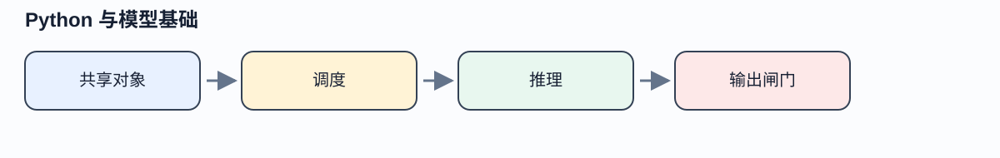

# 让 Agent 的语言运行时与模型输出具有可解释的边界

> **本篇先看结论**：共享对象 → 调度 → 推理 → 输出闸门。先判断当前任务缺少哪一环，再选择工具或模型；图示为教学结构，不代表外部服务已实测。



**读图任务**：从左到右指出每一步产生的事实、决定或证据，并写出一个会让流程停止的条件。图中颜色只辅助层级，节点文字和下方替代说明才是完整含义。

**图示文字替代**：共享对象 → 调度 → 推理 → 输出闸门。若图片不可用，按同一顺序阅读上面的字段；任何未验证的外部调用、真实用户效果和浏览器表现仍须单独记录。


Agent 调用变慢、状态串扰和合法 JSON 中的错误事实，经常来自不同层。先能区分“Python 对象由谁持有”“协程何时交出控制权”“模型实际产生了什么”，才有条件把问题交给正确组件。本篇补齐这些必要先修：不是要求读者在进入课程前自行掌握，也不把语言运行时错误归咎于模型。

先完成[输入、类型与断言](01-foundation.md)。本篇用失败报告读取任务贯穿 Python 对象、并发与输出消费；模型小节解释后续上下文与检索方案依赖的推理机制。读完回到[问题发现](p01-discovery.md)，完成信任边界与 f02 后进入[上下文、记忆与提示](n02-context-memory-prompt.md)。HTTP、权限与业务候选的完整链见 [API 边界](f01.md)和[模型候选](f02.md)。示例采用 Python 3.14 标准库；联网核对日期为 2026-10-11，在线文档补丁版本不等同本机实跑版本。

## 1 对象共享必须是设计选择

`state2 = state1` 只给同一个对象另一个名称。`state1.copy()` 会产生新的外层字典，但它的 `messages` 值仍可指向同一个列表。于是两个请求看似有独立状态，第二个请求 append 一条工具结果时，第一个请求也看到了它。这不需要多线程，只要共享可变对象就会发生。

```python
import copy
state1 = {'messages': []}
state2 = state1.copy()
state2['messages'].append('report-71')
assert state1['messages'] == ['report-71']
state3 = copy.deepcopy(state1)
state3['messages'].append('report-72')
assert state1['messages'] == ['report-71']
```

这段代码故意暴露浅拷贝的边界。元组也只保证槽位不能重新绑定：`x = ([],)` 后 `x[0].append(...)` 合法。`frozen=True` 的数据类同样不自动冻结内部列表。[Python copy](https://docs.python.org/3.14/library/copy.html)定义浅、深拷贝的差异；本课程采用的工程约定是：每个任务创建独立可变容器，共享的资料快照使用只读值，不把活动连接、锁或身份对象塞进 `deepcopy`。

进一步说，复制不是并发一致性协议。两个工作者从同一 revision 读取后分别保存，深拷贝只能避免内存别名，仍可能发生后写覆盖。持久状态需要版本比较或事务，后续 [e01](e01.md)承担该问题。基础练习先用 `is` 检查内部对象身份，修改一个任务的列表，再证明另一任务不变；只比较初始值相等无法发现别名。

函数也是对象，可以传给另一个函数并返回一个包装函数。装饰器应保持参数传递、返回值和异常传播；日志应观察调用，不能偷偷决定重试或把异常变成 `None`。同步包装的核心如下：

<details>
<summary>展开：python 示例（15 行；用途、关键分支和验证状态见正文）</summary>

```python
from functools import wraps

def logged(events):
    def decorate(fn):
        @wraps(fn)
        def wrapper(*args, **kwargs):
            status = 'raised'
            try:
                value = fn(*args, **kwargs)
                status = 'returned'
                return value
            finally:
                events.append((fn.__name__, status))
        return wrapper
    return decorate
```

</details>

`@wraps` 保留名称、文档等元数据及 `__wrapped__`，方便检查和调试；它不会自动保证包装逻辑正确。[functools 官方说明](https://docs.python.org/3.14/library/functools.html#functools.wraps)。异步函数必须用 `async def` 包装并 `await fn(...)`，否则量到的只是创建 coroutine 对象的时间，异常也不会在包装层展开。本篇完整例分别实现两类包装，不记录参数和返回正文。真实日志接收器还可能失败；须选择有界缓冲和明确失败策略，不能让遥测错误覆盖原业务异常。此最小例只用调用者提供的内存列表，不声称解决生产日志投递。


> **中段视觉停顿｜Python 与模型基础**
> 
> **状态卡**：输入/观察 → 当前决定 → 允许动作 → 可核证据 → 合理停止。
> 
> **阅读任务**：找到正文中第一次出现“未知、拒绝、缺证或需要人工确认”的位置，说明它为什么不能被当成完成。
> 
## 2 固定工作者解决的是在途工作上限

协程函数调用返回 coroutine 对象；`await` 推进它，`create_task` 将其交给事件循环调度。事件循环在可挂起点切换任务，因此并发等待网络通常能减少总等待，但在 `async def` 中执行长时间 CPU 计算或 `time.sleep` 仍会阻塞整个循环。I/O 接口应优先用异步实现；确实只有同步 I/O 时可评估 `asyncio.to_thread`，但取消等待不会保证线程内的外部动作停止。CPU 密集型工作应测量进程池或外部服务的调度与序列化代价，不能只加 `async`。

只在每个任务内部加 Semaphore，仍可能先创建几十万个等待中的 Task。它们持有参数、栈与上下文，限制了执行并发却没限制排队内存。本例使用 `Queue(maxsize=workers)` 和固定数量 worker，让生产者在队列满时暂停；输入流如果本身已整体载入内存，仍需另改为分批或流式读取。

<details>
<summary>展开：python 示例（18 行；用途、关键分支和验证状态见正文）</summary>

```python
queue = asyncio.Queue(maxsize=workers)
# producer 逐项 await queue.put((id, delay))，结束后放每worker一个None。
# 以下为完整例中的worker核心，不是远端调用SDK。
async def worker():
    while True:
        item = await queue.get()
        try:
            if item is None:
                return
            idx, delay = item
            try:
                async with asyncio.timeout(timeout):
                    await asyncio.sleep(delay)
                    results[idx] = 'OK'
            except TimeoutError:
                results[idx] = 'TIMEOUT'
        finally:
            queue.task_done()
```

</details>

本例将已知的逐项超时转成结果，让其他项继续；意外异常保留给外层 `TaskGroup`。TaskGroup 中子任务发生普通异常时，会取消其余未完成子任务，等待清理后以异常组报告。单纯的 `gather` 默认在首个异常传播时不保证取消其他任务，不能把两者恢复语义混用。取消通常在下一个可挂起机会注入 `CancelledError`；清理放 `finally`，显式捕获后通常继续抛出。`asyncio.timeout` 在上下文外体现为 `TimeoutError`，吞掉内部取消会破坏该机制。[Python 3.14 asyncio](https://docs.python.org/3.14/library/asyncio-task.html)。

演算轨迹：两个 worker 接收 1ms 与 2ms 项，结束后接第三个 200ms 项；逐项期限 50ms，结果为 OK、OK、TIMEOUT，活动计数最后回到零。这个时间只用于构造路径，不是性能测试。进程被暂停或调度异常时，毫秒级测试可能受环境影响；验收应同时检查清理、上限和状态，不把某个精确耗时当合同。远端写请求超时后效果可能未知，不能把本地 TIMEOUT 改称“没有创建工单”。

## 3 LRU 容量、复杂度与权限不是同一个问题

LRU 淘汰最近最久未被访问的键。用哈希表定位节点，加双向链表维护先后，读取或更新时移到尾部；插入满额时删除头节点。常见哈希假设下 get/put 平均 O(1)，最坏散列行为不能许诺 O(1)。下面用 `OrderedDict` 表达同一机制，缓存容量按条数，不按字节；单条值过大仍能撑满内存。

<details>
<summary>展开：python 示例（18 行；用途、关键分支和验证状态见正文）</summary>

```python
from collections import OrderedDict
class LRU:
    def __init__(self, capacity):
        if type(capacity) is not int or capacity < 0:
            raise ValueError('CAPACITY')
        self.capacity, self.data = capacity, OrderedDict()
    def get(self, key):
        if key not in self.data:
            raise KeyError(key)
        self.data.move_to_end(key)
        return self.data[key]
    def put(self, key, value):
        if self.capacity == 0:
            return
        self.data[key] = value
        self.data.move_to_end(key)
        while len(self.data) > self.capacity:
            self.data.popitem(last=False)
```

</details>

容量 2 时依次 put(a)、put(b)、get(a)、put(c)，应淘汰 b；再次 put(a,新值) 只更新并刷新顺序，不增加大小。容量 0 表示禁用缓存；缺失抛 `KeyError`，不能用合法值 `None` 混作不存在。[OrderedDict 重排操作](https://docs.python.org/3.14/library/collections.html#ordereddict-objects)。

如果缓存失败报告，键至少要反映资料版本与有权观察的范围。LRU 不会自动失效过期文档，更不会撤销已失效权限。可缓存不可变公开块；受保护数据仍须在读取时按当前权限确认。并发线程访问本例还需互斥或换受控缓存；协程间跨 await 的读改写也必须明确原子边界。

长期服务的内存增长，应先区分高水位与持续保留。固定负载预热后分阶段记录 RSS、Python 分配、缓存条数与估计字节、活动任务数、队列深度、请求大小及并发数。用 `tracemalloc` 在相同阶段比较快照，按分配位置找增长；它追踪 Python 分配，不能独自解释 GPU、所有本地扩展和系统分配。RSS 在 GC 后不下降也不必然是泄漏，分配器可能保留内存供复用。[tracemalloc](https://docs.python.org/3.14/library/tracemalloc.html)。

定位时提出可证伪假设：缓存长度与内存一起增长则限制缓存；完成 Task 仍在全局集合中则在读取结果后移除；慢下游导致队列增加则背压和期限；大响应短时峰值则限制流/响应大小。修复验证须在相同持续负载、预热和观察窗口下重复，检查对象增长斜率、尾延迟和拒绝数，不能只观察一次 `gc.collect()`。完整离线例只构造 128 个 bytearray 的保留与清空，帮助读快照差异，不伪装成长时服务证明。

## 4 从 token 到下一 token：模型在哪里获得事实

这里采用 decoder-only 自回归 Transformer 的教学抽象，不假定所有商用模型内部完全一致。文本经 tokenizer 映射为离散 token ID；token 不是汉字或英文单词的固定单位，空格、语言和术语会改变分割。ID 查 embedding 得到向量序列，位置信息加入计算，使相同词项在不同顺序中可以产生不同表示。

对某层输入矩阵 X，线性投影得到 Q=XWq、K=XWk、V=XWv；一个注意力头计算 `softmax(QKᵀ/√d + mask)V`。因果 mask 使位置 t 不能读取未来位置；多头用不同投影形成不同的关系表征，再组合。逐位置前馈网络施加非线性变换，残差与归一化支持深层信息流。最终当前末位置表示经词表投影得到 logits，softmax 形成下一 token 分布；选出一个 token 后继续。注意力基础来自 [Attention Is All You Need](https://arxiv.org/abs/1706.03762)，本段是对 decoder-only 场景的教学适配，并非原论文编码器—解码器结构原样复述。

可以先手算注意力：取两个位置的 Q=K=[[1,0],[0,1]]，V=[[2,0],[0,4]]，d=2。位置1被因果掩码限制，只得到 V1=[2,0]；位置2得分为 [0,1/√2]，softmax 约 [0.330,0.670]，输出约 [0.660,2.680]。若忘记掩码，位置1也会读到 V2，训练时就泄漏未来。这个固定矩阵只演示一个头，不代表完整模型。

设教学词表仅有“通过”“失败”“未知”，logits 为 2、1、0，softmax 概率约 0.665、0.245、0.090。最大概率只是模型在当前条件下偏好的 token；如果报告根本没有进入上下文，选中“通过”不会使其成为事实。温度改变分布锐度，采样引入随机性；温度低也不能补回缺失证据或保证严格确定性，具体可复现性还受模型、算子和服务实现影响。

模型参数保存训练中形成的统计结构；一次外部检索把特定文档加入本次输入，不会因此修改权重。把最新政策写进检索库，可以使它被读取、带版本引用；微调通常用于行为、格式或领域分布适配，不能当成精确删除和更新事实的数据库。长上下文把更多候选材料直接放入输入，省去一次召回但付出长度、时延与注意力干扰代价；不保证模型使用了正确那一段。三者可组合，选择取决于知识更新频率、资料规模、可引用性、行为稳定性和获准资源，详见[检索入库](n05-retrieval-ingestion.md)。

若中文任务比英语差，不应立即认定模型容量不足。先比较 tokenizer 后实际 token 数与截断位置；对相同语义的双语输入冻结任务条件；逐段记录原查询、编码方式、必要块召回、模型候选和工具参数。检查中文标点/单位/日期、路径大小写、Unicode 规范化和工具是否只接受英文枚举。翻译可以帮助召回，但须保留原始 ID、否定与数值条件，并把翻译错误单列。只比较最终回答平均分，会把检索失败和输出消费错误混在一起。

## 5 合法结构是消费起点

提示“请返回 JSON”属于文本指令，模型仍可能返回解释或残缺字符串。某服务的 JSON 模式可能约束可解析 JSON，却未必限制字段名和类型；按 Schema 约束生成进一步约束所支持的结构。供应商支持的 Schema 子集、完成状态、拒绝与截断必须查当前契约，不能把这三类方式统一称“格式保证”。例如 [Claude Structured Outputs](https://platform.claude.com/docs/en/build-with-claude/structured-outputs)说明结构约束及拒绝、输出上限等例外；此处只引协议差异，不提供未运行的 SDK 调用。

消费顺序是：完整响应和拒绝分类→解析→类型与字段→业务身份与可核事实→候选。拒绝不是坏 JSON，截断不是空成功，类型合法的另一报告不是当前报告。完整例用自定义内部信封 `status,payload`，没有冒充供应商格式。对于报告 ID 为 r1 的请求，`{"report_id":"r2","failed":true}` 通过类型后应得到 SEMANTIC_MISMATCH；`failed:1` 不能因 Python bool/int 关系而冒充布尔值。流式预览不得在文档完成之前进入有副作用工具。

结构无法证明“根因已确定”。需要根因时分别保存确定事实、假设与引用，交 [f02](f02.md) 的业务校验和 [c02](c02.md) 的证据支持检查。本例不自动修复 JSON；若采用有界重试，应保存原错误与重新生成的版本，不能修改失败记录使初次输出看起来正确。

## 6 可运行入口与迁移练习

完整离线例：[examples/n01-runtime-boundaries.py](examples/n01-runtime-boundaries.py)。在本目录运行 `python3 examples/n01-runtime-boundaries.py`，无第三方依赖、文件写入、网络或模型调用。输出包含 `SELF_CHECK_OK`、两个正常项和一个超时项、活动计数与内存夹具差值；字节数因解释器和环境变化，不设固定“通过值”。这只是作者自查入口，独立运行结论以本版 QA 为准。

EX-N01-A 基础练习：构造三层嵌套状态，分别用赋值、浅拷贝和只读 tuple of tuples 传给两个任务，提交内部身份和修改轨迹。参考分析：外层复制无法阻止共享下层；只读深层结构可以共享，但更新应创建新值，不能以冻结外层冒充整体冻结。

EX-N01-C 实现练习：不使用 OrderedDict，写哈希表＋双向链表 LRU，节点包含 prev/next/key/value；get 时拆下再接尾，put 更新已有节点，满额时从头拆节点并同步删除字典项。提交容量 0、覆盖、缺失和连续访问测试，并画出每次头尾变化。只用列表 `remove` 的实现虽可正确，但访问 O(n)，需如实解释。

EX-N01-B 排错练习：把异步替身中的 sleep 换成一个明确有界的同步阻塞等待，对比旁路心跳任务的间隔；再恢复异步等待，加入取消并核 finally 执行。参考分析：异步并发不等于抢占式并行，超时不是硬 CPU 限额。不得把该实验改成真实高负载或未授权外部调用。

W-N01 综合作品：提交一份请求处理器，具有独立任务状态、有界入队、逐项失败、原异常保留和输出校验；同时给一份“合法 JSON 但错误业务身份”的反例。参考分析必须说明本机取消、远端效果和语义真假的三条边界。完成它提供可审查作品，不自动证明真实模型、服务性能或岗位能力。


## v13 取舍与失败停顿

把本篇的核心判断写成四行：**前置条件**、**允许动作**、**观察信号**、**停止/升级条件**。如果其中一项没有来源或运行证据，状态应保留为未知或待补证。

| 状态 | 先做什么 | 不能宣称什么 | 复验材料 |
| --- | --- | --- | --- |
| 正常 | 保存输入、版本与关键输出 | 不把示例当生产保证 | 运行记录或来源定位 |
| 拒绝/缺证 | 记录原因，缩小范围或等待 | 不用换模型掩盖缺口 | 拒绝码、缺项和下一步 |
| 超时/未知 | 核对原动作或原快照 | 不重建第二个效果 | 原操作查询与账本 |

## v13 分层练习与一页复盘卡

**基础**：指出图中每个节点对应的输入、状态和证据。

**迁移**：改变一个会影响结论的条件（版本、权限、输入、故障或预算），重写下一步和停止条件。

**综合**：提交一份可由另一位读者复现的作品，包含入口、选择理由、正常/失败/未知轨迹、来源或运行记录，以及仍待验证的事项。

复盘卡：

- 我的任务与完成条件：____
- 当前控制路径与放弃条件：____
- 关键状态、来源或权限：____
- 正常、失败、未知、停止分别是什么：____
- 已运行/有来源与仍未验证：____
- 交付文件与下一次复验：____

## v13 编辑交接说明

- 本稿保留 v12 的正文、来源、正式先修、原练习和未验证边界；v12 原文未修改。
- 开篇图为教材结构草图；中段视觉停顿用于打断连续阅读，需由设计师复核目标尺寸、箭头避让、色彩对比、窄屏和文字替代。
- 本稿中的 11 行及以上代码已用 `<details>` 标记为默认折叠候选；产品确认最终交互，开发实现，测试独立核默认状态、键盘、读屏、刷新、深链和脚本不可用降级。
- 需要设计师制作/复核的资产：`assets/n01-python-model-foundations-runtime-boundary-v02.svg`，邻近正文为开篇结论与首次机制转折；图示任务是读者指出状态和停止条件。
- 本稿未声明真实模型、外部 API、框架、浏览器渲染、真人学习效果或职业能力已验证。
