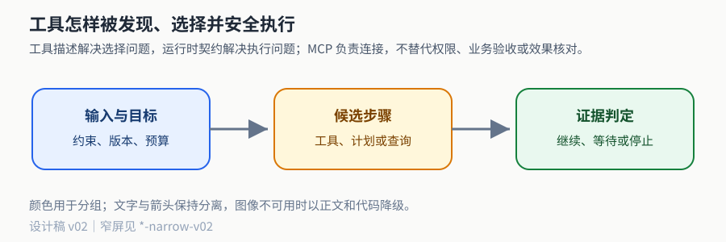
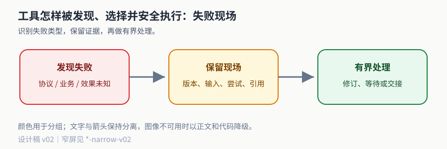

# 工具增长到上百个时，怎样发现、选择并安全接入

工具接入有两条独立路径：模型需要足够准确的能力描述来选工具，宿主需要足够严格的契约来决定能否执行。MCP 可以统一应用与外部能力的发现和消息交换，但不会替模型判断业务目标，也不会替服务端授权。工具越多，越需要先缩小可用集合，再展示必要 Schema，而不是把全部说明塞入每次请求。

先完成[写工具](c03.md)、[API 边界](f01.md)与[动作身份导读](c01-control-primer.md)。本篇固定讲 MCP **2025-11-25** 规范，访问日期 2026-10-11；这是选定教学版本，不声称每个客户端/服务商都已实现，也不声称始终为最新规范。具体 SDK 和传输互操作没有在本例运行。


> **本篇先看结论**：工具描述解决选择问题，运行时契约解决执行问题；MCP 负责连接，不替代权限、业务验收或效果核对。



**读图提示**：蓝色表示输入或约束，黄色表示候选动作，绿色表示证据判定，红色表示需要保留的失败现场。图中内容是教学结构，不代表外部服务已实测。


## 1 工具说明必须帮助区分近邻

`process_data` 同时负责找资料、读文件和创建工单，很难让模型确定何时该用。把它拆成 `search_reports`、`read_report`、`create_issue`，不是为了名字好看，而是让动作和对象、缺少的前提、返回结果可区分。

| 工具 | 适用条件 | 必要输入与产物 | 不适用或风险 |
| --- | --- | --- | --- |
| search_reports | 只知道现象或部分标识 | query→候选 ID、摘要、来源版本 | 不保证全文，不创建工单 |
| read_report | 已有允许范围内的确切 ID | report_id→完整报告、版本、哈希 | 不能接受任意本机路径或URL |
| create_issue | 正文已核且准确内容已获批 | project/title/body/evidence_ids→回执 | 有外部副作用，超时可能效果未知 |

描述应包含“何时用、何时不用、输入单位/格式、输出与失败”。参数 Schema 限定字段、类型、长度和枚举；资源归属、当前权限与内容批准不由 Schema 决定。将 tenant、approval 或万能 credentials 开放给模型参数，是把可信身份混入不可信提议。工具结果也应返回状态码与可消费对象，不只一句“操作成功”。

名称和描述可以实验，而不是凭直觉定稿。冻结近义、缺 ID、否定、双意图与越权样本，比较错选率、参数无效率和正确等待；必须分开“正确工具不在候选集”与“工具已在但模型选错”。前者改发现层，后者改能力描述、示例或决策；两种错误都不是加重试就能解决。

## 2 能力目录与渐进暴露

本篇采用的目录项包含注册来源、稳定工具 ID、版本/Schema 哈希、作用域、动作类别、副作用级别、短描述、输入概要和正文 Schema 存储位置。调用者身份来自可信会话，先按授权范围过滤，再用领域路由、词法与语义检索找小候选集；只把这些工具的完整 Schema 加入本轮模型输入。

```text
可信身份与目标
 → 允许的目录分区
 → 能力检索/路由(top-k候选、分数、检索版本)
 → 读回注册表并核tool_id/version/schema_hash
 → 暴露少量完整schema给模型
 → 模型提议
 → 再核当前权限、参数、版本、批准与预算
 → 执行并回传同次调用结果
```

检索器可以将“定位失败日志”映射到 search_reports，但不能替代调用授权。目录 Schema 在发现后变化，执行器应拒绝旧版本提议并重新暴露；授权被撤销后，即使模型已经看过工具也必须拒绝。缓存键包含租户、权限版本、工具目录版本，不能把管理员目录缓存给普通用户。

候选上限也有失败模式。top-k 太小漏掉不常见工具；太大增加上下文与近邻混淆。可以先按业务域路由，再召回少量目录；低置信、同名歧义或缺必要字段时澄清。工具召回评价用“完成该任务所需工具是否在候选集”；模型选择评价用“在正确候选已提供时是否选对”；参数评价再独立。不能将某次精确关键词命中包装成自然语言理解可靠性。

完整例构造 103 个工具，用英语词项交集演示权限前置过滤和渐进暴露；没有实现中文语义检索、否定理解或真实模型选择。查询 `find failure report` 应优先 search_reports；同意图若换成完全不重叠词汇可能漏召回，必须记录这个局限。真正支持多语言需要按 [n05](n05-retrieval-ingestion.md) 的编码与标签方法评估。

## 3 MCP 位于模型外部的连接层

宿主 host 是运行应用、管理会话和策略的主体；client 维护与 server 的协议连接；server 暴露工具、资源与提示。典型路径是宿主把工具描述适配给模型，模型返回 Tool Calling 提议，宿主校验后通过 MCP client 发送请求，server 调用具体业务能力并回传结果。模型不直接获得 OAuth 令牌或任意网络连接。

[生命周期规范](https://modelcontextprotocol.io/specification/2025-11-25/basic/lifecycle)要求初始化协商协议与能力，成功后再进入普通操作。请求携带 id，响应以相同 id 关联；通知没有请求 id，不等待对应响应。下面是自编的完整最小消息轨迹，字段遵照该版本，省去的是传输封装，不省初始化阶段：

```json
{"jsonrpc":"2.0","id":1,"method":"initialize","params":{"protocolVersion":"2025-11-25","capabilities":{},"clientInfo":{"name":"textbook-host","version":"12.0"}}}
{"jsonrpc":"2.0","id":1,"result":{"protocolVersion":"2025-11-25","capabilities":{"tools":{},"resources":{},"prompts":{}},"serverInfo":{"name":"report-fixture","version":"1.0"}}}
{"jsonrpc":"2.0","method":"notifications/initialized"}
```

若服务器回复另一版本，客户端核自身支持集；不支持则断开，不能把未知协议当兼容。服务器声称支持 tools，不代表客户端必须开放给模型；宿主可以进一步限制能力。初始化说明和工具描述属于外部来源，不因此升为系统指令。

这里选择普通同步请求路径；该规范还允许更丰富的可选能力，不能假设 server 必须实现全部。完整接入要按 negotiated capabilities 开启行为，不根据工具名字猜支持分页、订阅或异步任务。

## 4 Tools、Resources、Prompts 提供不同对象

Tools 是可调用操作，通常面向模型选择；Resources 是 URI 标识的上下文数据，由应用决定如何纳入；Prompts 是可参数化消息模板，常由用户选择。规范没有强制唯一 UI 模式；这三种控制取向不是权限保障。不能因“resource只读”忽略敏感数据，也不能因“prompt来自官方服务”跳过输入信任边界。

下面用同一报告展示原语。每个 JSON 行是独立消息而非一个大 JSON 文档。

**发现和调用工具。**

```json
{"jsonrpc":"2.0","id":2,"method":"tools/list","params":{}}
{"jsonrpc":"2.0","id":2,"result":{"tools":[{"name":"read_report","description":"Read an allowed report by exact ID; never creates an issue.","inputSchema":{"type":"object","properties":{"report_id":{"type":"string"}},"required":["report_id"],"additionalProperties":false}}]}}
{"jsonrpc":"2.0","id":3,"method":"tools/call","params":{"name":"read_report","arguments":{"report_id":"r1"}}}
{"jsonrpc":"2.0","id":3,"result":{"content":[{"type":"text","text":"report r1 revision 2: boundary assertion failed"}],"isError":false}}
```

[Tools 规范](https://modelcontextprotocol.io/specification/2025-11-25/server/tools)定义发现、调用与结果。分页返回 nextCursor 时继续读到需要的目录范围，不能只取第一页又称全部工具可见。结果的协议结构与业务事实分开；本例一段文本不能证明真实报告存在，实际接入须回传业务版本和证据元数据，并按应用合同校验。

**发现和读取资源。**

```json
{"jsonrpc":"2.0","id":4,"method":"resources/list","params":{}}
{"jsonrpc":"2.0","id":4,"result":{"resources":[{"uri":"report://r1/revision/2","name":"report-r1","mimeType":"text/plain"}]}}
{"jsonrpc":"2.0","id":5,"method":"resources/read","params":{"uri":"report://r1/revision/2"}}
{"jsonrpc":"2.0","id":5,"result":{"contents":[{"uri":"report://r1/revision/2","mimeType":"text/plain","text":"boundary assertion failed"}]}}
```

URI 是服务器资源标识，不意味着宿主应直接把它当本机路径打开。资源可有参数化模板与可选订阅，但只能在声明能力及权限范围内使用。[Resources 规范](https://modelcontextprotocol.io/specification/2025-11-25/server/resources)。

**发现和获取提示。**

```json
{"jsonrpc":"2.0","id":6,"method":"prompts/list","params":{}}
{"jsonrpc":"2.0","id":6,"result":{"prompts":[{"name":"inspect_report","description":"Prepare a report analysis request","arguments":[{"name":"report_id","required":true}]}]}}
{"jsonrpc":"2.0","id":7,"method":"prompts/get","params":{"name":"inspect_report","arguments":{"report_id":"r1"}}}
{"jsonrpc":"2.0","id":7,"result":{"messages":[{"role":"user","content":{"type":"text","text":"Analyze report r1 using verified evidence; list missing facts."}}]}}
```

`prompts/get` 返回消息模板，不是在服务器上完成了一次报告分析，也没有自动调用模型。宿主选择如何使用模板并应用自己的安全策略。[Prompts 规范](https://modelcontextprotocol.io/specification/2025-11-25/server/prompts)。




**中段阅读任务**：读完本图后，写出当前系统需要保留的三类证据，并说明哪一种情况必须等待或交接；图示未验证真实浏览器、窄屏和读屏表现。


## 5 把协议错误、业务失败和效果未知分开

对未知方法可收到 JSON-RPC error，例如 `{"jsonrpc":"2.0","id":8,"error":{"code":-32601,"message":"Method not found"}}`。这是协议层失败，不能当成工具业务回答。已经进入工具但报告不存在，可以用工具结果 `isError:true` 携带受控错误内容；不要在错误中泄漏另租户对象存在性。返回成功内容但引用版本不符，则是应用合同拒绝。

三者的处理不同：协议不匹配需修适配/版本；输入或权限错误需修参数或获取合法范围；暂时读取失败可在预算内重试。外部写入超时仍是效果未知，先用逻辑动作 ID 核对，不能因请求 id 不同就当新动作。[c03](c03.md)区分协议调用 ID、逻辑动作 ID 和物理尝试 ID，MCP不会合并这些业务身份。

[传输规范](https://modelcontextprotocol.io/specification/2025-11-25/basic/transports)包含 stdio 与 Streamable HTTP。本教学版本的 stdio 通过标准输入输出交换协议消息，普通日志不能污染 stdout；HTTP 后续请求携带协商版本头，按服务端返回处理会话等可选行为。不能把断开连接解释成远端撤销，也不能把可恢复传输解释成业务 exactly-once。真实接入必须在所用客户端/服务端版本上验证，并单独记录超时、断线、迟到及关闭行为。

## 6 第三方认证是独立合同

先确定谁在授权：用户、宿主服务身份，还是明确委派的工作负载。再确定令牌由哪个受信授权服务器签发、用于哪个资源 audience、包含什么 scope、何时过期、如何撤销。令牌不是模型参数；将宿主收到的任意 bearer token 原样透传到下游，会混淆受众和委派范围。

MCP 2025-11-25 的[授权规范](https://modelcontextprotocol.io/specification/2025-11-25/basic/authorization)针对 HTTP 传输定义授权机制；stdio 的凭据来源不同，不能机械套 HTTP OAuth 流程。实际接入应通过可信资源元数据发现授权服务器，核 issuer/受众和最小 scope，采用所支持客户端流程；浏览器重定向和授权码交换按规定绑定请求，不能接受任意回调与令牌目的地。令牌刷新按授权服务器的期限和旋转合同执行，到期或撤销失败返回需重新授权，而不是把旧 token 塞给模型修复。

服务端验证签名或受控 introspection、issuer、audience、时间和权限，再检查具体资源归属；scope 包含 reports.read 仍不代表可读所有报告。每次调用复核，发现后撤权不能继续执行。审计只记录脱敏主体、范围、工具、资源、版本与结果，不记录密钥。对 refresh token 轮换、并发刷新和撤销传播，接入清单应明确唯一刷新责任者和失败恢复，避免多工作者同时使用旧刷新令牌。

离线例 `Credential` 是假定可信适配器已经验证过的声明夹具，只演示 audience、subject、scope、expiry/revocation 与对象权限闸门；没有 JWT 验签、OAuth 跳转、真实刷新或撤销服务，不能称认证实现通过。接入验收需在隔离测试服务中分别注入过期、错误受众、撤销、范围不足及对象越权，观察拒绝层与无泄漏日志。

## 7 Tool Calling、MCP、Skills 与 A2A 如何一起使用

| 层 | 本篇采用的职责 | 不承担的保证 |
| --- | --- | --- |
| Tool Calling | 模型输出工具名/参数提议，应用执行并关联结果 | 不自动执行、不自动授权 |
| MCP | 宿主客户端与能力服务器的发现和消息契约 | 不决定业务目标，不保证下游效果唯一 |
| Skills | 可复用说明、脚本、参考材料与资源的组织和按需读取 | 不是远端工具通信协议，不自动授脚本权限 |
| A2A | 跨系统 Agent 的任务、消息及产物交接 | 不保证对方推理正确或完成整体业务验收 |

[Agent Skills 规范](https://agentskills.io/specification)将技能组织为含 SKILL.md 与可选脚本/资料的目录，渐进读取减少无关上下文；脚本是否执行仍受宿主权限与任务授权控制。A2A 的跨系统身份、任务生命周期和产物合同见 [n07](n07-multiagent-a2a.md)，其官方[协议说明](https://a2a-protocol.org/latest/specification/)作为职责对照；具体版本由该章固定。

一个具体组合是：宿主加载“报告分析”技能以理解工作方法，通过 MCP server 发现和读取报告，模型 Tool Calling 提议选择对应只读能力，确需外部研究服务时再通过 A2A 委派子任务。没有外部 Agent 时无需 A2A；只有三个自有函数时直接适配也可合理。协议增加统一接入和复用，同时增加版本、认证、观测与故障面的成本，按项目边界选择。

## 一页复盘卡

- 我的问题需要哪些可验收产物：____
- 当前工具/协议的权限与版本边界：____
- 结果属于协议错误、业务失败还是效果未知：____
- 下一步是重发现、澄清、核对还是交接：____

## 8 运行与作品

运行 `python3 examples/n04-tool-catalog.py`，完整文件为 [工具目录离线例](examples/n04-tool-catalog.py)。预期打印 103 个目录项、仅可见只读候选与 SELF_CHECK_OK；内部验证目录版本变化、到期、scope、对象权限和不兼容版本拒绝。它是本地夹具，没有 MCP 传输或真实模型。

EX-N04-A：为 search/read/create 重写说明，使“看看失败但不要建单”和“已知 r1 要读全文”可区分。参考分析：前者不能靠出现 create 一词被路由到写；候选检索和最终语义判断分层，权限拒绝不是理解正确的替代指标。

EX-N04-B：给 100 个同域工具加入相似名称，测候选漏召回；发现后更新 Schema 或撤权限，再发送旧提议。参考分析：重新发现或澄清，不静默用新工具解释旧参数；调用前核验不可省。

EX-N04-C：手工追踪上述初始化到调用消息，加入错误版本、错误 audience、业务拒绝与写入超时。参考分析分别落到协议协商、认证、业务合同和效果核对；不能都用“重试一次”处理。

W-N04：提交版本化目录、Schema 哈希、完整消息轨迹、接入契约矩阵和失败归因。真实互操作、令牌生命周期与供应商服务稳定性仍须实际隔离环境证据。