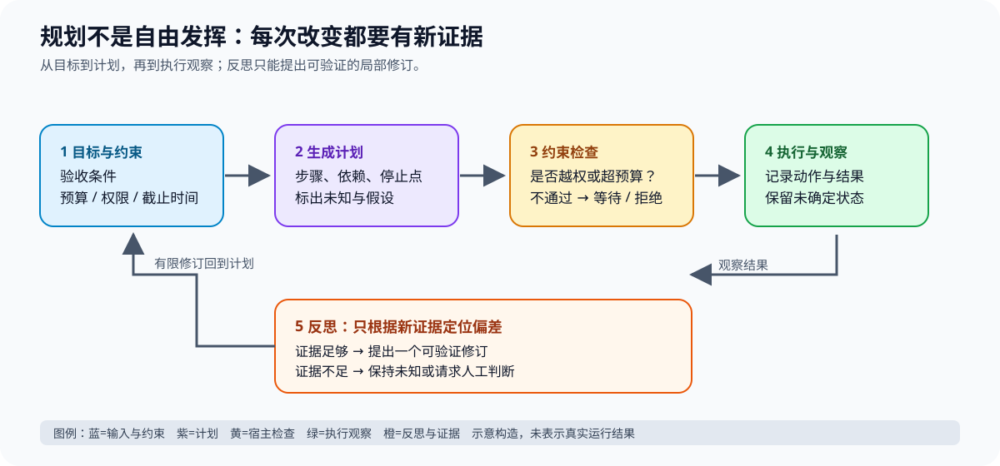
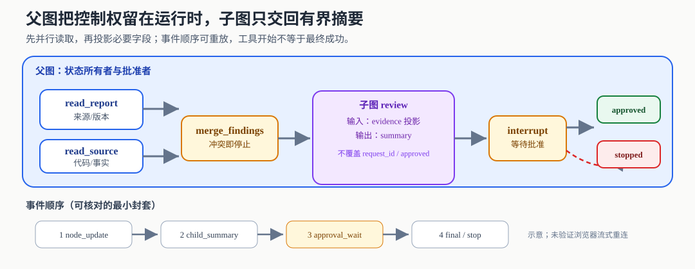

# 把控制循环映射为可恢复的状态图

当任务要等待人、并行调查、跨节点保存结果时，图编排的核心价值是把“下一步是谁、此前哪些更新已记录”交给运行时。图不会自动判断证据真伪，也不会替外部系统兑现动作只执行一次。先修为[固定流程](c01-fixed-workflow.md)、[动态循环](c01-control-loop.md)和[持久状态](e01.md)：先能画出业务状态，再选择 LangGraph 或自研实现。

本章使用 Python LangGraph **1.2.4**、langgraph-checkpoint **4.1.1**、langchain-core **1.4.0**，核查日期2026-10-11。示例针对这组本机已安装版本；官方滚动文档另列来源，不声称任意历史或未来版本兼容。LangChain v1提供模型/工具接口、`create_agent`等较高层构建入口；LangGraph提供较低层图执行、状态与暂停恢复能力，LangChain agent建立于LangGraph之上。选择LangChain不是退出LangGraph，选择LangGraph也不要求每个节点调用模型。[LangChain v1说明](https://docs.langchain.com/oss/python/releases/langchain-v1)

> **本章先看结论**：状态所有者、可重放更新和恢复版本必须先被定义；图只编排路径，不能替证据、授权或远端动作回执背书。



**读图提示**：此处沿用 v13 的状态/前沿视觉语义；当前资产用于帮助读者建立“状态—节点—证据—恢复”关系，图示未验证真实框架运行、浏览器窄屏或读屏体验。设计师后续可替换为专属状态图。

## 先定义状态的所有者，再画节点

同一缺陷调查由两个只读节点读取报告和源码，汇合后生成草稿，等待批准。任务状态不是一份越来越长的聊天记录：

| 字段 | 内容与写入规则 | 不应放进来的内容 |
| --- | --- | --- |
| request_id | 宿主给定，整个任务稳定 | 模型每轮重新生成的业务身份 |
| findings | 以资料ID及版本为键；重复同值允许，冲突拒绝 | 未标来源的自由文本“事实” |
| draft/digest | 汇合节点生成，digest绑定待确认快照 | 自动继承旧草稿的批准 |
| approved | 当前快照的确认结果 | 将自然语言“应该可以”解释为执行授权 |
| result | 明确候选已批准或停止 | 还未发生的工单创建成功 |

节点读取快照，返回**局部更新**；边决定后继。StateGraph的状态schema可以用TypedDict，字段的reducer决定更新如何合并；未定义reducer的普通字段按覆盖处理。TypedDict帮助类型检查，不是运行时业务验证器。[Graph API](https://docs.langchain.com/oss/python/langgraph/graph-api)

并行报告和源码节点同时返回`findings`，简单“最后写者覆盖”会丢掉其中一份。用列表追加又可能在重放时重复。这里选以不可变来源键合并，已存在键内容不同则中止调查；不能为了让图走通静默覆盖冲突。源版本改变时应新增键或启动新的资料快照。这个reducer是本章业务设计，不是LangGraph自动提供的真实性保证。

```python
# 摘自本章可执行例：冲突必须暴露，返回新对象不就地改输入。
def merge_findings(left, right):
    merged = dict(left)
    for key, value in right.items():
        if key in merged and merged[key] != value:
            raise ValueError("conflicting finding: " + key)
        merged[key] = value
    return merged
```

对互不冲突的来源，该操作满足结合、交换和幂等，合并结果不依赖两个读取者完成顺序。若数据本身是有序步骤，不能盲用集合合并，必须另存逻辑序号、检测缺项；如果两个节点都要决定唯一的`approved`，应先重构为一个授权所有者。Reducer解决更新规则，不解决职责争抢。

## 一条真实框架执行路径

[完整离线例](examples/n06-graph.py)不调用LLM、不访问网络、不执行外部写入。它实际构建两个并行读取节点、一个独立schema子图、一处interrupt以及批准/拒绝条件分支。关键连接如下：

```python
# 核心连接摘录；完整导入、节点与self_test见链接文件。
graph.add_edge(START, "read_report")
graph.add_edge(START, "read_source")
graph.add_edge(["read_report", "read_source"], "propose")
graph.add_edge("propose", "approve")
graph.add_conditional_edges(
    "approve", lambda s: "accept" if s["approved"] else "stop"
)
compiled = graph.compile(checkpointer=InMemorySaver())
```

列表起点的汇合边等待两条读取路径的结果。`propose`只消费已经合并的finding，排序后形成确定性草稿，并对`[request_id,draft]`的JSON计算摘要。规则路由适合批准真值、预算、权限等确定条件；模型路由适合在允许目标中判断下一处调查。模型路由的输出仍须映射到白名单节点；未知节点应返回澄清或停止，而非动态执行模型给出的函数名。

运行方式：在具备上述依赖的环境执行`python3 examples/n06-graph.py`。预计输出allow/deny/stale三个状态，最后输出`n06 PASS`。这不是完整安装锁文件；重建环境时应同时保存Python和传递依赖版本，避免只钉主包造成复现漂移。

正常轨迹：两个读取完成→按来源键合并→子图返回草稿→暂停，`get_state(config).next`为`('approve',)`→宿主用同一个`thread_id`传入`Command(resume=...)`→摘要一致且approve为真正布尔True→只形成`approved_candidate_only`。如果拒绝或摘要不一致，进入`stopped_without_write`。本例没有认证真人的通道，`resume`字典是测试夹具；实际服务必须由已认证维护者端点核身份、任务所有权、过期时间及不可重用批准，不能把能提交字典等同有权限。

## Checkpoint不是远端事务

持久化至少要覆盖状态、下一步、暂停信息和执行身份。LangGraph通过checkpointer保存检查点，调用者用thread_id选择执行线程。示例使用内存保存器，进程退出就丢失；长期任务应选持久后端，并验证存储、并发执行和版本迁移，不能给内存示例贴“可跨部署恢复”标签。[持久化说明](https://docs.langchain.com/oss/python/langgraph/persistence)

`interrupt()`暂停后恢复时，节点从起点重新执行，到interrupt处取得恢复值。于是“先发邮件，再暂停批准”会在恢复时重发；即便将写入放在批准之后，也可能在写入成功、检查点未提交时崩溃。批准节点应只准备可重复计算的数据；实际写工具需独立逻辑动作ID、下游幂等契约及未知效果核对，沿用[写工具](c03.md)。示例特意计数批准节点进入次数：三次任务共进入六次，以暴露重入而非隐藏它。[Interrupts规则](https://docs.langchain.com/oss/python/langgraph/interrupts)

检查点还不能原样跨版本读入：新增必填字段需默认或迁移，删除/改名节点可能使`next`无法解析。发布前保存旧图在每个等待点的快照，分别尝试恢复；无法证明兼容就保留旧worker完成存量任务，新任务走新版本。恢复时重新检查当前资源权限，但不能重写历史动作事实。

## 子图是一份契约，不是共享所有记忆

本例父图的`findings`为字典，子图的`evidence`为字符串列表，子图输出`summary`。父节点明确执行：投影必要字段→`review.invoke`→只提取summary写回draft。这样内部审阅过程不会自动覆盖request_id或approved。若父子图确有相同语义的共享键，可以把编译子图直接作为节点；不同schema应使用包装节点映射。父图配置checkpointer时，子图的持久语义及命名空间必须随所用版本验证。[子图通信](https://docs.langchain.com/oss/python/langgraph/use-subgraphs)

不要把同名字段当同义字段。子图的`messages`可能表示专家工作历史，父图的`messages`可能表示对用户已展示记录；直接混合会把内部猜测变成用户可见结论。跨图返回应携带`claim、source/version、limitations`，父图校验证据后再决定是否展示。子图私有schema也不是保密边界，调试和流式状态可能包含内部字段，输出仍需按受众过滤。

## 流式输出是一串事件，不是逐字成功凭证

本例`stream_mode="updates",subgraphs=True,version="v2"`返回含type/ns/data的事件；测试核对子图命名空间实际出现。updates反映节点更新，values反映状态快照，messages用于模型消息块，custom用于自定义进度。前端不要把所有事件拼成同一条答案。[流式模式](https://docs.langchain.com/oss/python/langgraph/streaming)

应用层可规定事件封套`{task_id,sequence,event_type,payload}`，分别标token、工具开始/结束、待批准、停止、错误和最终结果。工具开始不等于成功，收到若干token不等于最终通过；最终状态以权威任务记录为准。断线重连应从记录重建状态或按序号补事件，重复序号丢弃，不能重提整个写任务。这里的序号/重放是本章应用建议，不是Graph流本身保证。

[流消费者策略例](examples/n06-graph-contracts.py)把上述sequence/event_type缩写为seq/kind：先验证task_id，再按序接受；同序同内容丢弃，同序异内容拒绝，遇序号缺口返回replay_required且不消费后来的final。待缺失事件补齐，重送final才形成终态。断线时没有final只能展示已收到的预览，不能把网络结束作为任务成功；该例只做内存事件校验，没有真实网络重连。



*图：父图只投影子图所需字段；恢复、冲突和未知外部效果回到人工接管或效果复核。该图是 v13 教学资产，未验证真实 LangGraph 运行、持久后端或浏览器无障碍表现。*

**中段阅读任务**：结合图为“摘要不一致、检查点版本不兼容、写回执未知”各写一个状态转移；指出哪一项必须进入 `WAIT_INPUT` 或效果复核。图片加载失败时，以本段状态转移文字和前文表格为准；图与任务未替代独立运行证据。

## 何时值得自研

若只有几个稳定状态，已有数据库任务表和运维平台，自研显式状态机可能更易审计：表中存task_id、revision、state、next_step、pending_approval、lease；worker按版本比较更新领任务，执行幂等步骤，追加观察后提交下一个状态；过期lease由另一worker接管。失败重放从账本中确定哪些逻辑动作已有结果，不能只回到上次函数调用。

引入LangGraph省去部分调度、reducer、暂停和可观测接线，但增加框架版本、序列化和恢复语义的学习成本。若业务有大量动态分支、子图复用和人工暂停，框架更有价值。比较同一组正常、冲突、批准过期、写回执丢失、版本迁移任务，测实现复杂度、故障定位和恢复正确性；“框架流行”不构成选择理由。

低代码平台还需单独检查：能否导出版本化状态/图、表达自定义reducer和补偿、接入自己的权限服务、检查点可否恢复及迁出、日志是否有完整身份链、并发与费用是否可控。用同一最小任务做黑盒合同测试，并实际尝试导出与恢复；若只有“连线能运行”的演示，不能判与自研或框架等价。平台的收益通常在集成和操作界面，限制可能在状态可控性、调试和迁移；这些需对选定产品及版本实测，本文不虚构平台排名。

练习一：把两个来源改成同一ID不同内容，解释为什么合并失败应发生在生成草稿前。参考分析：上游版本冲突使证据包不确定，继续生成会随机采用资料；先报冲突、重新取得一致快照。

练习二：让用户批准后修改草稿，再恢复旧批准。应提交摘要不一致的拒绝轨迹；不能把测试改成只检查approve=True。练习三：将示例改成持久后端，在暂停后退出进程再恢复，记录版本、线程、实际状态和重复节点次数；未完成该练习前不能声称本例验证跨进程恢复。作品须附状态图、schema、三条失败轨迹及依赖锁，独立评阅人用新输入复现。

### 复盘卡

- 当前状态的唯一所有者与版本：____
- 哪些更新可交换、可幂等，哪些冲突必须停止：____
- 恢复后需要重新核对的权限或外部效果：____
- 本例尚未验证的框架、存储和生产契约：____
