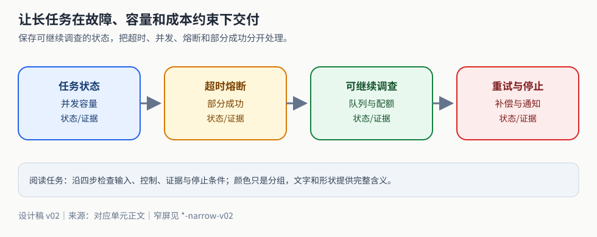

# 长任务交付的核心是状态、租约和未知效果

先看任务如何保存、恢复和补偿，再读容量与性能细节。

<strong>本章阅读方法</strong>　先读彩色总览图，再按“机制 → 失败 → 练习”阅读；图中颜色只辅助区分状态，结论仍以正文和证据为准。

**读图任务**：用一句话说明图中控制权在哪里、哪一步可能失败、失败后应保留什么证据。图片无法加载时，以本段文字和后续正文降级阅读。
上线后的Agent任务会遇到用户取消、工具限流、进程重启和部分业务动作已经成功。可靠交付不是把每个错误都重试，而是让系统知道目前发生了什么、哪些效果未知、谁仍有权推进任务，以及继续运行是否值得。先修为[发布回退](e04.md)、[性能成本](e05.md)、[沙箱](n08-sandbox-security.md)和[持久恢复](e01.md)。本章把运行服务作为一个有预算的任务系统，再单列本地推理的高级性能问题。

## 长时间研究任务要保存可继续调查的状态

一份研究不能只存“已经聊到这里”。最小持久结构可拆为：

| 记录 | 必须保留的事实 |
| --- | --- |
| task | 用户目标修订、范围、允许结局、总预算、状态、deadline |
| plan_node | 子问题、依赖、计划版本、完成条件、当前状态 |
| evidence | 来源ID/版本/摘录位置、取得时间、校验状态、支持或反对哪个命题 |
| attempt | 节点尝试ID、工具请求、开始/结束、费用/未知结算、失败类 |
| lease | owner、expires_at、单调epoch；接管时epoch增加 |
| checkpoint | 已验证节点、尚缺证据、待确认动作和下一个可执行前沿 |

Worker先以数据库比较并更新取得lease，执行期间续租；提交结果时要求task未取消、目标修订未变、epoch仍匹配。恢复者从权威记录重建就绪节点，保留版本有效的证据，不把每个检索重新做一遍。若目标从“推荐方案”变成“只列风险”，旧计划需重验；若来源已撤回，依赖它的结论失效，但原历史记录保留供审计。

取消的第一步是写入canceled或cancel_requested并提高epoch，停止派新工作；再尽力取消本地和远端请求，记录那些无法确认停止的动作。旧worker迟到不能发布completed，因为其epoch已失效。远端已发生写入仍要核对或补偿，不能因用户点了取消就抹掉事实。外部写工具还应要求支持业务围栏或独立动作账本，本地epoch只能阻止本地提交，不能让一个不检查epoch的外部系统自动拒绝旧请求。

> **中段读图停顿**：先用图定位控制边界，再回到下一节核对机制、失败条件和证据。图示是教学辅助资产，未替代真实接口、浏览器、生产负载或真人专家验证。

## 部分成功之后怎样补偿

设任务先预留资源、再创建草稿、最后发布；发布被拒绝时，前两个效果可能需要撤回。补偿是新的业务动作，不是数据库时间倒流：释放预留不保证恢复原来队列位置，撤回通知也不能让收件人没看过。先按业务定义哪些效果可撤、是否有额外权限、什么时间窗口内有效。

采用逆依赖顺序，而不机械反转所有调用。例如草稿依赖预留，先撤草稿再释放预留；互不依赖操作可以并行补偿，但仍需独立身份。每个步骤保留原操作ID、效果状态、补偿动作ID、补偿意图/尝试/回执和未决原因。对于原效果unknown，先查询原动作，不能盲补偿一个未证实存在的对象；对于补偿超时，先查同一补偿动作，不生成新ID再做一遍。

[离线恢复例](examples/n09-runtime-recovery.py)模拟两步已经成功、第一次补偿效果已发生但回执丢失。首次返回paused_unknown_compensation，第二次先从模拟供应方结果表核对该补偿，再处理另一项；第三次运行不重复效果。真实系统要先把补偿意图写入持久账本，再发送，并依赖下游幂等或可核对契约；例中的账本只是内存列表，不支持断电恢复，也不模拟真实供应商。

给用户的结果应区分“原任务失败、已完成哪些撤回、尚有哪些未决效果、何时/由谁继续处理”。如果补偿持续失败，保留需要人工处理的责任与状态；不能把“发起补偿”写成“已全部恢复”。原任务的失败不因补偿成功改成成功，补偿成功只是副作用已处理。

## 并发、超时和熔断限制不同的东西

入队前限制每租户的积压长度和任务年龄，worker限制在途任务数；每个下游另有连接/请求预算。只在每个请求内部用Semaphore而预先创建几十万协程，仍会堆积内存。用有界队列与固定worker产生背压；阻塞库不能直接占住事件循环，见[运行基础](n01-python-model-foundations.md)。

将端到端deadline拆给排队、模型和工具，各段只消费剩余额度；不能每次重试重新获得完整超时。读操作遇到可重试瞬时错误，可以在剩余次数内按指数退避加随机抖动；参数错误和权限拒绝不重试；写超时先按效果未知核对。限流若有可信Retry-After可作为等待下限，过期任务应停止而非继续挤队列。

熔断器按下游/操作故障域统计窗口内技术失败，业务“没有结果”不等于服务故障。本章策略：closed允许请求；10个时间单位内2次技术失败则open，冷却5个单位；冷却后half_open只允许一个探测，成功close并清窗口，失败重新open。参数只为解释状态机，不是生产推荐阈值。实际阈值依据错误预算、流量和故障代价制定。[离线例](examples/n09-runtime-recovery.py)覆盖半开并发拒绝、再次失败和恢复。

熔断器本身不提供线程安全或跨进程一致性；共享状态需要锁/CAS，已在途请求要携带代际标识，避免旧结果错误关闭新一轮熔断。不同租户的业务错误、不同供应商故障应隔离；否则一个客户的坏参数可把全站熔断。降级可以转规则检索或排队待恢复，但必须向上层标明能力变化，不能用占位回答掩盖下游不可用。

例中`acquire`返回generation/sequence/probe标识，outcome须交还同一token；进入open或结束半开探测时切换代际。旧closed请求即使在新探测期间成功，也只记stale_generation，不能把half_open改为closed；重复回执不重复统计。该例是单线程有限状态模型，pending集合还需要真实系统按请求deadline回收并记录未知结果，不能无限保留失联请求。锁、共享存储、真正供应方故障及异步并发均未由这个模型验证。

## 内存持续增长应先找到持有者

请求量平稳不等于在途数量平稳。若每分钟到达100个任务、只能完成80个，未完成队列和上下文仍持续增加。先同时采集到达/完成率、活动任务数、队列长度、连接数、缓存条目/字节、每任务历史长度、Python分配量和进程RSS；按任务阶段关联，而非看到RSS变大就喊“GC泄漏”。

诊断顺序是：热身后固定负载，取得多个间隔快照；观察停止输入后是否回落/稳定；按对象分配位置比较增量，再找引用持有者。仍被列表或回调闭包引用的结果不会因gc.collect消失；无界缓存需要TTL/容量/字节上限与租户预算；悬挂Task要检查未await、超时被吞、未关闭流和持续等待队列；暂时峰值会在任务结束后对象释放，但分配器保留内存使RSS未必立即下降。

Python tracemalloc追踪受其管理的内存分配及位置，不覆盖全部原生库、GPU或进程RSS；开始追踪之前分配的对象也不会凭空进入历史。用`asyncio.all_tasks()`观察当前事件循环尚未结束的Task，再关联任务ID和等待位置；不能用它证明其他线程/进程没有工作。[tracemalloc](https://docs.python.org/3/library/tracemalloc.html)、[asyncio Task](https://docs.python.org/3/library/asyncio-task.html)

[有限内存例](examples/n09-memory-diagnostic.py)每批分配32个4KB对象，共4批，对比保留列表、最多4项缓存和临时对象；打印current/peak和分配位置。对象数量断言固定，字节和时序不做跨机器精确承诺。修复验证需在相同工作负载和热身下比较长期增长斜率、结束后的持有对象以及任务吞吐，确认没有用丢结果或过早清上下文换取低内存。真实服务还应单独测原生推理库和连接池。

## 本地模型与托管API比较的是交付责任

本地方案负责模型/量化版本、硬件容量、驱动和推理引擎、排队、扩缩容、监控、备份与安全更新；托管方案减少其中一些运维，但受供应方配额、故障、版本变化、数据处理条款和网络依赖约束。本地不自动更私密：日志、依赖和运维访问仍要控制；托管也不自动满足某种数据要求，应核具体服务合同。

对同一代表性任务集比较质量底线、拒绝和结构化输出、中文/长上下文、并发、首token/完整任务延迟、可用性与数据边界。成本分母用**合格任务**：本地含硬件折旧、闲置、功耗、维护和备机，托管含输入/输出、工具、重试及网络相关费用；价格和账单必须取实际依据，不能把GPU采购价除以最高吞吐假装实际单位成本。混合路由先验证哪些任务小模型可完成，再保留升级预算，避免低质量触发多次重试反而更贵。

## 高级选读：prefill、decode与KV cache

Decoder模型的prefill处理整段输入，形成各层的Key/Value等中间状态；decode每步生成一个新token并复用已有KV。长输入会加重prefill和首token时间，长输出会延长decode占用；实际瓶颈还取决于硬件、batch和模型，不能无测量断言所有prefill都计算受限、decode都内存受限。

KV内存的粗估为`2 × 层数 × 活动token数 × KV头数 × 每头维度 × 每元素字节`，2对应K与V；另有分配、元数据、对齐和其他张量开销。Grouped-query attention的KV头数可以小于查询头数，因此不能只用隐藏维度套算。活动请求越多、上下文越长，KV总量越大；结束或取消任务的KV需释放，前缀复用还要区分模型版本、模板、精确token和租户数据边界。

PagedAttention类设计按块管理KV以降低连续分配的浪费并支持共享；它不消除KV体积本身，也不保证任意任务比其他引擎快。[PagedAttention论文](https://arxiv.org/abs/2309.06180)、[vLLM实现说明](https://docs.vllm.ai/en/latest/design/paged_attention/)

静态batch等待一组请求后一起处理，长短不齐时可能受最长任务拖累；连续批处理允许完成者退出、新请求加入，提高设备利用，但排队和抢占可能影响首token及尾延迟。分块prefill让长输入与decode调度共存，能改变两者竞争关系；具体参数需按引擎版本实测。[vLLM调优文档](https://docs.vllm.ai/en/latest/configuration/optimization/)

公平实验固定模型权重/量化/精度、硬件、引擎版本、输入输出长度分布、采样条件、并发与到达过程，分别测冷/热、缓存开/关、已完成请求吞吐、TTFT、每token间隔及p50/p95/p99端到端时延。以相同质量与错误/超时统计比较，不只报最快一轮；请求被拒绝或超时不能从分母静默删除。记录服务实际完成率和显存峰值，找吞吐收益是否牺牲尾延迟。本章没有GPU实测数据，因此不给性能排名。

练习一：给补偿加一个“请求超时且查询未知”分支，结果必须停止在待核对而非继续假定撤回。练习二：取消长研究任务后向它提交旧epoch结果，核拒绝且历史证据保留；再设计远端仍运行的用户告知。练习三：把有限内存例扩成受控稳定负载，解释current、peak和RSS差异，提交至少三个时点与修复前后同条件结果。最终作品包括任务/补偿账本、容量合同、恢复轨迹和推理比较计划；真实生产与GPU性能仍需各自实际证据。

## 一页复盘卡

- 我正在解决的任务与验收条件：____
- 本章的关键控制边界或比较分母：____
- 一个正常轨迹与一个失败/未知轨迹：____
- 当前证据支持到哪一层，哪些仍未验证：____
- 下一步应补的运行、来源、用户或专业证据：____

